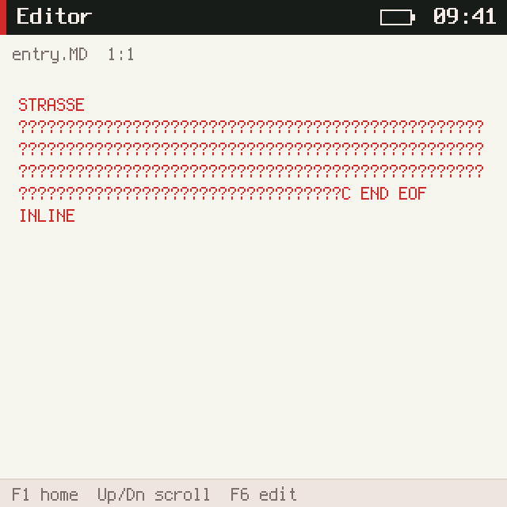

# Bounded typed Markdown inline formatting for imported lines

The typed Editor can open a 64 KiB file and stream preview rows through the screen budget. Preview first recognizes the block on each physical line. Ordinary text and fenced code can borrow a range from the document directly. Headings, lists, quotes, and paragraphs containing inline markers pass through `editorMdPlain` before row wrapping. That staging step uses a 4,096-unit buffer. An imported line can be longer than the 4,000-character edit insertion limit, so the current path can silently omit valid formatted text.

The baseline keeps the source bytes intact. A 4,917-byte heading and a 4,915-byte paragraph each put `**EOF INLINE**` after 4,900 bytes on the same line. The original Editor displays the marker after paging. Typed Wasm omits it without a fault. The same replay includes a line with repeated unmatched link openers. See `various/long-inline-before.json` for outcomes and the exact sizes.

## Follow the preview from disk to a wrapped row


`editorPreviewSource` establishes the style and text interval, including block prefixes. `editorMdPlain` applies three inline replacements in order. The JavaScript reference uses consecutive regular expression replacements. Compaction must finish each pass before starting the next, since deleting one delimiter can make earlier-separated characters adjacent for a later pass. The compositor receives finished rows with color and indentation. It has no knowledge of these Markdown rules.

The formatter leaves the document buffer at SDK slot 0 intact and uses the 65,536-unit buffer at slot 10. `typedSdkCopySpan(text,start,end,destination,offset)` stages the selected source range with checked source and destination intervals. The typed compaction uses the existing same-buffer move. The scratch content is active only while its matching preview job owns it. Preserve preview detachment rules across F6 and a successful file replacement.

## Bound matching and compaction by work

Each pass uses a monotonically advancing input offset and output offset. A selected span is copied to the output offset and the input offset skips past the whole match. The output stays at or behind the input, so sliding a span never overwrites future input. An unmatched stretch can be copied as one span after the next interesting delimiter is located.

```text
copy the source span to scratch
for each pass in bold, code, links:
    while the next cursor and its candidate fit the current slice:
        find the earliest possible opener
        if a closing match exists:
            move the literal prefix and captured text to the write cursor
            continue after the match
        else:
            emit the range whose openers share the failed close
    if unfinished:
        save the input and output positions and yield
    else:
        set the active length to the compacted size
wrap the formatted text into the existing preview window
```

The typed code decides how to recognize matches.

- Bold requires two opening asterisks, a nonempty body, and the earliest eligible closing pair. The reference's dot excludes U+2028 and U+2029 within an imported physical line. Where a closer is absent before that boundary, preserve the remaining literal range to that boundary.
- Inline code takes the next backtick after a nonempty body. Adjacent delimiters need a one-unit retry because the second delimiter may begin a valid longer span. When there is no following delimiter, copy the rest of the physical line in bulk.
- A link uses the next close bracket, an immediately following open parenthesis, and the next close parenthesis. If that close bracket lacks the parenthesis, intervening opening brackets cannot make the same ending valid. Preserving this whole literal prefix avoids one full-tail scan per unmatched opener. The destination syntax remains the reference's simple delimiter rule.

Use the existing checked `typedSdkSeek` for common delimiter scans and `typedSdkMove` for contiguous spans. Each opener or closer probe scans at most 1,024 units. An unfinished probe retains its position across settles. A formatting step costs eight of the preview loop’s 96 work units, so a segment makes at most 12 probes. The measured cases exercise unmatched markers, denser nested replacements, and a long literal destination.

## Preserve bounded heading expansion

The reference uppercases heading text after the three formatting passes and before wrapping. `typedSdkUpper(text,start,end,output,offset)` appends the Unicode expansion of a checked interval. The typed code submits up to 32 source units at a time and excludes a surrogate half from a chunk boundary. It keeps the unconsumed expansion at the start of scratch slot 7 and refills to at least 100 UTF-16 units when input remains. That gives the existing wrapper at least 50 code points of lookahead, enough to decide whether a 49-column word ends at the width boundary. Real spaces and EOF remain the only word boundaries.

The full-size scratch adds about 128 KiB. The state fields `mdPass`, `mdStart`, `mdSize`, `mdRead`, `mdWrite`, `mdProbe`, and `mdClose` hold continuation state between events. The compiler and runtime agree on a ceiling of 80 scalar words. Editor uses 71. The existing 768 KiB runtime profile applies to both compiled targets.

## Opening and restoring one full-size line

The physical line end used to be recomputed each time a wrapped-row checkpoint was loaded. A file composed of one long line made each restoration rescan nearly 64 KiB. Checkpoints now carry both logical line boundaries, so restoring a known row only recomputes its short wrapped width. A common exact-unit path in `typedSdkSeek` also reduces overhead for newline scans.

The long-file open captures its saved snapshot before yielding to cursor restoration and viewport preparation. `typedSdkCodePoints(text,start,end)` counts code points, and `typedSdkPointIndex(text,start,end,count)` converts a count back into a UTF-16 offset. Typed code decides the logical line, persisted cursor format, limits and exact view. A clean exit records the cursor and signals Files. Capturing a new Editor view at that point would perform another whole-line count just before switching away.



## APIs, files, and gates

| Source | Responsibility |
| --- | --- |
| `picocalc-os/js/apps/editor.js` | Reference block matching, inline replacement order, and uppercase behavior |
| `picocalc-os/worlds/editor/markdown.typed` | Typed block rules, inline matcher and compaction |
| `picocalc-os/worlds/editor/preview.typed` | Physical-line stream, cooked text, word wrapping and cached rows |
| `picocalc-os/sdk/typed/world.c` | Checked counted-string windows, scratch memory, moves, Unicode uppercase |
| `picocalc-os/compiler/typed-world.js` | Shared import signatures and scalar state bounds |
| `picocalc-os/sdk/typed/rv32-slot.S` | Ordered RV32 runtime entry jumps |
| `PICOCALC-TYPED-WORLDS/scripts/05-measure-large-editor.mjs` | Reproducible `--long-inline` cases |

`scripts/02-check-full-inline.sh` compares both target backends and archived reference behavior for small Markdown, the two 65,536-byte formatted inputs, a long plain Unicode line, the long preview, and late navigation. `scripts/03-measure-line-end.sh` checks persisted position 1:65473 after a cold reopen of the same full-size heading. `scripts/04-check-preview-cancel.sh` cancels a dense preview, restarts it, and checks both screenshots and the final formatted marker. Keep the physical receipts alongside the simulator evidence.
