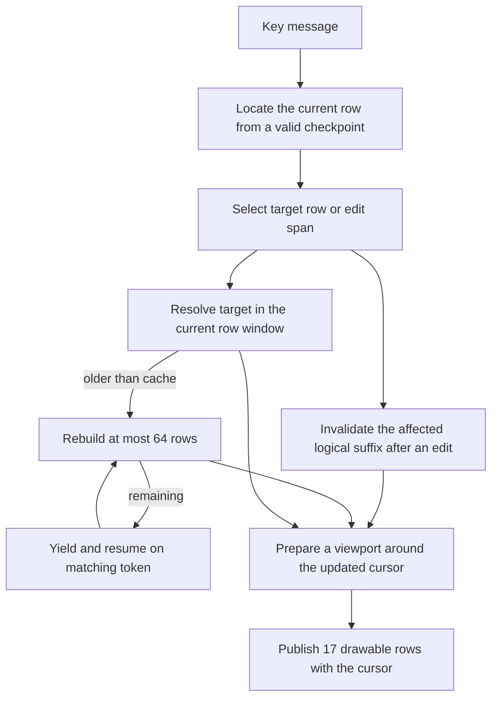

# Typed Editor row checkpoints and cursor navigation

The Editor app compiles the same typed JavaScript sources into a Wasm module or an RV32 ELF. The kernel owns file capabilities and scheduling. The generic SDK supplies fixed buffers, checked UTF-16 operations and the timer used to resume a turn. The compositor draws frames published by the app. Editor policy stays in the typed files, including placement, cursor movement and edits.

## Read the failure from the screen back to the source

A staged 65,536-byte input contains 851 long physical lines and a final `needlezzz` line. Enter in Find mode reaches 852:1. Right and Up then each exceed the host Wasm profile's 200 virtual ms budget in their own key events. The reference reaches 852:2 and 851:46 respectively. Those outcomes are recorded in the capacity ticket's `various/editor-nav-after-match-host.json`. On the physical RV32 build the status shows 852:1, but the visible pixels omit the row containing the match. Both the original and the port publish that row at index 17.

The compositor body provides 270 pixels. The status row, gap, and textarea inset consume 20 pixels. A small-font row uses 14 pixels, so the LCD can show 17 rows. Adjust the textarea row count and scroll bounds in the port and the JavaScript reference together. Preserve the existing Page Up and Page Down increment of 16 independently of viewport height.

## Reuse a contiguous range of row checkpoints

A document offset is a UTF-16 index. A logical line is bounded by LF. A logical line may occupy several wrapped display rows with 49 code-point columns. Each checkpoint describes the start of one wrapped row, the containing logical line's start and number, and the Markdown fence state before drawing that row. Row and line offsets can equal 65,536, so the existing layout stores two 16-bit halves per coordinate.

Use the existing 256-unit SDK buffer at slot 9 as a circular array of 36 seven-unit records. The valid interval is inclusive. Its oldest row advances when a new checkpoint would overwrite it. A lookup checks the interval before reading. Reopening or discarding a document clears the interval. A successful mutation removes checkpoints at or beyond the first affected logical line. Earlier rows continue to have the same offset, wrap and fence state. When editing a newline, find the prior logical line strictly before the deletion offset because deleting it can merge that line with the next.



```text
choose a checkpoint before the requested document offset
if no valid checkpoint precedes the target, begin at row zero
for at most 64 rows:
    restore or compute row metadata
    remember the row in the ring
    stop at the cursor's row or the requested upward destination
if there is more work:
    retain the row and schedule a matching timer receipt
otherwise:
    complete the move and publish the viewport
```

Sequential keys remain ordered while a motion or frame is pending. A restored file position can itself require several viewport slices. Delay the open reply until its first viewport is ready so later editing keys cannot arrive against an incomplete row cache. The existing Files ask grants 3 seconds. Measure a late reopen and retain its deadline in verification.

## Compilation and test boundaries

The bundled Editor source is already 65,482 bytes. The parser's shared 64 KiB cap leaves inadequate room for a readable implementation. Allow 96 Ki code units for the typed-world linker in both targets. Preserve the standalone compiler cap and verify the unchanged runtime slot and measured memory on the target.

- `worlds/editor/view.typed` owns row scanning, checkpoint encoding and restoration.
- `worlds/editor/edit.typed` owns key policy and identifies document mutations.
- `worlds/editor/document-view.typed` produces the viewport and finishes a deferred open.
- `worlds/editor/editor.typed` routes file and timer receipts.
- `js/system/compositor.js` supplies the actual drawable textarea height. `js/apps/editor.js` supplies the original observable behavior with the corrected row geometry.
- `compiler/typed-world.js`, `typed-wasm.js`, and `typed-rv32.js` carry the typed-world source bound. The runtime allocates 64 state words and a 256-unit checkpoint buffer, so check the state layout separately from source size.
- The capacity ticket's `04-check-search-traversal.sh` and `05-measure-large-editor.mjs --after-match` reproduce the baseline. Extend the cross-target replay for late Right, Up, repeated Page Up beyond the cache, an edit followed by navigation, and restoration after reopen. Check the visible row index as well as the status. Confirm both firmware builds and an EOF frame on the physical LCD.

Long imported Markdown inline formatting has its own source-line staging limit. The navigation work does not depend on changing that pipeline.
