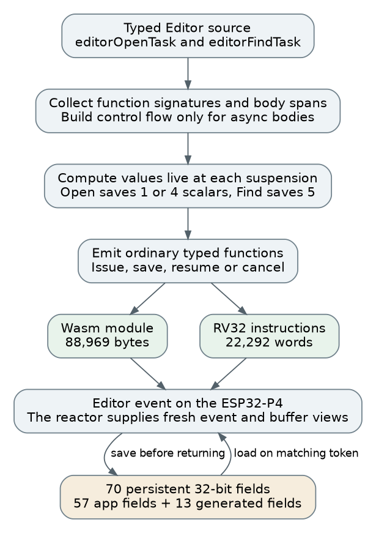

# Compiling a complete asynchronous Editor on the PicoCalc

Open a 65,536-byte file with CR LF line endings in the PicoCalc Editor. Files sends an open request and transfers a file handle. Editor asks the filesystem for its bytes. The bytes arrive on a later kernel turn. Editor normalizes portions of the document, yields between portions, restores the cursor, and publishes the first screen. A successful Open includes the reply to Files. Losing the handle, accepting a keystroke in the middle of normalization or returning success before the screen is ready would each give observably different behavior.

The original Editor implemented this sequence by assigning progress to named fields and testing incoming tokens in its event handler. The revised Editor writes the read and its normalization loop inside one typed `async` function. The compiler generates ordinary functions and persistent integer fields which can resume the calculation. Files and the filesystem still use the same messages. The typed frontend on the ESP32-P4 can produce either a Wasm module or native RV32 instructions from this source. The two generated programs share the same application state layout and event API.



## What survives a kernel turn

At the first read suspension, Open must remember the file handle. The call `typedSdkFileRead(handle)` issues the request. A subsequent event identifies its completion by token. Editor obtains text or error information from the *current* event. Saving the old event pointer would give the program a view with the wrong lifetime. A numeric file handle has a different contract. The kernel keeps its resource alive until the owner releases it.

Later the same task pauses between normalization slices. On the next turn the loop can read the file handle, total input length, next source position and next output position. CR LF consumes two input units and produces one output unit. Using a single position for both would corrupt later text. The compiler assigns one saved field to each of these four scalars. It reuses the handle field across the two suspension sites. It can reacquire the document buffer from the SDK after a wait.

Editor Find has a different frame. The task can yield after 1,024 work units. Its five saved locals are `at`, `end`, `anchor`, `foldedAt` and `phase`. The original `advance` parameter affects the starting point and is dead by the time the task yields. The query and text are reacquired at the start of a slice. The two tasks share 57 application fields for document state and rendering. Thirteen further fields hold their control positions, outstanding tokens and saved values. Together they occupy 70 four-byte fields, versus 71 in the preceding implementation. The pending title length occupies code unit 95 in an existing SDK buffer whose 95 title units use offsets 0 through 94. The state-field budget measures a particular ABI resource. Total persistent data also includes SDK buffers and the document itself.

[Checked field layouts by source revision](../../PICOCALC-EDITOR-ASYNC--suspend-and-resume-editor-open-and-find-in-typed-source/various/06-checkpoint-layouts.jsonl)

## How the compiler decides which fields to allocate

The parser reads function signatures before emitting bodies. It can therefore type-check a call to a function declared later and keep native lowering streamed by function. It records call edges and rejects recursion with a diagnostic. Distinct integer types distinguish a UTF-16 code-unit offset from a cursor column at compile time. Both still fit in one four-byte integer. Exhaustive matches check that a search phase receives a case. An out-of-range incoming word follows the generated trap path.

The async pass identifies the ordinary functions, the async functions and their calls. For each async statement, it determines which variables the statement reads and which assignments replace their current values. Liveness describes whether a value at one program point can reach a later read. In a loop, the analysis repeats until going around the back edge adds no new values. This matters when the only use of the value lies in the next loop condition.

```text
live_after(block)  = union of live_before(successor) for each successor
live_before(block) = reads(block) union (live_after(block) minus writes(block))

for each suspension:
    retain the live scalar values needed after resumption
    record where execution continues and which token it awaits
    obtain fresh event, output and hints arguments on the next turn
```

The design rejects a local scratch buffer that would need to survive a suspension. Declared ambient parameters have explicit new-turn sources. A nested async helper can need a caller return position and its own saved variables. Two root tasks sharing a helper get distinct frame storage so that starting one root cannot overwrite the state of the other. The runtime compares a completion's token with the currently active request. Both a duplicate and a late completion after cancellation must leave the persistent state unchanged. The test harness compares the entire record.

The synchronous compiler then consumes generated ordinary code. On the device `p4_typed_compile` creates a QuickJS runtime, loads the appropriate compiler files, invokes the linker and measures the whole call. Editor grants that runtime 4 MiB and six seconds. Retaining a token object for each token in the entire module exhausted the 4 MiB host QuickJS trial. The revised pass uses source offsets for ordinary function bodies and retains token detail where task syntax needs it. The result shows why the in-memory representation of a compiler pass matters even when its generated application uses only a few additional fields.

## What the host proved

| Source checkpoint | Wasm module bytes | RV32 instruction words | Persistent fields |
| --- | ---: | ---: | ---: |
| Original Editor | 88,255 | 21,886 | 71 |
| Distinct offset and column types | 88,255 | 21,886 | 71 |
| Exhaustive search phases | 88,302 | 21,922 | 71 |
| Generated Open | 88,852 | 22,186 | 71 |
| Generated Open and Find | 88,969 | 22,292 | 70 |

The distinct types reproduced both original artifacts byte for byte. Open added 264 native words relative to the enum checkpoint and reduced `editor.typed` from the original 204 lines to 177. Find added another 106 words and brought that file to 174 lines. Across the original and complete programs the change is 406 words (+1.86%) and 714 Wasm bytes (+0.81%). A count of static instructions measures storage and potential instruction paths. Only executed work contributes to the latency of a particular search.

We ran the frozen 24-workflow host suite on the original, the pre-await Editor, Open alone and the combined Open/Find revision. The Editor-specific suite compares thirteen workflows with the JavaScript reference. A further five fixtures drive real Wasm and emulated RV32 reactors through deliberately ordered events. The Open guard test examines all 64,685 bytes of the saved normalized file. The replacement-search test injects a stale completion with the replacement operation in progress and compares its frames with a control that only opened the replacement file. Deterministic delivery tests the application's transition rule even where ordinary kernel scheduling serializes requests. Physical interactive runs test the complete stack with its normal scheduler.

[Pre-await host receipt](../various/host-before-await.json) · [Open receipt](../various/host-open.json) · [Combined host receipt](../various/host-find.json) · [Five real-reactor fixtures](../../PICOCALC-EDITOR-ASYNC--suspend-and-resume-editor-open-and-find-in-typed-source/various/04-combined-event-fixtures.jsonl)

## What forward declarations cost on the actual machine

The single-pass compiler used to require declarations before calls. The new signature pass sees later functions before the emitter encounters their callers. On the ESP32-P4 the median full native compile of the unchanged hand-written Editor increased from 2,475.846 to 2,539.880 ms, a difference of 64.034 ms (+2.59%). Both medians use three cold-boot observations. Peak QuickJS allocator use rose from 1,410,860 to 1,465,288 bytes (+54,428). Each compiler emitted an ELF of 240,452 bytes. This clears the professor's five-percent on-device timing allowance for E5.

The independent host frontend-only test missed the professor's historical absolute threshold of 31.4 ms. In one pinned session the old frontend took 55.89 ms and the E5 frontend 49.18 ms. An unpinned repeat put the E5 result at 50.04 ms between old baselines of 46.16 and 45.86 ms. The old frontend's clock itself varied across sessions. The board's cold clock additionally covers initializing QuickJS, loading the compiler, emitting RV32 and linking the native module.

[Original physical trials](../various/physical-original.json) · [E5 native boots](../various/physical-e5.json)

## Reading the physical measurements

The device compiler reports microseconds from the cold compile call, peak QuickJS allocator bytes and output module size. Each trial selects a known firmware image and reboots. For the small interactive workflow we subtract the Editor's starting CPU count from its ending count. This measures all Editor turns while typing, saving, searching, previewing and canceling an edit. It excludes time charged to Files, the compositor and bus drivers. The two captured images show Find and preview. For the strict image comparison the two firmwares receive the same wall time from the port. All timings and timeout decisions still use the monotonic hardware counter.

Whole-document Find uses three queries. An early match ends at 1:2. A dense miss compares many candidates across several slices. The unique late hit ends at 852:1. A native SDK seek can skip an entire line, so a physically late hit can consume fewer slices than a miss. We start at delivery of the final Enter key to the active prompt and stop once the Editor returns a frame with the expected status. Separate counters measure elapsed time, CPU charged to all Editor segments, and time spent in its engine and reactor. Display refresh and the later serial transfer of the captured screenshot fall outside this interval.

## Reproduce the stages

| Source or script | Responsibility |
| --- | --- |
| `picocalc-os/compiler/typed-wasm.js` | Scan declarations, check calls and cycles, enforce types, and emit synchronous operations. |
| `picocalc-os/compiler/typed-async.js` | Read task bodies, determine live scalars, lay out frames and transform async operations. |
| `picocalc-os/compiler/typed-world.js` | Specify the two world entry points and SDK imports, including the awaitable descriptors. |
| `picocalc-os/worlds/editor/editor.typed`, `find.typed`, `state.typed` | Follow Open from its file handle through normalization. Follow Find from a query through cancellation and its final frame. |
| `scripts/08-host-replays.py` | Execute the historical suite in a detached checkout of a named commit. |
| `scripts/02-prepare-images.sh`, `09-fixed-wall-images.py`, `03-board-qualification.py` | Build both engines and replay the small real workflow with matched screenshots and allocator measurements. |
| `scripts/05-find-observer.inc`, `06-prepare-observer.py`, `07-time-find.py` | Add the optional whole-search clock, drive actual searches and check the status reported by the loaded Editor. |
