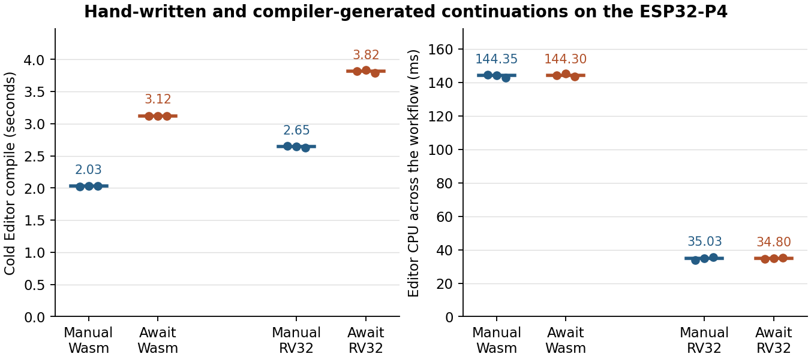
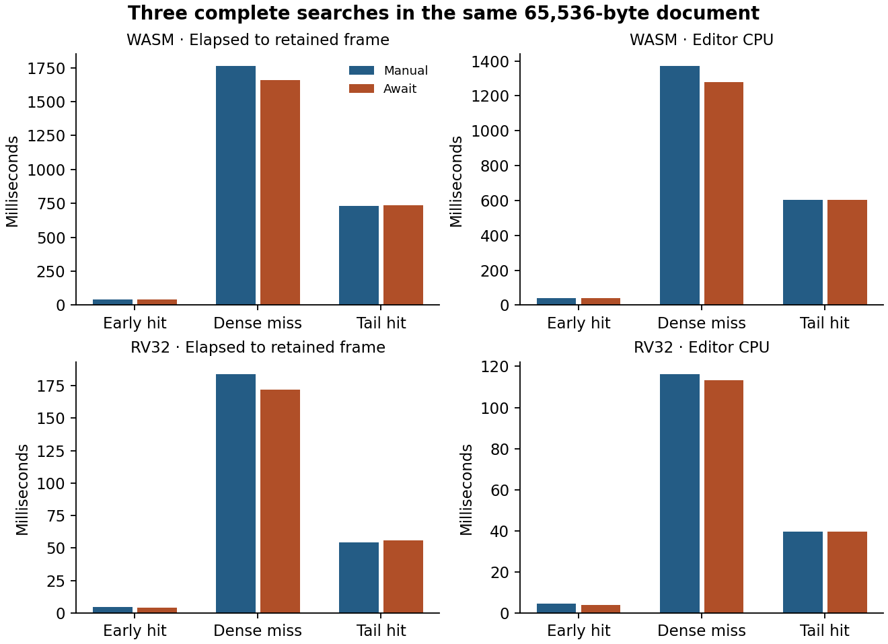
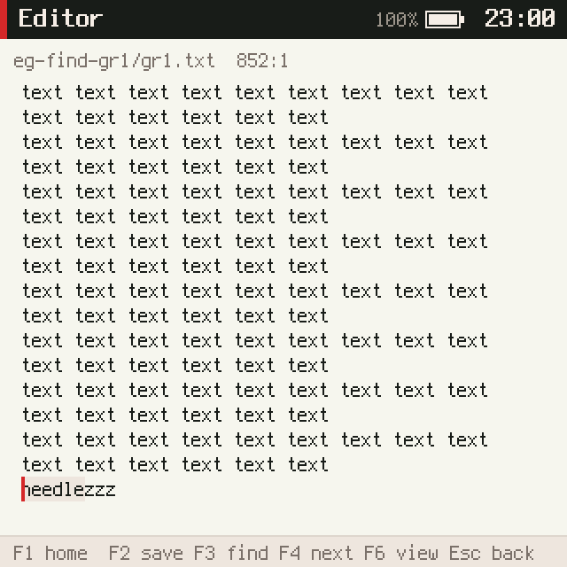
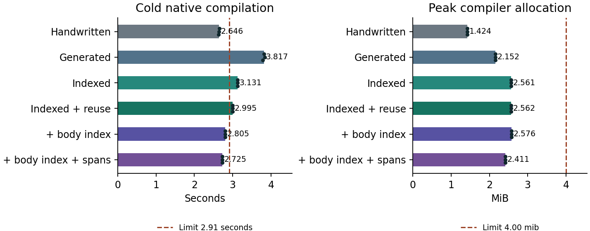
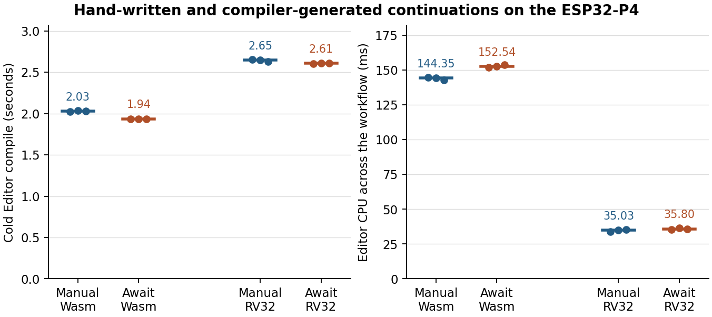
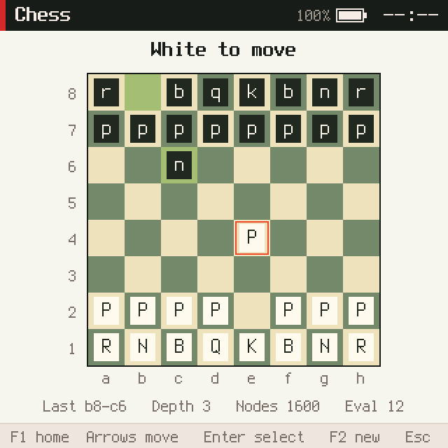

# Compiling a complete asynchronous Editor on the PicoCalc

Open a 65,536-byte file with CR LF line endings in the PicoCalc Editor. Files sends an open request and transfers a file handle. Editor asks the filesystem for its bytes. The bytes arrive on a later kernel turn. Editor normalizes portions of the document, yields between portions, restores the cursor, and publishes the first screen. A successful Open includes the reply to Files. Losing the handle, accepting a keystroke in the middle of normalization or returning success before the screen is ready would each give observably different behavior.

The original Editor implemented this sequence by assigning progress to named fields and testing incoming tokens in its event handler. The revised Editor writes the read and its normalization loop inside one typed `async` function. The compiler generates ordinary functions and persistent integer fields which can resume the calculation. Files and the filesystem still use the same messages. The typed frontend on the ESP32-P4 can produce either a Wasm module or native RV32 instructions from this source. The two generated programs share the same application state layout and event API.


## The language underneath the Editor

Consider a small search that examines offsets zero through four while staying inside a supplied length. It returns one of four outcomes. A match at the first position, a later match, reaching the work limit, and exhausting the input each have a distinct meaning. At length nine, searching for offset three returns a match and searching for offset seven hits the work limit. At length four, searching for seven exhausts the input first. The accompanying program compiles with the ordinary typed frontend and runs six checked cases in Wasm. [Complete typed example](../sources/search-limit-example.typed) · [Executable check](../scripts/27-check-guide-example.mjs)

| Professor task | What the compiler learns from this example |
| --- | --- |
| E1, conditional alternatives | `if`, `else if` and `else` group mutually exclusive cases. After taking a branch, control continues after the whole conditional unless the branch returns or breaks. |
| E2–E3, counted loops and exits | A `for` initializer runs once, the condition runs before each iteration and the update follows an ordinary iteration. A `break` exits its nearest loop and skips its update. |
| E4, strict inequality | `i !== i32(wanted)` produces a Boolean after the compiler checks the operand types. The comparison operates on machine integers. |
| E5, forward calls | The entry function `result` calls `scan`, defined later. Reading function signatures before body emission gives the compiler the parameter and return types. The call graph check rejects recursion. |
| E6, enumerations | `ScanEnd` names every possible result. If a new member is added, an exhaustive `match` must handle it. The real Editor applies the same rule to line-suffix, later-line, earlier-line, line-prefix and terminal search phases. |
| E7, distinct integers | `Unit` gives offsets a type identity. The explicit conversion `Unit(limit)` establishes that a plain integer is being used as an offset. Conversion back with `i32(limit)` allows integer comparison. These conversions require no runtime instruction. |

Together these rules separate three jobs. The type checker rejects a wrong unit or a missing search case. Structured control tells the backends where a loop or branch may go. The continuation compiler uses these control paths to determine what must survive when a running function suspends.

The native instructions for inequality illustrate why we test separate uses of each operator. When a caller returns a Boolean, the register backend must materialize 0 or 1. When an `if` immediately consumes that Boolean, the backend can branch on the operands. We compiled both `a !== b` and `!(a === b)` with the staged register emitter. Each value-returning function occupied ten native words and each branching function occupied eleven, including its return path. The stock stack emitter had previously used 18 versus 19 for the branch fixture. We executed the register versions 116 times with Boolean and signed integer inputs, including both signed extremes. [Actual register code and results](../../PICOCALC-LANGUAGE-E--control-flow-forward-calls-enums-and-distinct-integers/various/register-inequality-execution.json)

## What survives a kernel turn

At the first read suspension, Open must remember the file handle. The call `typedSdkFileRead(handle)` issues the request. A subsequent event identifies its completion by token. Editor obtains text or error information from the *current* event. Saving the old event pointer would give the program a view with the wrong lifetime. A numeric file handle has a different contract. The kernel keeps its resource alive until the owner releases it.

Later the same task pauses between normalization slices. On the next turn the loop can read the file handle, total input length, next source position and next output position. CR LF consumes two input units and produces one output unit. Using a single position for both would corrupt later text. The compiler assigns one saved field to each of these four scalars. It reuses the handle field across the two suspension sites. It can reacquire the document buffer from the SDK after a wait.

Editor Find has a different frame. The task can yield after 1,024 work units. Its five saved locals are `at`, `end`, `anchor`, `foldedAt` and `phase`. The original `advance` parameter affects the starting point and is dead by the time the task yields. The query and text are reacquired at the start of a slice. The two tasks share 57 application fields for document state and rendering. Thirteen further fields hold their control positions, outstanding tokens and saved values. Together they occupy 70 four-byte fields, versus 71 in the preceding implementation. The pending title length occupies code unit 95 in an existing SDK buffer whose 95 title units use offsets 0 through 94. The state-field budget measures a particular ABI resource. Total persistent data also includes SDK buffers and the document itself.

[Checked field layouts by source revision](../../PICOCALC-EDITOR-ASYNC--suspend-and-resume-editor-open-and-find-in-typed-source/various/06-checkpoint-layouts.jsonl)

## How the compiler decides which fields to allocate

The parser reads function signatures before emitting bodies. It can therefore type-check a call to a function declared later and keep native lowering streamed by function. It records call edges and rejects recursion with a diagnostic. Distinct integer types distinguish a UTF-16 code-unit offset from a cursor column at compile time. Both still fit in one four-byte integer. Exhaustive matches check that a search phase receives a case. An out-of-range incoming word follows the generated trap path.

The async pass identifies the ordinary functions, the async functions and their calls. For each async statement, it determines which variables the statement reads and which assignments replace their current values. Liveness describes whether a value at one program point can reach a later read. In a loop, the analysis repeats until going around the back edge adds no new values. This matters when the only use of the value lies in the next loop condition.

```text
live_after(block)  = union of live_before(successor) for each successor
live_before(block) = reads(block) union (live_after(block) minus writes(block))

for each suspension:
    retain the live scalar values needed after resumption
    record where execution continues and which token it awaits
    obtain fresh event, output and hints arguments on the next turn
```

The design rejects a local scratch buffer that would need to survive a suspension. Declared ambient parameters have explicit new-turn sources. A nested async helper can need a caller return position and its own saved variables. Two root tasks sharing a helper get distinct frame storage so that starting one root cannot overwrite the state of the other. The runtime compares a completion's token with the currently active request. Both a duplicate and a late completion after cancellation must leave the persistent state unchanged. The test harness compares the entire record.

The synchronous compiler then consumes generated ordinary code. On the device `p4_typed_compile` creates a QuickJS runtime, loads the appropriate compiler files, invokes the linker and measures the whole call. Editor grants that runtime 4 MiB and six seconds. Retaining a token object for each token in the entire module exhausted the 4 MiB host QuickJS trial. The revised pass uses source offsets for ordinary function bodies and retains token detail where task syntax needs it. The result shows why the in-memory representation of a compiler pass matters even when its generated application uses only a few additional fields.

## What the host proved

| Source checkpoint | Wasm module bytes | RV32 instruction words | Persistent fields |
| --- | ---: | ---: | ---: |
| Original Editor | 88,255 | 21,886 | 71 |
| Distinct offset and column types | 88,255 | 21,886 | 71 |
| Exhaustive search phases | 88,302 | 21,922 | 71 |
| Generated Open | 88,852 | 22,186 | 71 |
| Generated Open and Find | 88,969 | 22,292 | 70 |

The distinct types reproduced both original artifacts byte for byte. Open added 264 native words relative to the enum checkpoint and reduced `editor.typed` from the original 204 lines to 177. Find added another 106 words and brought that file to 174 lines. Across the original and complete programs the change is 406 words (+1.86%) and 714 Wasm bytes (+0.81%). A count of static instructions measures storage and potential instruction paths. Only executed work contributes to the latency of a particular search.

We ran the frozen 24-workflow host suite on the original, the pre-await Editor, Open alone and the combined Open/Find revision. The Editor-specific suite compares thirteen workflows with the JavaScript reference. A further five fixtures drive real Wasm and emulated RV32 reactors through deliberately ordered events. The Open guard test examines all 64,685 bytes of the saved normalized file. The replacement-search test injects a stale completion with the replacement operation in progress and compares its frames with a control that only opened the replacement file. Deterministic delivery tests the application's transition rule even where ordinary kernel scheduling serializes requests. Physical interactive runs test the complete stack with its normal scheduler. The stock kernel can queue ordinary mail while a turn awaits completion. The race fixtures therefore inject events at the specified suspension points; they test the order of delivery without asserting a physical 50 or 100 ms delay. A separate fixture runs the old normalization implementation on the same candidate data and compares all 10,000 UTF-16 units after each of four settlements. It reproduces every intermediate buffer in Wasm and both RV32 compilation modes. [Professor acceptance audit and exact artifact identities](../../PICOCALC-EDITOR-ASYNC--suspend-and-resume-editor-open-and-find-in-typed-source/various/08-professor-g-host-audit.txt)

[Pre-await host receipt](../various/host-before-await.json) · [Open receipt](../various/host-open.json) · [Combined host receipt](../various/host-find.json) · [Five real-reactor fixtures](../../PICOCALC-EDITOR-ASYNC--suspend-and-resume-editor-open-and-find-in-typed-source/various/04-combined-event-fixtures.jsonl)

## What forward declarations cost on the actual machine

The single-pass compiler used to require declarations before calls. The new signature pass sees later functions before the emitter encounters their callers. On the ESP32-P4 the median full native compile of the unchanged hand-written Editor increased from 2,475.846 to 2,539.880 ms, a difference of 64.034 ms (+2.59%). Both medians use three cold-boot observations. Peak QuickJS allocator use rose from 1,410,860 to 1,465,288 bytes (+54,428). Each compiler emitted an ELF of 240,452 bytes. This clears the professor's five-percent on-device timing allowance for E5.

The independent host frontend-only test missed the professor's historical absolute threshold of 31.4 ms. In one pinned session the old frontend took 55.89 ms and the E5 frontend 49.18 ms. An unpinned repeat put the E5 result at 50.04 ms between old baselines of 46.16 and 45.86 ms. The old frontend's clock itself varied across sessions. The board's cold clock additionally covers initializing QuickJS, loading the compiler, emitting RV32 and linking the native module.

[Original physical trials](../various/physical-original.json) · [E5 native boots](../various/physical-e5.json)

A separate trial repeated the professor's fifteen-sample frontend benchmark on the same pre-E Editor source, pinning all three compiler processes to host CPU 7. The old frontend took 44.73 ms, the staged native token index took 39.28 ms, and reusing token objects at two internal call sites brought that to 35.15 ms. This last figure is 21.4% below the current control and 3.75 ms above the professor's absolute 31.4 ms ceiling. These results apply to parsing, checking and emitting Wasm function bodies for the handwritten source. The following physical experiment includes the generated continuation code and native linking. [Runner and recorded samples](../../../20/PICOCALC-LEXICAL-INDEX--index-typed-source-once-for-the-cold-picocalc-compiler/scripts/12-run-professor-frontend.sh)

The portable frontend eventually cleared the historical absolute gate. The experiment used the professor's unchanged QuickJS C host, JavaScript timing driver and original Editor input. A new parser dispatched on the current token directly, and a simpler regular expression supplied portable tokens when the optional native index was absent. Across six interleaved quiet-start sessions, the candidate's fifteen-sample medians were 24.99, 24.89, 25.25, 25.34, 25.68 and 25.55 ms. Their median was **25.30 ms**, 19.4% below the absolute ceiling. The matched original frontend ran at 29.85–30.85 ms. Keeping the source-span compiler with its previous portable scanner instead took 34.57–35.42 ms. The same candidate passed all 24 host workflows. [Host timing records](../../../20/PICOCALC-PARSER-DISPATCH--measure-predictive-token-dispatch-in-the-typed-compiler-frontend/various/professor-bounded/portable-reference-wall.jsonl) · [Compiler identity and full replay](../various/host-integration-portable.json)

Consider what happens when the parser reaches `if (at !== end)`. The lexer must recognize `!==` as one operator, after any leading spaces. The parser can select the `if` production by inspecting the current token once. On ordinary QuickJS the new lexical expression captures the complete token spelling and classifies it by its initial code unit. On the P4, the optional C index represents each occurrence as four 32-bit words: starting offset, ending offset, spelling identifier and delimiter-link field. The index distinguishes *where* each occurrence appears from the shared spelling record. Offsets count JavaScript UTF-16 code units, including in strings or comments preceding a token.

```text
advance the parser cursor:
    if a whole-source borrowed cursor is still at its next indexed row:
        load that row's offsets and its cached spelling
        overwrite the current token and step forward one row
    otherwise:
        use the bounded indexed cursor, or scan from the requested source offset

select a prefix expression:
    inspect the current token
    enter the corresponding production and consume its operands
```

A caller that saves the token for later needs a stable object. A caller that consumes it before advancing can reuse one object. A bounded parser may start inside a token or end before the next token does. The fast path is restricted to the sequential whole-source case, leaving the general path responsible for precise scanning and diagnostics. Comparing 6,151 borrowed-lexer cases and the actual module bytes makes these contracts testable. [Parser study](../../../20/PICOCALC-PARSER-DISPATCH--measure-predictive-token-dispatch-in-the-typed-compiler-frontend/analysis/01-qualifying-the-portable-typed-frontend-on-the-historical-editor.md)

## Reading the physical measurements

The device compiler reports microseconds from the cold compile call, peak QuickJS allocator bytes and output module size. Each trial selects a known firmware image and reboots. For the small interactive workflow we subtract the Editor's starting CPU count from its ending count. This measures all Editor turns while typing, saving, searching, previewing and canceling an edit. It excludes time charged to Files, the compositor and bus drivers. The two captured images show Find and preview. For the strict image comparison the two firmwares receive the same wall time from the port. All timings and timeout decisions still use the monotonic hardware counter.

Whole-document Find uses three queries. An early match ends at 1:2. A dense miss compares many candidates across several slices. The unique late hit ends at 852:1. A native SDK seek can skip an entire line, so a physically late hit can consume fewer slices than a miss. We start at delivery of the final Enter key to the active prompt and stop once the Editor returns a frame with the expected status. Separate counters measure elapsed time, CPU charged to all Editor segments, and time spent in its engine and reactor. Display refresh and the later serial transfer of the captured screenshot fall outside this interval.

### Cold build and application execution on the ESP32-P4

Each cell below is the median of three physical trials. Each pair uses the same target, reactor and UI workflow. The starting Editor has handwritten Open and Find handlers. Its successor expresses both operations with `await`.

| Measurement | Handwritten | Generated | Change |
| --- | ---: | ---: | ---: |
| RV32 cold compilation | 2.646 s | 3.817 s | +44.28% |
| RV32 CPU charged to Editor during the workflow | 35.03 ms | 34.80 ms | −0.66% |
| Wasm cold compilation | 2.028 s | 3.121 s | +53.90% |
| Wasm CPU charged to Editor during the workflow | 144.35 ms | 144.30 ms | −0.03% |

Both captured frames matched across all runs within each engine. The CPU differences fall within the spread of the three runs. An editor user who repeatedly edits and recompiles the source would pay an additional 1.171 s on the native target in this comparison. The ten-percent acceptance threshold permits an additional 0.265 s. [Matched physical measurements](../various/workflow-comparison.json)



### Running the generated search to completion

A useful execution benchmark holds the input and the visible answer fixed. We gave both Editors the same document and the same three queries. Each cell below measures elapsed milliseconds between the final Enter key and the completed Editor frame. Each percentage uses the handwritten time on the same backend as its denominator. [Physical Find records](../various/search-comparison.json)

| Query | Editor turns | RV32 handwritten → generated | Change | Wasm handwritten → generated | Change |
| --- | ---: | ---: | ---: | ---: | ---: |
| Early hit | 1 | 4.516 → 4.086 ms | −9.52% | 41.515 → 41.608 ms | +0.22% |
| Late hit | 27 | 54.230 → 55.810 ms | +2.91% | 732.409 → 738.086 ms | +0.78% |
| Dense miss | 297 | 183.880 → 171.667 ms | −6.64% | 1,762.060 → 1,656.603 ms | −5.98% |

The dense miss requires 296 suspensions and resumptions. The generated version completed it faster on both targets in this run. The late hit was slightly slower on both. Each cell represents one complete search, so the experiment establishes the executed work and observed elapsed time for those particular runs. Repeated trials would be needed to estimate a typical timing difference. All twelve final frames were captured and verified against their recorded checksums.





### Where the additional compiler time goes

The phase experiment times each operation on the device and pauses the enclosing phase clock when a nested phase starts. Summing the disjoint durations reproduces the outer compiler stopwatch for every sample. Each firmware produced three explicit reboots. In the instrumented comparison, generating synchronous code from asynchronous source accounted for 896.5 ms of the 1,179.7 ms increase, or 76.0%. The ordinary typed frontend added 127.5 ms, and loading the compiler and setting up its arguments added 115.5 ms. Native lowering, assembly, validation and linking together added 15.4 ms. [Paired phase measurements](../various/g4-compile-phases.json)

Within the asynchronous rewrite, reading the source program took 440.8 ms, scanning for operations took 181.4 ms, and analyzing tasks took 160.7 ms. Constructing the rewritten text took 57.1 ms. Even eliminating text construction entirely would recover only about 6% of the outstanding 906.8 ms. A representation that lets several passes reuse tokens or skip ordinary function bodies can address larger measured costs. Its value depends on cold trials that include constructing and reclaiming that representation.

### Reusing tokens and original function bodies

Consider an ordinary synchronous helper at the end of a file that also contains an asynchronous search task. The compiler reads both declarations to resolve calls. It must inspect the task for suspension points, and it must ultimately emit code for the helper. Copying the helper's complete body into a new generated program also gives the downstream parser a new string to tokenize. The helper itself has acquired no new behavior. This example separates three opportunities that the experiments test independently.

1. A **lexical index** records the source offsets and spelling of each token. A parser reading tokens a second time can use those records. Two variables spelled `i` share a spelling record while keeping their distinct lexical bindings. Storing the index costs memory at compile time.
2. **Token reuse** lets a parser overwrite its current token record as it advances. This is valid at two internal sites that consume the token immediately. A parser that saves a sequence needs a stable record for each saved token. The physical indexed compiler took 3.131 s, and reusing the current record brought it to 2.995 s. Peak compiler allocation on the reuse arm was 2,686,260 bytes, about 419 KiB above the generated Editor's original compiler. [Measured native study](../../../20/PICOCALC-LEXICAL-INDEX--index-typed-source-once-for-the-cold-picocalc-compiler/analysis/01-what-token-indexing-buys-on-a-physical-picocalc.md)
3. **Source-span reuse** stores the original beginning and end of an ordinary body. An emitter can read that body in its original source and read edited or newly generated code from separate segments. A companion pass uses indexed records to decide which ordinary bodies need more inspection. On the async Editor, the combined candidate indexed the 69,884-unit original and 18,498 units of generated or edited segments. The earlier indexed approach indexed a complete second source of 81,233 units. Both emitted the same linked native executable and Wasm module. [Implementation and host comparison](../../PICOCALC-LANGUAGE-E--control-flow-forward-calls-enums-and-distinct-integers/analysis/04-what-shorter-source-spans-and-indexed-body-scans-save-in-the-async-compiler.md)

Source spans affect diagnostics as well as speed. A syntax error in an unchanged helper refers directly to its original location. An error in generated code needs a mapping back to the statement that caused it. The experiment compares the first reported error and call-graph order on invalid inputs and compares the complete artifact on valid inputs. In the host comparison, retaining ordinary spans by itself used less memory than retaining signatures alone, but took longer to compile. Combining spans with indexed body inspection reduced the median linked host CPU time from 169.852 to 154.838 ms and peak tracked allocation by 124,992 bytes. The next experiment screened both combinations on the PicoCalc. The three boots with indexed body inspection took 2.805, 2.806 and 2.805 seconds. Reusing source spans as well brought the median to **2.725 seconds**, 80 ms faster than indexed inspection alone. Median peak allocation also fell from 2,701,352 to 2,528,448 bytes. Streaming remained enabled in every arm.

| Native cold build, three fresh physical boots per arm | Median | Change from handwritten | Median peak compiler allocation |
| --- | ---: | ---: | ---: |
| Handwritten Editor | 2.646 s | baseline | 1,493,644 B |
| Generated Editor with original compiler | 3.817 s | +44.28% | 2,256,776 B |
| Generated Editor with body index and token reuse | 2.805 s | +6.04% | 2,701,352 B |
| Generated Editor with body index, token reuse and source spans | 2.725 s | +3.01% | 2,528,448 B |

Relative to the original generated implementation, the last compiler recovered 1.092 seconds per cold build at a cost of 271,672 additional peak compiler bytes. This experiment treats the compiler's temporary peak allocation separately from the running Editor's 70 persistent fields. The qualifying ceiling was 2.910 seconds, computed from the handwritten median before candidate selection. The two candidates finished below it on the screening firmware. [Physical compiler comparison](../../../20/PICOCALC-LEXICAL-INDEX--index-typed-source-once-for-the-cold-picocalc-compiler/various/physical-comparison-composed.json)



The source-span compiler then ran the full short workflow three times on each backend. The native median was 2.730 s to compile (+3.18% against the handwritten control) and 36.39 ms of Editor CPU (+3.88%). Wasm took 2.088 s to compile (+2.94%) and 152.81 ms of Editor CPU (+5.86%). Both captured frames matched the handwritten baseline within each engine on every trial. The team restored the factory firmware and verified Files, Agenda and Editor all booted. This follow-up uses integrated application firmware; the preceding six-arm screening used a frozen application revision to isolate the compiler change. [Source-span workflow and five device gates](../various/workflow-source-spans.json)

The linked Editor output in this experiment has the same SHA-256 digest as the first generated Editor on each target. Consequently the rise from 34.80 to 36.39 ms in median native workflow CPU cannot be attributed to different guest instructions emitted by the new parser. Small sample sizes and system-level effects still matter with identical guest code. The experiment did not isolate which one accounts for this difference. This is why the raw trials, the program digest and the definition of each clock are all part of the performance record.

## The combined portable and native compiler

The last candidate uses the same portable parser on both machines. The ESP32-P4 also installs the native lexical index. This experiment matters because the portable parser changes how the frontend consumes tokens even when the native index supplies them. Qualifying a host parser and a device scanner independently does not measure their interaction.

| Median of three fresh PicoCalc boots per target | Handwritten Editor | Generated Editor, initial compiler | Generated Editor, combined compiler | Combined vs. handwritten |
| --- | ---: | ---: | ---: | ---: |
| Native cold compilation | 2.646 s | 3.817 s | **2.606 s** | −1.49% |
| Wasm cold compilation | 2.028 s | 3.121 s | **1.935 s** | −4.59% |
| Native CPU for interactive workflow | 35.03 ms | 34.80 ms | 35.80 ms | +2.20% |
| Wasm CPU for interactive workflow | 144.35 ms | 144.30 ms | 152.54 ms | +5.67% |
| Native compiler peak allocation | 1,493,644 B | 2,256,776 B | 2,538,156 B | +69.93% |
| Wasm compiler peak allocation | 1,545,892 B | 2,263,468 B | 2,536,168 B | +64.06% |

Relative to the first implementation of the same generated Editor, cold compilation improved **31.72% on RV32 and 38.01% on Wasm**. Native compilation used 281,380 additional peak bytes, leaving 1,656,148 bytes below the compiler's four-MiB allowance. A better implementation of the compiler made the *same generated Editor* available sooner. The workflow includes UI and SDK work and was slightly more expensive in these trials. [Combined compiler workflow records](../various/workflow-portable.json)



### A complete search on the production compiler

We repeated all three searches on each physical engine using the production compiler. The input digest, query, number of guest turns and number of settlements match the earlier comparisons. Each row below compares one complete physical observation per arm. This table distinguishes a candidate's ability to complete a long operation, which the fixture directly tests, from a claim about typical response time, which requires more repetitions.

| Backend | Early hit | Late hit at 852:1 | Dense miss |
| --- | ---: | ---: | ---: |
| Native, elapsed | 4.315 ms | 47.104 ms | 151.736 ms |
| Native, change vs. handwritten | −4.45% | −13.14% | −17.48% |
| Wasm, elapsed | 41.826 ms | 755.747 ms | 1,605.471 ms |
| Wasm, change vs. handwritten | +0.75% | +3.19% | −8.89% |
| Turns on each backend | 1 | 27 | 297 |

Two intervals in the dense native miss illustrate the distinction between clocks. The operation took 151.736 ms from Enter to the retained result. The kernel charged 111.633 ms to the Editor segments. The engine and reactor accounted for 101.691 ms within those segments. Reporting only the first turn, the pure guest clock, or the elapsed time as though they were interchangeable would change the scientific question. [Final paired measurements](../various/search-portable-comparison.json)

The integrated production revision is `e0ad43b`. A detached checkout of that commit passed the 24 frozen application workflows. The acceptance audit recomputed the source and firmware digests, verified the host timing harness and 70-field layout, and matched every complete Find trial to its serial counters and framebuffer transfer. At the end of the experiment the board booted the original Files, Agenda and Editor natively. [Final acceptance receipt](../various/final-acceptance.json) · [Replay from the actual merge](../various/host-merged-portable.json)

## How far the result generalizes

Editor is a strong test of suspension and resumption because the original implementation exposes the state that a human programmer chose to keep. Its 64 KiB search stresses long cooperative operations, but the SDK can skip a line in a single call. A native loop that does most of its own integer arithmetic can spend a different fraction of its time in emitted guest code. Compiler speed, native instruction quality and application responsiveness therefore need separate observations even when the application source is identical.

The lab added a typed chess world as a complementary workload. Its iterative-deepening alpha–beta search generates, makes, and undoes moves, and extends captures to avoid evaluating an unfinished exchange. Because typed call graphs exclude recursion, the program keeps search frames in an explicit stack. A fixed search budget gives each compiler the same work. Record the position, move, score, completed depth and number of examined nodes before comparing engine time per node. A changed move or search tree demands an explanation before the timing ratio can represent a code-generation improvement. Chess played no role in selecting the Editor parser parameters. [Chess engine and workload design](../../../20/PICOCALC-TYPED-CHESS--a-playable-typed-chess-engine-and-a-repeatable-picocalc-compiler-workload/analysis/01-chess-search-without-recursion-on-the-picocalc.md)

The first physical Chess measurement used its own native firmware and compiler revision. Chess compiled on the P4 in **1.898 s**, with 1,298,116 bytes of peak compiler allocation. White played e2–e4. Black replied Nb8–c6 after examining 1,600 nodes and completing depth three, with a score of +12 in the engine's centipawn scale. The host replay produced the same move, score, depth, node count and 78 timer settlements. The board accepted the user's move and produced a retained frame in 3.147 ms. Enter to the retained reply frame took 472.922 ms, of which 258.777 ms was charged to Chess across 79 segments. The narrower engine clock read 250.684 ms. It includes reactor work as well as search. Those distinct measurements let a future code-generation experiment check that it searched the same tree and distinguish guest work from scheduling and rendering. One native trial cannot supply a physical Wasm comparison or a distribution of response times.

The Chess run restored the reference firmware and verified all three original worlds. This was a native execution test on the physical board; the prebuilt Wasm Chess image has host replay coverage.



## Reproduce the stages

| Source or script | Responsibility |
| --- | --- |
| `picocalc-os/compiler/typed-wasm.js` | Scan declarations, check calls and cycles, enforce types, and emit synchronous operations. |
| `picocalc-os/compiler/typed-async.js` | Read task bodies, determine live scalars, lay out frames and transform async operations. |
| `picocalc-os/compiler/typed-world.js` | Specify the two world entry points and SDK imports, including the awaitable descriptors. |
| `picocalc-os/worlds/editor/editor.typed`, `find.typed`, `state.typed` | Follow Open from its file handle through normalization. Follow Find from a query through cancellation and its final frame. |
| `scripts/08-host-replays.py` | Execute the historical suite in a detached checkout of a named commit. |
| `scripts/02-prepare-images.sh`, `09-fixed-wall-images.py`, `03-board-qualification.py` | Build both engines and replay the small real workflow with matched screenshots and allocator measurements. |
| `scripts/05-find-observer.inc`, `06-prepare-observer.py`, `07-time-find.py` | Add the optional whole-search clock, drive actual searches and check the status reported by the loaded Editor. |
