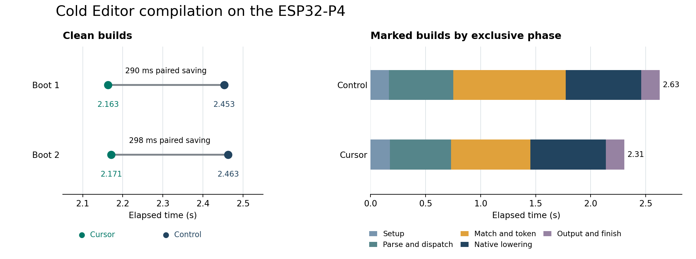

# Where cold typed compilation time goes on PicoCalc

A cursor-based lexer saved **290–298 ms** on a cold Editor compile on the ESP32-P4. Peak QuickJS heap increased by about **9 KB**. The change reduced a roughly 2.45-second compile by about 12% while preserving the native program byte for byte. It fell short of the half-second target and exceeded the control's peak, so it remains an experiment.

The timestamps explain where most of the gain came from. In marked Editor runs, finding a token and writing it to the lexer state took about 1.02 seconds in the original compiler and 0.72 seconds with the cursor. The rest of the frontend, native lowering, and compiler setup each had measurable costs of their own. A clean paired experiment established the time savings because the trace added roughly 140–170 ms to each run.

## A compile that pauses to hand off a function

Editor runs as native RV32 code on PicoCalc, but the bundled Editor program begins as typed JavaScript source. The app wrapper reads that source and an ELF reactor, a small prelinked program with room for instructions and entry stubs. It creates a fresh QuickJS realm and evaluates the typed compiler, the native backend, and the app-specific linker. QuickJS executes this compiler and returns the patched ELF. The application itself runs the generated ELF outside QuickJS.

A parser has to recognize `return count + 1;`, resolve `count` in the current function, verify the types, and emit an operation to add two integers. The lexer gives it tokens such as the identifier `count` and the plus sign. When the parser finishes the function, the native backend immediately lowers its operations to RV32 instructions. This streaming arrangement lets the compiler release the operation array without waiting for all of Editor's functions. At the end the backend assembles the instruction arrays, fills in calls between functions, and patches them into the reactor.

```text
read inputs -> create QuickJS -> evaluate compiler scripts -> prepare arguments
  parser -> lexer -> parser -> lower function 1 -> parser -> lexer -> ...
  assemble instructions -> patch the ELF -> copy the result -> release the realm
```

The placement of `lower function 1` makes a single timer around the parser misleading. If a parser timer covers 20 ms and an 8 ms callback happens inside it, adding both timers yields 28 ms for 20 ms of work. Exclusive time charges each point to a single category. The parser tallies 12 ms in this example, less again if it calls the lexer inside those 12 ms. This distinction matters for the earlier result. The historical study grouped about 1.4 seconds between backend callbacks under the frontend and JavaScript setup. That interval included several kinds of work. It could justify opening the compiler for measurement, but it could not predict the time saved by a lexer.

## The cost of one token

The control calls a sticky regular expression at the end of the previous token. It matches whitespace and line comments before trying an identifier, integer, string, or operator. The successful call constructs a QuickJS match result including its named groups. The JavaScript compiler then selects the captured group and creates a token object carrying its value, kind, and source offset. The next call discards that token after the parser reads the primitive fields.

The cursor candidate moves through the same UTF-16 code units with `charCodeAt`. It scans each recognized token and slices the token text, then updates three fields of a single object. The parser continues to ask for one token at a time. A host-only variant uses the same cursor and creates a fresh object on every successful scan. That comparison can help interpret the allocator change within the host engine.

Even comment handling has a compatibility edge. The regular expression can first treat `//` as a comment and then backtrack out of the comment when it cannot find a token after it. A slash becomes ordinary punctuation in the retry. The first candidate reported `1:2: invalid token` for the following shape. The original lexer produced both slashes and the words on the first line before eventually reporting the invalid token.

```js
x  // ignored
   @
```

The saved regression case also contains a U+2028 character inside the comment, which the pattern consumes alongside the comment text. The repair sends an unmatched cursor scan through the original regular expression. That preserves its backtracking, the end-of-file offset, and the original invalid-token diagnostic. The compiled regular expression and its setup cost remain present. The candidate changes the ordinary successful scan and token allocation together. The board results therefore measure their combined effect.

## What the clock measured

The firmware measures a cold compile from the first app input read to the end of QuickJS teardown. It creates a new runtime and context every time. The kernel and flash cache can already be warm. Both clean compilers run inside the same disposable fixture with the JavaScript probes disabled. The app inputs, native backend, streaming setting, allocator, compilation limits, build and board remain constant.

In the marked variants, every change of phase records one monotonic timestamp. Each boundary closes the previous interval and opens the next. The compiler accumulates time by phase and tracks the maximum live allocator total it observes in each phase. The parser yields the clock to the lexer, and switches it to backend lowering around the function callback. The lexer switches from matching to token handling after it identifies the token. The code closes the measurement before printing the phase records. The parser requires every run's phase times to sum exactly to its outer stopwatch time and its phase heap maxima to reproduce the outer tracked peak. This partition reports which code is active when allocations overlap. A phase's peak can include objects allocated earlier that it still needs.

Four balanced blocks per boot put every compiler variant in every position. Each position compiles Files, Agenda, and Editor in that order. A repeat starts from a fresh board boot with the same firmware. The paired comparison subtracts the control from the candidate within each block, then takes the median of those four differences. The individual runs remain available. The result threshold was fixed before the board slot. Editor should save at least 500 ms on both boots without exceeding the maximum control heap peak measured for the same boot.

| App | Boot | Control median (ms) | Cursor median (ms) | Paired time change (ms) | Paired peak change (bytes) |
| --- | ---: | ---: | ---: | ---: | ---: |
| Files | 1 | 237.2 | 231.8 | -5.5 | +13,146 |
| Files | 2 | 236.6 | 232.6 | -3.7 | +13,154 |
| Agenda | 1 | 663.5 | 597.5 | -66.0 | +13,150 |
| Agenda | 2 | 664.7 | 602.7 | -62.3 | +13,144 |
| Editor | 1 | 2,453.1 | 2,163.2 | -289.8 | +9,036 |
| Editor | 2 | 2,463.0 | 2,171.1 | -297.9 | +9,020 |

Each time or heap change is the median of the paired differences. The two elapsed-time columns show separate medians, so subtracting those columns can give a slightly different value. Every Editor pair was at least 284 ms faster and every Agenda pair at least 57 ms faster. With byte-identical control compilers in a separate calibration, Editor paired changes ranged from −5.2 to +6.8 ms. Files showed a 3.7–5.5 ms median change under the scanner and a 4.0–5.4 ms range under the byte-identical calibration. The Files effect overlaps ordinary variation on this fixture.

The maximum Editor peaks for the two boots were 1,410,960 and 1,410,904 bytes for the control, compared with 1,419,924 and 1,419,920 bytes for the cursor. Each boot exceeded its control maximum by about 9 KB. All 96 compilations succeeded within the original per-app runtime and heap limits.



*The clean points show per-variant medians and the labels give paired median savings. The marked bars use the mean duration of each phase across both boots, so each stack sums to the corresponding mean total.*

## Reading the detailed trace

The second boot gives the following marked Editor medians. Each phase group sums its exclusive times within a run before the median is computed.

| Phase | Control (ms) | Cursor (ms) |
| --- | ---: | ---: |
| Inputs, realm, script evaluation, and arguments | 167.1 | 175.4 |
| JavaScript dispatch | 20.5 | 20.5 |
| Parsing, type checks, and typed operations | 566.4 | 535.1 |
| Regex match or cursor scan | 648.6 | 578.6 |
| Token handling | 372.2 | 141.1 |
| Native function lowering | 685.9 | 688.6 |
| Native assembly | 137.5 | 136.5 |
| Patch native reactor | 22.9 | 22.6 |
| Copy and teardown | 9.7 | 9.4 |
| **Outer marked total** | **2,632.1** | **2,307.6** |

The control performed 16,793 lexer visits and 120 streamed native lowering calls on every Editor run. The cursor had the same counts. Those visits added up to 16,914 entries into the parser category, accounting for its initial entry and each return from the lexer and backend. The old phase study's 1.4-second interval combined the frontend with JavaScript setup. The comparable marked categories here are dispatch, parse, match, and token handling, totaling about 1.60–1.61 seconds for the control. This is a fresh measurement with finer and more expensive probes on the pinned production compiler. The clean control took 2.453 and 2.463 seconds at the two per-variant medians.

Both marked runs pay an additional JavaScript-to-C call at each clock boundary. The initial dispatch marker covers native linker work around the frontend and backend functions. The assembler marker starts after the parser returns and stops before the return expression creates the signature list. The argument phase contains the existing streamed-mode print. The result-copy phase includes releasing the JavaScript arguments. The recorded peak comes from QuickJS's heap allocator and omits the external C buffer holding the copied module. Together the categories partition the existing application timing boundary. They still include interrupt noise, allocator behavior, and the cost of the probes.

The clean-to-marked paired increases for Editor were 171 and 164 ms for the control, and 145 and 139 ms for the cursor. The ~26 ms difference in probe cost makes the marked comparison overstate the clean speedup. Each marked build is a partition of its own elapsed time. The roughly 230 ms drop in the token-handling category and the 65–70 ms drop in matching point to the lexer's common path as the largest source of improvement. Those categories include the cost of callbacks at their boundaries and possible GC changes across the run. The board compare cannot assign the clean saving independently to named captures, token reuse, and the rest of cursor scanning.

The startup trace also makes the memory result less surprising. During evaluation of the typed compiler script, the marked Editor peak increased from 313,156 to 333,644 bytes. The arguments phase peaked at roughly 691 KB for the marked control and 697 KB for the cursor. Those differences appear before the first typed token is read. The replacement keeps the original regex for fallback and adds the cursor and its helper functions. Their setup and retained code are plausible contributors to the early footprint difference. The global peaks occur much later, when generated code, frontend metadata, and assembly buffers coexist. The trace measures simultaneous live memory and cannot assign the later peak to individual allocations.

The lexer is large enough to remain a credible area for research. The current scanner still spends about 0.72 seconds in marked match and token phases, and parsing and lowering also remain substantial. An isolated experiment could hold scanning fixed while reusing the control token, and hold allocation fixed while changing only the match representation. Comparing the script-evaluation and argument-phase heap against a cursor with a smaller fallback would distinguish growth in startup footprint from allocation changes during compilation. The present cursor misses both release criteria even though it preserves the generated program.

## Check the program produced by the compiler

The control, cursor, two marked variants, and cursor that creates a fresh token passed 71,814 token cases and 535 compile cases in Node. The lexical tests compare value, kind, token start, next cursor position, and the first diagnostic. The corpus includes every UTF-16 code unit in token context, randomly assembled fragments, malformed escapes, embedded surrogates, and comment boundaries. Vendored QuickJS also ran the complete token and compile fixtures independently. The three clean compiler variants produced identical result records in that engine.

All five variants also linked byte-identical Wasm for the three apps against the available host reactor builds. The resulting modules passed WebAssembly validation. Their linked sizes were 49,089 bytes for Files, 67,429 for Agenda, and 88,255 for Editor.

All five variants on the host produced identical RV32 instructions, metadata, and linked ELF images for each app. The emitted instruction payload is 3,216 bytes for Files, 16,232 bytes for Agenda, and 87,544 bytes for Editor. The linked ELF sizes are 24,424, 66,364, and 240,452 bytes respectively. The app reactor reserves fixed code space, which explains why the linked image is larger than the raw instruction payload. The board trial validates every timed output against the expected SHA-256 for the exact bundled reactor.

The native guest tests then run paired variants through the same emulated application workflows. They compare stdout and the number of RV32 instructions from driver entry to exit. Files tests startup, directory sorting, rounding, and directory creation. Agenda tests its persistence, grouped navigation, mutations, editor and refresh behavior. Editor tests a normal edit alongside large input, dense inline preview, and late navigation. The Editor fixture uses its own shared test reactor and compares the resulting native visual trees with the original app. The separate firmware test hash-qualifies the board reactor.

| Guest workflow | Instructions for each frontend |
| --- | ---: |
| Files | 88,823 |
| Agenda | 2,193,310 |
| Editor edit | 2,543,239 |
| Editor large | 7,621,786 |
| Editor dense inline preview | 22,853,317 |
| Editor late navigation | 42,316,056 |

These counts show identical executed work for the fixtures. They measure deterministic guest instructions, which can be reproduced through the emulator. Physical guest wall time requires a separate measurement. Since the compiler's output bytes are equal, a change in compiler time cannot be attributed to any change in generated guest work.

## What the host can tell us

The host test runs the vendored QuickJS build in fresh processes with all six orders of its three variants, twice. A first wall-time run overlapped other builds and had large scheduling outliers. The follow-up recorded elapsed and process CPU time inside the same boundary. For all 108 follow-up compiles, the native image digest matched the corresponding oracle.

| App | Control CPU median (ms) | Paired CPU change, cursor (ms) | Paired CPU change, cursor with fresh tokens (ms) |
| --- | ---: | ---: | ---: |
| Files | 9.50 | +0.08 | +0.25 |
| Agenda | 37.73 | -1.97 | +0.19 |
| Editor | 65.78 | -4.62 | -1.25 |

With the cursor fixed, a fresh Editor token cost 3.73 ms more per paired CPU median than a reused token, and the elapsed-time check gave 3.76 ms. The cursor with reuse saved 4.62 ms of CPU time against the original over all Editor blocks. Token materialization contributes to the host result, and the P4 still needs a separate treatment to measure that contribution there.

The host and ESP32-P4 run the same vendored QuickJS source on different processors, with different instruction timings, allocator implementations, and memory hierarchies. A host timing measured from fresh realm creation has the same broad shape as the cold board interval. A speed ratio still belongs to the hardware and runtime configuration on which it was timed. The host-only fresh-token result can localize a direction for further work. The share attributable to token reuse on the P4 remains open.

## Reproduce the comparison

Start in the repository at `/home/manuel/code/wesen/2026-10-20--ds-js-os`. The ticket `PICOCALC-FRONTEND-COLD` contains the stage program, cursor source, phase counters, app fixture, and named receipts below. The stage program copies the production compiler, app sources and port from commit `40bcf850a5809ef6d839127869faa952596ed157`. It needs already installed ESP-IDF dependencies for the disposable port.

1. Run `scripts/01-stage.py WORK --board-assets PORT_ASSETS` and `bash scripts/05-build.sh WORK IDF_EXPORT_SH`. Record the exact compiler and firmware digests.
2. Run `scripts/09-host.py WORK` for the vendored QuickJS experiment. If local Wasm reactors are available, pass their directory after the fixture path in `scripts/06-oracle.mjs` to verify linked Wasm too.
3. Run `scripts/10-guest.py WORK P4_GCC RV32EMU` from the ticket for guest counts. The emulator uses the support object files in its directory.
4. Use the lab supervisor's capture procedure for the two board boots, then run `scripts/07-board-receipt.py WORK WORK/oracle.json BOOT1.log BOOT2.log` against their complete serial captures.

The generic early design review ran through Claude Code with the `opus` alias and high effort, which the CLI resolved to `claude-opus-5-5`. It identified callback exclusivity and observer overhead as priorities and proposed lexical differential cases. The project-specific request was interrupted during the lab pause without a completed review. The local Sol 6.2 High researcher implemented the experiment and authored this account after the user's updated model choice.

## Evidence

- [Experimental design](../design-doc/01-measuring-the-cold-frontend-before-replacing-the-lexer.md)
- [Investigation diary](../reference/01-frontend-cold-compilation-investigation-diary.md)
- [All 96 board compile rows and phase records](../various/board-phases.json)
- [Byte-identical control calibration](../various/aa-calibration.json)
- [Application output oracle](../various/host-oracle.json)
- [Vendored QuickJS differential and timing receipt](../various/quickjs-cold.json)
- [Native guest workflow receipt](../various/guest-workflows.json)
- [Opus design review provenance](../various/opus-receipt.json)
