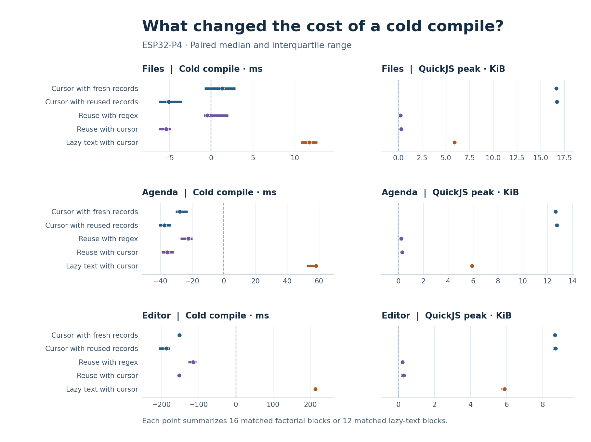

# What made tokenization faster on the handheld

Editor compiled **307 ms faster** when the PicoCalc’s typed compiler switched to a cursor scanner and reused one token record. The two changes each saved time. The cursor accounted for nearly all of the **9,194-byte** increase in peak QuickJS heap. The faster compiler fit the existing budget with 2.65 MiB to spare and produced the same native executable.

A separate parser experiment materialized 61% fewer Editor token strings and took **214 ms longer** than the eager cursor. It also raised the allocator peak. The lexer can correctly leave most token strings unallocated, but this implementation moved extra work into the parser’s most frequent checks.

## What the parser needs from the lexer

The typed compiler converts each function to numeric operations, then immediately passes those operations to the RV32 backend for native instruction generation. The backend collects the native instructions and patches them into an ELF reactor, a prelinked executable with space reserved for the compiled functions. Our measurement starts when the app reads the typed source and reactor. It includes the creation of QuickJS, evaluation of the compiler and linker, compilation, linking, result copy and QuickJS teardown.

A lexer recognizes one token at a time. In `let gap:i32 = 3;`, the identifier `gap` occupies UTF-16 positions 4 up to 7, including position 4 and excluding position 7. The compiler needs the text `gap` as a key in its local-variable map. It needs the number `3` for conversion and type checks. The semicolon only marks the end of a statement. A token with kind, value and source position gives the parser the same data for all three tasks, even when recognition would be enough.

The original lexer runs a sticky regular expression at the current input offset. The match includes trivia and a named capture for an identifier, integer, quoted string or operator. The compiler selects the matched value and builds a new token object. A cursor scanner uses the code units directly to determine the token’s kind and extent, then takes a slice. In either case the parser only needs the current token. Reuse works because every binding or operand the parser keeps is already a string or number by the time it advances.

## Two changes in the same measurement

An earlier physical comparison changed the scanner and the token record together. This time one image held all four treatments. The eager payload and field order stayed fixed. The cursor uses the original regex when its ordinary scan finds no token. That fallback matters when a terminal `//` comment causes the sticky regex to backtrack and recognize a slash as punctuation. The record lifetime stays consistent in the fallback, at end of file and before an invalid-token diagnostic.

| Scanner | Fresh record, Editor | Reused record, Editor |
| --- | ---: | ---: |
| Sticky regex | 2,461.3 ms | 2,349.8 ms |
| UTF-16 cursor | 2,309.5 ms | 2,157.8 ms |

Those four cells are per-lane medians. To separate the effects, compare two lanes in the same block, then take the median of those differences. For example, holding the records fresh puts the cursor **152 ms** ahead of regex on Editor. Holding reuse fixed puts it **187 ms** ahead. Both pairs change the scanner, and they disagree about the size of the gain. Similarly, reuse saves **115 ms** with regex and **152 ms** with the cursor. Each lexer performs different work around constructing or updating the token. The difference of differences measures how much one treatment changes the other’s effect. It was roughly −30 to −34 ms at the two boot medians.

| Within-block change | Files time, ms | Agenda time, ms | Editor time, ms | Editor peak, bytes |
| --- | ---: | ---: | ---: | ---: |
| Use cursor with fresh records | +1.3 | −27.6 | −151.7 | +8,894 |
| Use cursor with reused records | −5.1 | −37.5 | −187.4 | +8,918 |
| Reuse records with regex | −0.5 | −22.4 | −115.3 | +224 |
| Reuse records with cursor | −5.4 | −35.7 | −152.4 | +296 |
| Use cursor and reuse versus original | −4.0 | −61.3 | −306.8 | +9,194 |
| Use lazy text with cursor and reuse | +11.7 | +58.2 | +213.7 | +6,020 |



*Every panel plots differences within complete blocks. The intervals mark the middle half of observed differences. Negative values mean a lower compile cost. Files has a much narrower time scale than Editor.*

Agenda also gains from both treatments. Files’ four-millisecond combined saving is within the range observed in earlier A/A calibration with identical compilers. The Editor combined saving ranged from 269 to 346 ms across its 16 pairs. Moving to a cursor consistently increased peak on each app. The larger peak was about 17 KB on Files, 13 KB on Agenda and 9 KB on Editor. Resident helper code and transient strings are possible contributors. The counter measures the maximum number of usable heap bytes simultaneously allocated by QuickJS. It cannot tell which allocation set that maximum. Reusing records saves repeated allocations and leaves the outstanding peak almost unchanged.

## Give the parser offsets and make text optional

The lazy variant uses the same cursor and still mutates one record. Its token stores `kind`, `at` and `end`. To recognize a keyword, the parser checks the span length and compares the source at `at`. To look up binary precedence, it reads the punctuation code unit and span length to select a canonical string for the existing operator table. It calls `text()` for an identifier, type name, number or quoted literal. That method caches the slice during the current token’s lifetime and the next scan invalidates it.

```js
is(value) {
    const { at, end } = this.token;
    return end - at === value.length && this.source.startsWith(value, at);
}
```

Separate instrumented parses of real applications counted 700 eager slices versus 255 lazy slices for Files, 4,158 versus 1,584 for Agenda, and 16,792 versus 6,496 for Editor. The 8,840 eager Editor punctuation slices disappeared. All 1,109 integer and 105 quoted-literal slices remained. Each instrumented compile produced the verified ELF. These counts describe source-slice operations and their token kinds. They leave heap behavior and execution cost to the board measurement.

The lazy version was slower in every comparison with eager cursor/reuse. Each eager grammar check compares a materialized token string. Each lazy check loads offsets, compares lengths and may call `startsWith`. Several parser checks can examine the same token before the lexer advances. Avoiding a slice reduces one local operation while adding work to those repeated checks. These are differences in the implementation. A phase breakdown would be needed to quantify their contribution to the 214 ms. The lazy variant also retained a higher QuickJS peak on each app. Counting fewer strings over a complete compile does not require fewer live bytes at its peak.

## What the board comparison establishes

Each block compiled Files, Agenda and Editor under all treatments in its image. Rotations and reverse rotations put each treatment into each position twice in a boot. Two boots gave 16 pairs per app for the factorial and 12 for the lazy comparison. A new QuickJS runtime and context were created for every sample. The firmware and underlying board state could be warm. The useful lazy contrast uses its own same-image eager cursor control, which took 2,161 ms on Editor, close to the factorial’s 2,158 ms.

Across both images, 300 timed compiles returned the exact expected full ELF hash. The linked module sizes remained 24,424 bytes for Files, 66,364 for Agenda and 240,452 for Editor. The host also produced matching linked Wasm and checked 69,643 lexical inputs and 318 compiler inputs through Wasm, buffered RV32 and streamed RV32. There were 136 matching diagnostic cases per route in Node and vendored QuickJS. The lexer trace compared the kind, value and source positions, and separately verified whether the next token had the correct fresh or reused identity. On-device guest smoke tests exercised the Files comparison and Agenda weekday functions. Both fixture runs restored the backed-up factory image and found all three applications running natively without a reported error.

The eager cursor with reuse is the fastest treatment across all three applications in these trials. Its worst Editor peak was 1,420,528 bytes within the existing 4 MiB ceiling. Its largest Files and Agenda peaks were 379,960 and 592,244 bytes within their shared 2 MiB ceiling. The experiment leaves the pinned production compiler unchanged and provides an exact candidate for the combined compiler comparison. The tested source-span parser carries a clear tradeoff: fewer slices, a slower cold compile and a higher peak.

[Design](../design-doc/01-measuring-scanning-and-token-lifetime-independently-on-the-picocalc.md) · [Token and compiler checks](../various/frontend-differential.json) · [Matched board evidence](../various/physical-summary.json)
