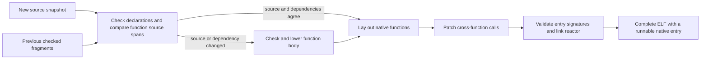
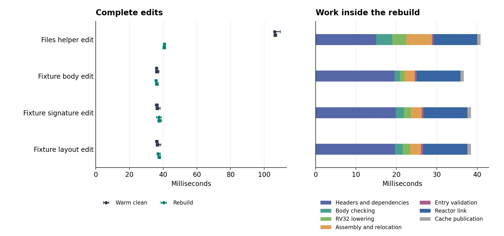

# What PicoCalc can reuse after editing a function

A Files developer changes the filename rules so a name may start with an underscore. The change fits in one helper. A clean compile checks and lowers every function. A rebuild that retains checked machine code can use six of the seven functions again. It still has to link the program because the new helper moves the caller. This experiment follows that edit from source through a complete linked ELF, the file the native loader expects.

On the ESP32-P4, the edited native entry returned in **43.4–44.5 ms** after source handoff, versus **106.8–107.4 ms** for a full compile in an already warmed runtime. Both routes produced the same complete ELF and accepted the edited filename. Reuse raised the QuickJS request peak by about **88 KB**. The small fixture's signature and record-layout edits had little work to save and took slightly longer than a full compile.

## An unchanged function can need a different jump

Files has a helper called `filesAlnum` and an entry called `filesName`. The entry normalizes a proposed name and uses the helper to decide whether the first character is allowed. The experiment adds one condition to the helper.

```js
function filesAlnum(c: i32): bool {
    return c === 95 || (c >= 48 && c <= 57) || (c >= 65 && c <= 90) || (c >= 97 && c <= 122);
}
```

The new expression added 32 instruction bytes. Before the edit, one call from `filesName` lay at byte 1,168 of the generated image and targeted byte 464, the start of `filesAlnum`. After the edit, the call moved to byte 1,200 and still targeted byte 464. RV32 encodes this jump as a displacement from the call instruction, so the old displacement of −704 would now land 32 bytes past the start of the helper. It has to become −736 even though the source and signature of `filesName` stayed the same.

A *fragment* stores one function's native instructions and a list of places where they call another function. Each list entry names its target. Inside a function, local conditions and loops jump between instructions that move together. The prototype can encode those jumps when compiling the body. A jump out of the function waits until the assembler has assigned an address to every function. Then the assembler patches the new image, while the bytes in the retained fragment stay available for future revisions.

The reactor is the prelinked part of the app. It has a fixed slot with entry stubs and room for generated code. The final linker copies the new image there and writes native jumps in the stubs. A caller of the reactor's `filesName` entry reaches the new routine through its stub. The fresh and edited images are both 24,424-byte ELFs. Their generated programs are 3,216 and 3,248 bytes, respectively. Equality is checked against a clean build of the same revision.



## When a function can still use its fragment

The compiler uses an exact source comparison from the `function` token through the closing brace. If the text matches and the earlier function depended on the same declarations, the prototype advances its lexer to the end of that span. This bypasses tokenization, type checking and lowering for the whole body. The span comparison still reads source text and every declaration header is parsed. The lexer reads the next token using the original lexer rules and current source offset. Comments between declarations therefore need little work, and an invalid symbol immediately after a reused function is still an error.

Calls bind to functions declared earlier in the file or made available as runtime imports. Changing an earlier function from `base(n: i32): i32` to `base(n: i32, extra: i32): i32` makes an old call invalid. An unchanged calling body carries the old signature in its assumptions. In the test it could only become valid after the caller supplied the extra argument. The next function up the chain still calls the caller using its original signature and could keep its fragment. A second attempt changes the callee's result to `bool` and leaves the caller unchanged. Rechecking the caller finds `22:22: expected i32, got bool`, exactly as the clean compiler does.

A record type tells the compiler how to interpret fields in memory. A read of `row.value` emits a load at a fixed offset. In the fixture, adding `pad: i32` before `value` moves `value` from byte zero to byte four and `tag` from byte four to byte eight. The two readers rebuild using the new offsets. The function that only passes a `Shared` reference to a reader still has the same signature and needs only the fact that `Shared` exists. It can keep its fragment. The experiment compares the entire layout whenever a function reads a field, so adding a field at the end may also rebuild a reader whose particular offset is unaffected.

The fixture also puts three functions in the source order `base`, `stretch`, then `caller`. The last one jumps back to the first. Growing only `stretch` moves that call from byte 236 to 260, while `base` stays at byte 144. The assembler replaces the displacement of −92 with −116. Both endpoints of the call retain their fragments.

| Sequential fixture edit | Functions rebuilt | Functions reused | Clean result |
| --- | ---: | ---: | --- |
| Grow the intervening `stretch` body | 1 | 10 | Same ELF. An unchanged caller's cross-function jump changes. |
| Add parameter to `base`, leave caller alone | Attempt rejected | | `22:18: expected ,` |
| Supply the new argument at the call site | 2 | 9 | Same ELF. The later `chain` body is reused. |
| Change `base` result to `bool` | Attempt rejected | | `22:22: expected i32, got bool` |
| Insert `Shared.pad` before both read fields | 2 | 9 | Same ELF. Both field readers rebuild and `bridge` is reused. |
| Change `Shared.value` to `bool` | Attempt rejected | | `8:21: expected i32, got bool` |
| Present a superseded revision and valid source | Clean fallback | | Same ELF. No old fragments are published. |
| Remove an unreferenced function after reseeding | 0 | 10 | Same ELF. New addresses and calls are assembled for the remaining bodies. |

The session owns the previous successful build and its revision token. If an edit arrives with an older token or a token from another session, the candidate runs the frozen clean compiler. A successful fallback publishes a fresh artifact and token and discards the fragment set. The next fragment rebuild starts empty. A failed compile leaves the previous success available. The caller also gets its own byte array, so changing a delivered artifact cannot corrupt the next cache hit. Ordinary source rejections take the clean path for their final diagnostic, with the clean compiler's error order and source position. This extra work affects the cost of an invalid edit.

The independent host review applied a different sequence to Editor's 120 functions and checked the same full ELF and diagnostic contracts. A body edit rebuilt one function. A signature edit with three updated callers rebuilt four functions and changed machine words in 42 linked bodies. Moving two `WorldState` fields rebuilt 77 functions. Seventy of those 77 emitted byte-identical words after relink. That result shows the cost of comparing an entire record layout when a field-level comparison could be sufficient. The Editor trial also covered an invalid shared event ABI and an offset-shifting interdeclaration comment that reused all 120 functions. [Independent Editor replay](../../PICOCALC-LAB-REVIEW--independent-examination-of-the-picocalc-compiler-lab/various/rebuild.json).

## What the clock measures

A cold compile starts a fresh QuickJS runtime. The stock ESP32-P4 wrapper reads the bundled Files source and reactor, evaluates the unmodified compiler, links an ELF, copies its bytes out and tears the runtime down. A session also has a setup cost. Seeding starts after that setup and creates the initial fragments and a private copy of the linked ELF.

An *edit-to-linked* interval begins when a prepared source string is handed to the existing session. It includes deciding which fragments apply, parsing and lowering changed bodies, assembling and relocating the complete code image, validating the entry signatures, and linking the new reactor bytes. Source editing, I/O and application loading are outside this interval. The warm clean comparison receives the same prepared source and reactor and rebuilds all bodies in the already initialized JavaScript realm. Each request's comparison checks either every byte or the exact diagnostic after both clocks stop.

There are two ways to benchmark unchanged source. The whole-ELF hit compares the already prepared source value and copies the saved ELF. The fragment relink walks the source, revalidates every retained fragment, and constructs an ELF. The gap between those two requests isolates how much work survives function reuse.

## What the board measured

The Files body edit linked in about **41 ms**, saving **65.6–65.9 ms** against a warm clean build. Across two boots, every unmarked pair saved at least 64.9 ms. Each boot ran four unmarked and four separately marked blocks for Files and for the fixture. The candidate and warm clean compiler ran one after the other in alternating order. The harness matched every complete linked ELF or diagnostic on the device and checked the output again against the host oracle.

| Timed request | Rebuild boot 1 (ms) | Clean boot 1 (ms) | Paired saving (ms) | Rebuild boot 2 (ms) | Clean boot 2 (ms) | Paired saving (ms) |
| --- | ---: | ---: | ---: | ---: | ---: | ---: |
| Files seed | 119.4 | 105.3 | −14.2 | 120.0 | 105.5 | −14.5 |
| Files exact hit | 1.06 | 105.4 | +104.4 | 1.07 | 105.9 | +104.8 |
| Files relink, seven fragments reused | 32.3 | 104.7 | +72.4 | 32.5 | 105.6 | +73.1 |
| Files body edit | 40.7 | 106.2 | +65.6 | 40.6 | 106.5 | +65.9 |
| Fixture body edit | 35.7 | 36.1 | +0.3 | 36.2 | 36.3 | +0.1 |
| Fixture repaired signature | 37.5 | 36.2 | −1.5 | 37.6 | 36.5 | −1.1 |
| Fixture shared layout edit | 37.0 | 36.2 | −0.8 | 37.6 | 36.6 | −0.9 |

All columns show medians. Savings subtract each paired rebuild from its warm clean comparison before taking the median. The Files fresh production wrapper separately took 238.5 and 238.3 ms across the two boots, with a peak of about 363,000 bytes of QuickJS heap. Candidate session setup was about 175 ms before its first seed. The setup and seed medians together exceed the stock cold interval. The improvement appears on later successful edits. [Physical raw samples and receipts](../various/p4-rebuild.json.gz).

The marked Files edit spent about 15.0 ms walking declarations and checking dependencies, 4.0 ms checking the changed body, 3.4 ms lowering it to RV32, 6.4 ms assembling the full code image, 0.43 ms validating the app's exported entries, 10.7 ms linking the reactor, and 0.86 ms publishing the revision. Marked samples took 0.36 and 1.01 ms longer in median paired differences on the two boots. Unmarked samples provide the total-time comparisons above.



*Dots and squares identify the two boots. Whiskers span the four unmarked samples per cell. The bars average the separately measured phase durations across both boots.*

The eleven-function fixture gives the validation walk more headers than Files and much shorter bodies to skip. Its body edit was within 0.4 ms of warm clean in both paired medians. The sign changed within each boot's repetitions. The signature and layout edits were around 1 ms slower at the median. The marked fixture body edit spent 19–20 ms on the declaration walk and about 11 ms on the same reactor link. Those two costs were almost as large as the entire clean compile. Rejections also repeat some work. The wrong-arity edit took about 26 ms to return the frozen diagnostic, versus 13 ms in the clean compiler. The stale revision fell back to a clean build, taking 37.2 and 37.4 ms versus warm clean medians of 35.6 and 35.5 ms.

In the component harness, the candidate-first Files edit used about 481,000 bytes live after the request and peaked at 513,000. When the clean compile ran first, the QuickJS realm still held its ELF while timing the candidate, putting the candidate's live and peak readings about 20 KB higher. These numbers include the runtime and harness. The separate continuous benchmark below uses a single prepared compiler per realm.

The loaded seed ELF's `filesName` returned −1 for `_Ab`. The loaded edited ELF's same entry returned three and wrote the UTF-16 code units for `_Ab`. The direct entry test used the normal ELF loader and measured loading and calling separately after the compile check. The body artifact's load median was about 1.5 ms, and the native return took 4–19 µs in the unmarked samples. That call demonstrates the edited program's behavior. It is too short and does different work from the seed to support a guest performance comparison.

## Follow the edit through native return

A separate firmware measured the entire interval from handing the already edited source to JavaScript until the first native `filesName` call returned. The uninterrupted stopwatch included compilation, obtaining the linked bytes, the ordinary ELF load into executable memory and the entry call. It stopped before checksums, comparisons and output. Source editing, creation of the compiler realm, initial cache seeding, and full Files window startup are outside this interval.

Every request had its own QuickJS realm. The clean compiler compiled and discarded the original Files ELF before measurement. The candidate seeded its cache from the same original source, then received the edited source. Both entry calls received `_Ab`, returned three and wrote the same three UTF-16 units. The artifact of every timed call had SHA-256 `7be267e2787cf2767dc6b94cbc4c4589679d0f2cd5b57fdf11a3f18ca2bed9d9`, the value from the frozen clean build of the edited source. Six pairs per boot alternated which warmed route ran first. [Continuous endpoint samples and receipts](../various/p4-endpoint.json.gz).

| Boot | Rebuild to native return (ms) | Warm clean to native return (ms) | Paired saving (ms) |
| --- | ---: | ---: | ---: |
| 1 | 44.46 | 107.40 | 63.35 |
| 2 | 43.43 | 106.82 | 63.54 |

The smallest saving across the 12 pairs was 62.16 ms. The time saved was about 59% of the warm clean interval. Median entry execution was 5–8 µs across the measured routes and boots. One native call took 101 µs and remains in the raw record. The native results establish that both compilers supply runnable versions of this edit. Almost the entire latency difference occurs before ELF loading.

The candidate realm had about 424,750 live QuickJS bytes immediately before source handoff, compared with about 357,270 for clean. Its peak during the isolated request was about 477,270 bytes against 389,450 for clean, an increase of approximately 87,820 bytes. These measurements include the warmed runtime in each lane, its source and reactor handles, and the candidate's retained cache. The ELF loader allocates separately. The cache experiment stays within the harness's 2 MiB QuickJS ceiling on Files. The two boots used one board. The cost of a resident Editor-sized cache on the device remains open.

## What the host establishes

Forty Node blocks used separate realms for the staged candidate and the frozen compiler and the exact reactor binary built for the board. A fresh stock realm, including evaluation of the three compiler scripts, had a 2.418 ms median on the host. The warm results below are microseconds. The last column is the median of within-block clean minus candidate differences. The two separate medians can round to a different difference.

| Request | Candidate (µs) | Warm clean (µs) | Paired savings (µs) |
| --- | ---: | ---: | ---: |
| Files seed | 349.0 | 293.5 | −55.0 |
| Files exact hit | 4.0 | 261.0 | 256.0 |
| Files relink, seven fragments reused | 68.5 | 246.0 | 180.5 |
| Files body edit | 92.5 | 266.5 | 179.5 |
| Fixture body edit | 82.5 | 75.5 | −6.5 |
| Fixture repaired signature | 87.5 | 78.0 | −12.0 |
| Fixture shared layout edit | 92.5 | 79.5 | −13.5 |

The Files edit was faster in every host block, by at least 138 µs. Fixture comparisons included blocks in both directions. The fixture has eleven headers and short function bodies. On Node, preserving ten fixture fragments is worth less than preserving six Files fragments. Cached byte identity protects correctness even on the slower side of that crossover. [Host samples and oracle](../various/host.json.gz).

## Reproducing the study

The control is `40bcf850a5809ef6d839127869faa952596ed157`, the streamed RV32 compiler. The candidate runs in a separate ticket harness. The harness exposes selected internals of the control compiler without changing its source in the source tree. The host oracle opens the clean compiler in its own realm using the original files from the frozen revision. The physical image bundles the staged compiler for incremental work, the original compiler for its cold Files wrapper and a known reactor. The board runner compares the printed SHA-256 hashes and literal diagnostics with the host results. The runner keeps UART captures locally and verifies the restored app after each experiment. The ticket preserves the complete structured results and a compact excerpt of the preboot loader failure.

Start with [the staging script](../scripts/01-stage.py), then run [the Node oracle](../scripts/04-host.mjs) against a Files reactor. The [case definitions](../scripts/03-cases.js) describe the exact edits and rebuild counts. The [board harness](../scripts/06-board.py) replays two boots with the lab's approved restore image. [The design](../design-doc/01-compile-one-edited-function-and-rebuild-its-native-links.md) traces the original parser and linker interfaces. [The chronologically ordered lab diary](../reference/01-function-rebuild-investigation-diary.md) records attempts and measurements.

## What carries over to the next edit

The amount of source that changes determines which body needs new machine instructions. The amount of work saved also depends on which bodies were expensive to check and lower. Files clears that threshold after one successful helper edit under the warm comparison. The initial seed costs an extra 14–15 ms over a warm clean build. The paired saving of about 66 ms on the next linked edit covers that seed premium in the measured case. The small fixture has less body work to avoid and shows how declaration checks and relinking can dominate an otherwise successful reuse decision.

Each rebuild still walks declarations, compares source spans and lays out the entire native image. The protection against wrong offsets is part of its cost. A more selective record dependency would compare the fields that a body actually used, which would narrow the conservative invalidation seen in Editor. The price of keeping those additional facts and the size of a resident cache for a larger application remain separate measurement questions.
