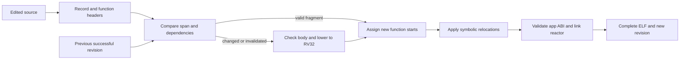

# Compile one edited function and rebuild its native links

A Files developer who adds an allowed filename character changes one helper. A clean native build lexes and checks all seven functions, emits their instructions, and writes them into a reactor. The reactor is a prelinked ELF with reserved instruction space and entry stubs for the native application. This experiment asks how much work the handheld can avoid after the first build of an editing session. It will compare an actual edited ELF against the entire artifact made by the frozen production compiler at `40bcf850a5809ef6d839127869faa952596ed157`.

## Why an unchanged caller still needs a new call instruction

Files checks the first filename character with `filesAlnum`. In the measured edit, that function gains a clause for the ASCII underscore. `filesName` keeps the same source text and still calls `filesAlnum(i32): bool`. The extra instructions move the later caller. Its old relative call instruction can now jump to the wrong address. In the candidate an unresolved call carries the target function's name. The assembler lays out all the bodies and encodes each call from its current location. The existing ELF linker then fills the reactor entry stubs and runtime-import calls.

The frontend resolves functions in declaration order. A function can call imports and earlier functions. A record declaration has named fields at four-byte offsets. Inserting a field before an existing one changes its offset even when the field's type stays the same. If the candidate passed an old machine word through in either situation, it could emit a different ELF despite every affected source line remaining syntactically valid.

## Establish what a reused function depended on

Stage tiny adaptations of the frozen compiler in a ticket-specific build. Expose its lexer and numeric function emitter, reuse its declaration and header parsers, expose native function lowering and jump encoding, and call the production app validator and slot linker. Retain unmodified frozen frontend, backend and app wrapper for the clean oracle. Staging verifies each adaptation anchor against the frozen source. The application compiler files stay in their original location and form.

The candidate walks record declarations and function headers in the production order. An exact previous function span, including the header and braces, is the reuse key for the source. Its comparison starts at the current `function` token. If a function matches, the candidate can advance the original lexer past its closing brace and ask for the next token at the original lexical boundary. The intervening statements are neither tokenized nor lowered. A changed function runs through the original numeric body parser and backend.

| Dependency | Information carried between builds | Why the candidate compares it |
| --- | --- | --- |
| Previous declaration or runtime import | Call name, ordered parameter types, return type, and binding kind | Type-check a call against its visible declaration and preserve the calling convention. The current binding index resolves symbolic relocation. |
| Record lookup | For type recognition, whether the record exists. For a field access, the ordered fields with their types and offsets | A field offset is embedded in a load or store. Body annotations and record-type recognition also use the record table. |
| Session revision | An opaque token for the last successful source for this compiler and reactor, kept inside the process | A stale or foreign edit basis cannot substitute pieces from an older object lifetime. |

For record dependencies record the lookups made by the original emitter. Check the entire layout for each touched record. This intentionally rebuilds some readers whose individual field offsets survive a change. There is no transitive body dependency because the candidate emits ordinary calls and performs no inlining. A caller of a recompiled reader can be reused if the reader's exported signature remains identical. A reference to an import stays an import and takes the normal linker route. Retain no parsed statements or numeric operations after lowering.

Intra-function jumps use relative addresses and can be encoded as soon as lowering finishes. Calls outside a body retain the target name. The dependency fingerprint distinguishes an import from a source declaration. When generating the new image, assign every body a start in the new order, copy its compact machine words, then encode each jump in the output buffer. Cached fragments are never patched in place. Require the same range checks and linker errors as the clean path.

## Session and failure behavior

One in-memory session owns its reactor, import contract and previous successful generation. It can build from an empty state, rebuild a new full source snapshot against the last successful token, and answer an exact-source hit. The exact-source hit copies the retained whole ELF. A second benchmark asks the candidate to walk the unchanged source and relink from function fragments. This distinguishes a cache hit on the entire module from a pass that validates each function. The artifact handed to the caller is a separate byte array so a consumer cannot change the cached copy.

A stale or foreign token takes the frozen compiler path. When the clean path succeeds after rejecting stale input, it publishes only a fresh artifact and token. A later edit repopulates function fragments. A source rejection preserves the most recent successful revision. Candidate failure takes the frozen path for exact error name and message, including line and column and ordering relative to backend checks. Publication follows successful ABI validation and ELF linking. In particular, a failed final link cannot leave a partially valid revision.

Track section durations and allocator limits in the harness. Hold at most one published generation and one build being prepared. Reused fragments are shared across those two generations. This experiment does not persist cache data, compile in the background, or set a production memory policy. Record the per-app source bound, session runtime heap ceiling, resident live heap after success, and high-water mark over each request.

## Tests and measurement

The Files workload keeps its actual reactor and app ABI. Introduce a leading underscore as an additional allowed character in `filesAlnum`, check that the call in `filesName` moves, and exercise `filesName` after linking. Run a second fixture with a call crossing a function that grows, a helper parameter change with and without a matching edit in its immediate caller, and a shared record layout edit read by more than one function. Preserve a transitive caller for which the interface stayed stable. Remove and reorder declarations, introduce bad syntax or a changed field type and try a previous or foreign revision. Compare every successful linked artifact byte-for-byte with the frozen app wrapper and compare every rejection's error name and message. A test that only compares scores or entry offsets could miss a wrong immediate in an unchanged body.

Measure genuine fresh-realm cold compiles and candidate seeding separately. From a seeded realm, measure end-to-end rebuild with the edited source already available to the compiler, exact source cache hit, and unchanged function reuse plus relink. Record the interface walk and dependency checks, changing bodies, RV32 lowering, image layout/relocation, ABI validation, reactor linking, and publication. A coarse unmarked path will quantify phase sampling overhead. Files' device outer cold control uses the stock app wrapper. The edit endpoint is a complete linked ELF, before guest loading and execution. Verify guest results from the actual linked slot separately.

Run the same edit cases in the host oracle and in staged QuickJS on ESP32-P4. Two reboots and alternating cold versus edit series reduce ordering bias on the single device. Keep raw samples alongside summary statistics. Only the parent lab supervisor schedules and runs physical flashing.

The prediction is that the Files body edit reuses six functions and runs faster than a warm clean compile, even after relinking and copying the output. Signature and record edits should reuse at least one body in the fixture. The clean oracle may be faster than the candidate for a tiny module or one that invalidates nearly every fragment. A cold candidate seed may cost more than the production compile because it creates cache records and retains a private ELF for later hits. A crossover is a result with its own sample and resource limits.
