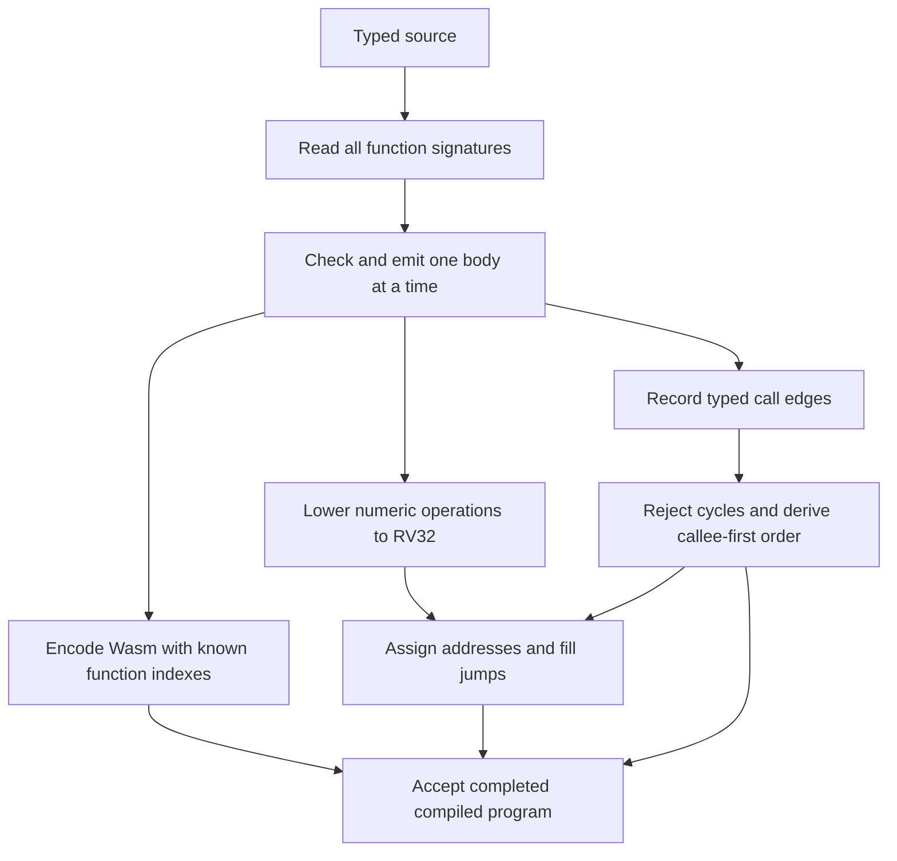

# How the PicoCalc frontend adds language features without buffering function bodies

When the PicoCalc compiles its Editor, the language frontend translates one function at a time into a short sequence of stack operations. WebAssembly uses these operations directly. The RV32 compiler translates each completed function into native instructions and can then release its stack operations. The compiler now accepts calls to functions that appear later in the file, exhaustive enumeration matches, and distinct integer types. These features rely on source-level information that can be retained independently of each function's operations.

> [!summary]
> A signature pass supplies call types to both targets, while a graph traversal preserves the guarantee against recursion. Named enum cases protect Editor's search state without growing its state record. Distinct types for UTF-16 offsets and Unicode columns reproduce the original Editor bytes.

## Source order and call order

Consider two functions whose first declaration calls the second.

```typescript
function advance(at: i32): i32 {
    return twice(at) + 1;
}
function twice(n: i32): i32 {
    return 2 * n;
}
```

When checking `advance`, the compiler needs the return type of `twice` before it can check the addition. Its signature gives the parameter and result types without reading the expressions that compute the result. The first pass reads the signature of each function and remembers the location of its opening brace. To reach the next signature, it matches structural braces while skipping quoted strings and line comments. When the compiler reads an Editor literal such as `"} // { "`, those characters do not become braces or comments in the surrounding program.

Wasm's call instruction takes a function index. The compiler gives `advance` the first typed definition's index and `twice` the next one. It can emit the call as soon as it checks the argument. A native jump needs a displacement from the call instruction to the callee. When lowering `advance`, the RV32 compiler knows which function is the target but has not assigned its address. Each call has a fixup, which is a record of the output location and target. The assembler walks the complete machine code in source order, assigns starting addresses, and uses them to fill the reserved jump words.



Before signatures were available in advance, the compiler accepted calls only to functions already emitted. Each call led strictly backward in source order, which made a cycle impossible. The replacement collects a directed edge from each caller to each typed callee and checks the graph explicitly. It walks the graph depth first, distinguishing functions that are unseen, functions on the current traversal path, and functions whose dependencies have been examined. An edge back to the current path identifies a recursive call cycle. The compiler reports the names along that portion of the path. A cycle invalidates the program even if it lies in a function the world never reaches.

The traversal appends a function to the dependency order when it finishes examining that function's callees. For `advance`, the dependency order is `[twice, advance]`; code placement still uses `[advance, twice]`. A downstream stack-bound analysis can now compute the callee's requirement first. The runtime keeps ordinary source-order symbol numbering on both targets.

## Locating the exit of a loop

A structured branch in WebAssembly counts enclosing control constructs. A while loop opens an outer `block` and then an inner `loop`. Branching to the block leaves the loop. Branching to the loop repeats it. Consider a search over indexes.

```typescript
function first(want: i32, limit: i32): i32 {
    let i = 0;
    for (i = 0; i < limit; i = i + 1) {
        if (i === want) { break; }
    }
    return i;
}
```

The branch for `break` is inside the `if`, the `loop` and the surrounding `block`. Those targets are numbered 0, 1, and 2 from the inside. The compiler emits a branch of depth 2. Adding another nested conditional increases the depth by one. Tracking the exit of the innermost loop independently of the control depth ensures that an inner break leaves just that loop.

The text of the update precedes the body, while execution reaches it afterward. The compiler temporarily writes the update into a separate operation array and appends that array after the body. An exit branch skips both the rest of the body and the update. This arrangement also keeps the declarations in the body out of the update's lexical scope. The generated body for an ordinary counted sum equals the byte sequence of its explicit while-loop form. The append copies one operation cell at a time. A buffer literal can emit hundreds of stores from a compact source expression, and a single spread call could exceed JavaScript's argument stack before the target program ever ran.

Strict inequality uses the same input types and precedence as equality. The Wasm emitter writes `i32.ne`. The RV32 emitter XORs the two operands and tests the result for nonzero. In a small conditional example, the native emitter used 18 instructions with direct inequality and 19 with negated equality. The staged model, which can fuse either comparison with the branch, counts 11 for each in model A and five in model B.

## An exhaustive search phase

The Editor's Find command continues a search across event turns. Its state must remember which region to scan next and whether the search ended. Six names express that state directly.

```typescript
enum FindPhase { LineSuffix, LaterLines, EarlierLines, LinePrefix, NotFound, Found }

function searchIsActive(phase: FindPhase): bool {
    match (phase) {
        LineSuffix, LaterLines, EarlierLines, LinePrefix: { return true; }
        NotFound, Found: { return false; }
    }
    return false;
}
```

This example shows the two groups that replace a numeric threshold. A compiler can check the groups by comparing two finite sets, the declared member names and those in the arms. Each arm also updates the set of previously listed members. If the first group omits `LinePrefix`, the compiler reports that precise name. Listing `Found` twice is an error even when the total number of labels equals the number of declared members.

The emitter evaluates the scrutinee once and stores its word in a temporary. The C reactor can pass a raw word with an out-of-range value to a typed function. The generated arms check actual member values, and the last alternate arm traps if no value matches. This fallback keeps corrupt state from taking the last valid source branch.

Some groups have consecutive numeric values. For a group from `low` to `high`, the emitter can use the unsigned interval test `u32(value - low) <= high - low`. For example, in the first group those limits are 0 and 3. Subtracting 0 leaves the word alone. Interpreting it as unsigned makes a raw negative value fail the limit as well. Sparse groups keep separate comparisons. The migrated Editor grows by 36 RV32 instructions and the state record keeps 71 fields.

## Distinguishing two measurements with one representation

Editor addresses its text buffer in UTF-16 code units. It saves a column as a count of Unicode code points. In the text `A🙂B`, the position of `B` is offset 3 in code units and column 2 in code points. Both are 32-bit integers, so representation alone cannot diagnose a call that substitutes one for the other.

```typescript
type Unit = distinct i32;
type Point = distinct i32;

function columnOf(text: string, at: Unit): Point {
    return Point(typedSdkCodePoints(text, 0, i32(at)));
}
```

The two explicit casts mark the SDK boundary where the reactor interface uses raw integers. At the source boundary, a variable of type `Unit` cannot be passed to a `Point` parameter. A literal such as `1` can take the appropriate nominal type in `at + 1`. The literal starts with a private marker that lets a declaration or operator supply its type. A bare initializer such as `let n = 1;` still infers a plain `i32`. Arithmetic that would introduce a unit product or mix coordinates is rejected.

The emitter has already produced the integer bits when it handles a conversion. Erasure means the conversion checks the source type, reports a new result type to the parser, and generates zero instructions. The same loads, SDK call and return reach both targets. The artifact comparison tests this instruction by instruction, including the linked Wasm module.

## What the measurements establish

| Source and compiler checkpoint | Linked Wasm bytes | Raw RV32 instructions | Editor state fields |
| --- | ---: | ---: | ---: |
| Stock Editor at `289281c` | 88,255 | 21,886 | 71 |
| E1–E5 compiler, stock Editor | 88,255 | 21,886 | 71 |
| E1–E7 compiler, stock Editor | 88,255 | 21,886 | 71 |
| Distinct positions at `ed86ba9` | 88,255 | 21,886 | 71 |
| Enum Find at `1357545` | 88,302 | 21,922 | 71 |

The first four rows agree byte for byte. The stock Files module remained 49,089 bytes with 804 RV32 instructions, and Agenda remained at 67,429 bytes and 4,058 instructions. The comparison compiled the same sources and used the same reactor inputs in separate JavaScript realms. Both modes of native lowering produced identical program images and relocations.

The differential test ran 46 positive results, including the four-function forward chain, and three invalid-enum inputs in Node's Wasm engine and CJI's RV32 interpreter. For the latter, it built a small ELF that called the generated instructions directly. It also checked 30 error cases against the Wasm entry point and both modes of the RV32 compiler. Compile-time exhaustiveness and the runtime invalid-value trap have different tests because a type error and a bad ABI word reach different parts of the compiler.

Two QuickJS sessions timed the frontend on the same frozen Editor source. The pinned session measured 55.89 ms for the baseline and 49.18 ms with E1–E5. An unpinned session placed E1–E5 at 50.04 ms between baseline medians of 46.16 and 45.86 ms. That is an increase of 8.4–9.1% in the second session and stays within the relative ten-percent target. The historical 28.53 ms baseline and 31.4 ms absolute threshold were both below the values measured in these sessions. The tested revisions exceeded the absolute threshold in both sessions. The physical handheld comparison belongs to the device qualification and is independent of these host timings.

## Reading and reproducing the implementation

In `picocalc-os/compiler/typed-wasm.js`, start at `scanSignatures` and `checkAcyclic`, then follow `FunctionEmitter.call` and `FunctionEmitter.match`. In `typed-rv32.js`, find the callback that receives signatures and the loop that assigns instruction addresses. Review `worlds/editor/state.typed`, `find.typed` and `positions.typed` for the two migrations.

The project ticket `PICOCALC-LANGUAGE-E` contains the intern design, investigation diary, test scripts, artifact hashes, exact compressed outputs, and the QuickJS logs. `01-check-functions-differential.mjs` accepts the ESP32-P4 cross-compiler and CJI RV32 interpreter paths. `02-compare-worlds.mjs` takes frozen revisions and checks byte equality. `03-time-quickjs.sh` runs the existing phase timer on explicit revisions.

Claude Opus 4.6 High independently proposed validating stale forward-call fixups and missing enum arms. The implemented checks exercise the produced RV32 images and inspect diagnostics for incomplete matches. Its design used a hypothetical C backend and permitted recursive function calls. Production uses Wasm and RV32 and retains the professor's explicit guarantee that typed recursion is rejected. Its discussion of structured conditionals and type erasure applies to the shared emitter.
