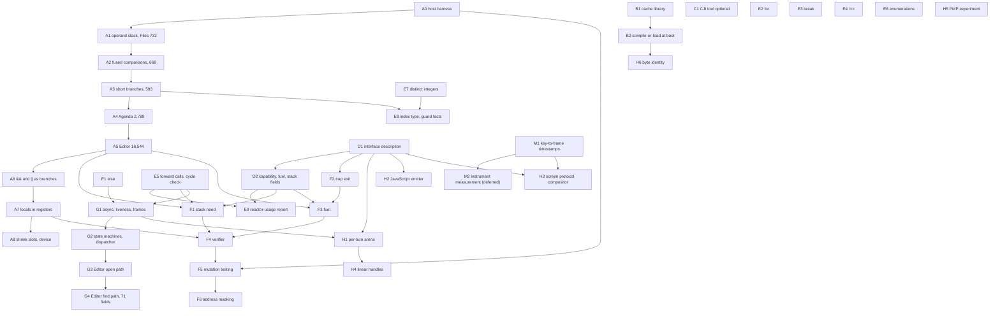

# Implementation plan: orientation, task index, dependencies and device qualification

This document is the entry point to the implementation plan for the next stage of the typed-JavaScript compiler on the PicoCalc. It defines the terms the plan uses, states the two decisions that shape the order of work, lists all 41 tasks with their dependencies, describes how a task is accepted on the workstation and qualified on the handheld, and names the one measurement that has to wait for an external instrument. The task descriptions themselves are in seven further documents, one per scope. A reader who finishes this document should be able to pick any task whose dependencies are done, open its scope document, and start.

The plan implements the roadmap of Article 10 of the special issue kept in `ttmp/2026/11/19/PICOCALC-COMPILER-ISSUE--*/sources/issue/`. The articles give the reasons for each technique and the literature behind it. This plan does not repeat those arguments. It turns them into steps, names the files and functions to change, and attaches to every step a check with a number that can fail.

## 1. The system in eight terms

The plan uses a small vocabulary. Each term is defined here once, in the order in which the definitions depend on one another, with the file in which the thing can be seen.

A **world** is one scheduled program. The kernel, called the **nucleus** (`picocalc-os/nucleus/kernel.c`), keeps a list of worlds from a manifest such as `picocalc-os/js/system.json`, delivers events to them one at a time, and accounts for each world's memory and processor time. Editor, Files, Agenda, the keyboard driver and the compositor that draws the screen are all worlds.

An **engine** is the mechanism that executes a world's code. There are three: QuickJS interprets JavaScript, WAMR interprets WebAssembly, and the native loader (`picocalc-os/port/esp32p4/optional/native_elf/native_elf_p4.c`) runs RV32 machine code from an ELF file. The manifest entry of a world names its engine (`"engine":"wasm"` or `"engine":"native"`).

A **turn** is the handling of one event by one world. The **turn budget** is the longest time a turn may take, given in the manifest as `budget_ms` (200 for the typed Editor). An engine that can count work, as WAMR does, ends an overrunning turn. The native loader can only notice an overrun after the handler has returned (`native_elf_p4.c`, line 248), which is the gap that Scope F closes.

The **typed compiler** is three JavaScript files in `picocalc-os/compiler/`. `typed-wasm.js` (671 lines) is the frontend: it tokenizes, parses and type-checks a source file in one pass and emits one WebAssembly function body per source function. `typed-rv32.js` (327 lines) is the RV32 backend: it translates each WebAssembly body to RV32 instructions and links the result. `typed-world.js` (69 lines) holds the contract between a complete typed application and the system. The compiler runs under Node on the workstation and under QuickJS on the device, from the same files.

A **reactor** is a prebuilt C module that sits between a compiled typed application and the nucleus. The shared reactor is `picocalc-os/sdk/typed/world.c` (508 lines). It owns the buffers and the state record, receives each event from the nucleus in `nw_on_event` (line 496), and calls the application's `typedWorldEvent`. In the other direction, the application calls the reactor's 28 functions, whose names begin with `typedSdk`. Files and Agenda still have reactors of their own in `picocalc-os/worlds/files/world.c` and `picocalc-os/worlds/agenda/wasm-world.c`.

The **slot** is the place where the compiled application is put inside the reactor. For WebAssembly it is two placeholder functions (`picocalc-os/sdk/typed/wasm-slot.c`) whose bodies the linker replaces. For RV32 it is a reserved area in the reactor's code segment, declared in `picocalc-os/sdk/typed/rv32-slot.S`: a 20-byte header with three magic words, the slot's size and a count word; one entry stub per application entry point (`typedWorldMeta`, `typedWorldEvent`); 28 trampolines; and empty space up to 229,376 bytes. The function `linkSlot` in `typed-rv32.js` (line 263) finds the header in the reactor ELF, checks it, copies the application's code in after the trampolines and patches the stubs.

A **trampoline** is one unconditional jump instruction to one reactor function. Line 20 of `rv32-slot.S` is `j typedSdkScreen`, line 21 is `j typedSdkBuffer`, and so on for 28 lines. Compiled code calls reactor function number *k* by a `jal` to the *k*-th trampoline. The numbering comes from the order of the table in `typed-world.js` (lines 11 to 40), so the two files must list the functions in the same order. Scope D replaces the two hand-written lists by one generated source.

The **operand stack** is the place where WebAssembly keeps intermediate values. `local.get b` pushes the value of `b`, `i32.add` pops two values and pushes their sum. The backend of today gives every operand-stack position a 4-byte place in the function's frame and emits a store for every push and a load for every pop (`push` and `pop` in `typed-rv32.js`, lines 66 to 74). A **compile-time operand stack** is a list inside the compiler that records, for each position, where the value is at this point of the translation: a constant not yet loaded, a local not yet read, a register, or a comparison not yet computed. A **flush** is the step that turns every such pending entry into a value in its agreed register before control flow splits or merges, so that the code after a join finds each value in the same place on every path. Scope A builds this.

One concrete instance ties the terms together. When the `e` key is pressed, the keyboard world publishes a key event. The nucleus starts a turn of the Editor world. With the native engine, the loader calls the reactor's `nw_on_event`; the reactor fills the four-field event record and calls the entry stub `typedWorldEvent` in the slot, which is a jump to the compiled function of that name. That function calls, among others, `typedSdkBuffer(0)` by jumping to the second trampoline and from there into `world.c`. It writes a description of the screen into the output buffer, calls `typedSdkScreen` through the first trampoline, and returns. The loader compares the elapsed time with the turn budget. The compositor world then draws the frame.

## 2. Two decisions that shape the plan

The project owner has made two decisions, and the plan is built on them.

**Native RV32 code is assumed worth having.** Article 10 placed a measurement of the path from key press to pixels before the backend work, as a gate. That gate is removed. The better backend of Scope A proceeds unconditionally and is the first scope. The measurement remains in the plan as task M1, an ordinary task that uses kernel timestamps logged over the serial console, and as M2, the only deferred task.

**The handheld is available; a logic analyzer is not.** Every task is first accepted on the workstation, with Node, the host simulator `picocalc-os/build/picocalc-host` and the RV32 emulator of the CJI tree. Where the result on the device matters, the task then has a device qualification step with predicted numbers. Only one thing needs an instrument that is not at hand: the time from a key press to visibly changed pixels on the LCD. Section 7 lists exactly what to run when a logic analyzer or a high-speed camera is available.

## 3. Reading order

Read in this order before starting any task.

1. Sections 1 to 6 of this document.
2. Article 5 of the issue (`sources/issue/05-code-generation-for-a-stack-machine-on-a-register-machine.md`), sections 5.2, 5.5, 5.6 and 5.8, then `picocalc-os/compiler/typed-rv32.js` from top to bottom. The file is short, and Scope A rewrites its middle third.
3. The scope document of the task you are taking. Each begins with the foundations for that scope and then describes its tasks.
4. The article section named in the task's "Where to look" list.

The scope documents are:

| Document | Scope | Tasks |
| --- | --- | --- |
| `02-scope-a-...` | A. RV32 backend with a compile-time operand stack | A0 to A8 |
| `03-scopes-b-and-c-...` | B. Module cache. C. CJI tool out of the default profile | B1, B2, C1 |
| `04-scope-d-...` | D. One interface description for the reactor functions | D1, D2 |
| `05-scope-e-...` | E. Language additions | E1 to E9 |
| `06-scope-f-...` | F. Stack bound, trap exit, fuel, verifier | F1 to F6 |
| `07-scope-g-...` | G. `await` as start and resume state machines | G1 to G4 |
| `08-scopes-m-and-h-...` | M. Key-to-frame measurement. H. Later items | M1, M2, H1 to H6 |

## 4. How a task is described

Every task has the same parts, so that a reader can find a given kind of information in the same place each time.

- **Goal.** One sentence.
- **Where to look.** Files, functions and line regions to read first, and the article section and literature reference for the technique. Line numbers refer to the repository at commit `dd69a81`.
- **Files and functions to change.**
- **Core algorithm.** Pseudocode.
- **Steps.** Numbered.
- **Worked example.** A small input and the expected output. Listings marked *emitted today* were produced by running the compiler; listings marked *target* are derived from the rules of the task and are what the implementation must produce or beat.
- **Acceptance on the host.** Exact commands and expected numbers.
- **Device qualification**, where it matters, with predictions.
- **What a wrong implementation looks like**, and which check catches it.
- **Dependencies, size and risks.** Size S is up to two days, M is up to two weeks, L is more.

Commands in all documents assume these shell variables, set from the repository root.

```sh
GCC=~/.espressif/tools/riscv32-esp-elf/esp-14.2.0_20260121/riscv32-esp-elf/bin/riscv32-esp-elf-gcc
OBJDUMP=${GCC%gcc}objdump
EMU=$(realpath cji)/build/rv32/rv32emu
ISSUE=$(ls -d ttmp/2026/11/19/PICOCALC-COMPILER-ISSUE--*)
NEXT=$(ls -d ttmp/2026/11/19/PICOCALC-NATIVE-NEXT--*)
```

## 5. The host acceptance baseline

Three checks recur in almost every task. They exist today and pass today.

**The replays.** `$NEXT/scripts/01-run-host-replays.sh "$GCC" "$EMU"` runs the 24 existing host checks of the three typed applications and prints one line per check. They are the scripts that earlier tickets wrote: for Files, a WebAssembly replay in the host simulator and an RV32 run in the emulator; for Agenda, seven checks including 3,924 token and date combinations compared across both targets; for Editor, the empty view, the layout vectors, and thirteen workflows of `02-check-editor-world.mjs` (default, `--large`, `--edit`, `--positions`, `--find`, `--markdown`, `--preview-large`, `--preview-line`, `--preview-inline`, `--preview-dense-inline`, `--dense-search`, `--tail-search`, `--late-navigation`). Each Editor workflow runs the JavaScript original and the WebAssembly build in the host simulator, compares their frames and framebuffer captures, then runs the RV32 build in the emulator and compares its frames with the original's. The output recorded on 2026-11-19 is `$NEXT/various/01-host-replays-baseline.txt`: 24 lines beginning `PASS`, exit status 0. When this plan says "all replays pass", it means this command exits with status 0.

**The instruction count.** `node $ISSUE/scripts/01-rv32-instruction-mix.mjs` classifies every emitted RV32 instruction. Today it reports 1,529 instructions for Files, 7,710 for Agenda and 43,965 for Editor.

**The model.** `node $ISSUE/scripts/03-register-cache-model.mjs` walks the same WebAssembly and counts what better rules would emit. `STAGE=n node $NEXT/scripts/02-staged-register-model.mjs` is the same script with three switches, so that each step of Scope A has its own predicted number. Its output is in `$NEXT/various/02-staged-register-model.txt`.

| | Emitted today | Stage 1: stack in registers, lazy constants and locals | Stage 2: comparisons fused into branches | Stage 3: short branches (model A) | Model B: locals in registers |
| --- | ---: | ---: | ---: | ---: | ---: |
| Files (7 functions) | 1,529 | 732 | 668 | 593 | 470 |
| Agenda (34 functions) | 7,710 | 3,313 | 3,047 | 2,789 | 2,418 |
| Editor (120 functions) | 43,965 | 18,909 | 17,544 | 16,544 | 13,255 |

Two further host tools are built by task A0 and used from then on: a small RV32 interpreter in JavaScript for differential tests of single functions, and a script that compares the emitted instruction count of each function with the model.

## 6. Device qualification

A device qualification step repeats, for a changed build, the procedure that the tickets of 18 and 19 November used. Its parts are fixed, and each produces a line or a file that is kept in the ticket's `various/` directory.

1. **Paired builds.** Build two firmware images from the same tree and the same `sdkconfig`, one with the WebAssembly engine and one with the native engine for the application under test. `ttmp/2026/11/18/PICOCALC-TYPED-WORLDS*/scripts/03-build-editor-firmware.sh IDF_EXPORT BUILD_DIR SDKCONFIG wasm|rv32 OUTPUT_DIR` does this for Editor and checks the bundle contents. Task C1 changes the options this script passes.
2. **Flash and boot receipts.** `ttmp/2026/11/18/PICOCALC-TYPED-WORLDS*/scripts/04-qualify-editor-on-p4.py --port ... --images ... --output ... --esptool-python ... --esptool ... --backup ...` flashes each image, reboots, and reads the serial console. The compile receipt is the line `editor compile source=bundle status=ok us=N peak_js_bytes=N module_bytes=N`, printed by `p4_typed_compile` (`picocalc-os/port/esp32p4/main/typed_p4.c`, line 133). The load receipt is `boot-world name=editor engine=E first_us=N total_us=N`.
3. **World memory at boot.** The console command `worlds` prints one JSON object per world; `mem_kb` and `limit_kb` of the application are recorded.
4. **Workflow with captures.** The script types a fixed workflow through the console commands `key` and `type`, takes framebuffer captures with `shot`, which are sent over UART with a CRC, and requires `crc ok` for each. File contents are checked with `cat` and `ls`.
5. **Bus health.** The command `stats` prints a line per bus. The step fails unless `i2c0` and `spi2` both show transfers and zero errors.
6. **Repeated trials in alternating order.** Where a time is compared between two builds, each build is flashed and measured at least three times in the order wasm, rv32, rv32, wasm, wasm, rv32, and the median is reported. `ttmp/2026/11/18/PICOCALC-AGENDA-COMPILER*/scripts/12-measure-matched-targets.py` is the existing script for repeated trials with medians; the alternating order is added by this plan so that a drift over time does not favour one build.

The reference numbers for Editor, from `ttmp/2026/11/19/PICOCALC-EDITOR-INLINE*/various/p4-inline-builds.json` and `p4-editor-worlds-at-boot.json`, are these.

| Editor on the device, today | WebAssembly | Native RV32 |
| --- | ---: | ---: |
| Compile time at boot | 1.99 s | 3.14 to 3.17 s |
| Compiler peak memory (`peak_js_bytes`) | 1,470,268 | 2,454,960 |
| Module size (`module_bytes`) | 88,255 | 240,452 |
| Loader time | 175.6 ms | 14.1 ms |
| World memory after boot (`mem_kb` of 768) | 528.0 | 710.1 |
| CPU time of the first turn | 177.8 ms | 14.6 ms |

The plan's device predictions are collected here. Each is repeated in its task.

| Task | Prediction on the device | Fails if |
| --- | --- | --- |
| A8 | Editor native `module_bytes` is 92,996 with the slot reduced to 81,920 bytes | the receipt differs from the host's `elfBytes` for the same tree, or exceeds 93,100 |
| A8 | Editor native `mem_kb` after boot is at most 570.0 (today 710.1) | above 570.0 |
| A8 | Editor native compile time is at most 3.17 s and `peak_js_bytes` at most 2,454,960 | either is higher than today |
| B2 | With a warm cache, no `editor compile` line appears at boot and the cache-hit line reports under 100,000 µs | a compile line appears, or the time is 100 ms or more |
| B2 | After the cached module is damaged by one byte, the boot prints a verification failure, recompiles once, and the following boot is a hit | the damaged module is loaded, or the next boot compiles again |
| C1 | The qualification image contains no `natives/compiler.elf` and is at least 600,000 bytes smaller than the same build with the option on | the payload is present |
| F3 | A fixture world with an endless loop ends its turn with a fault and the other worlds keep running; Editor's CPU time per turn rises by less than 5 percent | the board stalls or reboots, or the cost is higher |
| G4 | Editor rewritten with `await` passes the device workflow with identical capture hashes on both engines and has at most 71 state fields | captures differ or the count exceeds 71 |
| M1 | For one key press in the native Editor, the application's turn is under 10 percent of the interval from keyboard read to end of display transfer | 10 percent or more |

## 7. Deferred until an instrument is available

One task cannot be done with the equipment at hand.

**M2. Key press to visibly changed pixels.** Task M1 measures every interval that the kernel can timestamp, from the keyboard bus read that returns the key to the end of the SPI transfer that sends the frame. Two intervals lie outside what the processor can see: the time from the physical key closing to the keyboard controller reporting it on I2C, and the time from the end of the SPI transfer to the liquid crystal changing. Measuring them needs one of two instruments.

With a logic analyzer of at least 1 MHz sample rate:

1. Build the firmware of task M1 with the option that additionally toggles a spare GPIO at the four timestamp sites (M1 adds this option, off by default).
2. Connect channel 0 to the keyboard matrix column of the test key, channel 1 to the I2C SDA line of the keyboard controller, channel 2 to the spare GPIO, channel 3 to the display chip-select.
3. Press the test key 30 times in the native Editor with a document open. For each press record: matrix edge to first I2C read that returns the key; that read to the GPIO edge of frame publication; frame publication to chip-select release.
4. Report the median and the 95th percentile of each interval and of the sum. Compare the kernel-timestamp intervals of M1 for the same presses with the analyzer's; they should agree within 100 µs. If they do not, the M1 timestamps are misplaced.

With a high-speed camera of at least 240 frames per second:

1. Film the keyboard and the screen together while pressing a key that inserts a visible character, 30 times.
2. Count frames from the key reaching the bottom of its travel to the first frame in which the character is visible. One frame is 4.2 ms at 240 frames per second, so the result has that resolution.
3. Report the median. Subtract the M1 interval to obtain the sum of the two intervals the kernel cannot see.

The result decides only one later item: whether the typed screen protocol and compositor (H3) are worth their cost. Nothing in Scopes A to G waits for it.

## 8. Task index

The table lists every task in the order in which the work is planned. Sizes: S up to two days, M up to two weeks, L more. The table has 41 rows: 9 in A, 2 in B, 1 in C, 2 in D, 9 in E, 6 in F, 4 in G, 2 in M and 6 in H.

| Id | Goal | Size | Depends on |
| --- | --- | --- | --- |
| A0 | Host harness: staged model, per-function count check, RV32 interpreter for differential unit tests | S | none |
| A1 | New lowering with a compile-time operand stack, lazy constants and locals; Files at 732 instructions | M | A0 |
| A2 | Pending comparisons fused into branches; Files at 668 | S | A1 |
| A3 | Short branches with fix-up; Files at 593 | S | A2 |
| A4 | Agenda on the new lowering at 2,789 | S | A3 |
| A5 | Editor on the new lowering at 16,544, with spills for deep stacks | M | A4 |
| A6 | Frontend compiles `&&` and `\|\|` in conditions to branches | S | A5 |
| A7 | Locals in registers; 470, 2,418 and 13,255 | M | A6 |
| A8 | Remove the old lowering, shrink the slots, qualify on the device | S | A7 |
| B1 | Cache library: content key, module before record, hash check on load | M | none |
| B2 | Compile-or-load at boot for the three typed applications; device timing | M | B1 |
| C1 | CJI compiler tool out of the default qualification profile | S | none |
| D1 | Interface description generating the import table, the trampolines and the C declarations; drift check | S | none |
| D2 | Capability, fuel charge and stack use recorded per reactor function | S | D1 |
| E1 | `else` | S | none |
| E2 | `for` | S | none |
| E3 | `break` | S | none |
| E4 | `!==` | S | none |
| E5 | Calls to functions defined later, with an explicit cycle check | S | none |
| E6 | Enumerations with exhaustive `match` | S | none |
| E7 | Distinct integer types | S | none |
| E8 | Unsigned `index` type and guard facts that remove bounds checks | M | A3, E7 |
| E9 | Per-world reactor-usage report checked against manifest claims | S | D2, E5 |
| F1 | Static stack need per function and per program | S | A5, D2, E5 |
| F2 | Controlled trap exit for native typed code | S | D1 |
| F3 | Fuel counter at loop back-edges with reactor-call charges | M | A5, D2, F2 |
| F4 | Verifier over emitted RV32: decode, control, stack, time and pattern checks | M | A7, F1, F3 |
| F5 | Mutation testing of the verifier | S | A0, F4 |
| F6 | Address masking and its verifier check (later, separate) | M | F5 |
| G1 | `async` and `await`: statement tree, liveness, the rule for strings and buffers, frame layout | M | E1, E5 |
| G2 | State machine generation, `start`, `resume`, `pending`, `cancel` and the dispatcher | L | G1 |
| G3 | Editor's open path rewritten with `await` | M | G2 |
| G4 | Editor's find path rewritten with `await`; at most 71 state fields; device qualification | M | G3 |
| M1 | Key-to-frame intervals from kernel timestamps over serial | S | none |
| M2 | Key press to visible pixels with an instrument (deferred) | S | M1 |
| H1 | Per-turn arena with its two lifetime rules | M | G1, D1 |
| H2 | JavaScript emitter and reactor shim | M | D1 |
| H3 | Typed screen protocol and typed compositor | L | D1, M1 |
| H4 | Linear handles, then typestate | L | H1 |
| H5 | PMP and user-mode experiment | M | none |
| H6 | Workstation and device builds give identical bytes | S | B2 |



An arrow means that the later task needs the earlier one. Tasks with no arrow into them can start at any time. Scope A is a single chain because each step is measured against the step before. B1, C1, D1, E1 to E7 and M1 are independent of Scope A and of one another, and a second person can take them in parallel.

## 9. Rules that hold for every task

- **The replays decide.** A task is not done while `01-run-host-replays.sh` reports a failure, whatever its own acceptance check says.
- **Both targets stay equal.** A change to the frontend changes WebAssembly and RV32 output together. The replays compare the two against the JavaScript original, and that comparison is the definition of correct behaviour until H2 exists.
- **The compiler must still run in a bare QuickJS realm.** `typed-wasm.js` and `typed-rv32.js` use no Node API, no clock and no randomness, and `p4_typed_compile` limits the compile to a heap and a duration. New compiler code keeps to plain ECMAScript. `$ISSUE/scripts/04-compile-phase-timing.sh` runs the compiler under QuickJS on the workstation and is the check for this.
- **Predictions are recorded before the result.** Each task's diary entry states the predicted number from this plan, then the measured one. A prediction that fails is reported as a finding, with the per-function table that shows where it failed.
- **Each task leaves a script and an output.** The script goes to `$NEXT/scripts/` with the next free two-digit prefix, and its output goes to `$NEXT/various/`, as the earlier tickets do.

## 10. Where the analysis had to be completed

The articles argue for each technique and leave some decisions open. Turning them into tasks required facts from the repository and choices that the articles do not make. They are listed here so that a reader knows which parts of the plan rest on the issue and which on this document, and so that the project owner can overrule a choice before work starts.

| Topic | What the analysis says | What the repository shows, and what this plan decided | Task |
| --- | --- | --- | --- |
| Intermediate predictions | One number per application for model A and model B | The steps of Scope A need their own numbers. A three-switch variant of the model (`scripts/02-staged-register-model.mjs`) gives 732 and 668 for Files before 593. The tolerances of 5 and 10 percent are this plan's. | A1 to A7 |
| Register assignment | "Assume a free temporary is always available"; a leaf keeps 10 locals in registers | Registers are tied to stack depth (five), with frame slots beyond; a leaf keeps 8 locals. Both raise the count slightly. | A1, A7 |
| Pending read before assignment | A rule the backend must obey | It never occurs in today's sources (0 of 161 functions), so its test is hand-written WebAssembly. | A1 |
| `&&` and `\|\|` as branches | "No 0 or 1 is ever produced" | 279 of the 358 operators stand in conditions (measured with an instrumented copy of the frontend). The predicted saving uses the minimum of 2 instructions per operator. | A6 |
| Memory gained by smaller code | Editor's native code would shrink by 107 to 120 KiB | The slot is a fixed 229,376-byte reservation charged to the world in full. Nothing is gained on the device until the reservation is reduced. | A8 |
| CJI tool "on the device" | Take it off the device | The CMake option already defaults to off. The typed tickets' build scripts turn it on. The 660 kB figure has not been re-measured. | C1 |
| Function-table input of the cache key | A fifth input | It is contained in the compiler bundle and the reactor today; it becomes separately hashable after D1. Storage location and hashing cost are open. | B1, B2 |
| Capabilities of reactor functions | "Which capability the function requires" | No list exists. None of the 28 functions needs a manifest claim; Editor has no claims and works on passed handles. Six classes are proposed. The "missing claim" check has no real instance. | D2, E9 |
| Enumeration values from numbers | Not addressed | No conversion from `i32` is provided; a number outside the enumeration traps in `match`. | E6 |
| Bounds checks removed by guards | "Most of these checks are redundant, and visibly so" | 10 of 66 loops have the guard `i < s.length`; three are in Editor. The prediction is at most 3 of Editor's 376 trap sites. | E8 |
| A trap ends the handler | Stated as a property of every engine | Native code traps with `ebreak`, and nothing in the native loader recovers from it. A trap exit is added as its own task, before fuel. | F2 |
| "The world's stack" | The stack need must fit it | A native world runs on the kernel task's 80 KiB stack and has none of its own. A limit of 8,192 bytes is chosen; kernel frames below a reactor call are not covered. | F1 |
| Fuel and the turn budget | 20 million units for 200 ms, as an example | The constant is taken from the example. Its relation to milliseconds is not measured, and it is not derived from the manifest's `budget_ms`. A span charge must be clamped at zero, which the article does not mention. | F3 |
| Verifier and removed checks | Pattern checking accepts an access only inside its check sequence | That rejects code from which E8 removed a check. Until address masking exists, untrusted source is compiled without guard facts. | F4, E8 |
| "Can do no harm when run" | The criterion for an accepted mutant | No way of observing harm is given. A policy mode of the test interpreter defines it; its coverage is the fixture inputs. | F5 |
| Address masking | `address = base + (address AND mask)` | Typed code holds absolute pointers, so the region must be aligned to its size and the high bits replaced. Whether the ELF loader can place a module so is unknown. | F6 |
| `await` | The transformation for one function | Open in the article: how a task is started and cancelled, where frames are stored, how buffers are supplied after a wait, what a failed request yields. Section G.2 decides all four. | G1, G2 |
| 71 state fields | A prediction | The search positions are both continuation state and state the view reads; saving them in a frame as well may exceed 71. The plan says what to report then. | G4 |
| Timestamps for a key press | Keyboard interrupt, dispatch, frame publication, end of the display transfer | The keyboard is polled over I2C by a world. The first stamp is the end of the I2C read that returns the key. | M1 |

## 11. Key points

- The plan has 41 tasks in nine scopes. Scope A, the RV32 backend, is first and unconditional.
- Every task has a host check with a number. The 24 existing replays must pass after every task.
- The device is used for qualification with paired builds, console receipts and CRC-checked captures. Nine device predictions are listed in section 6.
- One task, M2, waits for a logic analyzer or a high-speed camera. Section 7 says what to run then.
