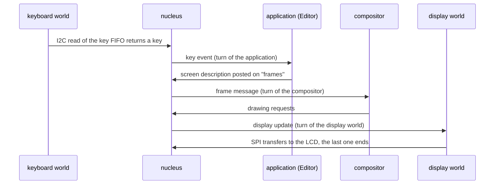

# Scopes M and H: the key-to-frame measurement and later items

This document has two parts. Scope M is the measurement that Article 2 calls the most important missing fact: how long the system takes from a key press to changed pixels, and how that time divides among the worlds. M1 measures everything the kernel can timestamp and is an ordinary task. M2 measures the two intervals outside the processor's view and waits for an instrument. Scope H lists six later items as short entries, so that their place in the order and their first step are on record.

The project owner has decided that the RV32 backend of Scope A proceeds without waiting for this measurement. The measurement still matters, for a different decision: whether the typed screen protocol and compositor (H3) are worth building.

## M.1 The path of one key press

A key press crosses five worlds, and each hand-over is a message through the nucleus.



The drivers are worlds like any other. The keyboard world polls the keyboard controller over I2C; its bus requests are carried out by `i2c_worker` in `picocalc-os/port/esp32p4/main/bus_p4.c` (line 92), which already records a start and an end time for every request (lines 98 and 36). The display world's transfers are carried out by `spi_worker` (line 222), which does the same (line 226). The nucleus starts each turn in `picocalc-os/nucleus/kernel.c` (line 691, where `K.cur` is set and the segment's cost is reset) and already logs per-turn costs when `K.trace` is on (lines 702 and 729; the console command `trace on` sets it, `main_p4.c` line 173). A world's screen is its retained post on the topic `frames` (`kernel.c`, line 281).

Every timing the project has recorded ends when the nucleus accepts a screen description, or earlier (Article 2, section 2.1). The four stages after that point have never been timed together.

---

## Task M1: key-to-frame intervals from kernel timestamps

**Goal.** Log, for single key presses on the device, the time of each stage from the keyboard read that returns the key to the end of the last display transfer, and the processor time each world spends, using only timestamps the firmware can take.

**Where to look.**
- `bus_p4.c`: `i2c_worker` (from line 92), in particular the read of `KBD_REG_FIF` at line 104, which is the request that returns a key; `spi_worker` (from line 222); the request record with `t0`, `t1` and `bytes` (line 36).
- `kernel.c`: the start of a segment (line 691), the end-of-turn accounting (lines 745 to 766), the existing trace lines (702, 729), message delivery (`run_deliver`, line 240), and the `frames` topic (line 281).
- `native_elf_p4.c`, line 247, and `nucleus/native_wasm.c`, line 229: the per-turn trace lines of the two compiled engines.
- `main_p4.c`, lines 131 to 174: the console commands, among them `key NAME`, `trace` and `stats`.
- Article 2, sections 2.1, 2.2 and 2.6: what is unmeasured, and the rough model that puts application code at about 4 percent of the measured part of a key press as native code and 20 percent as WebAssembly.

**Files to change.** `picocalc-os/nucleus/kernel.c` and `nucleus.h`: a key-trace record and its console output. `bus_p4.c`: two stamps. `main_p4.c`: a console command `keytrace on|off|show`. `picocalc-os/host/` needs no change beyond what the nucleus provides. New `$NEXT/scripts/15-measure-key-to-frame.py`, in the style of `ttmp/2026/11/18/PICOCALC-AGENDA-COMPILER*/scripts/10-measure-agenda-boot.py`.

**Core algorithm.**

```
record for one key press (filled only while keytrace is on; one record at a time):
    t_key      end time of the I2C request that returned a key          (bus_p4.c, device only)
    per turn, in order, until the display goes idle:
        world name, start time, end time, cause (message type)           (kernel.c)
    t_frame    time at which the application's post on "frames" was accepted
    t_spi_end  end time of the last SPI request before the SPI queue stays empty for 20 ms   (bus_p4.c)
    spi_bytes  bytes sent to the LCD for this key press

when the record is complete, print one line per stage:
    kt key=<name> stage=<n> world=<w> start_us=<relative to t_key> dur_us=<n> cause=<type>
    kt key=<name> frame_us=<n> spi_end_us=<n> spi_bytes=<n> worlds_cpu_us=<sum> idle_us=<total - sum>

the measuring script, per build:
    send 30 key presses through the console command `key`, 700 ms apart, with a document open in Editor
    parse the kt lines; report the median and the 95th percentile of: key to application turn start,
    application turn, frame to compositor turn end, compositor turn end to spi end, and the total;
    and the share of the total spent in each world
```

A key injected with the console command enters at the keyboard world's FIFO read (`inj_pop`, line 104), so it exercises the same path as a physical key from that point on.

**Steps.**
1. Add the record and the turn stamps to the nucleus. They run in the host simulator too, with the simulator's virtual clock.
2. Add the two device stamps in the bus workers.
3. Add the console command.
4. Write the measuring script. It flashes nothing; it drives a running device over the serial port.
5. Measure the paired Editor builds, WebAssembly and native, three runs each in alternating order.

**Worked example.** The expected shape of the output for one key press in the native Editor. The numbers are placeholders that show the format, not predictions.

```
kt key=a stage=1 world=keyboard   start_us=120   dur_us=310   cause=timer
kt key=a stage=2 world=editor     start_us=520   dur_us=1600  cause=key
kt key=a stage=3 world=compositor start_us=2300  dur_us=14800 cause=frames
kt key=a stage=4 world=display    start_us=17400 dur_us=900   cause=draw
kt key=a frame_us=2110 spi_end_us=41200 spi_bytes=30720 worlds_cpu_us=17610 idle_us=23590
```

**Acceptance on the host.**
- `picocalc-os/build/picocalc-host` with a script that turns the trace on and types one key prints, in `uart.log`, one `stage` line for each of the keyboard, the application and the compositor in that order, with non-decreasing `start_us`, and a summary line whose `worlds_cpu_us` equals the sum of the `dur_us` values. A new check, `$NEXT/scripts/15-check-keytrace-host.mjs`, asserts this for Editor as JavaScript and as WebAssembly.
- With the trace off, `uart.log` of every replay is unchanged: all replays pass.
- The record adds no allocation to the turn path; `make SAN=1` builds and the check passes under the sanitizers.

**Device qualification.** This task is mostly device work.

| Receipt | Prediction | Fails if |
| --- | --- | --- |
| 30 key presses, native Editor | 30 complete records, each with `spi_end_us` present | fewer than 30 complete |
| Share of the application's turn in the total (key read to SPI end), native | under 10 percent (Article 10, section 10.7; the rough model gives about 4 percent of the measured part) | 10 percent or more |
| The same share, WebAssembly | higher than native; the rough model gives about 20 percent of the measured part | lower than native |
| Bus health during the run (`stats`) | 0 errors on `i2c0` and `spi2` | any error |
| Editor CPU per turn with `keytrace off` | within 2 percent of the build without the trace code | more |

Report, besides these, which world has the largest share. Article 2 expects the compositor. If the application's share is 10 percent or more, Article 10 says to raise the priority of the backend work for that application; under the owner's decision that work is already first, so the finding changes nothing in Scopes A to G and is recorded for H3.

**What a wrong implementation looks like.** Taking `t_spi_end` from the first SPI request after the compositor's turn measures the start of the screen update and not its end; a full-screen update is many transfers. The total then comes out several times too small and the application's share too large. The summary line's `spi_bytes` is the check: a full Editor screen is 320 by 320 pixels at 16 bits, 204,800 bytes, and a partial update is a known fraction of that; a record that reports a few bytes has stopped at the first command.

**Dependencies.** None. **Size.** S. **Risks.** The articles describe the measurement as "kernel timestamps at keyboard interrupt, key dispatch, frame publication and end of the display transfer". On this device the keyboard is polled over I2C by a world, so there is no keyboard interrupt to stamp; the earliest observable instant is the end of the I2C read that returns the key, and the polling interval before it is invisible to M1. That interval and the LCD's own response are what M2 adds.

---

## Task M2: key press to visible pixels (deferred)

**Goal.** Measure the two intervals that lie outside the processor's view: from the physical key closing to the I2C read that reports it, and from the end of the SPI transfer to the pixels changing.

This is the only deferred task of the plan. It needs a logic analyzer or a high-speed camera. Section 7 of the orientation document (`01-implementation-plan-...`) gives the complete procedure for both instruments, the 30-press protocol, and the agreement check between the analyzer and M1's timestamps. M1 adds a build option, off by default, that toggles a spare GPIO at its four stamp sites, so that M2 needs no further firmware work.

**Dependencies.** M1. **Size.** S.

---

## Scope H: later items

These six items come after Scopes A to G. Each entry states the goal, the evidence that motivates it, the first step, how it would be accepted, and what it depends on.

### H1. Per-turn arena

**Goal.** Let typed code allocate memory that lives for one turn, with two rules that keep it safe: a reference into the arena may not be stored in the state record, and may not be live across a wait.
**Why.** The typed language cannot allocate; Agenda's sorted and grouped task list is 869 lines of C in its reactor for that reason (Article 9, section 9.5; Article 10, section 10.1).
**First step.** Add a reactor function that returns the arena's base and size and a reset in `nw_on_event`; add a `turn` lifetime attribute to reference types in `typed-wasm.js`; reuse G1's liveness for the second rule.
**Acceptance.** A fixture that builds and sorts a list in the arena on both targets; rejected programs for both rules; allocation costs at most 5 instructions in the register lowering; Agenda's grouping moved from C to typed source with all Agenda checks passing.
**Depends on.** G1, D1. **Size.** M.

### H2. JavaScript emitter and reactor shim

**Goal.** A third backend that emits JavaScript with the typed language's semantics (`(a + b) | 0`, `Math.imul`, checked division, checked `charCodeAt`), and a JavaScript implementation of the 28 reactor functions, so that QuickJS can run the typed source.
**Why.** Every ported application exists twice, and the replays depend on the hand-written JavaScript original as the reference (Article 10, section 10.4).
**First step.** Emit JavaScript from the WebAssembly bodies or directly from the frontend for the differential fixtures of A0, and add it as a third column to `04-check-functions-differential.mjs`.
**Acceptance.** All differential fixtures agree across three backends; the Editor replays pass with the emitted JavaScript in place of `js/apps/editor.js`.
**Depends on.** D1. **Size.** M.

### H3. Typed screen protocol and typed compositor

**Goal.** Replace the JSON screen description by record layouts that the application writes and the compositor reads at fixed offsets, and write the compositor in the typed language.
**Why.** Editor contains 104 `writeLiteral` calls that format JSON, the reactor converts and escapes it, and the compositor parses it into garbage-collected objects (Article 10, section 10.3). A full Editor screen as records is 1,734 bytes.
**First step.** None until M1 has reported. Start only if the compositor's share of a key press in M1 is the largest of any world.
**Acceptance.** To be written from M1's numbers: a predicted reduction of the compositor's turn time, checked with M1's script.
**Depends on.** D1, M1. **Size.** L.

### H4. Linear handles, then typestate

**Goal.** Make "a grant must be revoked, sent or stored exactly once on every path" a compile-time property.
**Why.** The exchange of a file between Agenda and Editor is a list of obligations enforced by careful code and tests (Article 9, section 9.6).
**First step.** A linear attribute on a handle type and the single-pass check that both branches of an `if` consume the same set.
**Acceptance.** Rejected programs for a leaked and a doubly released handle; Editor's handle paths annotated with no change to generated code.
**Depends on.** H1. **Size.** L.

### H5. PMP and user-mode experiment

**Goal.** Find out whether a world's native code can run in user mode under the processor's physical memory protection, and what a trap into the reactor costs.
**Why.** It would confine native code from any compiler, including CJI's output, which no pattern verifier can check (Article 7, section 7.7). The firmware already uses PMP to split code from data (`CONFIG_ESP_SYSTEM_PMP_IDRAM_SPLIT=y` in `picocalc-os/port/esp32p4/sdkconfig`, line 1368).
**First step.** A standalone firmware experiment: count the free PMP entries, drop to user mode for one function, measure the round trip of a trap.
**Acceptance.** Three numbers: free entries, trap round-trip time in microseconds, and whether ESP-IDF's interrupt handling tolerates user-mode code on the kernel's core.
**Depends on.** Nothing. **Size.** M, with high risk.

### H6. Workstation and device builds give identical bytes

**Goal.** Show that the typed compiler under Node on the workstation and under QuickJS on the device produces byte-identical modules, so that bundled applications can be shipped precompiled with their cache keys.
**Why.** The compiler uses no clock and no randomness, and the workstation harness already produces a module of the same size as the device's; equality of the bytes has not been checked (Article 6, section 6.7).
**First step.** On the host, compare the SHA-256 of the module from Node with the one from `$ISSUE/scripts/04-compile-phase-timing.sh`, which runs the same compiler under QuickJS. On the device, print the module's SHA-256 in the cache line of B2 and compare.
**Acceptance.** Three equal hashes per application and engine: Node, QuickJS on the workstation, QuickJS on the device.
**Depends on.** B2. **Size.** S.

## Key points of Scopes M and H

- A key press crosses the keyboard world, the application, the compositor and the display world. M1 stamps each turn and the two bus events at the ends, and reports each world's share.
- The keyboard is polled, so the earliest stamp is the I2C read that returns the key. What precedes it and what follows the last SPI transfer need an instrument and are task M2.
- M1's prediction is that the native application's turn is under 10 percent of the path. Its result decides H3 and nothing earlier.
- The six later items each have a first step and a dependency, and none of them blocks Scopes A to G.
