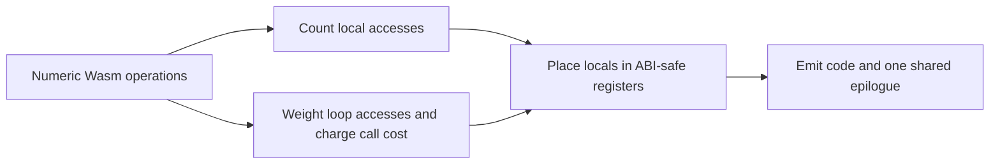

# What register homes save in a PicoCalc function

The PicoCalc typed compiler used to give every local a slot in the current function's stack frame. To perform `at = at + 1;`, the native program could load `at` into a register, add one, and store the result. Assigning `at` a register for the duration of the function lets the compiler name that register as both input and output. The loop then executes a single addition for the assignment.

Two policies implemented that change on top of the A6 compiler. They brought Editor from 15,954 instructions to **12,725 with use counts** and **12,748 with loop weights and call costs**. Both met the 14,581-instruction ceiling. Editor's static local loads fell from 5,367 to 486 or 758, while the candidates added 1,278 or 1,112 save and restore instructions for callee-saved register homes.

## Decide which register a local can keep

A leaf function makes no calls. PicoCalc's native ABI passes the first eight arguments in `a0` through `a7`. A leaf can keep a parameter in its incoming register for the body, and other locals can use unused argument registers. The same registers in a function that calls another function may change at the call. That function chooses from `s1` through `s11`, which the callee preserves. It saves the old contents of each register it claims and restores them on the way out. A branch from an early `return` reaches the same restoration code as a final return.



The use-count policy counts all local operations equally. The loop policy multiplies by eight within each enclosing loop, capped at three loops. When a function contains a call, it skips a candidate whose weighted count does not exceed the two instructions required to save and restore that home. This favors repeated work in a loop while sparing a save pair for a rarely accessed local. The estimate uses static loop structure and has no information about trip counts or branch frequencies. Both policies use the same ranking tie-break, register pools and code generation.

At an assignment to a register local, the lowerer can send the previous result directly to its final destination. In `bump`, the sum of two parameters goes directly into `a2`, and the update after the guard writes the same register. Both policies produce five instructions.

```text
add   a2, a0, a1
blez  a2, done
addi  a2, a2, 1
done:
mv    a0, a2
ret
```

The compiler sometimes has a reference to an old local value waiting for an enclosing expression to consume it. Overwriting the register first would change that value. A one-opcode lookahead allows a direct destination only when no older deferred read of the local exists. Otherwise the old read is copied to its operand home before the assignment. The deepest focused fixture needs to spill that saved value into the frame. A second ABI detail appears in signed division: the overflow-check code needs its own scratch register even when it is a leaf, so that function reserves `a7` if it divides. Its eighth parameter lives in the frame in that case.

## Account for loads, instruction words and frame size

An instrumented frame-only lane emitted the exact same native image, entry offsets and import relocations as the original A6 candidate. All lanes used the same Wasm frontend. Its local load and store counters give a comparable reference for the register lanes. A separate machine-word decoder counted all stack-based loads and stores. Those totals also include expression spills, return-address traffic and register saves.

| Workload | A6 words | Use-count words | Loop-weighted words | Ceiling |
| --- | ---: | ---: | ---: | ---: |
| Files | 516 | 395 | 392 | 517 |
| Agenda | 2,496 | 2,130 | 2,099 | 2,660 |
| Editor | 15,954 | 12,725 | 12,748 | 14,581 |

| Workload | A6 local loads | Use-count loads / save-restores | Loop-weighted loads / save-restores |
| --- | ---: | ---: | ---: |
| Files | 140 | 5 / 32 | 9 / 26 |
| Agenda | 751 | 32 / 312 | 56 / 274 |
| Editor | 5,367 | 486 / 1,278 | 758 / 1,112 |

A save and a restore each count as one instruction. Editor's frame-only compiler emitted 5,489 stack loads and 1,292 stack stores. The use-count policy emitted 1,246 and 988, and loop weighting emitted 1,434 and 987. The maximum individual Editor frame stayed at 192 bytes. Twenty-two functions in each candidate needed no frame. All native totals fell within ten percent of the historical model rerun on the A6 operations. The `countUnit` fixture produced 17 instructions. [Per-function code accounts and guest traces](../various/host-account.json)

One focused loop with a call executes 134 stack loads under A6. The use-count version executes 24 and the loop-weighted version executes 19 on the same input. The loop-weighted result still takes 237 total instructions against 234 for use counts in that example. The counters distinguish an instruction present in the image from one executed on a repeated path.

The native interpreter initialized callee-saved registers with sentinel values and checked them and the stack pointer after every return. An imported function deliberately clobbered caller-saved registers except its result. The checks compared returned values and observable memory with Wasm, including two signed-division traps. The original 24 application checks passed on each policy. [Use-count replay](../various/host-replays-uses.json) · [Loop-weighted replay](../various/host-replays-loops.json)

## Guest performance and cold compiler cost

The P4 compared A6 with both placement policies in one firmware. Each of the six blocks on each of two boots compiled Files, Agenda and Editor with all three policies. The order rotated within a boot. The device produced the matching host ELF hash on all 108 cold builds. The active normal-world lane was the loop-weighted candidate, which loaded successfully on both boots.

| Workload | Use-count cold change | Loop-weighted cold change | Use-count peak change | Loop-weighted peak change |
| --- | ---: | ---: | ---: | ---: |
| Files | +17.31 to +18.14 ms | +16.63 to +18.43 ms | +15,448 to +15,454 B | +15,452 to +15,464 B |
| Agenda | +53.49 to +57.54 ms | +54.55 to +55.68 ms | −37,172 to −37,170 B | −37,292 to −37,286 B |
| Editor | +199.16 to +200.57 ms | +213.09 to +216.94 ms | −196,812 to −196,806 B | −196,720 to −196,710 B |

The ranges are the two per-boot medians of paired comparisons with A6. Editor's A6 cold boot medians were 2.949 and 2.959 seconds. The use-count candidate took 3.149 and 3.158 seconds, and the loop-weighted candidate took 3.167 and 3.178 seconds. QuickJS peak allocation fell about 192 KiB in both Editor candidates. Files used about 15 KiB more during cold compilation.

The firmware timed three native kernels in checked batches of 128 calls at 360 MHz. For Editor, the fixture copies the app's exact instruction image into the firmware. Its native `editorFindMatch` entry can call only `editorFold` and issues no reactor import. The two inputs test a case-insensitive match or a mismatch on the last of 96 code units. Both exercise the entire scan. The receipt checks that the measured machine code appears byte for byte in the physical firmware and matches the independently counted app image.

| Native function | Use-count cycles reduction | Loop-weighted cycles reduction |
| --- | ---: | ---: |
| Files name comparison | 55.77% to 55.81% | 55.77% to 55.81% |
| Agenda weekday computation | 12.76% to 13.41% | 14.91% to 16.00% |
| Editor's 96-unit search match | 41.29% on both boots | 41.30% to 41.31% |

The Editor comparison used about 9,780 A6 cycles per call and about 5,740 cycles with either policy. The slow path loads each code unit and folds its case before comparing. The two policies allocate the hot loop locals in registers. The weighted policy leaves the rarely accessed `end` parameter on the frame and saves one fewer register. The change had little effect on this workload. The Agenda timing advantage for loop weighting concerns the checked weekday kernel. The use-count policy gave the smaller Editor image and lower cold time, with closely matching Editor guest cycles. The results come from three deterministic workloads on one P4. The board returned to its saved app image after the trials. [P4 cold and guest receipt](../various/physical.json) · [Paired results](../various/physical-summary.json) · [Editor guest call closure and identity](../various/editor-guest-oracle.json)

## Reproduce the comparison

Stage a pinned A6 control with `scripts/01-stage.py`. Run `scripts/03-verify.mjs` for the small functions, native byte equality and per-app accounting. The P4 stage is built by `scripts/04-stage-board.py` and the A6 build wrapper. `scripts/07-board.py` checks the exact Editor guest text against the corresponding application before collecting paired samples and restoring the board. [Preimplementation design](../design-doc/01-choose-a-register-home-before-lowering-a-function.md) · [Investigation diary](../reference/01-register-homes-investigation-diary.md)
