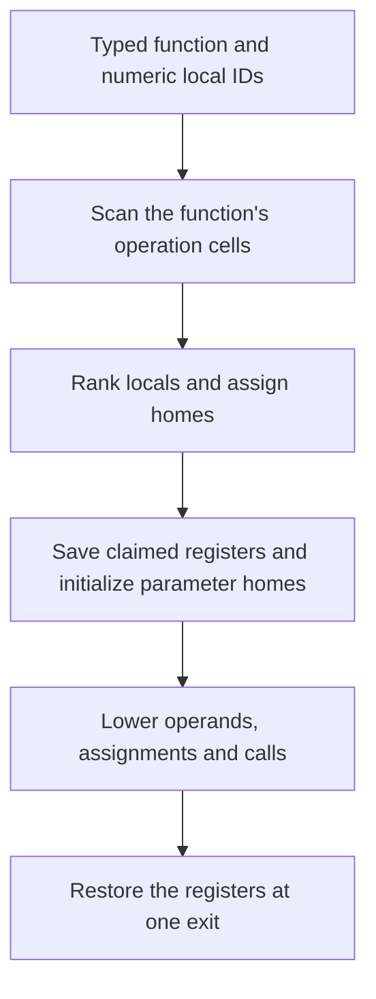

# Choose a register home before lowering a function

PicoCalc Editor repeatedly reads locals inside loops that scan a line or search a string. The A6 compiler keeps a local's value in a slot in the current function's stack frame. An RV32 instruction uses registers for its operands, so reading a local often causes a load. A register home gives the local a register for the duration of the function. A loop can benefit from removing the same load on every iteration. A caller that uses a callee-saved register must preserve the previous contents before assigning the home. The experiment compares how two small ranking policies trade those costs.

## Where a local and an operand live

The shared frontend numbers parameters and locals in `picocalc-os/compiler/typed-wasm.js`. It sends one function with numeric opcodes and immediate cells to the native lowerer. In the staged lane, `typed/rv32.js` defines `FunctionCode`. A `local.get i` can leave a deferred operand descriptor on the compiler's abstract operand stack. When an instruction consumes the descriptor, `valueAt` currently loads local slot `4*i` into the actual machine register. This is separate from the slot for a spilled expression operand. An instruction that modifies a local first resolves any earlier deferred reads of it. Otherwise a program that reads an old value and writes the local before using the old value would read the new one.

A register home leaves this deferred-read contract intact. A pending descriptor refers to a numbered local and a snapshot of the value that was current when it was added. Materializing the descriptor can return that local's machine register directly. Settling a deferred descriptor still copies or spills the value into its own operand home so that calls, joins and later writes can execute independently.



## Assign homes without changing application interfaces

Both candidate lanes use the same placement and instruction selection. They differ in the score passed to placement. `uses` adds one per local read or write. `loops` weights each access by `8 ^ min(loopDepth, 3)`, using the number of enclosing Wasm loops as its estimate of repetition. When the function contains a call, `loops` charges each chosen home two operations for saving and restoring its prior contents. It chooses a home only when the total estimated benefit exceeds that charge. Both policies tie-break in increasing local index order. The weight and cutoff are fixed before running the application workloads. Scope A7 calls for a cheap policy and one that considers loops and calls. Keeping the placement pool identical isolates the ranking and cutoff.

An instruction scan must skip immediate cells based on the opcode. An index can numerically equal the call opcode. That occurrence says nothing about the function's use of the calling convention. Track structured block, loop and conditional openings and close the corresponding kind at each end. A call anywhere in the body, including a conditional path, makes the function non-leaf. A leaf makes no calls and can use argument registers `a0–a7`. Leave each chosen parameter in its incoming register and put other locals in free registers. Expression operands already use `t0–t4` and the scratch registers `t5–t6`. A possible signed division overflow check also needs one scratch that does not alias either operand. In such a leaf, reserve `a7` for that check and store the eighth argument in the frame when present. A non-leaf chooses from `s1–s11`. Under the RISC-V calling convention, these registers survive a call. Save only the registers chosen, plus `ra` for the return address.

```text
plan(body, policy):
    scan opcodes for local accesses, loop depth, calls and signed division
    pick ABI pool from leaf status and required scratch registers
    rank by the policy score, break ties by local index
    keep selected leaf parameters in matching a-registers
    assign remaining eligible locals to free registers
    assign aligned frame offsets to remaining locals, saves and operand spills
```

The prologue stores selected saved registers before moving parameters into them. It leaves `sp` aligned to 16 bytes, including at every call site, and adjusts it only when the function needs a frame. The epilogue restores registers from the same slots and sits at the existing shared exit reached by all early and final returns. Keep the existing spill behavior around calls for live computed operands. Candidate planning must finish with the function and release the temporary arrays before lowering the next function. Keep only native words and relocation records for the assembler.

## Forward a result without overwriting a pending read

Consider `let sum = a + b;`. The current lowerer emits an addition into a temporary and then stores to the stack slot. When `sum` has a register home, the addition can name that register as its output. The compiler knows that the next opcode is `local.set sum` because both operations lie inside the same structured control region. The proposed `resultRegister` checks a single following opcode and uses the register home when no older unfinished operand still refers to `sum`. The later `push` consumes that `local.set` and updates the abstract operand stack as though the operations executed separately. If an older pending read exists, emit the usual temporary and run the existing settle-before-write logic in `local.set`. This protects a raw sequence such as `local.get sum; …; local.set sum` where the earlier value remains in use.

Only result-producing arithmetic and memory reads that already use `resultRegister` are candidates for forwarding. A structured result merge has its own common operand home. Calls retain their established return behavior, and `local.set` can move directly from `a0`. A function return may overwrite `a0` because its home is dead on the selected exit path. A signed divide cannot overwrite a live parameter home on later non-exit paths, which is why the plan reserves scratch when it sees that opcode.

## Implementation and measurement sequence

1. Use the pinned A6 compiler with SHA-256 `eaafeda68a206aa27b86a54e510ca65ed3e3c50763d23004e169fe9a329eb960` for `typed/wasm.js` and `532c5ed74ac6105b98c6a4609bae7f9c551f89e5a19ab36cd0e6faba91745e5b` for `typed/rv32.js`. Research output remains in a ticket-local patch and two staged bundles. A third, instrumented frame-only lane must emit bytes identical to A6 and is used only for host accounting.
2. Add the plan, update local load/store paths and update `FunctionCode.lower` to build and restore the frame. Run a signed divide in an eight-argument leaf, poisoned volatile registers in a host import, an assignment followed by a call on a conditional path, a non-leaf with more than 11 candidates, and early exits. Reuse the interpreter that checks preserved registers and SP on every internal return. Include a raw pending-register read above operand depth four, where settling must spill.
3. Add the single-opcode result forwarding. Instrument optional per-function counts for local loads and stores, saves and restores, forwarded assignments and frame length. Cross-check total decoded stack access words separately. Re-run A6 condition cases as well as the application replays on both RV32 candidates. Classify each ceiling independently and include both static and actual execution effects.
4. Build one P4 image with A6, uses and loops lanes using the matched cold-compiler fixture. Run identical compiler inputs and flashed reactors with the same streamed setting. Compare per-boot paired time and peak QuickJS bytes. Time checked guest batches for Files comparison and Agenda weekday from the same text and an Editor operation if its app-local calls can be preserved independently of reactor imports. A register change can remove instructions while increasing cycles from saves or layout. Record the paired differences with the guest inputs and firmware identity.

| App | A6 measured instructions | A7 ceiling | Historical A6 model B |
| --- | ---: | ---: | ---: |
| Files | 516 | 517 | 390 |
| Agenda | 2,496 | 2,660 | 2,126 |
| Editor | 15,954 | 14,581 | 12,679 |

The model's ten-register leaf budget differs from the proposed ABI pool because it assumes a different temporary register plan. Report distance from the model as a separate check. Six or fewer instructions for `bump` and nineteen or fewer for `countUnit` are explicit scope-A fixtures. A heap increase is a measurement to report alongside latency and guest cycles.

The independent Opus review proposes a call-site spill policy for a follow-up comparison and recommends hostile caller-saved clobber fixtures. Its fixed save/restore accounting and capped loop weights inform this design. The first comparison keeps non-leaf homes in callee-saved registers across both ranking lanes so their effects can be attributed to the assignment decisions.

[Professor's A7 implementation task](../../PICOCALC-NATIVE-NEXT--a-smaller-rv32-backend-a-module-cache-safety-checks-and-await-for-typed-picocalc-worlds/design-doc/02-scope-a-an-rv32-backend-with-a-compile-time-operand-stack.md#task-a7-locals-in-registers) · [A6 design](../../PICOCALC-CONDITION-TARGETS--compile-typed-conditions-directly-to-branch-destinations/design-doc/01-how-a-boolean-expression-becomes-a-branch.md)
