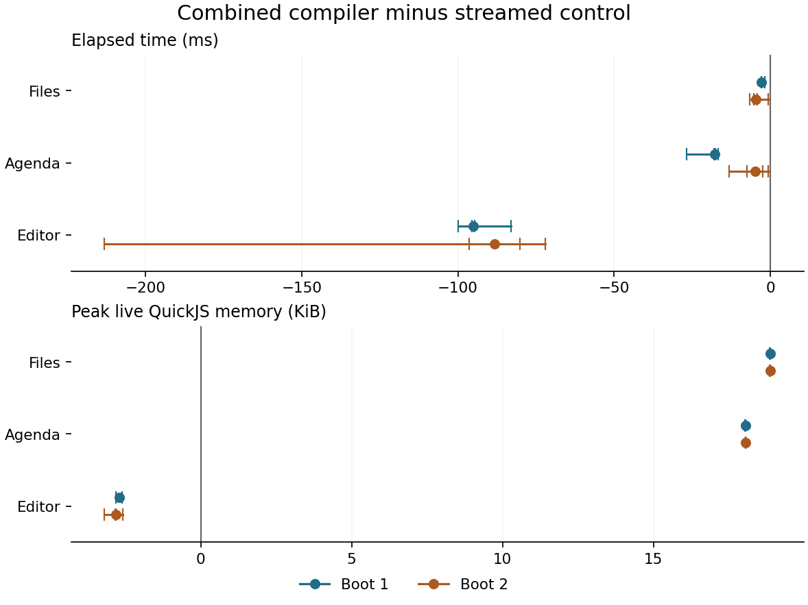
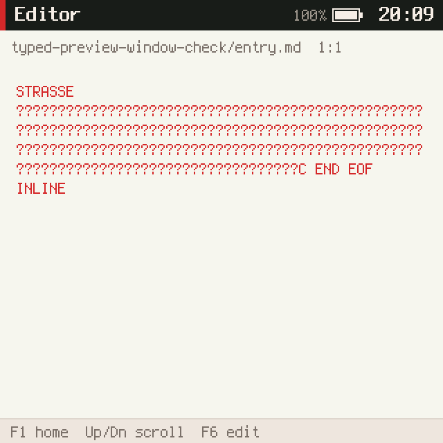

# What happens when two native compiler optimizations share the same output?

Opening a typed PicoCalc application starts two different computations on the ESP32-P4. First, QuickJS runs the compiler and produces a native executable. Then the processor runs that executable when the operating system sends the application an event. A compiler change can improve either computation. The previous two studies identified one improvement in instruction selection and another in the compiler’s temporary storage. This experiment asks what happens when a single real compiler does both.

## One comparison, two implementation choices

Suppose the source checks `if (left < right)`. The frontend emits operations that consume two signed integer operands, produce a Boolean and consume it at a conditional. The backend can implement that sequence literally, computing a result in a temporary register and testing it for zero. If the next operation is the conditional, it can instead use a RISC-V instruction that compares the original registers and branches. This is predicate fusion. A comparison used as a value still has to compute the Boolean. The backend retains the existing long-jump sequence for large functions.

Whichever sequence the backend selects, the instruction words must be stored until the program can be laid out. A call to another function or an imported reactor operation needs a displacement from the call site to its final destination. The production backend stores words in JavaScript arrays per function. Compact output stores them in 1,024-word typed chunks addressed within the complete program. It copies the used words into a contiguous byte array before handing the program to the existing linker. The frontend still streams one checked function at a time.

```text
                     Words to retain          How to retain them
Production selection     more             per-function arrays | compact chunks
Fused selection          fewer            per-function arrays | compact chunks
```

The questions are coupled. Fusion changes how many words compact storage writes, how many chunks it allocates, and where it must patch forward jumps. The impact on compiler memory can depend on whether a few words cross a chunk boundary, and on which stage happens to hold the largest set of live objects.

## What a correct result looks like

Hold instruction selection fixed and change storage. The raw machine words, layout and relocation metadata, and every byte of the linked ELF should be identical. Now change instruction selection. Some bytes *should* change. The old and new programs should still return the same values, mutate the same memory and perform the same operations in the same order. A complete ELF includes reserved space in the reactor, so its length can stay the same while the used instruction area gets smaller.

| Application | Production words | Words with fusion, using either storage strategy | Linked ELF bytes |
| --- | ---: | ---: | ---: |
| Files | 804 | 738 | 24,424 |
| Agenda | 4,058 | 3,784 | 66,364 |
| Editor | 21,886 | 20,507 | 240,452 |

The hash equalities held for both storage pairs on all three inputs. The combined compiler passed 1,343 differential cases, including 24 expected traps. A separately authored suite compared 637 returning executions and six traps with WebAssembly. Six complete guest workflows covered Files, Agenda and four Editor operations. These suites exercise different inputs. Their case counts are reported separately. Another test placed a function prologue at word 1,023 so its frame initialization crossed into the next chunk, then verified 139 relocation entries. Eleven invalid inputs checked error ordering and the public linker’s validation behavior.

## Where the timer starts

The trial firmware calls the same C application entry points used to boot ordinary native worlds. The selected backend is the only script that varies. Files reads one source file. Agenda assembles its program from its reminder and entry modules. Editor reads a bundled source generated from its source list. All use their normal reactor, fresh QuickJS runtime, budget and linker. The reported time includes input loading, compiler initialization, translation, linking and handoff through runtime teardown. Each complete output is hashed after timing. The peak covers live usable bytes reported by the QuickJS allocator. The C caller’s source, module copies and other operating-system allocations have separate ownership.

The same four compiler configurations run once in each of four positions on a boot. For each position the runner invokes Files, Agenda and Editor in that fixed order. A second boot repeats the design. Eight fresh compilations of any one configuration and application across two boots give us two independently reported block series on one board. The design balances compiler order within apps. It does not estimate how changing the app order or using a different device would affect them.

## How to read an interaction

For one block, let the measured times be `base`, `branch`, `compact` and `both`. If the two savings added exactly, the predicted combined time would be `branch + compact − base`. Subtract that prediction from the measured combined time. The resulting interaction is positive when the combination delivers less saving than addition predicted, negative when it delivers more. Compute this inside each matched block and summarize by boot.

The same arithmetic can describe observed heap peaks, but a peak is the maximum over an entire run. The high point for one configuration can occur at a different stage from another. A positive memory interaction establishes how far an additive prediction misses. It does not identify which allocation lived too long. Measuring a phase or identifying the live objects would require its own instrumentation.

## Results on two physical boots

All 96 timed compiles produced the expected ELF. In the table, “time saved” means control time minus combined time, and “heap change” means combined peak minus control peak. Each figure is the median of four matched block differences on that boot. The values retain the pairing even when the two independently calculated group medians would give a slightly different difference.

| Application | Boot 1 time saved | Boot 2 time saved | Boot 1 heap change | Boot 2 heap change |
| --- | ---: | ---: | ---: | ---: |
| Files | 2.83 ms (1.18%) | 4.66 ms (1.91%) | +19,328 B | +19,318 B |
| Agenda | 17.84 ms (2.68%) | 4.90 ms (0.74%) | +18,496 B | +18,490 B |
| Editor | 95.13 ms (3.87%) | 88.27 ms (3.59%) | −2,768 B | −2,888 B |

Within every matched block the combined compiler was faster than the streamed control on all three apps. Absolute combined median compile times were approximately **238–239 ms for Files, 647–657 ms for Agenda and 2.361–2.370 s for Editor**. Four blocks per boot give enough observations to see the repeated direction. They give limited precision on the smaller timing differences, particularly for Agenda.



The chart uses candidate minus control on both axes. Left of zero means the candidate took less time or used fewer peak bytes. Each line covers the four matched differences on a boot. Ticks mark individual observations and a dot marks the median.

### Why the separate heap savings could not be added

On the second boot, Editor’s group median peak was 1,410,872 bytes for the control, 1,394,726 for fusion, 1,399,092 for compact storage, and 1,407,984 for both. Simple addition of the isolated reductions would predict a combined peak of 1,382,946 bytes. The observed median was about 25 KB higher than that prediction. The more precise matched-block calculation produced a memory interaction of **+24,886 bytes on boot 1 and +25,152 bytes on boot 2**. The combined peak still finished just below the control. Among the four measured configurations, fusion alone had the lowest Editor peak.

Several facts constrain the explanation. The fused Editor emits 82,028 bytes of code, small enough to occupy 21 typed chunks. Compact output without fusion emits 87,544 bytes and occupies 22. Nevertheless the combined compiler peaked about 8.9 KB *higher* than compact alone. There is another cost beyond the instruction payload. For instance, all candidate compiler scripts are larger than the 15,766-byte control script. The combined script is 18,107 bytes. The earlier independent study also found a high live allocation during final linking. This experiment measures the entire clean compile and deliberately includes neither an allocation trace nor per-phase hooks. It cannot assign the extra bytes to script evaluation, chunk metadata, linking overlap or collector timing.

The small applications expose a different cost profile. Fused Files emits 2,952 instruction bytes, which occupy one 4 KiB chunk. Fused Agenda emits 15,136 bytes and occupies four chunks. The actual peak increase for both apps was around 18–19 KB, substantially larger than the unused last-chunk capacity. Reducing chunk size, based solely on that unused space, would have little evidential basis. A phase-specific measurement on Files and Agenda could test where most of their extra memory becomes live.

### Where the combination helps

For Editor, the combined compiler finished about 17.1 and 18.6 ms sooner than compact alone at the matched medians. Relative to the additive time prediction, it saved an additional 24.8 ms on boot 1 and 2.7 ms on boot 2. The variation argues against claiming a precise interaction time. For Files and Agenda, compact alone had the shortest group median time on both boots. Adding fusion gave those apps the smaller generated program while also increasing compiler peak allocation.

Because the fused and combined ELFs match byte for byte, an application running the combined output gets exactly the fused instruction sequence for that build. The previous study’s approximately 14% improvement for long Files name comparisons is relevant to that sequence. This trial re-executed application workflows and measured compilation; the physical cycle figure belongs to the earlier comparator experiment.

## Integration decision

**The combination qualifies on correctness and on the three current compile budgets. Its demonstrated strength is cold Editor latency and smaller generated code.** The evidence rules out a general per-app heap saving. In particular, the production control has the lowest measured compiler peak for Files and Agenda. The combined candidate raises their peaks by about 19 KB even as it slightly reduces the largest peak in this three-app catalog.

For a memory-first default, retain the production configuration while deciding which memory objective matters. If the objective is the largest cold compile across the current catalog, fusion alone gave the largest observed reduction of that maximum because Editor dominated it. If the product can spend roughly 19 KB of compilation headroom in the smaller apps to reduce latency, the combined candidate has a measured case for integration. All three apps remained within their existing hard limits. A future production change can make that trade explicit using the same checks.

The next compiler research measurement I would fund is a breakdown of the frontend interval. The earlier study attributed about 1.38–1.43 s of Editor time there, including setup and work between function callbacks. The present combined result saves about 0.09 s. Distinguishing lexing, parsing, type checking and IR creation would tell us where another substantial cold-build reduction is possible. Phase-specific allocation measurements of the smaller apps can run alongside that work.

## What the handheld actually ran

After the timed series, the experimental firmware selected the combined compiler for normal native loading. Files, Agenda and Editor each reported their native `compiled.bin` with no last error. The Editor replay staged a 65,536-byte Markdown document, opened it, entered preview and sent Page Down. Both frame captures passed their CRC check and matched the qualified reference outside the status clock. The fixture was removed after the run.



To repeat the measurements, start at the project’s `AGENTS.md` and open ticket `PICOCALC-RV32-COMBINED`. Its design guide gives the build and device commands, the diary records decisions and anomalies, and the scripts directory contains the generator, semantic checks, board runner, paired analysis and plotting code.
