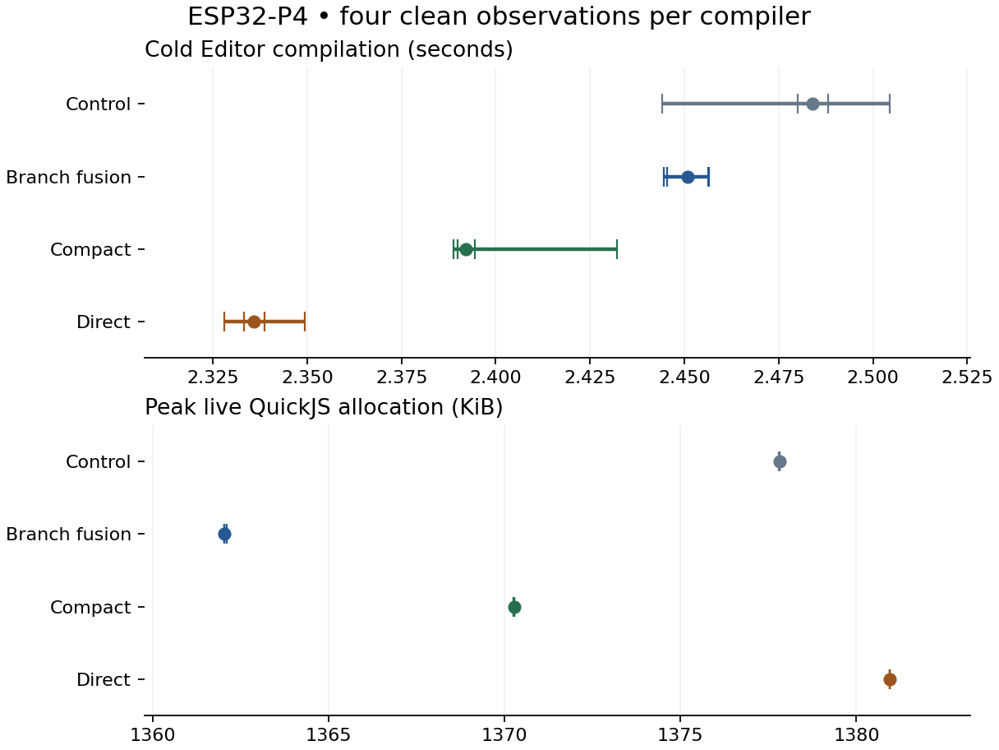
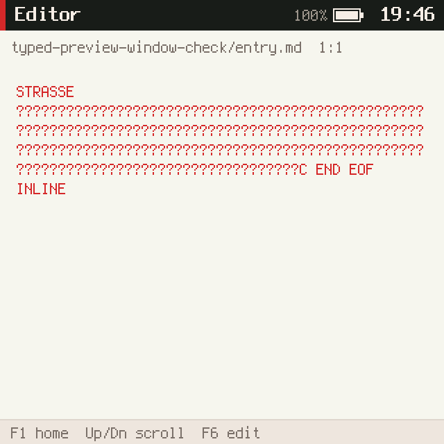

# How a handheld compiler spends time and memory

An intern opening the PicoCalc Editor can observe two programs in succession. The first reads the application source and builds an executable on the handheld. The second receives a key event, modifies the document and renders the result. Both use the same ESP32-P4 CPU. A compiler change can improve either program, or both. To decide what to ship, we need to identify which one did less work and which user operation benefits.

## Follow a signed comparison from text to the CPU

The language accepts typed functions and has native operations on 32-bit integers. Imagine that a function takes two signed integers, tests `a < b`, and conditionally updates an Editor cursor. Type checking establishes which comparison to perform. Lowering translates that checked operation into instructions. In the intermediate representation, both operands are placed on a logical operand stack. The less-than operation consumes them and produces a Boolean. The following conditional consumes that Boolean.

```text
Instruction selection for the true arm of if (a < b)

Baseline                         Branch candidate
slt  t, a, b                     blt  a, b, +8
bne  t, zero, +8                 jal  zero, alternate
jal  zero, alternate             ... true arm ...
... true arm ...
```

This is a schematic register assignment. The comparison must remain signed. With `a = -1` and `b = 1`, signed less-than is true. Unsigned less-than interprets the same bit pattern as 4,294,967,295 and is false. The backend also uses unsigned comparisons for bounds. Confusing these operations would change which inputs trap. The tests include signed extrema, out-of-range indices, negative indices, side effects and deep expressions that spill operands from registers into the stack frame.

A true comparison advances over a four-byte jump into the true arm. On false, that jump reaches the alternate arm. The conditional instruction therefore has a constant local displacement even if the conditional body is long. The branch candidate preserves that scheme. It recognizes seven comparison forms, an optional Boolean negation and an immediately following conditional. A returned Boolean, an assignment that stores the result or another unrecognized consumer takes the ordinary path. This small pattern needs no additional pass or global analysis. Both the condition encodings and the reach of the conditional and jump instructions are specified by the ISA. [RV32I control transfers](https://docs.riscv.org/reference/isa/unpriv/rv32.html)

The raw Editor instruction image illustrates the distinction between emitted code and its container. The baseline emits 21,886 four-byte instructions. Fusion emits 20,507, saving 5,516 bytes. The physical trial reactor contains a fixed reservation, so both complete ELF files occupy 240,452 bytes. Reserving less space is a separate design decision that needs a maximum supported application size and a failure test when the reservation is exceeded.

## Follow an instruction word from emission to the loader

Streaming controls when the compiler can discard each function’s *input* to instruction selection. A function’s checked body can go away once the backend has emitted its words and recorded pending references. Generated words cannot go away at that point. A forward call may name an address early in compilation whose final offset depends on functions emitted later. An exported entry has to point at the right instruction, and an imported reactor call has to reach its trampoline. A trampoline here is a small prebuilt instruction sequence at a known position that transfers control to a runtime operation.

The baseline keeps machine words in a JavaScript array for each function. Following layout and patching, it copies them into one byte array. Linking the program makes a private copy of the reactor template, writes the executable bytes into its code slot and installs the remaining entry and call displacements. The allocated objects can coexist. A 4-byte target word does not imply that storing its JavaScript representation costs 4 bytes of compiler heap.

The output experiment first appends words to 1,024-word typed arrays, each holding 4,096 bytes of instruction payload. All function entries and pending patches have a shared coordinate measured in words. Word 1,023 is the last word in the first chunk. Word 1,024 is the first in the next, regardless of where a function began. Keeping lengths and offsets in the correct units is essential. An entry in the public program metadata is a *byte* offset, so recording word 1,024 there requires writing 4,096.

```text
emit(word)             append at global word index; allocate next chunk when full
finish(function)       record frame patches and control-flow target positions
finish(program)        resolve internal jump displacements; collect import fixups
raw caller             allocate exact byte length and serialize all words
linked caller, direct  validate reactor; copy template; serialize into reserved slot
                       patch exported entry jumps and imported calls; return owned ELF
```

“Direct” describes the destination of that serialization. The frontend still streams, the compiler still retains instruction chunks until needed, and the caller still receives an owned executable. The public `typedRv32.compile` API still supports clients that need a standalone image. This distinction makes two experiments possible. Compare control versus compact to change the word representation. Compare compact versus direct to remove the extra intermediate image on the linked path.

Every byte in the output experiments should remain identical to the corresponding baseline byte. That property is stronger than showing one Editor screenshot, because it compares every emitted instruction and relocation as well as unused slot bytes. Branch fusion intentionally changes instructions. There the test must compare observable behavior. The independent examiner compared return values, mutation and call order with WebAssembly on 637 normal cases plus six traps. The branch implementer separately ran 1,343 cases including 24 traps. The two suites have different sources and coverage and should not be added together as a count of distinct cases.

## Choose the unit before interpreting the result

| Quantity | Who performs the work | Unit and scope |
| --- | --- | --- |
| Cold compile latency | QuickJS executing the compiler, plus its C embedding | Microseconds from starting the bundled input reads through destruction of the fresh compiler runtime. |
| Compiler heap peak | QuickJS custom allocator | Maximum simultaneous live allocator-usable bytes. It excludes the caller’s C buffers and the rest of the operating system. |
| Generated code size | RV32 backend | Words or bytes of application instructions within the reactor. |
| Retired instructions | Instrumented RV32 execution | Dynamic count on a particular replay, including its measurement window. |
| Physical execution time | P4 executing compiled `filesCompare` | CPU cycles per comparison for one fixture, measured in 128-call batches. |

For example, the complete Files guest replay retires 88,823 instructions in the control and 88,750 with fusion, a difference of only 73. The Editor late-navigation replay goes from 42,316,056 to 38,662,647, an 8.63% reduction. If a replay spends most of its time in unchanged runtime code, even a substantial change in a single compiled loop can have a small impact on the total. A hardware counter on one loop and a guest instruction count for a whole application answer different questions.

## How the experiment is controlled

The four clean compiler configurations process the same source and compiler options. Each makes four physical compilations against the same reactor. In the four blocks each configuration runs once in each position. Hashing the final output occurs after timing and is compared with an oracle using the actual reactor from this IDF build. File hashes from a host toolchain with a different reactor cannot be compared directly. The trial also checks the physical code being timed, including an ELF symbol byte comparison, matching entry-address alignment and a hash from the board at runtime.

A second version of the compiler records phase transitions. The allocator updates the maximum for the current phase on each allocation and initializes that maximum with all still-live objects at phase entry. A large maximum during parser execution can reflect completed code retained from earlier functions. The phase in which a high-water mark is observed identifies objects that coexist then. Finding which code allocated them requires an allocation trace or another controlled change. We used fresh clean runs for the main comparison and separate instrumented runs for that attribution.

## The physical results

The primary boot gave the following medians of four clean Editor builds. Input reads, runtime startup, compilation, result extraction and teardown are timed. The hash check runs afterwards. Each executable had the expected SHA-256.

| Compiler | Cold compile | Peak live QuickJS bytes | Change in peak vs. control |
| --- | ---: | ---: | ---: |
| Streamed production control | 2.484 s | 1,410,878 | — |
| Branch fusion | 2.451 s | 1,394,718 | −16,160 |
| Compact words, raw intermediate | 2.392 s | 1,403,150 | −7,728 |
| Compact words, direct linked output | 2.336 s | 1,414,092 | +3,214 |



Each tick represents one clean build and the dot is its group median. To reproduce a relative effect while preserving the block pairing, compute `100 × (control_us − candidate_us) / control_us` within each block, then take the median of those four percentages. The primary paired median savings are 1.33% for fusion, 3.17% for compact and 6.06% for direct. Subtracting or dividing the displayed group medians uses a different estimator. One of the four blocks times fusion slightly slower than control. Four balanced blocks on one board support a bounded engineering decision; they do not supply a population estimate for all P4s and workloads.

A second boot of the identical study firmware tested repeatability. Median control / fusion / compact / direct times were **2.463 / 2.462 / 2.397 / 2.331 s**. Within-block median savings were 0.12%, 2.48% and 5.07% respectively. The small cold-build effect from branch fusion nearly disappeared on repetition. Its peak stayed about 16 KiB below the control on both boots. Direct and compact were faster in all eight matched comparisons apiece across the two boots. The second clean peak figures were 1,410,872 / 1,394,728 / 1,403,148 / 1,414,090 bytes in the same order. We report the two boots separately because running four fresh runtimes within a single boot does not produce four independent board restarts.

### Why removing an 87,544-byte buffer increased peak memory

The direct compiler eliminates the contiguous intermediate holding 87,544 bytes of Editor instructions on the linked path. Its instrumented assembly phase fell from about 149.8 to 45.1 ms. The largest allocation observed *during assembly* fell from 1,415,086 to 1,208,626 bytes. If the experiment had stopped at assembly we would have overestimated the peak-memory benefit of the complete operation.

During linking, direct still owns all its instruction chunks and metadata while it allocates the writable reactor-sized result. Its instrumented peak reached 1,414,468 bytes in phase 5. Phase 6 inherited those live objects. In the baseline, the link phase peaked at 1,394,058 bytes and assembly was more expensive. The peak migrated from one phase to another. This explains how the direct path could be the fastest clean build while using 3,214 more peak bytes than the clean control. It is also why an allocator counter attached only to the raw intermediate would give the wrong answer to “How much memory do I need to boot Editor?”

The independent host run used the project’s vendored QuickJS and the production C embedding entry, with six balanced blocks. On host, control / compact / direct Editor peaks were 1,920,216 / 1,632,152 / 1,651,264 bytes. On P4 they were 1,410,878 / 1,403,150 / 1,414,092. These are measured differences between executions. Runtime object representation and allocator usable-size accounting depend on the target. We did not isolate a single allocator or layout change as the cause of the host-to-board gap.

### Which execution paths benefited from fusion?

The Files test provides the same two UTF-16 names and directory flags to two independent implementations of the same function. It times 128 calls per batch, verifies the return value through an accumulator, alternates which variant runs first, and repeats 16 paired blocks per input. Both functions are warmed before measurement. The table shows group medians in cycles per call and the median percentage of the 16 paired differences. The board ran the measurement on its kernel core at 360 MHz.

| Files input | Control | Fusion | Paired saving |
| --- | ---: | ---: | ---: |
| Equal 91-unit names | 6,542 | 5,630 | 13.95% |
| First differing unit is the last of 91 | 6,519 | 5,609 | 13.96% |
| One name is a 71-unit prefix | 5,121 | 4,409 | 13.90% |
| Names differ at the first unit | 105 | 95 | 9.48% |
| Directory flag settles comparison | 30 | 30 | Within order noise |

The long comparisons execute the optimized control flow inside a loop. They were faster in every paired block. The directory shortcut exits immediately. Its measured difference changes sign when the running order changes and cannot support a speed claim. On the second boot all three long-name cases again saved 13.9–14.0% of paired cycles. The experiment does not time end-to-end Files browsing, keyboard-to-frame latency or storage I/O.

## How to reproduce the reasoning

1. Start with the branch and output tickets reached through `AGENTS.md`. Build the frozen control and candidates with the branch ticket’s `scripts/01-construct.sh` and the output ticket’s `scripts/01-prepare.py`. Record the actual JS file hashes.
2. Run the independent `scripts/examiner/guest.mjs` and `scripts/examiner/output.mjs` entry points with the arguments documented in the examiner guide. Check both positive and rejected inputs. Pay attention to the first error when a program has two independent faults.
3. For the physical trial, follow the commands in this ticket’s experimental design. Read the host oracle and device digest for the same reactor. Extract the four clean blocks and compute paired differences. For phase attribution, compare the two marked runs per variant separately.
4. In `picocalc-os/compiler/typed-rv32.js`, follow `FunctionCode.binary`, `FunctionCode.branch`, `compile` and `linkSlot`. In the branch patch, locate `fuseBranch`; in the output generator, locate `InstructionSlabs.patch` and `copyTo`. These are the smallest reading paths that explain the results.
5. Predict what will happen if a future pass emits fewer words. It can reduce the number of chunks even when the complete ELF size is unchanged. A larger fraction of elapsed time may then belong to frontend processing. Combine and measure the candidates to test that prediction.

## The lab decision

Advance branch fusion to production-integration review. It is a small local lowering rule, passed two independent semantic suites, reduced used code in all three apps, reduced real guest work in Editor, and helped the P4 execute the long Files comparison. Preserve the fixed-width long jump when integrating it, so behavior for long functions remains covered. The patch is a research candidate; production still uses the original streamed backend at this checkpoint.

For cold-compile latency, direct output is the stronger candidate. For the present memory preference, compact is the candidate that improved both measured dimensions on this board. Its memory improvement is only about 7.5 KiB on Editor. Place these two alternatives in the same integration decision with explicit time and memory budgets. Counting the raw buffer removed from the algorithm would give the wrong priority.

The most informative next experiment is a two-by-two comparison on the same production entry: fusion off/on crossed with control/selected output storage. The present studies tested each change independently. Adding the measured time savings by arithmetic assumes the two mechanisms never change one another’s cost. In fact, fusion emits fewer words for the storage candidate to copy and patch. After the choice, profile the residual frontend work. In this run phase 0 accumulated about 1.38–1.43 s, including the frontend and setup between 120 function callbacks. That total identifies where to instrument next; it does not yet identify a particular tokenizer, type checker or parser algorithm to replace.

## What ran through the actual loader

After the repeated compile trials, the normal device loader received the branch-built Editor. The replay created a 65,536-byte Markdown document with a long inline link, UTF-8 text and nested formatting, opened it in Editor, entered preview, and sent Page Down. Both framebuffer captures passed their transport CRC and matched the qualified reference at every pixel outside the status clock. The fixture was removed after the run. This connects the instruction-level evidence to a visible application behavior on the handheld.



The replay tests this Editor path on the physical hardware. The complete three-app execution replays and the storage candidates’ artifact checks have their own receipts in the companion studies.
