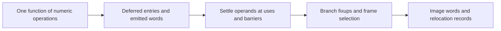

# Where an RV32 operand lives between instructions

## The PicoCalc experiment

The Files world can compile on the handheld before it opens a directory. Its compiler checks the types in the app, then lowers a sequence of WebAssembly-style operations for each function into native RISC-V instructions. On the ESP32-P4, those instructions execute from a reserved region in a reactor ELF. The frontend can finish and release one function's operations before it parses the next. This experiment keeps that lifetime and asks how much native code the backend can remove by deferring decisions within one function.

At `40bcf850a5809ef6d839127869faa952596ed157`, `picocalc-os/compiler/typed-rv32.js` already assigns the first five operand-stack positions to `t0` through `t4`. It loads a `local.get` into its assigned register immediately. The earlier fusion patch shares that starting point and removes the Boolean produced immediately before a branch. Files has measured 804 native words in the production lowerer and 738 with that fusion patch. The design model predicts 593 for a combination of delayed operands, comparison fusion, shorter transfers, cheaper immediate forms, and leaf frames. A word is four emitted instruction bytes.

The following implementation guide takes place inside the research ticket. `scripts/01-stage.py` will extract the frozen backend and wrappers into a disposable directory and create three lanes for the production control, adjacent fusion, and the staged candidate. It will also produce intermediate variants for the Files accounting. Scripts in the ticket own the experiment, and `various/` will hold standalone measurements and workload identities. The C reactor wrappers keep their public interfaces. The compiler receives numeric operand cells through `typedWasm.compileFunctions` with `numericOperands` set to `true`. This matters when scanning for calls and looking beyond a comparison because constants and indexes are single cells on the production path.

The held-out test concerns portability of a counting model across applications. The old model’s prediction for Agenda is already public within this project. Before the first candidate Agenda run, commit a new forecast based on the old stage-three model and the residual observed on Files. Scale the summed old per-function Agenda estimate by the ratio between the Files staged result and the Files model sum. Round the central estimate to a word and round a ±5% band outward. Record both that band and the old uncalibrated ±5% band. Require the observed Agenda total to fit the calibrated band and all behavioral gates before proceeding to Editor. Report the actual function residuals and bounds even when the updated forecast misses. Keep candidate linkers, emulator runs and board builds that would produce Agenda output downstream of the prediction commit.

The Files accounting table will report historical and current counts separately. The current experiment will derive a word count from successive entry offsets and the final image byte length. For each function, record production, fusion, shortened branches, lazy operands and immediate forms, leaf frames, and delayed returns as cumulative variants. Each difference belongs to that ordering. Compare the staged total to Model A from the old model, and inspect the residual for functions exceeding both four words and 10%. The former model assumes some ideal placements, so inspect call-result moves, same-register transfers, shifts, explicit returns and exact branch ranges. Whole-program totals can agree while two functions have countervailing errors.

Use the existing host emulators and replay harness as independent checks of execution. Node WebAssembly supplies values, expected traps and memory effects for scalar fixtures. Run each variant with the normal application wrappers and verify deterministic streamed and buffered artifacts, exact diagnostics, and app event traces. The planned new witnesses include a function whose forward conditional skips more than 4 KiB, a loop whose early-exit condition skips a similarly wide body, signed extrema, a pending read above depth five at a local write, an imported call that overwrites caller-saved registers, and both paths of a value-producing expression. The frontend ordinarily emits statement branches and structured expression joins. Exercise a pending read across a same-local write with a numeric frontend operation fixture so the invariant remains testable independent of current source syntax.

Once Agenda qualifies, compile all Editor sources at their normal wrapper limit and link the result into a fresh reactor with an 80 KiB reservation. A successful link requires room for the slot magic and metadata, exported entry words, runtime call trampolines and the entire emitted image. Confirm the executable segment and resource size through the ELF and native loader. Apply the size change in the disposable build. A board run uses paired cold samples with lane order reversed between boots, per-phase heap peaks, application bytes and memory high-water marks, and guest workflow timing from the same interactions. Reserve the singleton board through the supervising operator. The physical stored module, the loaded world allocation and the static code image are three independent observations.

## Review the critical order of operations

A lazy local names the value read at its original `local.get`. Imagine `local.get 0; i32.const 19; local.set 0; end` in a function with one parameter and one i32 result. The result equals the original parameter. Settle the buried read before the store. If both values sit above depth five, the snapshot can use a scratch register and write its slot before the assignment materializes its own source into scratch. A similar ordering applies before branch fusion and a condition scratch may hold live operands. Settle the entries inherited by both paths before bringing the predicate operands into scratch. On `else` and `end`, place the value in the shared depth’s register or stack slot before binding its label. The next instruction then has a single location to read on either path.

RISC-V uses `a0` for the result and `a0` through `a7` for arguments. A delayed result occupies `a0` until consumed or settled. The call barrier must account for live entries below the operands and visit their homes before writing argument registers. Evaluate nested arguments in frontend order, then move their already evaluated values into distinct ABI homes. The division-overflow guard also uses `a0` as scratch in the baseline and needs the same care. Keep runtime checks and the address arithmetic of memory accesses in the same semantic order.

Short conditional instructions cover a signed PC-relative range of −4096 to +4094 bytes. Each initially occupies two words including the fallback `jal`. A layout pass may remove the second word if its conditional can reach the target in the resulting layout. Compute a boundary map from old to new offsets, including the boundary at the end of the array. Apply it to function-local label positions and source positions of every call or jump, including import relocations. Frozen global callee starts are assigned after local relaxation. Retry if necessary while the list shrinks. A conservative fixed pass limit can leave a branch long while retaining valid output. Compare returned bytes on branches just inside and outside the range, and include a large loop to exercise the signed backward case.

## A worked trace

For `return x + 1;`, the frontend emits `local.get x`, `i32.const 1` and `i32.add`. The first operation records an index in the compiler's abstract stack. The second records an integer. When the addition consumes them, the backend reads `x` into `t0` and emits `addi t0,t0,1`. The single `addi` performs the addition using the constant already encoded in the instruction. The return moves the result into `a0`. The same output arrangement works with an eager operation such as a memory load. Its abstract entry simply says that the value is already in its home.

The functions in the output image may start at new offsets after lowering. The linker can still read entry offsets and call relocations from the same interface and patch them into the reactor. Re-derive image offsets from the instructions that survived layout, and use the final offsets for host comparisons.
