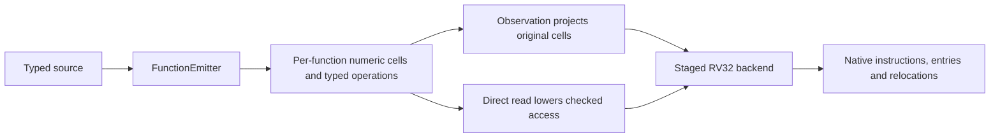

# From a typed text read to RV32 instructions

A typed source expression such as `text.charCodeAt(i)` requires the compiled program to locate a UTF-16 code unit and check that the index belongs to the text. The PicoCalc compiler initially represented those steps as several numeric stack operations. This experiment carried the original read through the function boundary, reconstructed the old program to check identity, and then gave RV32 a way to lower the read in one operation.

## Follow one text read

The SDK lays out a counted string as a 32-bit length followed by 16-bit unsigned code units. Suppose the pointer `text` is 32 and the code units at offsets 36 and 38 are `0xFEDC` and `0xD83D`. A read at index 1 obtains `0xD83D`, which returns as the integer 55,357. With length 2, indices 2 and −1 trap. The baseline comparison treats the bits of the index as unsigned, so −1 compares as a large positive integer.

The parser normally emits the expression that computes the index, saves that result to a synthetic local, reloads it for the check, and reloads it for the address calculation. The backend can use deferred operand locations and fuse the check's comparison and branch. The individual stack instructions still encode the temporary and two uses of the receiver.



In the observed version, the typed read sits after the index expression. It carries the receiver's local slot, whether the header is a string length or a buffer capacity, and the old temporary's slot number. The projection expands that event into the old operations before lowering. The parser allocates the old temporary before parsing the argument so nested reads preserve slot numbering. The projection iterates at instruction boundaries because an immediate constant of 256 has the same value as the typed-read tag.

The predicate event originates at a typed scalar comparison followed by an actual branch consumer. It preserves the operator, any inversions, the control operation, and its immediate. In `while (!(i >= n))`, one inversion comes from the explicit source `!`. The false destination of the loop adds a second inversion. The observation path projects both, preserving the byte sequence the staged peephole would have seen.

## How the direct lowerer uses the operation

The direct lane receives the evaluated index on the operand stack. That stack is a compiler structure for locating intermediate values. The values themselves may reside in registers, in spill slots or as deferred constants or local reads. The emitted machine code uses the same unsigned comparison as the original check.

```text
index = pop evaluated i32
receiver = load receiver local
length = load 32-bit header at receiver
bltu index, length, success
ebreak
success:
  receiver = reload receiver local
  address = receiver + (index << 1)
  push unsigned_16bit_load(address + 4)
```

The check happens after index evaluation. If computing the index calls a typed function that writes to memory, the write therefore precedes the check and load. Success leaves one value at the original operand depth. Values lower on the stack retain their registers or spill slots. The standalone backend needs two scratch registers and reloads the receiver after it has used one scratch for the header. The A7 composition reads the receiver through the register allocator and reuses its register home when available.

## Evidence from the staged comparison

The observation compiler and staged control matched the full native images, entry offsets, relocations, function signatures and record layouts. Compiling in buffered mode gave the same images as streaming within each lane. The Wasm function bodies also matched. In the ESP-IDF host oracle, the observed Editor ELF had the same SHA-256 as the staged Editor ELF. The three programs used matched reactor reservations.

| World | Staged and observed RV32 words | Direct RV32 words | Direct reduction | String and buffer read events | Predicate events |
| --- | ---: | ---: | ---: | ---: | ---: |
| Files | 593 | 572 | 21 | 7 | 25 |
| Agenda | 2,793 | 2,695 | 98 | 32 | 113 |
| Editor | 16,541 | 16,174 | 367 | 115 | 324 |

Editor delivered 35,133 numeric cells to the staged lowerer. The observation stream carried 33,223, and the direct-read stream carried 33,108. The largest Editor function still took 2,477–2,479 cells in all versions. The compiler allocates a projection array for a function that contains typed events. Its high-water allocation also includes retained native words, call fixups and the final ELF. Peak QuickJS bytes measure the combined allocations.

The test fixture exercises high code units and both receiver kinds. An index computation updates a record before a read. A short-circuited expression skips that call and the potential read trap. The deepest expressions carry ten values around the read. Across 126 runs, all lanes matched the Wasm return value, trap status and memory contents. Forty-six runs trapped in each lane.

## Composing with two other backend changes

Direct condition lowering, A6, records the order and targets of short-circuited predicate evaluations. It can remove a materialized Boolean from `a && b` when the result only controls a jump. The adapter records the relative position of a comparison in each captured condition segment and restores it when that segment is emitted. Against A6, observation remains byte-identical, and direct Editor falls from 15,954 to 15,587 words.

The A7 local register study assigns some locals to machine registers. The A7 adapter teaches the plan about receiver uses that occur inside a typed read. It uses the allocator's `readLocal` operation and honors result forwarding to the next assignment. Against the A6+A7 loop-weighted control, direct Editor falls from 12,748 to 12,430 words. The combined host qualification compares both register policies. The dispatch scripts preserve the individually measured compiler variants.

## Reproduce and trace a function

Run these commands from this ticket's directory. Use an empty path for the compiler staging directory.

```sh
python3 -B scripts/01-stage.py /tmp/typed-op-study
node scripts/06-verify.mjs /tmp/typed-op-study
python3 -B scripts/05-stage-board.py /tmp/typed-op-study/lanes /tmp/typed-op-p4
```

Read the `charCodeAt` path in the staged `typed/wasm.js` output beside the emitter extension. Follow `TYPED_READ` through the projection and through the direct machine instruction path. Run the verifier and locate `fixtures` in its output. Then use the application row for Editor to match the raw code hash to the linked ELF oracle. [Emitter](../scripts/02-emitter.js), [projection](../scripts/03-projection.js), [direct lowerer](../scripts/04-direct-read.js), [host evidence](../various/host.json), [linked ELF oracle](../various/board-oracle.json).
