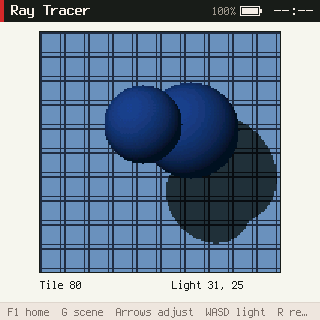

# From a Typed scene description to pixels on the PicoCalc

Consider two spheres lit by the same lamp. Both initially use one blue material. An author wants to adjust only the right sphere from blue to gold. Copying the whole scene would work, but it would hide two questions that matter for an interactive handheld. Can objects share material definitions safely? Can a key change a single parameter without running the scene-building program again? The answer depends on what the compiler retains between scene construction and drawing.

## What crosses the interface

A scene on this PicoCalc occupies a bounded buffer. A four-byte capacity header precedes 303 two-byte cells. The cells contain a versioned header followed by tables for expressions, materials, spheres and parameters. An expression produces a color, a scalar, or a coordinate pair. A material refers to a color expression. A sphere refers to a material. A color mix therefore needs three operands: the two colors and the weight used to combine them. The graph allows both sphere materials to refer back to the same blue color. The right sphere can acquire a new material without disturbing any existing expression.

A validator walks the live entries in order. Once an expression has been checked, the validator knows its result type. Each later expression may refer to earlier entries of the expected types. This detects forward references and prevents cycles without a recursive search. A material can reference only a color. A parameter slot has its own bounds and allowed numeric range. The fixed tables make the upper bound on validation work and memory explicit. [Frozen contract and acceptance fixtures](../design-doc/01-shared-scene-graph-contract-and-acceptance-fixtures.md)

The lighting and visibility kernel uses C and the established PIE assembly routine for sphere intersections. Typed builds the scene and evaluates the material graph. This division has an observable consequence. Changing the formula that supplies a sphere's color can be a change to a Typed source file. Changing the geometric meaning of a sphere still belongs to the renderer. RGB565 is the final screen format. Keeping RGB channels separate through material evaluation lets the tests distinguish an arithmetic error from quantization when the channels are packed for display.

## Three ways to author a scene

The first implementation uses direct calls. A builder allocates a color, then a material, then a sphere. The caller passes its graph explicitly and receives a handle. The second implementation permits direct functions to be declared as namespace members and receiver methods. The compiler knows the type of the expression to the left of a dot, resolves the target function and supplies the receiver as an actual argument. A named record literal can supply coordinate fields. The compiler checks field names and types and preserves the order in which the author wrote any expressions with side effects.

The third source form adds a construction-time callback. The tile material reads the position of a future surface hit, scales it by a captured parameter, takes its fractional parts and turns the resulting mask into a color mix. While the builder runs, the position is symbolic. The callback constructs the graph operations for this calculation. A later change to the parameter edits the slot to which the graph refers. At draw time each hit supplies concrete x and y coordinates.

The distinction matters at a conditional. An ordinary bool known during construction can decide which nodes to append. A BoolExpr denotes a computation whose answer depends on rendering inputs. Branching on its integer handle would merely test the identifier's numeric value. The frontend diagnoses this error at the Typed condition and names the per-hit expression type. Scalars and vectors have distinct expression-handle types for the same reason.

## How the teams could work independently

The renderer and shader used a hand-built graph while the frontend work was isolated. The receiver researcher compared fluent syntax with direct calls against the same fixture. The callback researcher checked construction counts, lexical shadowing, captured handles, and rejection of invalid expressions on both targets. During integration the two changes overlapped in the compiler's direct-call entry. The merged frontend ran both test suites before it was used for the actual scenes.

I compiled each of the three assembled sources to Wasm and RV32, executed both builds, retained their buffers between calls and compared results after every operation. For each source there were two fixtures and three weights per fixture. After each update, every graph byte outside the selected parameter cell kept its prior value. Equivalent scenes also produced identical graph digests on these fixtures. The left sphere stayed blue, the right sphere reached the intended color at full weight, and sampled floor colors followed the selected checker or captured pattern. The independent reviewer then used an evaluator with separate code and tested whole images. [Cross-target execution receipt](../various/director/stages.json)

## Why the unit of shader execution matters

Calling a material function once for every pixel is a direct implementation of the interface. At 160 by 160 pixels that entails 25,600 calls. A whole scanline needs 160 calls per frame. It also exposes information that a single material sample cannot share with its neighbors. Within a run of identical material handles, a constant color can be reused. A checker with two constant colors only changes at a cell boundary. A recognized tile graph has an explicit fractional-coordinate test. A general graph still evaluates according to its declared operations. This means a whole-frame comparison measures both the change in call frequency and the opportunities visible within a row. Distinguishing these two effects would require a further arm with row-sized calls and the scalar evaluator at every pixel.

## What a fractional parameter means on the screen

A material author who writes a tile scale of one tenth expects a regular period. A Q8 parameter stores an integer divided by 256, so the nearest representable scale is 26/256, or 0.1015625. At coordinate 100 the two scaled positions already differ by 0.15625. A function that takes the fractional part and compares it with a threshold can turn a small coordinate difference into a different pixel color. Screen positions farther from the origin accumulate a larger difference.

The reviewer evaluated the tile predicate using exact rational arithmetic, independently rounded binary32 operations, and Q8. For the authored scale 1/10 the binary32 predicate agreed with the rational predicate on all 25,600 locations. Q8 selected the opposite branch at 8,516 locations, or 33.27%. For 1/12 the count rose to 8,897, or 34.75%. These are predicate decisions sampled on the plane. Visible sphere coverage and the choice of colors determine how many final screen pixels would change. The public material contract should state its representable values. Authors using exact dyadic parameters can work within that contract today. A future change to the number format should compare both its device cost and its boundary behavior. [Independent numeric experiment](../various/review/numeric.json)

## What happened on the handheld

The reviewer installed each authoring stage three times and ran the same material and lighting inputs through both shader entry points. All 108 paired observations produced identical RGB565 arrays. Independent pixel expectations and separate unlit samples also agreed. The table gives medians from the callback stage. Each frame time includes the shared C visibility and lighting work and ends with the frame ready in memory.

| Scene | Per-pixel calls | Scanline calls | Median paired time reduction | Build graph | Edit one parameter¹ |
|---|---:|---:|---:|---:|---:|
| Shared material with a checker floor | 154.133 ms | 28.877 ms | 81.24% | 89 µs | 0.734 µs |
| Captured tile material | 168.079 ms | 18.202 ms | 89.17% | 85 µs | 0.732 µs |

¹The edit measurement divides the duration of a batch of 1,024 updates by the count. It excludes drawing. The row path recognizes the tile graph and evaluates its two-color formula directly. That specialization explains how the more expressive fixture can have the shorter frame. A different graph can take the general evaluator. [Physical measurement and controls](05-what-does-it-cost-to-change-a-material-on-a-handheld.md)

The tracked compiler interval had medians of 517.175 ms for hand-authored source, 530.946 ms for fluent source and 543.594 ms for the callback source. The callback stage took about 5.1% longer than the hand stage on this corpus. Its peak tracked QuickJS allocation rose from 716,704 to 738,460 bytes. These are complete source units with different declarations. A claim about the cost of lowering one callback would require a smaller controlled pair. In ordinary operation the compiler runs at installation. The editable graph and its compiled material functions survive a keypress.

The final ordinary firmware booted eight native worlds. The reviewer entered the Ray Tracer with the keyboard and compared the 240 × 240 viewport against its independently enlarged reference for five scene states. Reset recovered the original fixed-color image. This exercises the full path from authoring through compilation, graph editing, rendering and compositor presentation. The next compiler experiment can now hold those inputs constant and move the remaining geometric and lighting decisions into Typed. That gives the project a way to distinguish material-authoring cost from generated-code performance. [Physical boot and image receipts](../various/review/final.json)
