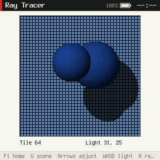
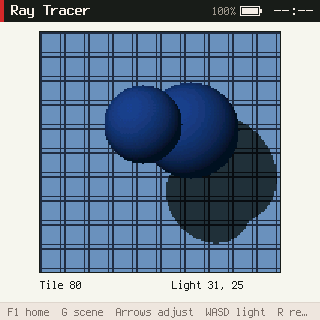

# What does it cost to change a material on a handheld?

Two spheres appear above a checkered floor. The left sphere keeps its blue material. Changing a number blends the right sphere from blue through muted brown to gold. Which work has to happen again? A useful implementation can answer this with four different units of observation: the input source, the retained graph, the unlit color at a hit, and the displayed RGB565 pixel.

Start with the unlit right-hand surface. Its blue input is (30,70,150), its gold input is (220,170,40), and its integer weight is 128 out of 256. One channel computes the weighted sum and drops the fractional part. The result is (125,120,95). A nearby floor pixel can still change with the light and the shadow geometry. Conversely two slightly different unlit colors can become the same 16-bit display color. Comparing only a screenshot cannot identify the operation that changed the scene.

## From four function addresses to one parameter store

The loader opens a bundled authoring source, compiles it in a fresh QuickJS runtime and links four native entry points into a bounded ELF text area. The SDK relocates the image. The loader asks the new image to construct and validate both fixtures in a separate module before publishing it. Ordinary rendering retains that module. The UI selects a fixture and supplies a weight and two light coordinates. A changed fixture triggers construction, a changed weight calls the guest setter, and a light change supplies new render arguments. This exposes the distinction between writing a parameter and recomputing its spatial effect over 25,600 rays. [Production loader](../../../../../../picocalc-os/port/esp32p4/main/candela_p4.c)

The constructor returns indices into bounded tables. A sphere points to a material and that material points to an expression. For the right sphere, the mix expression points back to the same blue expression that the left material names. A second blue record with equal channel values would produce identical pictures today while losing that sharing property. The checker follows the handles in the graph returned by the physical program. It separately compares graphs with a manually authored Python fixture whose independent allocation order differs. The parameter test compares every used and spare graph cell, allowing only the parameter at index 295 to change. [Graph and ray interpreter](../scripts/review/oracle.py)

## Which drawings have an independent expected answer?

The portable C renderer calls a material callback to retrieve three channels. To check geometry separately, the host harness gives it a Python color callback and compares the resulting RGB565 buffer to a second implementation of every ray, shadow, light and pack operation. The second implementation computes square roots with integer arithmetic, chooses the first sphere at a tied depth, and directly intersects the ray toward the lamp with each sphere to decide if the floor is shadowed. Seven complete frames at different scene, weight and lighting settings matched pixel for pixel. Three padding words at the end of each row retained their sentinel values. This validates the host geometry with independent materials. The physical check exercises actual compiled guest materials. [Host cases and results](../various/review/host.json)

Thirty-four malformed graph cases exercised count overflow, bad or forward references, wrong result types, unused operand words, out-of-range colors or parameters, and spheres crossing a permitted depth bound. Each was rejected before the first framebuffer write. Four valid controls exercised the nominal graph, empty geometry, a larger declared capacity and all tables at their maximum count. The malformed corpus exercises the trusted C validator before shading. It does not measure arbitrary guest code or establish crash confinement.

## At which boundaries does fixed point differ from floating point?

The tile pattern uses a parameter k between 0 and 256. For integer x between 0 and 159 the first scale produces xk/256. The largest numerator is 40,704, which fits in the 24-bit significand of binary32. The threshold 1/8 is also exactly representable. The independent sweep classified all 41,120 one-dimensional inputs identically in binary32, Q8 and rational arithmetic. Combining two such classifications with a Boolean AND preserves exact agreement over the full 160×160 image. For the shared material, the endpoint colors and integer weight also fit exactly during multiplication and addition. All 771 channel-and-weight observations produced the same truncated byte. The largest discarded fraction of a color level was 0.9921875. [Numerical sweep](../various/review/numeric.json)

A prospective author might want a spacing of one tenth of a cycle per pixel. Q8 rounds 0.1 to 26/256. The change accumulates with position, and the mask has discontinuities both at the fractional wrap and at 1/8. At (2,21) the original decimal and binary32 put the pixel on the dark side, while Q8 puts it on the bright side. Across the plane, 8,516 of 25,600 labels disagree. In 2,144 differing cases the rational coordinates are within 1/256 of a decision boundary. In the remaining 6,372, accumulated phase error has moved the classification farther. This answers a different question from whether a declared Q8 input produces the correct fixture.

| Authored cycles per pixel | Q8 numerator | Q8 versus exact, out of 25,600 | f32 versus exact |
|---|---:|---:|---:|
| 1/10 | 26 | 8,516 | 0 |
| 1/12 | 21 | 8,897 | 0 |
| 1/7 | 37 | 5,832 | 0 |
| 1/3 | 85 | 14,045 | 0 |
| 127/1000 | 33 | 8,169 | 0 |

Even a fully representable set of input parameters can produce an inexact intermediate. Applying three scale nodes with weights 252/256, 251/256 and 250/256 at x=50 yields 47+31/256 after successive truncation. Binary32 yields 47.1264114. One fractional value is below 1/8 and the other is above it. Three such disagreements appeared in 480 coordinates from three fixed sequences. This small stress test identifies a genuine limit of the single-scale proof. It is not a frequency estimate for arbitrary material graphs.

## How much work happened on the physical P4?

The starting application and partition were verified by flash readback. The previously installed classic ray tracer reproduced four frozen viewport checksums. The new single ordinary firmware embedded all three authoring sources. Each cold measurement created a new compiler runtime and installed the resulting module on the kernel task. Three blocks rotated which source went first. The plain hand source also compiled under the pre-Candela host compiler from revision c065dc2; its Wasm, RV32 text and final linked ELF were byte-for-byte the same as under the integrated compiler. The physical hand-stage compiler latency below belongs to the integrated binary. [Frozen compiler comparison](../various/review/loader.json) [Cold installs](../various/review/loads.json)

| Median of three cold installs | Hand | Fluent shared scene | Captured tile scene |
|---|---:|---:|---:|
| Source bytes | 14,569 | 15,367 | 15,942 |
| Generated RV32 text bytes | 14,736 | 15,052 | 15,312 |
| Compiler telemetry, ms | 517.175 | 530.946 | 543.594 |
| ELF allocation, relocation and entry binding, ms | 1.799 | 1.935 | 1.796 |
| Whole checked install, ms | 520.684 | 534.598 | 547.276 |
| Tracked peak compiler heap, bytes | 716,704 | 725,340 | 738,460 |
| Monitored PSRAM high-water increase, bytes | 800,980 | 810,644 | 824,284 |

The whole install starts before reading bundled source and template. It includes compilation, relocation, construction and validation of both possible scenes, publication and teardown of the prior module. Each ELF file occupied 66,816 bytes and its loaded segment occupied 66,092 bytes, reflecting the fixed slot size. Its separate resident module struct occupied 732 bytes including the graph's 612-byte struct; the shader's row scratch and the 51,200-byte RGB565 output are separate. Peak compiler heap measures allocator-reported usable bytes. The PSRAM delta measures free memory lost at the monitored low point from source acquisition through relocation, while the preexisting module was still alive. A system-wide allocator can also observe background allocations. These overlapping figures have different scopes.

The P4 rendered at 160×160 with the same PIE geometry for both material programs. One entry evaluated a single unlit material for each hit or floor pixel. The other processed one material row per invocation, using the optimized canonical tile expression where applicable. Timing enclosed the complete material and geometry render into PSRAM, with display enlargement, UART, screen transfer and diagnostic buffer comparisons outside the clock. Within each block each stage, fixture and weight ran once per ordering, with independent clean fills for both arms. That produced 108 paired comparisons. The table pools 18 observations per row across three weights and three blocks; each arm uses the same output address. [All paired renders and three unlit samples per trial](../various/review/rows.json)

| Program stage and fixture | Guest build, µs | Validation and graph copy, µs | Setter, µs per call | Scalar material frame, ms | Row material frame, ms |
|---|---:|---:|---:|---:|---:|
| Hand, shared | 81 | 61 | 0.734 | 154.144 | 28.914 |
| Hand, tile | 83.5 | 66 | 0.733 | 167.999 | 18.176 |
| Fluent, shared | 89 | 61 | 0.734 | 154.217 | 28.924 |
| Fluent, tile | 83.5 | 65.5 | 0.732 | 168.189 | 18.312 |
| Callback, shared | 89 | 61 | 0.734 | 154.133 | 28.877 |
| Callback, tile | 85 | 65 | 0.732 | 168.079 | 18.202 |

The setter column divides the median duration of 1,024 guest calls by 1,024. Calls alternate between the requested weight and its complement; at midpoint 128 the two values coincide. The other weights and the physically captured interactive edits exercise true parameter changes. On the final source the row path took 5.34 times less time for the shared-material scene and 9.23 times less for the tile scene, expressed as ratios of median times. The measured savings reflect fewer guest calls and the implementation's row algorithm together. The three authoring stages leave the material and geometry code substantially unchanged. Their different cold compile costs do not imply that a captured expression is recompiled each time a user presses an arrow.

## What did the player actually see?

The selectable app opens from F1, V. G selected the shared scene; Right changed its mix. A second G selected the tile scene at 64/256; Right raised the frequency to 80/256; W changed the light. All five captured 240×240 viewports agreed byte-for-byte with the independent ray oracle after its nearest-neighbor enlargement. The two tile images below are unaltered whole-screen captures. Reset returned the classic renderer to its historical viewport CRC 4b91a3c8. A final app and partition readback, reboot, eight healthy native worlds, one installed mobile painter with zero rejections, and advancing I²C keyboard transfers completed qualification. [Screens and hashes](../various/review/screens.json) [Final physical receipt](../various/review/final.json)

The tested Q8 representation reproduces every single-scale fixture sample for the declared inputs, and the retained graph makes parameter edits cheap. More expressive decimal frequencies and nested transforms need an explicit precision policy before promising equivalent boundary placement. The present compiler already separates authoring-time work from rendering-time work on the ordinary, selectable app.
