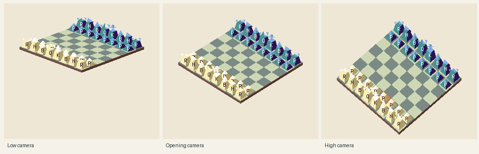
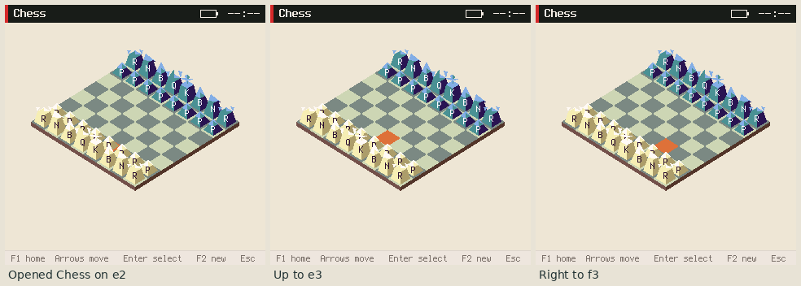
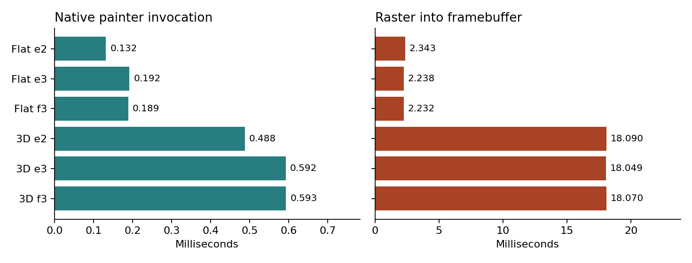

# How a Chess position becomes a three-dimensional screen on the PicoCalc

When the Chess game starts, it already knows the identity of each piece and its square. For a three-dimensional board it can publish exactly the same facts as it does for a flat one. The change is in the second artifact the game sends: the program that draws the position. This makes Chess a precise experiment in transferring code to the compositor. A different source program can change the geometry of every pixel while keeping the engine, packet format, selection rules and transport in place.

There are three different performance questions in this example. How long does the receiving board take to turn the source into callable machine code? How long does that code take to turn a single game position into drawing commands? How long does it take to draw and present those commands? Changing the instruction set used for a vertex calculation directly affects only one part of the second interval. We investigated the scalar renderer and the compiler’s ability to generate packed vertex operations separately before attempting to connect them.

## Drawing the same board from three angles

A vertex is a point in the three-dimensional coordinate system of the board. Let x and z denote position along the two board edges, and let y denote height above its playing surface. Each square is 16 units on a side. An orthographic camera maps a world point to a pair of screen coordinates. Its projection keeps parallel edges parallel. The renderer computes horizontal screen position u and vertical screen position v as follows, using integer arithmetic.

```text
u = 160 + x - z
v = 42 + (x + z) * pitch / 8 - y
```

Consider the first square in the opening pose, with pitch equal to five. Its far corner at (0, 0, 0) becomes (160, 42). Its right corner at (16, 0, 0) becomes (176, 52), and its near corner at (16, 0, 16) becomes (160, 62). Moving a vertex 20 units upwards changes v by −20. The reader can thus predict where a bishop’s tall geometry should appear without running the program. The compositor later adds a 22-pixel vertical offset to these body-relative coordinates to leave room for the header.



*These images were generated from the same normalized Chess position by replaying the painter at three pitches. The camera parameter belongs to the experiment. The ordinary game controls continue to operate the cursor and pieces.*

For a square the painter splits a quadrilateral into two triangles. For a piece it places faces at several heights. A knight has a sloping neck, a rook has corners at the top and a bishop has a pointed crown. Each face has one RGB565 color. The program shades the two sides differently, so adjacent faces remain distinguishable on the small screen. A letter stays visible on the front of each piece. The graphic is intentionally low polygon. Faces on the more distant squares are emitted first, so closer pieces cover distant faces where their screen projections overlap.

## A small change in the receiving compositor

The 2D command language understood filled and outlined rectangles, glyph runs and a terminal hints string. Our first prototype added one operation for a filled triangle. Its eight 16-bit words hold the operation number, three coordinate pairs and a color. The receiver checks that all three vertices fall within the application body. It validates the entire command stream before the visible display list changes. This prevents a truncated final triangle from leaving the first half of a failed frame on screen.

The rasterizer traverses the integer rows covered by the triangle. At each row it intersects the two active edges at pixel-center height, expresses the resulting horizontal interval as a half-open range, and fills the selected span with the existing graphics primitive. Two neighboring triangles that share a diagonal must agree on the ownership of the pixel centers that lie exactly on that edge. A triangle with zero area produces no spans. Both details show up in an independent oracle that evaluates three directed edge equations for each candidate pixel. Ten reference triangles, including opposite vertex orders and boundary cases, matched this oracle. Four malformed lists were rejected.

A real picture has many more records. The opening in the frozen scene consumes 406 commands and 3,281 words. This exceeds the older 274-command limit for the flat painter while fitting inside the existing 4,096-word output buffer. The private experiment therefore changes the command count bound and keeps validating each command. A change to the cap changes the maximum allowed work. It justifies measuring how long a busy opening takes to rasterize, even if the bytes in the incoming PSIX position stay exactly the same.

## Following a position through the system

1. The native Chess producer sends the Typed source in a counted message. The receiving firmware admits the trusted source identity. A compiler worker builds a closed RV32 procedure from the delivered bytes. The loader installs its entry on an internal-RAM stack.
2. The producer publishes the PSIX position. The receiver decodes pieces, cursor, selection, legal marks, last move and hints into 90 scalar cells. A cursor move changes which board squares are colored; it requires no new painter compilation.
3. The painter projects board corners, emits the board and its visible rim, then walks the piece diagonals in depth order. It builds a scratch command list and reports the word count. The compositor keeps the last fully validated list.
4. The graphics layer draws spans and existing glyphs into the app body. The ordinary compositor adds its header and hints, commits the framebuffer, and asks the display driver to transfer the changed regions. Reading a committed framebuffer and recording completed display transfers test different parts of that sequence.

The first 3D source is a closed two-buffer program. The independent review checked native and Wasm results against each other, computed the geometry of the ground triangles independently, and compared whole arenas to catch writes outside the returned list. It compared 47 historical game fixtures as well as synthetic states. Ignoring glyphs and colors, all six piece types produced distinguishable geometry. Enabling the experimental vector selector on this source yielded the same 9,572 machine-code bytes as the stock compiler and selected no vector loops.

## Why a useful loop can be absent from a working renderer

A flat board has 64 squares and only 81 distinct grid corners. A program that asks for the four corners of each square makes 256 projection requests. It is easy to express and has low storage overhead. Its calls each produce one point just before that point is consumed. The vector experiment, in contrast, acts on consecutive independent vertices whose coordinates are already available in separate arrays.

The proposed connection gives the closed painter a private, bounded workspace holding six columns: three coordinates and three results. A single initial loop fills a 9 by 9 lattice. A checked Typed function projects the complete lattice. Later code looks up its four grid indices for each square and emits the same triangles as the scalar painter. A row beginning at grid index 9r has corners 9r+c, 9r+c+1, 9r+c+10 and 9r+c+9. The last square touches the 81st point at index 80. For 81 vertices, ten complete eight-lane groups can execute, followed by one scalar tail.

This experiment has a stringent correctness test. The full drawing command stream can remain identical even when the geometry computation changes. It also has a stringent performance control. Constructing and rereading the coordinate columns costs time, and piece geometry, glyphs, rasterization and display transfers still take place. With a stationary camera, a table of precomputed grid points could be faster than either per-frame projector. Rendering a changed pose is an appropriate place to measure projection throughput; rendering an unchanged pose is an appropriate place to test reuse.

## The scalar native scene on the physical board

The running Chess app sent a 7,093-byte source file and three PSIX positions. The target-enabled compiler produced the same scalar code as the host control, because the frozen source had no eligible packed loop. The receiving board spent 1,064,648 µs compiling the source and 741 µs relocating the result. One source and one installation served all three states, with three native invocations, three paints and zero rejects.

| Cursor position | Native invocation | Raster | Completed SPI checksum of app area |
|---|---:|---:|---|
| e2 | 488 µs | 18,090 µs | 9bfb0fa8 |
| e3 | 592 µs | 18,049 µs | 372bf81b |
| f3 | 593 µs | 18,070 µs | 65a21193 |

At each position the operator compared all 190,720 application bytes, including the hints strip. An independent program also reconstructed the picture received by the panel driver from completed SPI writes. The changed checksums show that the cursor moved. Together with full-array equality, they establish a stronger result than a photograph of a board that happens to look correct. The actual keypad continued to require the isolated status-register substitute. These are physical processor and display results with a substituted input source.



*Physical framebuffer captures for e2, e3 and f3, reconstructed from the device. The lab compared the screen data with the completed display transfer as well as the host reference.*



The visual work changed substantially. In the first 3D cursor move, invocation plus raster cost 18.641 ms. Raster alone occupied about 96.8% of that sum. Even eliminating the entire 592 µs native call in this sample would reduce those two measured intervals by only 3.2%. The isolated vertex transformation is a fraction of the native call. This arithmetic defines how to interpret the fast PIE kernel without using it to predict a dramatic frame improvement. The chart excludes validation, composition, SPI transfer, player input and panel response. The original 2D screen uses a different appearance and has correspondingly different raster work.

## A real packed projection in the delivered painter

The combined program uses 81 vertices in a complete 9 by 9 board grid. It accepts the same state and output as the frozen scene and six additional private scratch buffers. The receiver owns 1,152 bytes of aligned internal scratch in six 192-byte records. Each record places its capacity four bytes before its aligned payload. The program fills coordinate columns from the board dimensions, invokes the automatically lowered projection on 81 points, then reads those outputs to construct the visible board rim and squares. Piece drawing retains its scalar implementation. The independent host review matched the frozen command and pixel results and checked the six channel addresses, a deliberately aliased input/output, and the final one-vertex tail. [Independent review](04-review.md)

A physical test also has to demonstrate that the running device entered the packed path. One version of the function stamps a reserved private scratch cell after completing the packed prefix. Two additional entries share its source and geometry and run without a stamp. One uses the same guards with scalar arithmetic; the other emits PIE. The operator requested repeated measurements explicitly from the serial console so that the experiment did not perform 176 timing calls in the application’s normal drawing turn. All three entries reside in one research image. On the host, independent inspection of that exact ELF traced each entry stub to its expected instructions.

The running Chess game delivered its 7,965-byte source to the P4. The test loader returned three executable entries in one 50,252-byte linked image. Preparing the three variants took 1,962,756 µs and relocation took 1,441 µs. This test-specific installation does about three variants' worth of compilation in one request; its time is meaningful as the setup cost of the comparison and cannot stand in for the cost of shipping a single optimized painter. The stamp was present for each physical view, all 3,281 drawing words agreed between entries, and the three SPI checksums matched the scalar scene. The device therefore executed vector arithmetic that helped produce actual screen geometry.

| Position | Improved scalar median cycles | PIE median cycles | Median reduction within each paired observation |
|---|---:|---:|---:|
| e2 | 188,920 | 185,356 | 1.89% |
| e3 | 188,936 | 185,363 | 1.90% |
| f3 | 188,923 | 185,342 | 1.88% |

Each row summarizes eleven paired observations. The test alternated entry order, warmed each entry, and averaged eight invocations per observation. PIE took fewer cycles in all 33 pairs. The paired median savings were 3,559–3,585 cycles depending on the position, approximately 9.9–10.0 µs at 360 MHz. Individual paired reductions ranged from 1.75% to 2.01% in this run. The two measured entries used the same data layout, source program and retained Chess state. Their timing excludes rasterization and SPI. It also excludes the stamp used to verify the separately presented path. The raw paired observations are summarized in the [director measurement receipt](../various/director-paired.json).

The result connects three scales of measurement. An isolated 256-point loop with the right memory layout gained a factor of eight compared with the improved scalar implementation. Inside the full painter, only 81 board points took that path, while piece geometry, geometry packing, buffer checks and command construction remained. The resulting full native invocation saved about 1.9%. Finally, rasterization of this visible picture took approximately 18 ms. Ten microseconds is roughly 0.05% of an 18–19 ms invocation-plus-raster interval. That last percentage is a sensitivity calculation. We did not measure a corresponding change in key-to-panel latency.

## What to use from this experiment

The working result is a complete example of an app-defined native renderer. Its producer can send an ordinary source program and continue to publish small independent position snapshots. Its receiver compiles the source, manages the lifetime of the executable, and presents validated geometry. The experiment also answers a narrower compiler question with a positive result: automatic range and dependence checks can select real P4 vector instructions in a function that contributes to visible application pixels.

For this stationary Chess view, I would focus rendering research on triangle spans, avoid regenerating static board geometry, and measure the regions changed by moving the cursor. If a future camera changes continuously, rerun the geometry benchmark for those moving views. Preserve the private scratch and ISA experiment as a reference for apps that have enough vertices to amortize their setup. The current scene does not complete a feature-parity replacement for all of the flat game's status and search displays. The validated 2D image remains the ordinary firmware. The separate [scalar implementation and qualification](02-scene.md) and [packed-scene experiment](03-packed-scene.md) give the code paths and controls for repeating both studies.

A census of that frozen opening gives a useful bound on the next optimization. The matte writes 89,600 pixels. The 372 triangles produce 5,580 nonempty horizontal spans, 3,916 shorter than eight pixels. Triangle stores, including overdraw, number 33,150. With aligned 16-byte stores, at most 11,792 of those writes could be grouped eight at a time under the assumptions recorded in the [span census](../various/raster-work.json). The actual cursor moves change just 328 and 604 pixels. This difference motivated two separate experiments, faster full rasterization and correct repaint from retained pixels.
