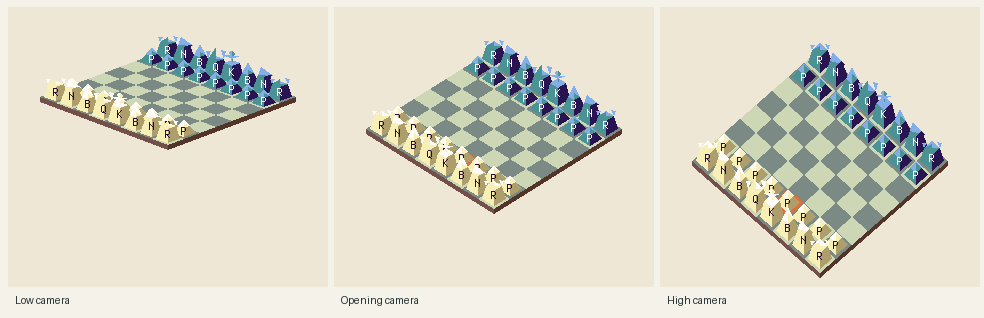
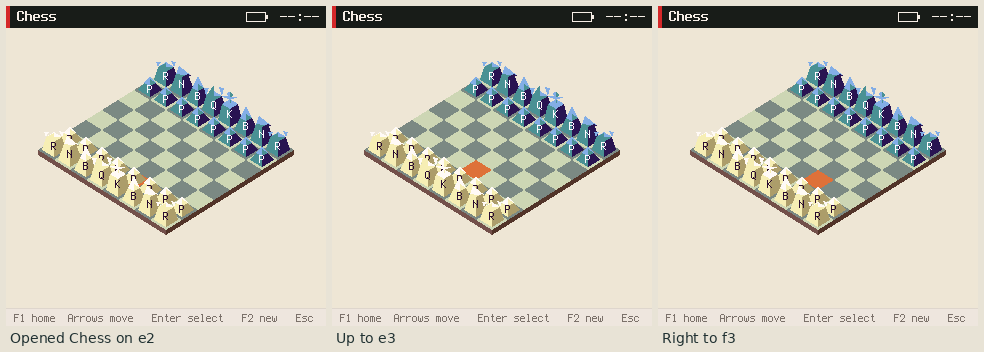

# How the PicoCalc renders a Chess position in three dimensions

Open Chess on the PicoCalc and press Up. The cursor moves from e2 to e3, but a pawn stays on e2. The game has reported two positions with the same pieces and different cursor fields. The receiving compositor has to place the pawn on the same square, change the highlight colors of the right two tiles, and send the resulting picture to the display. In this trial the picture contains a raised playing surface, two differently shaded sides on each tapered piece, and a different silhouette for each piece kind. Chess supplies the program that describes these shapes.

The experiment has three inputs at different times. Chess sends a version-pinned Typed program once at startup. It sends a compact position each time the screen state changes. The painter also has a camera setting. The handheld uses one fixed setting and the host runs the same opening through three. These inputs let us ask different questions. Changing the camera tests the projection. Advancing the cursor tests an ordinary update to the same camera. Checking what returned through completed SPI writes tests the display boundary.

## A position can describe a screen without containing its pixels

A Chess application's renderer needs the pieces on 64 squares, a legal-destination mask for each rank, and fields including the cursor and selected square. The game already sends these values as PSIX, a compact indexed encoding of structured state. The receiver checks and decodes the packet into a flat array of 90 unsigned 16-bit cells. Cells 0 through 63 encode piece identity and side. Cells 64 through 71 encode rank masks. The remaining pairs encode nine signed fields. The first pair is the cursor. The e2 cursor uses index 52 because row six starts at 48 and e is the fifth file. In the next packet the cursor index becomes 44, eight less. The pawn cell at index 52 has the same piece value.

A separate source message contains a text program in Typed, the project's restricted statically typed JavaScript-like language. The receiver approves the message when the publisher and receiver are the known worlds and its bytes equal the firmware's trusted copy. Chess's embedded source and the trusted copy come from the same build input. The compiler then reads the received bytes, produces RV32 machine code, verifies the closed function signature and links the result into a reserved slot. The renderer exposes one callable entry, `paintChess(state, out)`. `state` points to the normalized cells and `out` points to a bounded array of drawing words. Both buffers start with the number of cells they can hold. The return value says how many words the painter wrote. When a valid position arrives before the compiler finishes, the receiver keeps those cells. The newly linked entry can paint the retained position as soon as it is ready.

There is a reason to split this across two messages. Each of three opening frames can reuse the same native program even though its cursor moves. Installation performs more work than a warm draw. Once it is ready, a new valid snapshot can run the same `paintChess` function immediately. Vertex positions and face colors live in the painter, so the only per-update input is the state. The same game rules and packet layout supported the earlier flat display and now supply the 3D experiment. [Typed painter](../scripts/scene/isometric.typed) · [Implementation guide](../design-doc/02-implement-and-qualify-the-scalar-scene.md)

```text
Chess sends Typed source ─→ compositor approves, compiles, links and keeps the entry
Chess sends e2 state     ─→ decode cells ─→ paintChess ─→ validate commands ─→ app pixels
Chess sends e3 state     ─→ decode cells ─→ same entry ─→ validate commands ─→ app pixels
```

## A board corner has three coordinates until projection

Choose x and z axes along the two rows of board edges. Give each tile a side length of 16 units. The top surface has y=0, and positive y lifts a point above the board. A point directly above (8, 0, 8) on the far corner tile might have world coordinates (8, 14, 8). Cameras can move that point's screen location while leaving the piece and the game state alone.

The painter uses an orthographic projection, in which parallel edges stay parallel across the projected board. Its screen coordinates are `u = 160 + x - z` and `v = 42 + (x + z) * pitch / 8 - y`. Division is signed integer division, and the projected positions used here have nonnegative screen coordinates. At pitch 5 the tile center (8, 0, 8) becomes (160, 52). The point at y=14 becomes (160, 38). Holding x and z constant keeps u constant and moves v up the screen by 14 pixels. Changing pitch from 5 to 7 instead moves the tile center to (160, 56). The difference reflects the x+z distance from the far corner and grows across the board.

A tile at the world origin spans `(0,0,0)`, `(16,0,0)`, `(16,0,16)` and `(0,0,16)`. At pitch 5 these points form a diamond with corners (160,42), (176,52), (160,62) and (144,52). The first drawn tile face is the triangle joining the first three points. The second face joins the first, third and fourth. The command stream stores those six coordinate numbers and a 16-bit color per triangle. The compositor's triangle rasterizer consumes these screen coordinates directly.



A piece changes the world coordinates before it changes the screen. A king's cross stands above its cap, and a knight projects a muzzle toward +x. The face on the side of positive z uses a lighter shade than the other visible side. The light pieces use warm tones and the dark pieces use blue tones. Type glyphs supplement the shapes on a screen whose tile widths are only 32 pixels. In the independent geometry review each kind produced a different face signature at a common square after color and glyphs were removed. The alternative host views use exactly the same piece data.

## Visible surfaces depend on face order

If the renderer painted a far pawn after the near piece that partly covers it, the far pawn's top could overwrite pixels that should belong to the near piece. The projection makes depth along the diagonals predictable. At y=0, increasing x+z increases v. The painter visits the board's 15 grid diagonals from the far corner forward, and orders pieces by `file + rank`. Pieces on one diagonal are 32 pixels apart in u and stay within about 12 horizontal pixels of each center. The chosen fixed view and bounded geometry make order predictable without storing a depth number per pixel.

Each filled polygon comes from triangles. Two triangles form a visible quadrilateral side, and small triangles produce tops, caps and a crown or cross. The board itself has 128 tile triangles and four triangles along its two visible walls. The walls extend five units below the playing surface. Highlighting e3 changes a tile color and keeps the projected world corners and piece order intact. Taller pieces overlap the diamonds naturally because their vertices have nonzero y.

The camera choices are restricted. The demonstration can change the pitch within a fixed viewing direction because all meshes are ordered for that direction. A camera rotating around the board would require a different visibility and ordering rule. Pitches 3 and 7 are host probes. Ordinary handheld input in this trial changes the Chess state at pitch 5.

## The command stream sets the receiver's work

The compositor already accepts compact fills, outlines, text and a terminal hint. The experiment adds opcode 5, eight 16-bit words comprising the opcode, three body-relative (x,y) pairs, and an RGB565 color. RGB565 stores the red and blue intensities in five bits each and green in six, matching the display buffer. The command validator checks all three vertex pairs, record lengths, record count and the terminal hint before replacing the retained command list. The output arena holds 4,096 words.

The opening emits 406 commands in 3,281 words. A square has two equal-sized triangle commands. An ordinary piece is eight commands or ten. A worst-case allocation covers 32 pieces at ten commands each, four slab triangles, 128 tile triangles, one fill and one hint. The resulting ceiling is 454 commands. A capture reduces the number of pieces on the board, although a promotion can change how many commands an individual piece uses. The private trial expands the older 274-record limit and fits that ceiling inside the existing word arena. The syntax checker for PSIX alone can accept impossible occupancies. The native buffer capacity and validator still bound writes and prevent an oversized result from replacing the display list.

A triangle rasterizer has to decide which integer-addressed pixels belong to a shape whose edges can pass through pixel centers. The implementation intersects two edges at row center y+½, rounds each boundary to the first pixel center on or past it, and fills an interval from the left boundary up to the right. This half-open convention settles ties along shared edges. Adjacent faces leave no crack where the centers land on a common diagonal, and a degenerate triangle such as a column of collinear vertices emits no span.

The host tests this with a second implementation. It examines a pixel center against all three directed edges and applies the tie convention in the orientation of each edge. It calculates no scanline intersection. The resulting 320×280 image, plus a distinct independent calculation of the compositor's 18-row hints strip, supplies the expected app bytes. The test shares shipped font cells with the product and rasterizes their coverage separately. It compared the C and Python body pixels in 51 states or view controls, checked ten triangle cases, and verified rejection of four malformed streams. The independent compiler reviewer additionally checked 15 whole arenas, the 128 tile triangles in each, and the six geometry signatures. [Host frame receipt](../various/host-poses.json) · [Reference renderer](../scripts/scene/oracle.py)

## Three frames from the actual handheld

| Input and cursor | Native command generation | Triangle and text raster | SPI busy in the observation window | Completed app pixels CRC-32 |
| --- | ---: | ---: | ---: | --- |
| Open Chess on e2 | 488 µs | 18,090 µs | 55.96 ms | `9bfb0fa8` |
| Up to e3 | 592 µs | 18,049 µs | 1.66 ms | `372bf81b` |
| Right to f3 | 593 µs | 18,070 µs | 1.42 ms | `65a21193` |



The PicoCalc received and compiled 7,093 bytes of source once. The compile worker took 1,064,648 µs of wall time and relocation took 741 µs. The receiver reported one source, one compile, three positions, three native calls, three paints and zero rejects by f3. The P4 linked ELF was 17,456 bytes. Its logged fingerprint matched the stock-linked ELF compiled on the host.

Each frame's 190,720 app bytes matched the independent host reference pixel for pixel, including the hint strip. The SPI observer covers a distinct boundary. It reconstructs RGB565 writes after the ESP SPI driver reports each transaction complete, using the LCD window commands to assign pixels to their positions. The app-area CRC from that reconstruction matched the framebuffer CRC for each pose, with zero incomplete transactions or faults. The observer runs inside the firmware and measures the bytes handed to the panel through SPI completion. The measurement ends at the SPI driver's transaction completion.

The key commands ran through the ordinary Chess focus and key handling, using the instrumented substituted key-status register. The physical qualification covers the opening and two cursor moves at the fixed pitch. The prototype presents piece glyphs, cursor and move highlights, and a help strip. The 2D release also offers coordinates and a move-evaluation footer. The qualified ordinary firmware was restored afterward and verified against its flash image. [Physical receipt](../various/scalar-device/receipt.json)

Raster replay took about 18 ms in all three observed frames. SPI busy time changed when the compositor could send small regions for the two cursor moves. The e3 movement sent 1,448 SPI bytes in its window and f3 sent 2,531. The rasterizer still walked the full triangle stream. This explains why most of the warm CPU cost survives a small display update. The SPI column is the controller's aggregate busy time over an observation window with an explicit settle period. Measuring key-to-display latency would require a timestamp spanning the input event and the last applicable transaction.

## What changes when the compiler can emit PIE?

PIE is the ESP32-P4's packed integer extension. One of its instructions can perform arithmetic on several small integer lanes together. The separate compiler study's kernel supplies eight independent projection inputs at a time. It establishes that the hardware and the experimental compiler can execute a supported vector loop. The scalar Chess painter instead calls its point projector one vertex at a time and interleaves the results with command emission and piece selection. Enabling the experimental target therefore gives the compiler zero eligible loops in this program.

The proof is concrete. The raw RV32 image from the stock compiler and from the target-enabled compiler matches byte for byte. Each output is 9,572 bytes, comfortably inside the 16 KiB slot. The closed mobile linker in the handheld trial requests the target and fails the build of the delivered program if its diagnostic list reports any successful PIE transformation. The handheld logged an FNV-1a fingerprint of `d5a226be` for the linked ELF, matching the stock-linked host image. That comparison matters because the fixed-size ELF slot makes two linked output sizes agree even when the bytes inside differ.

A subsequent packed scene experiment can rearrange the input to a batch of projected board vertices, then feed those exact projected values into the same triangle stream. Its correctness question concerns which coordinates the triangles actually consume. Its performance question concerns the entire path including compiler installation, scalar piece geometry, raster spans and display I/O. A faster isolated projection alone leaves all four of those costs in place.

## Reproducing the study

Start with `projectPoint` and `paintPose` in the Typed painter. Derive the first diamond at each pitch, then run the host replay and pixel comparison. The first diamond tests the projection's signs and offsets. The full-frame comparisons test the composition of hundreds of later primitives. Use the physical receipt to follow the e2 packet through compilation, retained paint, and completed SPI alongside the matching screenshot. [Implementation and reproduction guide](../design-doc/02-implement-and-qualify-the-scalar-scene.md)
