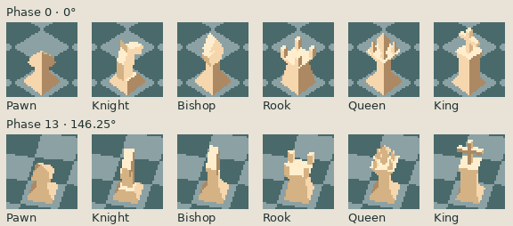

# Six Chess solids and a rotating camera

A black knight on b8 stays on b8 as the view turns. Its long muzzle passes around the square. From one phase we see the broad side of the neck and from another we see the narrow head and its thickness. The board edge labels move with the board while keeping their letters upright.

The Chess world sends the compositor a position containing pieces, selections and move endpoints in game coordinates. The receiving compositor adds one number describing the viewing angle. The Typed painter takes that state buffer and an output buffer. The output is a sequence of projected colored triangles and small text records. The framebuffer compositor consumes those screen coordinates and colors directly. [Maintained painter](../../../../../../picocalc-os/worlds/chess/painter-3d.typed) · [Geometry guide](../design-doc/03-maintain-six-meshes-and-the-rotating-camera.md)

## Assemble the piece before choosing a view

A piece occupies a 16-unit square. Its vertex coordinates are offsets from the square center. The widest model extends seven units along either horizontal axis. Positive y raises a vertex above the board, and the tallest point in the set is the king's cross at y=30. A small number of planes gives each shape its own profile.

The simplest construction joins two square horizontal rings of different sizes. That solid is a frustum, a trimmed pyramid with a cap or a joining ring at the top. When the upper ring shrinks to a point, its walls become triangles. Stacking these parts makes a broad base, a narrow middle and a head. Each ring in Typed packs a height and a half width as a single integer. The pawn's ring value 50 denotes a height of six and a half width of two. The next ring, 74, keeps that width and raises the height to nine. The constant width gives the pawn a thin neck. Rings 92 and 123 form the head, and ring 136 ends at a point above it.

The rook tapers toward the shaft and widens again to a square platform. Four squat solids rise from its corners. Their tops and the gaps between them form its crenellations. The queen's upper shoulder carries four pointed solids. A taller central tip rises between them. Its crown shares the outer layout of the rook, with a different height profile and pointed caps.

The knight, bishop and king need outlines that are harder to write as rings. Each starts with a pedestal and adds an *extrusion*. Draw an outline in a vertical plane, make a parallel copy behind it, and connect each edge to the corresponding edge of the copy. This gives the piece two caps and the walls that make it thick. The knight's outline has an ear, a sloping forehead and a long muzzle. White and black knights face opposite ends of the board. The bishop's outline rises to its mitre and cuts inward along one side to form the notch. The king's outline makes four arms of a cross. The lower arm meets the pedestal.

For an outline with an inward notch, drawing triangles from a single vertex could fill the gap. The generator clips off a convex corner whose triangle contains no other remaining vertex, then joins the edges next to it. Repeating this step creates triangles that stay inside the outline. This process, called ear clipping, creates seven cap triangles for the knight, six for the bishop and ten for the king. The side quads follow the original outline. [Outline generator](../../../../../../picocalc-os/tools/generate-chess-meshes.py)

## Rotate the geometry about the center

The board's x and z axes follow files and ranks. Its center is (64,64). For each world point the painter first computes dx = x − 64 and dz = z − 64. Rotating by the chosen sine and cosine gives the new horizontal coordinates cos·dx − sin·dz and sin·dx + cos·dz. Scaling sine and cosine by 256 lets the handheld compute the result with integer arithmetic. Nine values between zero and a quarter turn suffice because the other phases reflect or negate those values.

The camera projects the difference between the rotated x and z coordinates onto the screen's horizontal axis. It projects five eighths of their sum onto the vertical axis and subtracts the point's height. The result is orthographic. Parallel lines remain parallel after projection. The vertical center of the board is 140 within the 280-row app body.

At phase 0 the world corner (0,0) appears at body pixel (160,60). At phase 4, one eighth of a full turn later, it moves to (250,84). At phase 8 it lands at (288,140). These are different screen coordinates for the same game corner. The painter applies the transform to the board, pieces, cursor and last-move tile coloring. At a completed quarter turn the input router uses the inverse mapping so the arrow keys continue to be meaningful in the displayed view. F3 and F4 request quarter turns in opposite directions, with a new picture at each of the eight steps.

The file and rank labels remain horizontal. The painter chooses the visible edge of the board for each label axis from that axis's slope in depth. A label therefore keeps its game coordinate while its screen position changes. The cursor border and the destination tile colors provide additional visible references during a turn.

## Decide which faces to draw

Each face starts as an ordered boundary. Projecting three vertices gives a signed area, and its sign says which direction the face points. The painter uses that winding to keep the visible walls of the frusta. For an extrusion it picks the nearer cap from the sign of the thickness axis in camera depth. The rotated knight can therefore show either broad side. The cap triangles and the visible walls share the same projected boundary.

The painter also needs an ordering among pieces. The fixed-view study used a diagonal traversal. At an intermediate phase the camera crosses the board at a different angle, so the renderer assigns each square a depth key using the rotated sum of its x and z coordinates. It visits occupied squares from far to near and uses the square index to settle ties. There are at most 32 occupied squares, so scanning the 64 cells for the next piece has a fixed bound and uses scalar storage. The procedure suits the board's restricted layout and footprint. Crown points and similar small parts have an explicit assembly order. Both choices let the compositor work with a color buffer alone.

Each side has a small RGB565 palette. Warm ivory top faces and brown shaded sides distinguish White's solids. Blue-gray and navy serve the same roles on Black. The gray-blue tile colors preserve contrast on the near side at panel scale. Surface roles determine the colors, while camera orientation determines each face's visible width. Changes in width and visibility provide depth cues during rotation.

## Count the output against the hardware budget

The first format stored preprojected triangle data in string literals. Its source looked compact, but Typed expands each buffer literal to a checked store for every character. The generated program reached 70,136 bytes. The final painter computes the frusta and wall visibility directly. Its outline table groups three 9-bit vertices in one i32, and its cap table groups two 12-bit triangles in one i32. The runtime divides and takes remainders to unpack the needed entry. These changes brought the generated RV32 to 23,848 bytes for a 16,316-byte Typed source. The WebAssembly module is 8,367 bytes.

A triangle record occupies eight 16-bit words. Text records have variable length, so both the record count and the total words need bounds. The tested maximum for a piece across all colors, types, squares and phases was 38 triangles. Charging that maximum to all 32 pieces, plus the floor, cursor, labels and status, gives a bound of 1,370 records and 11,022 words. The 12,288-word 3D arena covers that bound. An input containing 33 occupied squares returns zero before changing the output.

The host comparison covers five snapshots from the real game for all 32 phases. It executes the generated RV32 in an instruction model and compares the complete arena to WebAssembly. It also projects every floor corner independently from trigonometry, checks both triangles of each tile and the cursor inset, and generates expected app pixels through an independent rasterizer. Every snapshot produced 32 distinct app-pixel hashes. The largest of those frames used 8,655 words. A separate 24,576-case placement sweep exercises both sides at all squares and phases. Those receipts cover geometry, code and bounds on the host. The physical camera and gameplay receipts cover runtime input and completed panel transfers. [Host geometry receipt](../various/maintained-geometry/host-validation.json) · [Implementation diary](../reference/05-maintained-geometry-diary.md)
