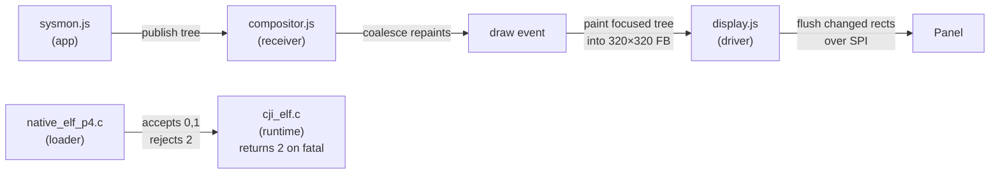

# How Much of a System Screen Must Cross the Mailbox?

## Introduction

On the ESP32-P4 PicoCalc, an app with a screen produces a declarative tree of text, tables or graphs, and the kernel publishes that tree to the compositor through a message channel. The compositor verifies the sender, retains the latest tree, and paints the focused application's tree into a 320×320 framebuffer. Changed rectangles are flushed over SPI to the physical panel. The native compositor runs as a CJI-generated ELF module under a strict budget: 80 ms per turn and an allowance of 768 KiB of charged memory. If the runtime detects a fatal condition it returns status code 2; the generic loader in `picocalc-os/port/esp32p4/optional/native_elf/native_elf_p4.c` rejects code 2 and the module is terminated.

The System monitor (`picocalc-os/js/apps/sysmon.js`) displays three tabbed views — Worlds, Handles, and Buses — along with two continuously updated graphs. It samples every 500 ms and retains 48 graph samples. Users can select any row in the active list. Prior to the fix, two serial-captured faults showed the compositor crashing with "out of memory" at 512 KiB of charged usage (uptime 39.836 s and 53.336 s), each followed by a returned-2 rejection 1.3 ms later. Two additional frame events (30.419 s and 31.763 s) exceeded the 80 ms budget without a preceding OOM message in the capture. The question this report addresses is: given these constraints, how much of the System monitor's screen content must be included in the published tree?

## Architecture



The compositor (`picocalc-os/js/system/compositor.js`) receives each published tree, verifies the sender, and stores the latest version. A separate draw event measures and paints the focused application's tree at a specific origin and size (x=8, y=28, width=304, height=270 in the test harness). A refused allocation does not add to charged usage, so the 512 KiB figure represents live allocations at the moment the allocator declined a request. The exact failed allocation size and the specific timing component responsible for the budget overruns were not measured.

## The Windowing Solution

Commit `df79a0f` introduces producer-side windowing. Instead of publishing all rows in a list, the application publishes a fixed-capacity window centered on the current selection. Worlds publishes up to eight rows and Handles up to fourteen. The source model, selected-item details, graphs, tabs, and update frequency are all preserved unchanged. The centering formula is:

```
start = clamp(sel - floor(capacity / 2), 0, max(0, count - capacity))
localIndex = sel - start
```

For an eight-row Worlds window, `floor(capacity / 2) = 4`. For fourteen-row Handles, `floor(capacity / 2) = 7`.

## Worked Example

Suppose the Worlds list contains 28 entries and the user has selected global row 20. With capacity 8 and offset 4:

1. Unclamped start: `20 - 4 = 16`
2. Maximum start: `max(0, 28 - 8) = 20`
3. Clamped start: `clamp(16, 0, 20) = 16`
4. Window rows: global indices 16 through 23
5. Local index of selection: `20 - 16 = 4`

The published tree contains only rows 16–23. The compositor receives eight rows and chooses which six to draw. Physical inspection of the board confirmed six visible rows on screen for this view, consistent with the rendering area and row height.

For the same selection, the six-row viewport begins at local row 1. On the panel this places global rows 17 through 22 in view.

At the boundaries, clamping prevents the window from sliding past the list edges. For selection 2: `clamp(2 - 4, 0, 20) = 0`, local index 2 (shifted above center). For selection 26: `clamp(26 - 4, 0, 20) = 20`, local index 6 (shifted below center).

## Pseudocode

```
function windowedRows(allRows, selected, capacity):
    count = length(allRows)
    offset = floor(capacity / 2)
    start = clamp(selected - offset, 0, max(0, count - capacity))
    localIndex = selected - start
    window = slice(allRows, start, min(start + capacity, count))  // exclusive end
    return (window, localIndex)
```

For graph rendering, each of the 48 normalized samples is mapped to an integer pixel distance from the baseline: `pixelDistance = -Math.round(-normalizedValue * (height - 3))`. Labels continue to use the original counter values, not the pixel distances.

## Evidence Table

| Measurement | Before | After | Reduction | Source Path |
|---|---|---|---|---|
| Tree bytes, final Worlds selection | 4016 | 1766 | 56.0% | Synthetic JSON fixture, 28 Worlds |
| Tree bytes, final Handles selection | 2641 | 1529 | 42.1% | Synthetic JSON fixture, 36 Handles |
| Tree bytes, Buses selection | 2678 | 1166 | 56.5% | Synthetic JSON fixture |


The tree byte figures are synthetic JSON tree sizes, not measured heap bytes or real serial packet lengths. The fixture uses 36 handles; this is not the observed real-world count. In a separate 152-second physical exercise of df79a0f, the compositor advanced from 181 to 1,256 turns and System advanced from 92 to 419. Zero faults were logged. These are cumulative counters within a run. Estimating a throughput improvement would require a matched timing comparison.

## The Half-Pixel Correction

During testing prompted by the producer review's recommendation for boundary stress cases, a one-pixel line mismatch was discovered. The native renderer computes absolute screen y by subtracting the fractional graph offset from an integer coordinate and then rounding. The initial candidate rounded the fractional offset alone before subtraction, which yields a different result when the offset is near a half-integer. Commit `ef0ff95` corrects this: when an inexact offset lies within `320 * Number.EPSILON` of a half, the original operand order (subtract then round) is preserved for the entire graph. An exact half follows the established tie-breaking rule. Sixty-nine additional host boundary comparisons then passed. This correction applies to ef0ff95; the physical capture described in the evidence table was performed on the earlier df79a0f candidate without this fix.

## What the Evidence Does and Does Not Prove

The physical experiment on df79a0f demonstrates that the windowed System monitor ran for 152 seconds with zero logged faults, three complete world snapshots, and four CRC-checked frames showing correct rendering across tabs and keyboard navigation. This is a direct physical outcome under the original time and memory budgets.

The evidence does not establish the specific allocation that failed in the original firmware, exact per-component timing, an unbounded runtime guarantee, or an SPI transfer speedup. The gap between the 512 KiB charged usage at the original OOM and the 768 KiB budget remains unexplained. The corrected record states that fragmentation, specific collector growth, and common cause are not proved. No allocator or fragmentation fix shipped. The tree byte reductions (1.1–2.3 KiB per tree in synthetic measurement) are small relative to that gap, so the mechanism by which the fix prevented the OOM is not fully characterized. The supervisor’s synthesis records the separate physical test on the rounding-corrected ef0ff95 firmware.
