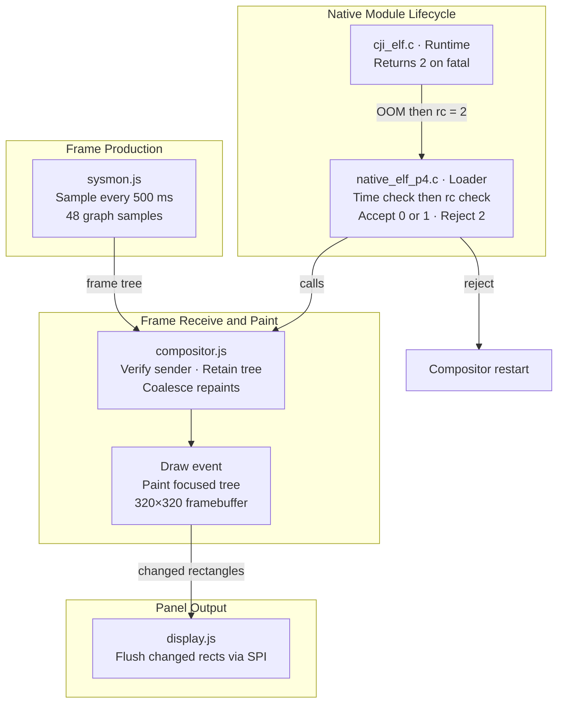

# Reading the Two Faults Behind a Compositor Restart

## Introduction

This report examines two out-of-memory faults that caused the native compositor to restart on the ESP32-P4 PicoCalc while the System Monitor application was in use. The investigation was structured as a bounded two-role review: one researcher examined the frame producer, another (the author of this report) examined the receiver and compositor paths. A supervisor implemented all code changes, ran the host comparison harness, and operated the physical board. This report covers the receiver-side analysis: how frames reach the compositor, what the raw serial log proves about the two faults, how the windowing fix in commit df79a0f reduces frame size, and what a 152-second physical experiment demonstrated. It also documents where the preliminary receiver review proposed incorrect conclusions and how the corrected evidence supersedes them.

## The Frame Pipeline

The System Monitor (`picocalc-os/js/apps/sysmon.js`) reads the world list and handles while focused, samples every 500 ms, and retains 48 graph samples. The user can select all rows across three tabs. Each update produces a frame tree sent to the compositor.

The compositor (`picocalc-os/js/system/compositor.js`) receives frames, verifies the sender, retains the latest tree, and coalesces repaint requests. A separate draw event measures the layout and paints the focused tree into a 320×320 framebuffer. Changed rectangles are flushed through the display driver (`picocalc-os/js/drivers/display.js`) to the panel over SPI. Importantly, a frame fault does not time the SPI transfer — the budget measurement covers computation, not panel communication.

On the ESP32-P4, the native compositor (`natives/compositor.elf`) is generated from JavaScript by CJI. The generic loader (`picocalc-os/port/esp32p4/optional/native_elf/native_elf_p4.c`) calls the module, checks elapsed time first, then inspects the return code. It accepts 0 (`NW_DONE`, frame complete) or 1 (`NW_LATER`, deferred reply) and rejects 2. The CJI runtime (`runtime/cji_elf.c`) deliberately returns 2 on a fatal error such as an allocation failure. The time budget is 80 ms and the memory quota is 768 KiB.



## The Four Logged Events

The raw serial capture from the original firmware contains four anomalous events. Two are time-budget violations without an accompanying out-of-memory message; two are OOM faults that caused compositor restarts.

| Event | Uptime (s) | OOM message preceding | Return code | Reported usage (KiB) | Outcome |
|-------|-----------|----------------------|-------------|---------------------|---------|
| 1 | 30.419 | No | — | 504 | Budget exceeded (> 80 ms) |
| 2 | 31.763 | No | — | 504 | Budget exceeded (> 80 ms) |
| 3 | 39.836 | Yes, 1.3 ms prior | 2 (fatal) | 512 | Compositor restart |
| 4 | 53.336 | Yes, 1.3 ms prior | 2 (fatal) | 512 | Compositor restart |

Events 3 and 4 are the two faults of the title. Each was preceded by a serial line reading `compositor: crashed: out of memory` approximately 1.3 ms before the loader recorded the return-code-2 rejection. The reported usage — 504 KiB for budget-only events and 512 KiB for OOM events — is well below the 768 KiB quota. However, a refused allocation does not add to charged usage. The reported figure reflects the state before the failed request, not the size of the request itself. The exact allocation that failed, the exact timing component that exceeded the budget, and whether the budget-only and OOM events share a common cause are all unmeasured. The corrected record states explicitly that fragmentation, specific garbage collector growth, and a common cause cannot be claimed as proved from this evidence.

## Correction: The Loader Rejects Return Code 2

The preliminary receiver review hypothesized a false-success vector: if the loader checked the return code with a narrow test such as `rc == 1`, a returned 2 could pass silently as success. The corrected evidence contradicts this hypothesis. The loader rejects 2 outright. There is no evidence of false success in the loader, and the system never clamps 2 to 1. The receiver review's additional proposals to reinterpret code 1 were also rejected by the supervisor. When an inference from code reading conflicts with observed board behavior, the board evidence governs. Reports should state what the evidence actually proves, not what a plausible reading of the code might permit.

## The Windowing Fix (df79a0f)

Commit df79a0f reduces frame size by publishing a centered window of rows instead of the entire list. The System Monitor retains the complete source model, selected details, tabs, update frequency, all selectable rows, and both graphs. The table change limits each published window to eight entries for Worlds and fourteen for Handles. A separate change reduces the size of the serialized graph samples, including those on Buses.

### Pseudocode

```
function window_start(selected, capacity, count):
    offset = floor(capacity / 2)
    max_start = max(0, count - capacity)
    return clamp(selected - offset, 0, max_start)

local_index = selected - window_start(selected, capacity, count)
```

For Worlds the capacity is 8 and the offset is 4. For Handles the capacity is 14 and the offset is 7. The local index positions the selection highlight within the published window while the global index is preserved for all model operations.

### Worked Example

Consider 28 worlds with the global selection at row 20, using the Worlds capacity of 8.

```
offset    = floor(8 / 2) = 4
max_start = max(0, 28 - 8) = 20
start     = clamp(20 - 4, 0, 20) = clamp(16, 0, 20) = 16
window    = global rows 16 through 23
local_index = 20 - 16 = 4
```

The published window contains eight rows starting at global index 16. When six rows fit on screen, rendering begins at global row 17. The physical board confirmed this geometry: the focused Worlds screen showed six visible rows.

### Graph Encoding

Each of the 48 graph samples is mapped from its normalized floating-point value to an integer vertical distance from its baseline: `scale = height - 3`. Labels continue to use the original counters. This reduces serialized precision without affecting visual output.

### Measured Tree Size Reductions

The supervisor's host comparison harness fed identical synthetic state through both the original and windowed screen functions, then passed the resulting trees to the original compositor's draw routine at x=8, y=28, width=304, height=270. Ordered framebuffer calls and arguments were captured and compared across 28 Worlds selections, 36 Handles selections, and one Buses selection. Result: zero drawing differences.

| Fixture | Original tree (bytes) | Windowed tree (bytes) | Reduction |
|---------|----------------------|----------------------|-----------|
| A (Worlds, final) | 4016 | 1766 | 56.0% |
| B (Handles, final) | 2641 | 1529 | 42.1% |
| C (Buses) | 2678 | 1166 | 56.5% |

These are synthetic JSON tree bytes, not measured heap bytes or real serial packet lengths. A fixture contains 36 handles, which is not the observed real-world number. No kernel ABI or memory/time budget changes were made.

## The Half-Pixel Correction (ef0ff95)

Producer-side review proposed half-pixel stress tests and short-table edge cases. The supervisor implemented them. A new test discovered a one-pixel line mismatch: the native renderer rounds absolute screen y after subtracting the fractional offset, while the first candidate rounded the offset alone. Commit ef0ff95 preserves original operands for an entire graph when an inexact offset lies within `320 × Number.EPSILON` of a half-pixel boundary. An exact half follows the established tie rule. Sixty-nine additional host boundary comparisons then passed.

## Physical Verification of df79a0f

The supervisor operated a 152-second scheduled capture on the ESP32-P4 board running the first candidate firmware (df79a0f), under the unchanged 80 ms and 768 KiB limits.

- The compositor advanced from 181 to 1256 turns; the System Monitor advanced from 92 to 419 turns.
- Three complete world snapshots were captured.
- Zero new logged faults or restarts were observed.
- Four CRC-checked, visually inspected frames confirmed: System Worlds with keyboard selected, last world `nat-dial` selected after 30 Down key presses, Handles tab, and Buses tab.
- The focused Worlds screen displayed six visible rows.
- A final Chess screen had a corrupt initial serial capture and was successfully recaptured separately.

This is a direct physical outcome on commit df79a0f. It does not establish the specific failed allocation, exact component timing, an unbounded guarantee, or an SPI speedup. The supervisor's synthesis reports the subsequent physical trial on ef0ff95. All board claims in this report are scoped to df79a0f.

## What Remains Unproved

The fix eliminated the observed faults in a bounded physical trial, but the fault mechanism is not fully characterized. The exact allocation that failed at 512 KiB against a 768 KiB quota is unknown. Whether the two budget-only events share a cause with the two OOM events is unestablished. No fragmentation analysis, allocator rollback fix, or kernel ABI change shipped. The relationship between synthetic JSON tree bytes and actual ESP32-P4 heap consumption has not been quantified.
