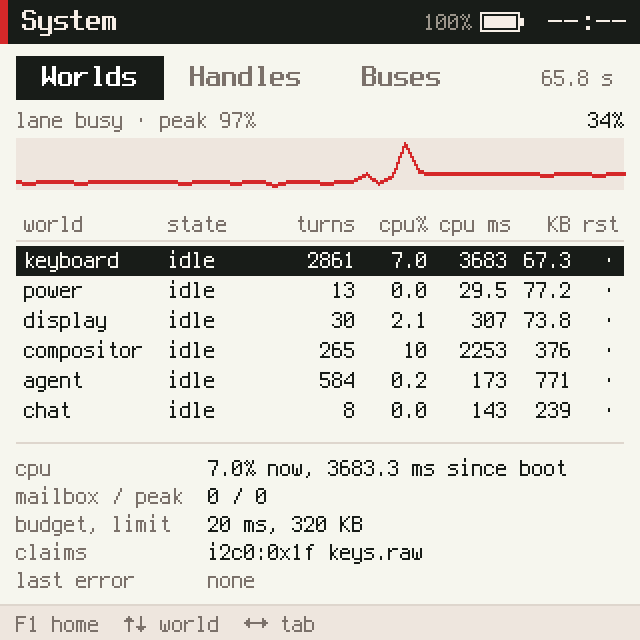
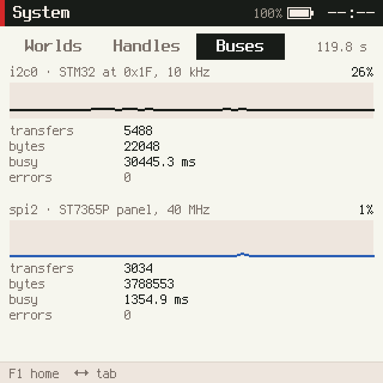

# Diagnosing a handheld compositor from the first key to the last pixel

Opening System on an ESP32-P4 PicoCalc sometimes made the compositor restart. The screen showed a native protocol error. The decisive piece of evidence was a second line printed roughly one millisecond earlier. Reading those lines together explained why a correctly delivered screen update could end with an invalid native return value. A separate experiment then established how much of that update the monitor actually needed to send.

## The event responsible for a pixel

Consider the CPU figure for the keyboard driver. System reads the world table twice a second. For two successive observations it subtracts the previous cumulative CPU time from the current one and divides by the interval between them. It formats the result in a table cell. As the selected row changes, a details section below the table also changes. Even a monitor that draws only six visible rows needs the complete list to let the operator navigate to the last world.

The producer, called sysmon inside the OS, is a JavaScript app. Its screen function returns a tree containing a graph, a table and text. After a successful segment the kernel renders an eligible app's screen; when the serialized frame changes, it retains the new frame and publishes an event identifying the owner. The compositor receives that event as a separate world. It checks the sender, saves the screen tree, and queues a draw for the currently focused app. The native executable for this service is built from JavaScript using CJI. Its implementation and the System app's implementation therefore run through different execution engines.

~~~mermaid
flowchart LR
    A[System samples world counters] --> B[Kernel compares and retains screen]
    B --> C[Native compositor decodes frames event]
    C --> D[Draw event measures and paints tree]
    D --> E[Commit finds changed rectangles]
    E --> F[Display transfers RGB565 pixels over SPI]
~~~

The kernel named *frames* as the active event in all four fault records. Painting occurs in *draw*, and the display transfer occurs in a third world. A performance investigation that started by timing SPI would measure a later part of this sequence. The defect appeared before that point.

## Reading the failure in order

| Board uptime | Compositor memory reported | Observation |
|---:|---:|---|
| 30.419 s | 504 KiB | The ELF event exceeded 80 ms. |
| 31.763 s | 504 KiB | A second frame event exceeded 80 ms. |
| 39.836 s | 512 KiB | The runtime had just logged out of memory. The event returned 2. |
| 53.336 s | 512 KiB | The same two messages recurred. |

The CJI ELF wrapper has a fatal-error path. It reports the runtime reason, marks the instance as crashed and returns 2 to the generic native loader. The native SDK defines 0 as a completed event and 1 as a deferred reply. The loader rejects the value 2 and the kernel applies its restart policy. A suggestion from the initial independent review was to convert every nonzero result to 1. That would turn a fatal error into an outstanding reply and defeat the supervisor. We retained the existing contract.

The world allowance was 768 KiB. The native allocator charges the module's segment and outstanding allocations, then checks the proposed charge before obtaining memory from the port. A request that is refused cannot increase the charged usage shown in the log. The two confirmed allocation failures therefore tell us more than the numerical difference between 512 and 768. They establish that the runtime failed to acquire memory; they do not identify which allocation failed. The port also has to be able to supply a block. Distinguishing these cases would require the request size and the result of each check at allocation time.

The elapsed-time guard is evaluated before the native return code. Neither of the two time-limit records included the runtime out-of-memory line in the capture. Decoding a large JSON tree, allocating its representation and running the collector are plausible contributors to that interval. This study measured their combined outcome. Assigning milliseconds to one of those operations would require separate timing.

## Reducing the frame while preserving navigation

At the time of the incident the Worlds tab formatted every world into seven cells on every refresh. The compositor computed how many complete rows fit and discarded the rest for drawing. The app already had the information necessary to avoid sending most of those rows. It could keep the full source table and publish the region surrounding the selection.

~~~text
capacity = 8 on Worlds, 14 on Handles
start = clamp(selected - floor(capacity / 2), 0, max(0, count - capacity))
rows_to_publish = format(source[start : start + capacity])
selection_in_message = selected - start
details_to_publish = describe(source[selected])
~~~

Take row 20 of a 28-world catalog. The producer sends rows 16 through 23. Its message selects local row 4. On the physical six-row Worlds viewport the compositor draws rows 17 through 22. The cursor, numbers and selected details agree with the original full-table behavior. At either end clamping prevents empty space ahead of the first or beyond the last row. A different panel geometry could change the enclosing window required; the executable drawing comparison documents the geometry under test.

A similar opportunity exists for the graph. The monitor keeps its full measurement history and uses the original values for percentage labels. For a 26-pixel line chart the renderer has 23 vertical units for the samples. An integer distance from the baseline is usually sufficient to reproduce a point, and a short integer generally requires fewer bytes to serialize than a fractional bus utilization.

The word *usually* mattered. A researcher's proposed test placed values at half-pixel boundaries. The first implementation moved one line endpoint by one pixel. The renderer rounds after subtracting the offset from its absolute screen coordinate. Floating-point subtraction can turn an inexact value close to a half into an exact half. Rounding the offset first loses that information. The final implementation preserves the original graph operands when an inexact offset lies close enough to a half for this distinction to matter. The small threshold is proportional to the 320-pixel coordinate range and the precision of a JavaScript number.

## Checking two different properties

The host test feeds identical System state to both versions of the screen function. Each tree goes through the production compositor draw routine. A stand-in framebuffer records every graphics operation and its arguments. Ordered equality covers row selection, text, line endpoints and colors. This comparison caught the rounding error while remaining independent of device timing.

| Synthetic tree | Earlier | Revised | Reduction |
|---|---:|---:|---:|
| Worlds | 4,016 bytes | 1,766 bytes | 56.0% |
| Handles | 2,641 bytes | 1,529 bytes | 42.1% |
| Buses | 2,678 bytes | 1,166 bytes | 56.5% |

These are measurements of serialized UI trees at the reported fixture selections. They exclude the event envelope and say nothing directly about peak heap. All 65 original drawing comparisons and 69 additional boundary comparisons passed on the final producer. The latter include short and empty tables and half-pixel graphs.

The physical test checks a different property. The board must continue processing the monitor's real periodic updates with the existing 80 ms and 768 KiB limits. We capture a world snapshot, launch System, scroll through the table, visit Handles and Buses, open System repeatedly and switch back to Chess. We collect another snapshot, compare restart counts, inspect the fault stream, verify screenshot checksums and read the actual frames. A restarted world can be idle and responsive by the time an operator asks for its state. Checking both the counters and screen content avoids mistaking recovery for success.

The first candidate completed a 152-second observation with the compositor advancing from 181 to 1,256 turns and System from 92 to 419. Neither restarted. The screens showed the keyboard driver, the final nat-dial row, the Handles table and the bus graphs. The first capture of the final Chess screen failed its transport checksum. A further read of the same framebuffer returned a valid image. That failure belonged to the capture operation, and the failed attempt remains in the ticket receipt.

## The result on the installed build

We flashed the rounding-corrected source at ef0ff95 and repeated the entire 152-second schedule. Three complete world snapshots and five CRC-verified framebuffer images were recovered. The compositor advanced from 181 to 1,256 turns, System from 92 to 419 and the display from 10 to 289. Each retained a zero restart count and an empty last-error field. The serial fault stream recorded no faults in the window. The final frame showed Chess at the opening position. The latest playable build remains installed.

The producer study showed that a little arithmetic in the monitor can remove more than half of a representative Worlds tree without removing a single navigable world. The receiver study showed why serial evidence needs two levels of interpretation: a native runtime reports the immediate reason for failure, and the loader reports how that failure appeared at the world boundary. Combining these findings allowed us to keep the existing limits, improve the message, and test the visible result against real hardware.

A new investigation would be warranted if another application reproduces a compositor frame fault or if a new display changes the number of visible rows. Save the runtime line preceding the kernel fault, the failing world and event, the firmware revision and an actual frame. If allocation failure recurs, measuring the requested size and the specific rejection point would distinguish quota exhaustion from a refused physical allocation. The present experiments establish that the reported interaction works under the tested conditions. They do not measure failure probability over hours of use.

The ticket is PICOCALC-COMPOSITOR-FAULT in the project repository. Its design guide follows the implementation from input to display. Its three diaries, two independent research articles, host differential harness and device receipts document how to repeat each test.
