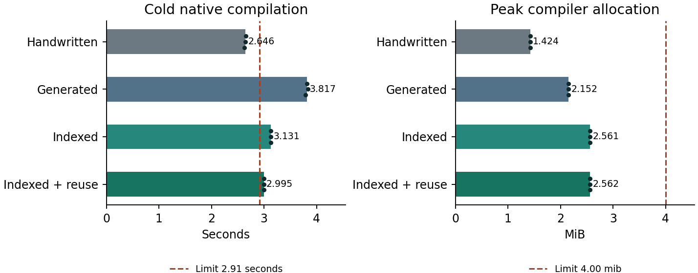

# What token indexing buys on a physical PicoCalc

## Context and Problem

The PicoCalc device compiler translates the Editor's typed source into a native linked RV32 executable inside a QuickJS runtime on a physical ESP32-P4 microcontroller. The compiler itself runs under QuickJS with a 4 MiB allocation limit. A prior asynchronous compilation path measured a median cold time of 3,816,925 µs (3.817 s) across three fresh compiles. An earlier compiler built the handwritten Editor in a median of 2,645,557 µs (2.646 s). The qualification ceiling allows ten percent beyond that time. The performance target is ≤2,910,113 µs (≤2.910 s). This study measures whether a native lexical index, built as an optional pre-pass, moves cold compilation toward that target.

## Lexical Index Design

A native scanner traverses each immutable source string and produces two structures: an array of uint32 occurrence records (UTF-16 start offset, end offset, symbol identifier, matching close-brace row incremented by one) and a spelling table (first start offset, end offset, kind). A symbol identifier denotes a unique spelling. Two distinct lexical scopes may both use the spelling `i`; they receive the same symbol identifier because the spelling is identical. Binding identity and type information are determined separately by the compiler's semantic passes. The index is scoped to a single compilation: original source and compiler-generated lowered source receive separate indices, and a fresh index is built after repeat, edit, or error compilations.

The native index declines ambiguous trailing comments and other unsupported input. When it declines, the ordinary JavaScript scanner handles that source transparently. On out-of-memory, the index frees its temporary state and yields control. This ensures that malformed, bounded, and Unicode cases preserve the reference semantics and that JavaScript diagnostics remain identical.

## Token Reuse

The token-reuse arm is a distinct optimization from spelling interning. It borrows one mutable current-token object per eligible cursor at two non-retaining parser sites, reusing that storage across successive occurrences regardless of whether their spellings match. A stored token from the index cannot share the parser's mutable current-token object because the parser overwrites that object on each advance: any retained reference would observe corrupted fields. The external lexer API and the async machinery that must save multiple tokens still receive independent objects. The original design's proposed exemption for identifier spellings was unnecessary; all spellings participate in the interning scheme uniformly.

## Measurements

All times are medians of three fresh compiles on one physical ESP32-P4, with power-on and explicit reboots deduplicated. Output byte counts include a fixed reserved code slot plus reactor.

| Arm | Median time (µs) | Samples (µs) | Median peak (bytes) | Output (bytes) |
|---|---|---|---|---|
| Manual control | 2,645,557 | 2,653,065 / 2,645,557 / 2,627,345 | 1,493,644 | 240,452 |
| Async control | 3,816,925 | 3,816,925 / 3,834,497 / 3,785,138 | 2,256,776 | 240,452 |
| Index | 3,131,202 | 3,132,429 / 3,131,194 / 3,131,202 | 2,685,364 | 240,452 |
| Index-reuse | 2,994,557 | 2,995,217 / 2,993,614 / 2,994,557 | 2,686,260 | 240,452 |

The manual control and async control differ in both compiler version and source. The manual control sets the qualification threshold; it is not directly comparable to the experimental arms as a measure of indexing alone. Absolute savings from the two experimental arms are measured against the async control.

## Analysis of Time

The index arm reduces median cold compilation by 685,723 µs (−18.0%) relative to the async control. The index-reuse arm reduces it by 822,368 µs (−21.5%). Neither arm meets the ≤2,910,113 µs gate. The index arm exceeds it by 221,089 µs; the index-reuse arm exceeds it by 84,444 µs. The 84,444 µs gap is the difference between the index-reuse median and the target threshold, not a separately observable compiler pass.

Production selection awaits the full application gates. This is a staged experiment. Equal output byte counts (240,452 bytes in all arms) are expected from the build configuration and cannot by themselves establish identical contents. Actual byte equality for three applications—Files, Agenda, and Editor—was verified on the host across nine app/target-mode combinations for the staged async compiler arms, with negative-input comparisons reported separately.

## Analysis of Memory

The peak allocation figures describe temporary plus persistent compiler allocations during compilation. They cannot establish retained heap after compilation completes. The manual control peaks at 1,493,644 bytes (approximately 1.42 MiB). The async control peaks at 2,256,776 bytes (approximately 2.15 MiB). The index-reuse arm peaks at 2,686,260 bytes (approximately 2.56 MiB), consuming an additional 429,484 bytes (419.42 KiB) over the async control. The index arm peaks at 2,685,364 bytes (approximately 2.56 MiB), 428,588 bytes (418.54 KiB) above the async control. The manual-to-async difference is 763,132 bytes (745.25 KiB). At peak, the index-reuse arm leaves approximately 1,508,044 bytes (approximately 1.44 MiB) of headroom within the 4 MiB limit.

## Correctness Testing

The correctness suite is a constructed test corpus, not a sample of real-world input. A cursor oracle recorded 9,470 bounded/seek observations and separately 3,072 randomized traces, plus 73 compiler inputs. Eight explicit sample sources and 271 randomized sample sources yielded indices. The producer compared 129,572 token records from 2,519 accepted sources and encountered twelve deliberately unsupported or ambiguous source inputs and three separate deliberately forced allocation failures. These are constructed correctness tests; the twelve declines and three allocation failures do not estimate real-world prevalence and should not be attached to any denominator.

## Hypotheses and Limits

The 84,444 µs gap between the index-reuse arm and the target is a measured fact. Whether further optimization can close it is a hypothesis. Possible directions include reducing native index memory overhead (the approximately 419 KiB penalty is substantial at this scale), optimizing the two non-retaining parser sites that benefit from token reuse, or reducing JavaScript-side overhead in the compilation pipeline. The index lifetime model—fresh index per compilation event—means that incremental editing gains are not captured by these cold measurements. Whether warm compilation would show different characteristics is untested.

The measurements establish that lexical indexing with token reuse produces a 21.5% cold compilation reduction on this hardware with this source. They do not establish production readiness.

[Verified board samples](../various/physical-index-boots.json) · [Matched comparisons](../various/physical-comparison.json) · [Producer test](../various/producer-differential.json)
