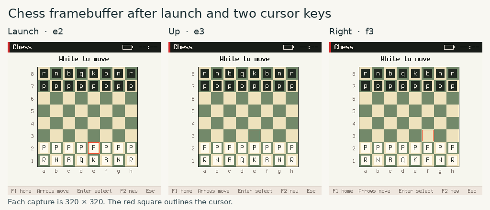

# From a delivered program to a painted Chess position

When the player moves the cursor from e2 to e3, the pieces and the rules of Chess stay the same. The two squares that need different cursor decoration can be identified from one number. Yet the original Chess screen message describes the colors, rectangles and letters that the compositor must draw across the entire board. That description lets the game control its appearance. It also requires the game to regenerate that appearance for each new position.

This study gives the game two messages. The first contains the text of a drawing function written in the PicoCalc’s Typed language. The second contains the values the function needs to draw the current screen. The compositor receives the text, compiles it on the ESP32-P4, and keeps a native RISC-V entry point. When a new position arrives, the compositor calls that entry point. The game remains responsible for legal moves and search. The drawing program has enough information to place a cursor and show a score without running the Chess engine.

The experiment asks three individually testable questions. Did the bytes that Chess sent supply the compiler input? Did the binary execute again on a genuinely different position? Did the normal graphics and display path produce the right picture? Compiling a sample program on an idle board answers only part of the first question. Matching a screenshot by itself also leaves open which path produced it.

## Follow a cursor from key to pixel

Chess numbers the squares from 0 through 63. The opening cursor at e2 has index 52. Pressing Up gives it index 44. The game publishes its new board state through a numbered native SDK call. The kernel copies the counted bytes into a message tagged with the identities and current generations of the sender and receiver. A generation changes when a world restarts. Comparing generations prevents a pending update from an earlier Chess process from replacing the current board.

The packet uses PSIX, an indexed binary screen format. The Chess profile stores an encoded board, legal destination marks, cursor and selection, last move, status, and search figures. A normal opening packet occupies 313 bytes. The largest allowed encoding occupies 329 bytes. A zero byte is ordinary data, so the transport passes a byte count at every step. Treating the packet as a C string would silently shorten it.

The receiver checks the encoded fields before producing the input consumed by the generated program. There are 64 piece cells, eight rank masks, and nine 32-bit fields, each represented by two 16-bit cells. The result occupies 180 bytes of cell data. The shape is fixed. Looking up the cursor does not involve allocating names, parsing a JSON object or consulting the original Chess process. The move is still a complete independent state, so the receiver can discard an older pending position during installation.

```text
world handling the key       kernel and receiver             active display
Chess changes cursor to 44
  emits PSIX position -----> check epochs, validate packet
                               read installed entry point
                               paintChess(state, scratch)
                               validate and retain commands
                               wake compositor ------------> paint body and hints
                                                              commit dirty bands
                                                              transfer RGB565 pixels
```

In the original geometry the cursor at e2 covers a 24-pixel rectangle with its top-left corner at (168, 210) on the physical screen. After Up the corner is at (168, 184). After Right it is at (194, 184). These coordinates give the experiment a check independent of the state encoder. A packet counter could advance despite a stale cursor, and a screenshot of an unchanged board could look credible without checking those three rectangles. The device operator checks both the complete application area and the specific cursor outline.

## How the source becomes executable

The publisher and receiver each have a reason to know the painter source. Chess owns the text it sends. The receiving firmware carries a trusted copy that it can use to decide which program it will execute in its own address space. It compares length and content. The bytes actually passed to the compiler come from a private copy of the received message. This distinction prevents a misleading experiment in which the app sends a token while the firmware runs some locally precompiled painter.

The source has 6,204 bytes. The frontend checks it and processes its functions in sequence. The native backend emits 11,216 bytes of RV32 instructions in the host reproduction. A small ELF file supplies a bounded code slot and a loader entry. The linked ELF occupies 17,456 bytes. Its size includes the reserved capacity and file structure. It is useful to distinguish generated instructions, the linked file, compiler working memory and long-lived UI storage when estimating the cost of another painter. None of those four quantities can be inferred from the file size alone.

Compilation runs on a worker with an 80 KiB stack allocated in external RAM. The kernel keeps running while the worker builds the linked image. The worker transfers ownership of that image through a one-element queue. The kernel subsequently loads the image and obtains the callable entry point. This division fixes a concrete ESP32-P4 constraint. ELF relocation performs cache maintenance, and the ESP-IDF routine requires the caller's stack to be accessible in internal memory while the caches are disabled. The existing kernel task has such a stack.

The first state message can arrive before the entry point exists. The receiver retains the newest admitted state and calls the painter as soon as installation finishes. When the same approved source arrives again, the receiver can reuse the installation. A new Chess generation must supply the approved source again before it may replace the visible position. A restarted compositor can ask the game for a fresh source and position. One cold installation and many frame-time invocations are visible as separate counters in the serial console.

## What the painter is allowed to draw

The native function receives two typed buffers. The first holds the 90 state cells. The second has capacity for 4,096 drawing words. The return value specifies how many words belong to this frame. A fill rectangle takes six words, including the operation number. Other supported records draw an outline, draw ASCII with one of the compositor's fonts, and supply the text for the system hints strip. The program emits commands in paint order. A glyph placed before its tile background would be covered when the background was drawn.

The receiver checks the count, operation number, record length, coordinates, font and text. Only the last record may supply hints. The entire result must pass before the service swaps the scratch list with the currently displayed list. An invalid final record therefore cannot leave half of a new screen visible. Rendering applies the existing graphics primitives at the body's origin, row 22. The ordinary compositor still owns the header, hints strip, overlays, framebuffer capability, and decision to present the composed image.

These bounds have a defined purpose. They limit what the command reader and rasterizer will consume. The firmware's native code shares the address space in which it executes, so admitting arbitrary downloaded source would need a separate isolation design. This experiment admits the bundled Chess publisher and one exact source identity. The message split would also work with a separately isolated painter executor, although the cost of doing so has to be measured independently.

## What the host comparisons establish

Two independent comparisons start from the earlier Chess corpus. The compiler study compares the drawing vocabulary across the reference, the Typed Wasm program, and RV32 execution under emulation. All 47 command streams agree. Their longest output occupies 1,085 words. The raster study then passes these words through the actual PicoCalc drawing implementation, compares every pixel of the 320 by 280 body against the earlier saved result, and checks the hints text. Every body matched. That exercises 4,211,200 pixel comparisons across opening moves, special positions and status displays. The experiment also checks that drawing the body leaves the two areas owned by the compositor untouched. Fourteen malformed or excessive command sequences failed before drawing.

The transport study starts one step further upstream. It runs the real game publisher, captures the delivered source and canonical frames, and checks a legal player move followed by the engine's reply. It tests every truncated prefix of its sample corpus and mutates individual bits. A mutation can produce a different legal packet. The question for the decoder is whether it admits a canonical encoding for an allowed field value and rejects malformed input. Full chess legality remains the game engine's responsibility. The older archived pixel results also share rendering primitives with the new host replay. They are strong regression evidence, while the device trial tests the remaining message, scheduling, relocation and presentation boundaries.

## What reached the physical display

The matched device images exercised the old screen description and the new native painter using the same key sequence. For each of three positions the observer compared 95,360 pixels from row 22 through row 319. These rows include the application and its rendered hints. It also reconstructed the display controller's write rectangles from completed SPI transactions. The physical captures matched the independently replayed old application and the preceding firmware. The observation point is the completed electrical transfer to the panel driver. This experiment did not measure optical response time.

| State | Completed SPI app CRC32 | Cumulative native calls | Last native invocation | Last raster |
|---|---|---:|---:|---:|
| e2 after opening | e7f6b2d0 | 1 | 132 µs | 2,343 µs |
| e3 after Up | ac694560 | 2 | 192 µs | 2,238 µs |
| f3 after Right | 478e7dea | 3 | 189 µs | 2,232 µs |



*The matched control at e2, e3 and f3. The new renderer produced identical application pixels in the physical comparison.*

The successful cold trial spent 1,029,397 µs in the measured compile interval and 721 µs relocating the resulting ELF. The compiler's peak tracked JavaScript allocation was 537,692 bytes. These quantities have different units and lifetimes. A cursor move paid neither the cold compile nor the relocation cost. Building commands took roughly eight percent of the sum of invocation and raster time on the two observed moves. That fraction describes two specific frames and excludes publication, validation, copying, queuing, display transfer, and the panel itself. It is too little evidence for a key-to-display speedup claim.

After f3, the operator restarted the compositor and reopened Chess without moving its cursor. The count of received sources increased from one to two. Accepted positions advanced from three to four. Compilation stayed at one and native calls stayed at three. The new compositor painted the retained commands, its paint count advanced to four, and the completed panel CRC returned to 478e7dea. This distinguishes reusing just the binary from reusing an already computed view. The state and decoded commands live in the service, which outlives a restart of the compositor world. A system reboot still requires a fresh install.

An earlier candidate explains why the final scheduling choice matters. Its worker ran concurrently on the other core. It compiled the source in 1,186,403 µs, but the foreground launcher draw exceeded the 80 ms turn limit during that boot. The report records this candidate as a rejected integration. Moving the worker behind the kernel on the same core permits it to make progress when the kernel sleeps. The revised 8-second wall deadline accounts for that preemption. We kept the foreground deadline at 80 ms. Different boots and wall-time limits prevent interpreting the difference in compile times as a controlled throughput improvement. A reusable compile service should measure both its own CPU consumption and request-to-ready delay. The prospective [compiler-service design](../design-doc/05-an-asynchronous-compiler-service-and-the-lifetime-of-a-painter-handle.md) spells out which component must retain the executable when compilation and drawing have distinct owners.

The attached keyboard controller continued to return I²C errors. The paired images substituted key status in the test driver, then ran the real game's key handling, normal compositor and physical display transfer. The ordinary image uses its normal input driver. Readback verified firmware 75c94df7b1aa. It booted the eight checked native worlds with zero restarts, and installed the received painter in 1,022,094 µs of compilation plus 872 µs of relocation. It completed 66 SPI transfers with zero errors. All 24 sampled keyboard transactions failed. The app was at the launcher during this ordinary-image check. Technical equivalence of these test screens and the physical keypad's availability are independent results.

## How to reproduce the experiment

- Start with the compiler chapter and its replay script. Check the SHA-256 of the source, linked image and RV32 code and the individual command counts. The instruction emulator validates generated output independently of the Wasm execution. [Compiler study](02-compiler.md)
- Run the transport study’s check script for the publisher replay, canonical encoding comparisons and message lifetime tests. To trace a game message, begin at the SDK publisher and follow the counted allocation to the nucleus dispatch boundary. [Transport study](03-transport.md)
- Feed the compiler replay’s binary fixtures and the original Chess control capture directory to the raster check. Its reference file digests are compared with the historical witness before pixels are compared. [Raster replay](../scripts/director/02-check-raster.py)
- Use the device study for exact firmware recipes, the serial input method, screen region definitions and SPI comparison. The retained framebuffer and the bytes returned by a completed panel transaction are different observation points. [Device study](04-device.md)
