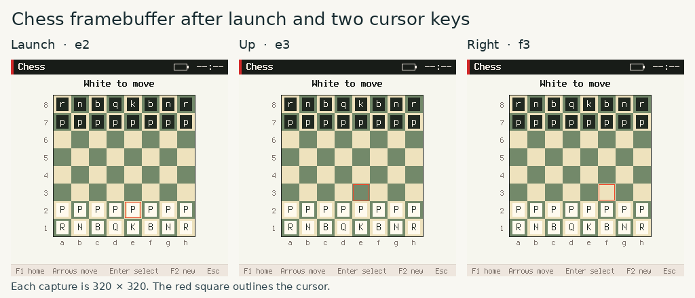
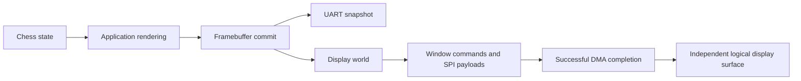

# Following a Chess cursor into the PicoCalc display

Chess starts with the white king's pawn on e2 and a red outline around its square. Press Up. The outline now surrounds the empty square e3. Press Right and it moves to f3. Every piece, coordinate label and instruction stays where it was. These three pictures exercise a useful case for a state-based renderer. The second and third pictures should be cheap to produce, yet each must reconstruct the complete, exact position from the latest state.



## Where a pixel exists

The application stores e2 internally as the number 100. The board representation gives every row a stride of 16. Row 6 and file 4 yield 6 × 16 + 4 = 100. The screen needs eight columns per row, so the painter receives a densely numbered square, 6 × 8 + 4 = 52. The original renderer paints the square in a canvas with a 26-pixel pitch and draws a 24-by-24 outline one pixel inside it. On the actual panel-sized framebuffer the outline runs from (168,210) through (191,233), inclusive. A 24-by-24 outline has 4 × 24 − 4 = 92 distinct pixels. After Up, its top edge is at y = 184. After Right, its left edge is at x = 194. This gives the operator an acceptance check independent of matching screenshot hashes.

The framebuffer contains 102,400 RGB565 pixels. Each pixel uses two bytes containing five bits of red, six of green and five of blue. Once the compositor finishes its work, it commits the changed regions to a front buffer. The display world sends commands specifying a window and then sends pixels for that window to the LCD controller over SPI2. The UART `shot` command snapshots this front buffer and ships a compressed copy to the host. A valid screenshot's checksum proves that the host reconstructed the captured bytes correctly. To identify a dropped flush or a malformed SPI window, the experiment also observes the later bus operation.

## Comparing the older renderer

We booted the previous release and compared its app and partition table to the verified files. The ordinary input preflight recorded 23 additional I²C transactions and 23 additional errors. The keyboard uses a separate STM32 microcontroller. Resetting the P4 leaves that controller powered. This peripheral fault predates the painter trial and prevented physical-key qualification.

In a temporary build the UART keys enter the native keyboard FIFO. An isolated substitution answers its key-count register, allowing the native keyboard driver to deliver a normal message. The launcher takes h and opens the real Chess world. The game handles the two arrow keys. In parallel, a host build runs Chess as a Wasm world against the previous screen-tree compositor. It produces the same three captures. All 95,360 pixels in rows 22 through 319, including the hints, agree at all three positions. In each capture the upper 22 rows contain 138 differences attributable to the independent system bars. The test reports that exclusion and preserves the full images.

| Capture | Cursor outline, inclusive | Host–device application pixels differing | Previous control SPI bytes during the window |
| --- | --- | ---: | ---: |
| Open Chess | (168,210)–(191,233) | 0 / 95,360 | 163,590 |
| Up | (168,184)–(191,207) | 0 / 95,360 | 2,326 |
| Right | (194,184)–(217,207) | 0 / 95,360 | 2,411 |

A bytewise comparison across each pair of control frames found exactly 184 changed pixels: 92 erase the old outline and 92 paint the new one. On Up, the changes span x = 168–191 and y = 184–233. On Right they span x = 168–217 and y = 184–207.

Each SPI total includes command bytes and any concurrent system bar updates. The totals demonstrate why knowing only the number of bytes sent is insufficient. Two transfers of identical length can write different pixels, and two transfers of different length can produce the same final image. [Previous physical control](../various/device/previous-control.json) · [Measured host comparison](../various/device/previous-control-pixels.json)

## Decoding completed writes

The LCD controller accepts an inclusive column interval, an inclusive row interval, and a command that starts the next pixel stream. Its first RGB565 pixel occupies the first column of the first row. Bytes are big-endian on this wire. The test firmware observes successful DMA completions, copies the returned bytes before their buffers can be reused, and decodes the pixels into a separate 320 × 320 surface in PSRAM. It keeps that surface across display requests. Arrows typically update a small region, so resetting the observed surface between keys would discard most of the previous panel contents.



The shadow surface starts with an unlikely fill pattern. At each checkpoint it must contain exactly the front-buffer application-region CRC, report no incomplete window and have seen no malformed or failed operation since boot. The program also compares all captured application bytes to the independent release output. These observations cover the device-memory and completed-write stages. Visible liquid-crystal response and physical keyboard scanning require separate observations.

## When the painter ran

On the accepted observer build the Chess world emitted the 6,204-byte painter at startup, followed by one position packet. The device compiled the received source once. By the time the launcher appeared there was one native execution and zero rasterizations. Native execution turns the position into a bounded list of drawing commands. Rasterization consumes that list to change framebuffer pixels. The distinction matters here: opening Chess painted the first position without recomputing its list.

| Device checkpoint | Source deliveries | Compilations | Position packets | Native executions | Rasterizations | Last native / raster time |
| --- | ---: | ---: | ---: | ---: | ---: | --- |
| Cold boot, launcher | 1 | 1 | 1 | 1 | 0 | 132 µs / no raster |
| Open Chess at e2 | 1 | 1 | 1 | 1 | 1 | 132 / 2,343 µs |
| Up to e3 | 1 | 1 | 2 | 2 | 2 | 192 / 2,238 µs |
| Right to f3 | 1 | 1 | 3 | 3 | 3 | 189 / 2,232 µs |
| Restart compositor and reopen | 2 | 1 | 4 | 3 | 4 | 189 / 2,302 µs |

The enclosing compiler interval was 1,029,397 µs and relocation took another 721 µs. The log inside the compiler measured 1,024,751 µs and a peak accounted QuickJS heap of 537,692 bytes. The linked ELF file was 17,456 bytes, including the executable reservation and ELF metadata. The 189–192 µs samples measure native command generation alone. Repainting the list consumed about 2.2 ms in this trial. The bus subsequently transferred damage. Comparing those two warm samples does not estimate a speedup over the legacy renderer.

Each candidate application-region screenshot matched the 95,360 original host pixels. Each of the three SPI reconstruction checksums matched its corresponding screenshot. The raw bus totals were 201,665, 2,326 and 2,411 bytes across 20, 8 and 4 transfers during the wider key windows, with zero errors. At the checkpoints the cumulative panel pixel payload and completed-window counts matched the controls exactly. The larger opening-window totals can include launcher and system updates that fall on opposite sides of the measurement boundary.

The compositor restart additionally tests where state survives. Reopening Chess after restart resent the source and the f3 snapshot. The cache retained one compiled program and the already generated list. The additional receipt advanced the packet counter, and repainting it increased rasterizations to four while native executions stayed at three. The reconstructed display and captured framebuffer still showed f3. [Candidate receipt](../various/device/observed-mobile.json) · [Host pixel comparison](../various/device/mobile-pixels.json)

## Why the first firmware failed

The first candidate also compiled the received input into a native program. During the same boot a compositor draw exceeded its existing 80 ms deadline, forcing a restart. We rejected that image before exercising Chess. Its compiler occupied another core while the foreground service painted. The repaired configuration scheduled compilation on the kernel's own core at a lower priority. A runnable kernel can then preempt compilation. The worker's eight-second wall-time limit includes time spent waiting for the kernel and still bounds a stuck compilation. The game and compositor kept their original turn budgets. This subsequent boot completed with zero unplanned world restarts among the checked native display, game, keyboard and compositor. The trial observed a failure and a successful repair, but did not directly measure cache contention or establish a statistical failure rate. [Rejected image and trace](../various/device/first-candidate-trace.json)

## The ordinary firmware

The matched ordinary image was installed and its application and partition-table hashes verified on the handheld. It booted the native keyboard, display, compositor, Chess, Snake, Editor, Files and Agenda with zero restarts and empty error records. The painter compiled once in 1,022,094 µs and loaded in 872 µs. It executed the initial state in 133 µs. The launcher remained foreground, so the raster count was zero. The bus reported 66 completed SPI transfers and zero errors at that checkpoint.

The normal keyboard test recorded 24 failed I²C transactions out of 24. Physical key acceptance remains open. The complete three-frame and restart acceptance belongs to the matched temporary image, where the extra code only observed display writes and supplied the test input register. The ordinary build used the same generated Chess source, native compositor, reactor and painter template. Its SHA-256 is `75c94df7b1aa565c8cb7858bea628aa2c9c644ef64cc885b96e1d80088f8af56`. A copy of the verified image and its partition is available in `/tmp/mobile-painter-production/build`. [Ordinary install](../various/device/ordinary-install.json) · [Ordinary build inputs](../various/device/ordinary-build.json) · [Observed build inputs](../various/device/observed-build.json)

## Reproducing the device test

Start at the repository root. The build script snapshots source and requires the ESP-IDF installation and managed components used by the original firmware. It defaults to the original verified recovery files in `/tmp/pico-snake-production/build`. Keep their digest with the board record. The board runner verifies the currently installed application and partition before writing a temporary image. It restores, verifies, and boots the original image at the end, including after a failed trial.

```sh
ticket=$(echo ttmp/2026/11/20/PICOCALC-MOBILE-PAINTER--*)
dev="$ticket/scripts/device"
bash "$dev/host-control.sh" /tmp/chess-wasm-reference
bash "$dev/build.sh" /tmp/chess-control control observe
python3 -B "$dev/play.py" /tmp/chess-old-display --image /tmp/chess-control/build \
    --memory-keys panel --spi
python3 "$dev/compare.py" /tmp/chess-wasm-reference/run /tmp/chess-old-display /tmp/old-pixels.json
bash "$dev/build.sh" /tmp/chess-painter mobile observe
python3 -B "$dev/play.py" /tmp/chess-new-display --image /tmp/chess-painter/build \
    --memory-keys panel --spi --mobile --control /tmp/chess-old-display
python3 "$dev/compare.py" /tmp/chess-wasm-reference/run /tmp/chess-new-display /tmp/new-pixels.json
```

On a working keyboard controller, omit the memory-key option to check the native status-register path as well. The UART still supplies the physical test's fixture keys. A human pressing the keypad is a separate input trial. The timing windows in this harness include settling delays and console traffic. They establish sequencing and transfer counters. The compiler, relocation, painter-execution and raster clocks come from firmware instrumentation around the corresponding code.
