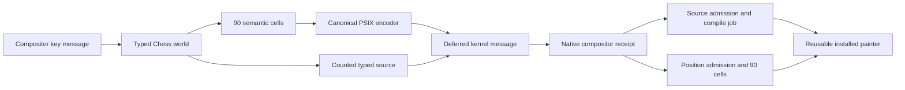

# Delivering the Chess painter and the counted position

The mobile image assembles the live Chess application from its regular source list, the mobile view, and a generated function that writes the exact painter source into the typed output buffer. The ordinary view remains callable for synchronous publication failure and ships as the normal build's only path. The generated function divides its source into at most 1,022 ASCII units per `writeLiteral`, which is the typed compiler's limit per call. Newline and quote escapes are decoded by the compiler. `typedSdkPainterSource` emits counted UTF-8. The first render of an instance publishes the source, then the first position. Chess sends another source after an authenticated compositor `painter.resend` or a failed first publication. F2 starts a new game within the same world instance, so it leaves source publication state intact.

## Boundaries

Each binary publication has a maximum count before the kernel copies anything. A source contains up to 16,384 bytes. A position contains up to 329 bytes. At most two sources and eight positions can be in flight across deferred effects, scheduled deliveries, and the compositor's mailbox. Thus at most 35,400 payload bytes and ten message records plus their scheduler wrappers can be in this route's kernel storage. The message owns the copy and stores its sender and destination epochs. A raw body has a dedicated internal representation and dispatch path. An ordinary JSON message with the same spelling retains its ordinary behavior.

A sending segment that crashes discards deferred messages. A delivered packet is discarded when the sender or receiver epoch differs from those stored in the message. The check runs when the kernel handles the delivery event and again when the consumer takes its turn. Receiver teardown removes binary messages from its mailbox and leaves ordinary messages in order. The callback borrows the packet synchronously, and the kernel frees the message when the callback returns. An independent consumer service owns any source used by a worker or state used by a future paint. See the [director implementation](./01-a-chess-app-that-installs-its-own-native-painter.md) for compile-result admission and restart behavior.

## Packet layout

| Cells | Meaning |
| --- | --- |
| 0–63 | Dense board from a8 to h1, one piece code per cell |
| 64–71 | Destination bits per rank, a-file in bit zero |
| 72–89 | Nine signed i32 values, two little-endian halfwords each |

The integers are cursor, selection, last source square, last destination square, status, hint, depth, nodes and score. Dense index 64 means that an optional square is absent. Snapshot status and statistics follow the existing Chess view's precedence. The encoder uses the established PSIX v1 schema with `app`, `title`, `frame.hints`, and `frame.tree`, including the semantic replay's `p` schema identity. The firmware independently compares incoming source bytes to its pinned source. This comparison supplies the current painter's identity.

The encoder computes exact length before writing. A normal snapshot occupies 313 bytes. Nodes and score can exceed PSIX's immediate signed 20-bit range. Each wide value adds a little-endian eight-byte double body. The fields are still signed integers at the semantic boundary, and accepted values reconstruct those same integers. The receiver extracts bounded string and tuple values, validates their domains, and reconstructs the canonical packet into a bounded scratch buffer. It publishes decoded cells only if the input and reconstruction have the same length and every byte matches. This final comparison verifies the dictionary, object order, offsets, tags and constant fields together. Admission proves the field domains and canonical representation. It leaves cross-field game rules such as piece count and paired last-move sentinels to the bundled producer. The painter and its command validator enforce their own output bounds.

Run [the transport checks](../scripts/transport/check.sh) to verify source identity from a live Wasm Chess world, byte equality with the independent JavaScript encoder, malformed-packet handling and kernel delivery lifetime. The [transport study](../analysis/03-transport.md) explains the results and what remains specific to the physical candidate.
