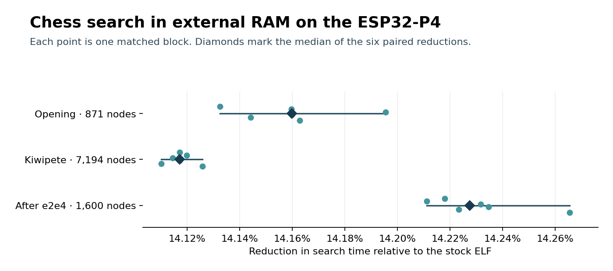
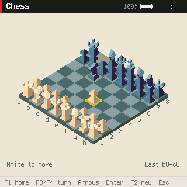

# How two streaming compiler changes affect a playable handheld

When Chess starts on the PicoCalc, the ESP32-P4 compiles the game it will shortly execute. The game can also submit Typed source for its board painter. The compiler therefore consumes time twice in different roles. The player waits while QuickJS runs the compiler. After the game starts, the player waits while the processor executes the compiler's output. We compared both intervals on the same handheld.

## What changed inside the compiler

A string or buffer on this system begins with a four-byte count. Each subsequent element is a two-byte UTF-16 code unit. A read at index i requires a check against that count and then an address calculation. The previous native path decomposed this operation into general-purpose operations early. The RV32 backend had to lower the resulting loads, compares, branches and arithmetic one at a time. In the promoted compiler the frontend records a checked-address operation. The native backend receives the receiver and position together. It can choose a conditional branch directly over a trap and form the address using a shift and addition. The check still runs whenever execution reaches the access. A second operation represents the ordered sequence of stores for a literal whose full destination range has already been checked.

Consider a write whose value expression calls another function. The Typed frontend evaluates the index, checks the destination, then evaluates the value. Calling the function before discovering an invalid index would change visible behavior if the function had modified another buffer. The test harness deliberately includes a failing destination and a value with a side effect, then compares all memory left behind. This is why comparing return values for valid indices would be inadequate. [Language and instruction-selection guide](../design-doc/01-from-the-typed-frontend-to-an-ordinary-psram-loaded-world.md)

The second change targets the calling convention. On RV32, the first arguments arrive in registers and the return address is already in a register. A small function containing only scalar expressions and simple control flow can often use those registers throughout. When the compiler has seen the current function, it checks a short allowlist, a limit of 128 tape cells, the absence of additional locals, and the parameter types. The tentative emitter must finish without spilling an operand. If it succeeds the function can return without the usual stack allocation, argument stores and return-address save and restore. Otherwise the same frontend output goes to the general emitter. The compiler discards the current function's frontend storage as it progresses. Calls, loops and functions outside the bounded class continue through ordinary lowering.

## What got smaller

The preceding study compiled exactly the same source four ways, allowing the effects on instruction bytes to be separated. The present integration reproduced the combined complete ELF byte for byte for Editor and Chess. The values below count bytes of generated RV32 instructions, exclusive of the reactor, jump stubs and padding.

| Complete source | Control | Frameless alone | Late text alone | Both | Reduction with both |
|---|---:|---:|---:|---:|---:|
| Chess with the 3D painter source writer | 256,400 B | 256,076 B | 181,184 B | 180,860 B | 29.5% |
| Editor | 89,168 B | 89,048 B | 75,932 B | 75,812 B | 15.0% |

Late text selection accounts for 75,216 of the 75,540 bytes saved in Chess. The incremental 324 bytes come from 16 frameless functions. Static size weights every instruction once. A helper might execute thousands of times during an engine search, whereas the game might run a long source-writing function only once. The size breakdown alone cannot tell us how much either change contributes to runtime. [Independent full-world compiler comparison](../../PICOCALC-NATIVE-WAVE--six-parallel-experiments-in-handheld-compiler-construction/various/director/composed-release-worlds.json)

The complete linked Chess ELF is still 274,892 bytes. Its reserved executable area has a fixed capacity and its entry and import stubs take space within that area. With 261,996 bytes available for generated code, usable headroom rose from 5,596 to 81,136 bytes. Editor's ELF is still 242,124 bytes. The mobile painter itself shrank from 23,848 to 21,572 instruction bytes, a 9.5% reduction, within its own 32 KiB slot. The candidate firmware image grew from 4,328,368 to 4,331,776 bytes. A future change to slot reservations or packaging should measure actual memory recovered. [Build and slot attestation](../various/release/build.json)

## Establish that the program still does the same work

The compiler owner and an independent qualifier exercised different failure modes. The held-out program generated 2,332 native bytes and passed 1,603 behavior checks in each of the streamed and buffered modes, including 101 expected traps. The directed tests include literal boundary lengths, invalid indices and helper functions that need a fallback from frameless lowering. For Files, Agenda, Editor and Chess the team linked the ordinary modules on both targets and compared the resulting Wasm with the previous compiler. [Independent host evidence](../various/host/combined.json)

The engine also had a reference independent of its renderer. Across 13 engine fixtures, 6,981 words matched the reference. A generic Chess world replay drove 98 events, 78 search slices and 18 screens, including stale and failed wakeups. In the mobile-painter study, five board positions and 32 rotation phases gave 160 comparisons. The returned lengths, output commands, protected memory and complete arenas matched the reference. Across those inputs the RV32 instruction model counted 104,430,252 executed steps with the old painter and 95,073,440 with the new one. This is an 8.96% change in modeled instruction count. Physical display latency includes other work. [Application replays](../various/host/app-suites.json) · [Painter traces](../various/compiler/mobile-painter.json)

## What an ordinary cold compile measures

The compiler runs in a fresh QuickJS runtime with an accounting allocator. Each target prints a line containing its source kind, status, elapsed microseconds, peak accounted JavaScript heap and returned module size. Peak accounted heap refers to allocations through this allocator. Other worlds, ESP-IDF bookkeeping and the frame buffer have separate costs. Restarting the OS gives all five compiler clients the same startup sequence. The ordinary-image comparison uses three cold boots per firmware on the same device, at 360 MHz with 200 MHz PSRAM. We used the median within each arm. The small run count and sequential firmware order make these product observations specific to this setup.

The two size measures predict different things. A short numeric tape can reduce allocations in QuickJS during compilation, particularly when the frontend would otherwise expand a string literal to many instructions. Once the game loads, the output size and the ratio of useful instructions to memory traffic can affect guest time. The first mechanism explains why the embedded source writer deserves attention even though it runs infrequently. Precise attribution of elapsed compiler time between text lowering and leaf selection would require timing each optimization separately on the release image.

| Compiler client | Control | Promoted | Change in time | Control peak JS heap | Promoted peak JS heap |
|---|---:|---:|---:|---:|---:|
| Chess | 3.638 s | 1.894 s | -47.95% | 3,170,172 B | 1,941,548 B |
| Editor | 2.585 s | 2.358 s | -8.77% | 2,543,412 B | 2,480,288 B |
| Agenda | 0.575 s | 0.565 s | -1.67% | 771,420 B | 770,140 B |
| Files | 0.274 s | 0.280 s | +2.51% | 480,392 B | 490,776 B |
| Chess painter | 1.362 s | 1.316 s | -3.36% | 693,300 B | 693,576 B |

Chess saved 1.744 seconds of compilation and 1,228,624 bytes of peak compiler heap (38.8%). Editor saved 227 milliseconds. Files paid about seven milliseconds and 10,384 extra bytes. The fixed setup work of the new backend is a plausible explanation on a short input. These measurements do not subdivide Files compilation enough to assign that cost to a particular function. The median time from the reboot command to the last compiler message across all five clients fell from 12.970 to 10.949 seconds. [Ordinary device observations](../various/device)

## How to time generated code in real memory

The application console accounts CPU time per world. That includes event dispatch, interaction with the OS and work done by the app before and after the search. To isolate generated search code, we copied the exact two complete linked Chess ELFs into one experimental image and loaded them successively with the same ESP-IDF loader used by ordinary worlds. The loader supplied a segment base. We mapped two known virtual addresses into that segment and checked that the base and both entry points were in the external-RAM range. The board and search-state buffers also live in PSRAM. This matters because instruction and data access on this device depend on memory placement.

Each timed invocation begins with chessStartSearch and repeatedly calls chessSearchSlice with a 48-step budget until the guest reports completion. The board initialization, ELF relocation, paint and serial output occur outside the measurement. An independent Wasm reference fixes the expected move, score, completed depth, visited nodes and number of slices. Every run must also preserve the root position. The three positions exercise 871, 7,194 and 1,600 nodes respectively. Equal node counts and equal answers make elapsed-time differences interpretable. Choosing a different move sooner would be a different experiment.

There are six matched blocks. The order alternates between stock-first and promoted-first, and the first position rotates across blocks. All code for each arm is loaded together, so a change in instruction placement and instruction-cache behavior is part of the result. Both optimizations are active in the new ELF. This experiment establishes the effect of the pair on these complete workloads. The exact role of each change in guest execution remains an open attribution question. [Benchmark sources](../scripts/psram)

| Position | Move | Nodes / slices | Stock median | Promoted median | Median paired time reduction |
|---|---|---:|---:|---:|---:|
| Opening | b1c3 | 871 / 41 | 122.129 ms | 104.843 ms | 14.16% |
| Kiwipete | e2a6 | 7,194 / 453 | 1,344.083 ms | 1,154.323 ms | 14.12% |
| After e2e4, ordinary move budget | b8c6 | 1,600 / 78 | 241.011 ms | 206.722 ms | 14.23% |

[The physical timing receipt](../various/psram/physical.json) records each run. All 36 searches matched the frozen result and restored the 135 checked root-position cells. All twelve image loads used the same segment base, 0x48008fc0, with guest entry addresses differing according to each program's layout. The promoted image finished sooner in all eighteen matched pairs. Percentages in the final column are calculated within each pair before taking the median. The time columns give each arm's median. Holding the amount of work fixed gives these three comparisons a stronger interpretation than a difference between two completed game turns alone.

For the position the player sees after e2e4, the isolated median search saved 34.288 ms. The ordinary Chess world's median saving was 34.656 ms. The two measurements use different harnesses, but the close agreement supports search execution as a practical explanation for the world CPU saving. A small difference between medians from separate experiments cannot be used to assign an exact residual cost to rendering or event dispatch.

## What the player and editor observe

In the ordinary firmware the operator started from the reference opening, played e2e4 and waited for two new painter packets and two completed paints. The reply was b8c6. After the move the Chess portion of the physical framebuffer, covering 95,360 pixels, was byte-identical to the reference on all three attempts in each firmware. Each arm also passed the active input, compositor and painter checks. An initial trial had caught a boot notification still covering the opening because compilation finished sooner. We kept the reference image and waited for the notification to expire in the untimed setup. The detector's first rejection also exercised the ordinary firmware rollback.

The median increase in CPU charged to Chess while handling the move was 246.665 ms with the previous firmware and 212.009 ms with the promoted compiler, a 14.05% reduction. The median first poll observing both paints fell from 463.171 to 400.228 ms. Those are upper observations from the host, and the observation windows overlap. They support a product-level timing comparison at this polling resolution. A claim about precise key-to-display latency would require timestamps from inside the display path.

Editor exercised a different kind of behavior. The operator used an owned scratch directory, edited two lines, saved, reopened, modified the file again and checked the persisted text. Across both firmwares the intermediate rendered frame matched, both versions read back correctly and cleanup removed the scratch data. One physical edit workflow per arm supports that functional result. Variation in storage latency would require many more samples for a speed claim. [Ordinary device evidence](../various/device)

## Release decision and the next discriminating experiment

The same compiler configuration reduced the two largest cold builds, kept streaming enabled, and reduced matched Chess search time by approximately 14% across three positions in external RAM. The evidence justifies keeping both changes in the playable firmware. Files paid about seven milliseconds per cold compile and still opened and ran through the ordinary firmware path. We accepted that tradeoff for this release. It is visible in the permanent comparison so future work can revisit it.

The next scientific question is attribution. Link complete Chess under the two single-change configurations already used in the static size comparison, then run them in the same matched PSRAM schedule. Late text selection dominates the difference in bytes, while the sixteen frameless helpers could have a much larger dynamic weight than their static size suggests. Timing the two missing arms would distinguish those explanations. Reducing the reserved code slots is a separate engineering decision that can use the new measured headroom.

After the temporary benchmark the operator restored and read back all 4,331,776 application bytes and the partition table. The promoted release rebooted with eight healthy native worlds, live keyboard polling and one installed painter with zero rejects. The installed application SHA-256 is 33b439d0a7bcdf85f01b373ed1ec71d654ce60d7079f2569fce4de859f29e813. [Firmware attestation](../various/release/build.json) · [Post-restore health](../various/psram/physical.json)
