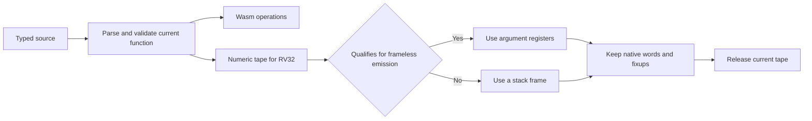

# From Typed operations to smaller RV32 functions

The PicoCalc compiles its maintained Chess painter from Typed source into instructions for the ESP32-P4. Two changes to the normal RV32 compiler reduced that instruction image from 23,848 to 21,572 bytes. Across 160 host test frames, the promoted compiler, the previous compiler, and the Wasm target returned the same counts and produced identical memory. The two changes remove different work. One uses the meaning of a checked text operation when choosing machine instructions. The other recognizes small functions that can keep their parameters in registers for the whole call. [Painter verification receipt](../various/compiler/mobile-painter.json)

## Where the compiler makes the choice

Typed is the source language. A call to `charCodeAt` or `setCharCodeAt` on its text types has defined bounds and evaluation rules. The shared frontend parses those calls, checks the argument types, and emits a function body. For RV32 the body is a numeric tape, a sequence of operation codes and their operands that the native emitter reads from start to finish. A local index or an integer constant occupies one tape cell, just as an operation code does. The native emitter translates those operations into 32-bit RISC-V instructions.

In the ordinary streaming mode, the native backend receives one validated function at a time. It can use information about that function's parameters, private locals, and operations while emitting its machine code. The compiler keeps the generated instructions and the information needed to resolve branches and calls at assembly time. The numeric tape and the function's temporary literal table are released after lowering. Wasm still uses the shared frontend's primitive expansion and its own binary writer. [Compiler integration diary](../reference/02-compiler-integration-diary.md)



## Follow a checked write through the machine

A Typed string or buffer begins with a four-byte header. The header stores a string's length or a buffer's capacity, measured in UTF-16 code units. A payload unit is two bytes, so the unit at position `p` is at `base + 4 + 2*p`. A checked operation validates the position before touching that payload.

```typescript
function overwrite(dst: buffer, src: string, p: i32, q: i32): i32 {
    dst.setCharCodeAt(p, src.charCodeAt(q));
    return 7;
}
```

This write has two separate checks. The destination check runs before evaluation of the value expression. The source check runs next. Only after both succeed can the final halfword store execute. Those checks matter even when the observed program result would be a trap either way. An effectful value expression might modify some other object before its own trap. The earlier destination check determines whether the value expression runs at all.

Previously the frontend expanded each checked address into primitive operations before handing the function to the native emitter. That sequence produced a comparison result, tested it in control flow, and then recalculated the address from the saved position. The numeric emitter now keeps a single checked-address operation with two operands, the receiver local and the position local. The native emitter can select a direct unsigned branch whose success target is immediately after the existing trap instruction.

This excerpt comes from the promoted `overwrite` image. The function's prologue and subsequent source read are omitted. The labels stand in for the addresses printed by the disassembler.

```asm
lw    t5, 16(sp)        # saved destination position p
lw    t6, 0(sp)         # destination header address
lw    a0, 0(t6)         # destination capacity
bltu  t5, a0, in_range  # begin address arithmetic if unsigned p < capacity
ebreak
in_range:
slli  t0, t5, 1
add   t0, t6, t0       # header-relative address, before the +4 payload offset
```

A capacity of eight and position seven make this branch succeed. The address held in `t0` is `dst + 14`. Later the store adds its four-byte payload displacement and writes at `dst + 18`. With position eight the branch falls through to the trap. A negative position such as minus one has an unsigned representation of 4,294,967,295 and also fails for this buffer. The successful destination address remains in `t0` while the checked source read uses other registers. The actual function finishes this expression with `lhu t1,4(t1)` for the source and `sh t1,4(t0)` for the destination. The emitted `overwrite` function went from 172 bytes to 124 bytes.

## Check an entire literal before writing it

A literal write needs a related but different guarantee. If any unit would fall outside the buffer, the operation traps before storing any part of the literal. Once the bounds checks succeed, every store uses the same checked start address plus a fixed displacement.

```typescript
function tag(out: buffer, at: i32): i32 {
    return out.writeLiteral(at, "A🐈");
}
```

This literal consists of three UTF-16 units. The letter is `0041` in hexadecimal and the supplementary character occupies the surrogate pair `D83D DC08`. With a five-unit buffer, position two fits and position three fails. The separate check of the last index, `at + 2`, completes before the first store. The selected fragment below starts after that check. `t5` loads the already checked address once. Each value is materialized in `t6` before the halfword store.

```asm
lw    t5, 12(sp)
addi  t6, zero, 65
sh    t6, 4(t5)
lui   t6, 0xe
addi  t6, t6, -1987    # 0xd83d
sh    t6, 6(t5)
lui   t6, 0xe
addi  t6, t6, -1016    # 0xdc08
sh    t6, 8(t5)
```

The address reuse leaves the source order and store width intact. An empty literal evaluates its position and returns zero without reading the capacity or writing any payload. The existing 1,022-unit limit keeps the final store displacement within the RV32 signed immediate range. The promotion changes the per-function numeric representation and machine instructions. The literal values are still encoded in the native instruction stream.

## Let scalar leaves keep their arguments in registers

A leaf function makes no calls. Under the calling convention, a caller initially supplies scalar arguments in `a0` through `a7`, receives an integer return value in `a0`, and records the return address in `ra`. The general compiler allocates a stack frame, saves `ra`, and copies incoming arguments into local slots. Those instructions give the emitter a predictable home for values that may be overwritten by a call or pushed out of its temporary registers.

```typescript
function advance(n: i32, step: i32): i32 {
    return n + step + n;
}
```

The previous emitter gave this function a 16-byte frame and emitted 13 instructions. As a frameless leaf it uses seven instructions. This is its entire promoted assembly listing.

```asm
addi  t0, a0, 0
addi  t1, a1, 0
add   t0, t0, t1
addi  t1, a0, 0     # n is still in a0
add   t0, t0, t1
addi  a0, t0, 0     # publish the return value
jalr  zero, 0(ra)
```

For `advance(9, 4)` the first addition produces 13. The second read of `a0` still yields nine, so the function returns 22. The register holding `n` can change once execution reaches the return path. Saving `ra` would add work even though the body never overwrites it.

Production eligibility is conservative. The numeric tape may occupy at most 128 cells, have up to eight `i32` or `bool` parameters, and declare no locals. An explicit list of allowed operations excludes calls, memory accesses, and local writes. If the attempted emission needs a spill, the compiler discards that attempt and lowers the function with a normal frame. A spill is the transfer of a value from a register to a stack slot because the current expression has more live operands than available registers. Division adds another constraint. Its zero and signed-overflow checks still run, and the frameless emitter uses `t5` for a check constant so it cannot accidentally overwrite a parameter in `a0`. [Compiler integration diary](../reference/02-compiler-integration-diary.md)

## Use the real painter to check the composition

The maintained mobile painter takes a board-state buffer and a command buffer using the closed `paintChess(buffer, buffer): i32` entry. Its output includes the number of words written. The host test ran five recorded board positions at each of 32 rotation phases. In every case it checked that the returned count was in range, that the input state was preserved, and that the complete arena matched the Wasm execution. The arena comparison includes words beyond the returned output, with a sentinel that would show an unexpected write. The same two programs went through the actual painter linker, with the same reactor and with both normal streamed and explicitly buffered compilation.

| Painter measure | Previous compiler | Promoted compiler |
|---|---:|---:|
| Native instruction bytes | 23,848 | 21,572 |
| Linked reactor bytes | 33,840 | 33,840 |
| Modeled instructions across 160 executions | 104,430,252 | 95,073,440 |
| Complete arena matches against Wasm | 160 | 160 |

The linked ELF contains a reserved executable slot, so its size remains fixed while the code placed in that slot shrinks. The modeled instruction count is about 9% lower on these frames. It counts guest instructions in a host model. Frame latency on the PicoCalc also includes compiling or installing the painter when required, interpreting the command stream, rasterizing, and transferring pixels to the display. Those activities use different measurement boundaries.

The maintained painter tests show both native optimizations operating through the same source, normal ABI, and real linker. A separate independent program supplies return, trap, and memory checks beyond the renderer's successful frames. Its production image also matches the previously qualified combined experiment byte for byte. The integration diary contains the commands for reproducing the host app tests, the instruction-shape regressions, and the painter comparison. [Painter verification receipt](../various/compiler/mobile-painter.json) · [Compiler integration diary](../reference/02-compiler-integration-diary.md)
