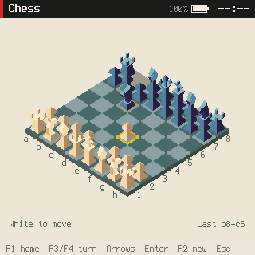
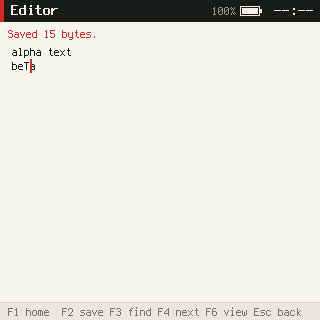

# What changes for the person playing Chess?

After White plays e2e4 on the PicoCalc, the screen briefly shows that Black is thinking. A second redraw places Black's knight on c6. We measured how long that reply took on the same handheld with two ordinary firmware releases. The median time the operating system charged to Chess changed from **246.665 to 212.009 ms**. The median time to the first host observation of the completed repaint fell from **463.2 to 400.2 ms**. All six timed final screens matched an independent rendering of the same position, pixel for pixel across the app and its hint row. [Physical comparison](../various/device/comparison.json)

The candidate combines two compiler changes. It keeps checked text operations intact until the compiler chooses machine instructions. It also lets eligible small functions that call no other function keep their inputs in processor registers and omit a stack frame. A frame reserves memory on entry to a function and releases it on return. The production trial measures their joint effect in complete applications. [Compiler design and instruction examples](03-from-typed-operations-to-smaller-rv32-functions.md)

These two clocks answer different questions. The CPU figure counts execution time charged to the Chess application. A serial command supplies the same Enter event a player can submit. After it arrives, the device must also deliver the input, schedule Chess again whenever its search yields, run the painter and make the result available to the display. The host sees the completed repaint only after a console query returns. The experiment preserves those delays because they are part of using the handheld. Its resolution is too coarse to resolve every saving within the application.

## What runs when the device boots

The firmware contains the Typed compiler and the source of four native apps. On a cold boot those apps are compiled on the handheld. The Chess world is the operating system’s unit of execution for that game. Its compiled module is an ELF file, the container that tells the loader where the code and data belong. The loader places the module in external pseudo-static RAM (PSRAM), fixes references for its final address and calls its entry point. The output of a fifth compilation installs the mobile painter, the program that converts Chess state into drawing commands. That source arrives in a screen message. [Native loader](../../../../../../picocalc-os/port/esp32p4/optional/native_elf/native_elf_p4.c) [Compiler telemetry](../../../../../../picocalc-os/port/esp32p4/main/typed_p4.c)

We measured the published firmware already installed on the board, then the candidate built from the promoted compiler. We verified both installed images against their build files and kept the partition table and filesystem in place. Each firmware was measured in a single block, so run order could influence small differences. Both used the ordinary streaming compiler, the same 360 MHz CPU configuration, and the normal application memory and search budgets. All six boots compiled the same five inputs and brought up the same eight native worlds. The table gives the median of three software-triggered cold boots per firmware. The time includes compiler setup, execution, copying out the module and teardown. Peak JS memory measures the compiler's tracked JavaScript allocation. [Baseline boots](../various/device/baseline-cold.json) [Candidate boots](../various/device/candidate-cold.json)

| App | Old compile (ms) | New compile (ms) | Time change | Old peak JS (bytes) | New peak JS (bytes) |
|---|---:|---:|---:|---:|---:|
| Agenda | 574.8 | 565.2 | -1.7% | 771,420 | 770,140 |
| Files | 273.6 | 280.5 | +2.5% | 480,392 | 490,776 |
| Editor | 2,584.6 | 2,357.8 | -8.8% | 2,543,412 | 2,480,288 |
| Chess | 3,637.7 | 1,893.5 | -48.0% | 3,170,172 | 1,941,548 |
| Mobile painter | 1,362.1 | 1,316.3 | -3.4% | 693,300 | 693,576 |

Chess accounts for the largest absolute drop in compile time and peak allocation. Files took longer to compile and used a larger peak heap. The mobile painter also compiled faster while its median tracked peak grew by 276 bytes.

The module length in the boot receipt is the size of the linked ELF container. Its native code occupies a reserved region with a fixed capacity. Shorter target code can leave more room inside that region while the module file retains its previous length. The build receipt separately records actual code bytes, usable capacity and remaining headroom. Those are the values to consult when deciding whether a growing Chess implementation fits. [Release build receipt](../various/release/build.json)

The host measured **13.677 versus 11.652 seconds** from issuing reboot until all eight native worlds and the painter reported healthy. This interval includes other startup work and the serial queries themselves. An instrumented panel or camera would be required for a power-on-to-first-pixel measurement.

## Following one move across the device

We started from a new game on every repetition. The console injected the same keys through the normal input path. Enter selected the pawn on e2, two Up presses took the cursor to e4, and the final Enter submitted the move. Only the last press started the timed interval. The app copied the new position to its working board and started Black's search with depth limit four and a 1,600-node budget. It yields between slices of up to 48 search steps so other work can run. The independent reference reached depth three, used 1,600 nodes, scored 12 and moved the knight from b8 to c6. The ordinary device exposes the finished board and hint through its framebuffer. The depth, node count and score quoted here come from the independent reference. [Search configuration and event handler](../../../../../../picocalc-os/worlds/chess/chess.typed) [Independent expected state](../various/device/reference/match.json)

Before the final key, the runner read the Chess world's accumulated CPU time and the painter's counters. It waited for two new packets and two new paints, then sampled the CPU counter again. One paint shows the submitted move and the next shows the reply. An independent reference renderer had already produced the expected opening and reply images. The runner decoded the physical framebuffer's length-checked RGB565 runs, checked its 320×320 CRC, then compared all 95,360 pixels below the 22-row system bar to those references. This comparison excludes changing system chrome while retaining the full board and bottom status line. [Device workflow](../scripts/device/workflows.py) [Baseline moves](../various/device/baseline-chess.json) [Candidate moves](../various/device/candidate-chess.json)

| Move | Old Chess CPU (ms) | New Chess CPU (ms) | Old host bracket (ms) | New host bracket (ms) |
|---|---:|---:|---:|---:|
| 1 | 246.223 | 212.009 | 380.9–463.2 | 315.7–405.7 |
| 2 | 247.600 | 212.385 | 377.0–458.8 | 317.4–400.2 |
| 3 | 246.665 | 211.430 | 382.0–464.9 | 317.4–399.0 |

The Chess CPU median fell 14.1% across these opening moves. The median of the first successful host polls also moved earlier. Individual host brackets overlap between arms, so their endpoints cannot support a precise claim about time saved at the panel.

The kernel charges time to a world across its executing segments. Work undertaken within the Chess turn, including SDK calls, contributes to the total. Waiting between segments and executing another world do not. Each opening produced 23,628 new SPI bytes and two additional paints in both arms. The reported wall interval begins at host key submission. Its lower endpoint is the start of the preceding unsuccessful counter poll and its upper endpoint is the end of the first successful poll. The screenshot below was taken after the timed interval and includes the ordinary system bar.

A probe on the panel bus would be needed to timestamp the last pixel on the hardware screen. [Kernel accounting](../../../../../../picocalc-os/nucleus/kernel.c)

## Following a text edit to storage and back

Files created an absent directory named `qcprobe7`. We checked the on-screen path, created `qcheck7.txt` inside it, entered two lines, moved the cursor and corrected a letter. The first saved document had to contain exactly `alpha text` and `beTa`. After closing and reopening the file, a second edit had to produce `beTa7` on the second line while preserving the first. The same Editor screen digest and both file revisions were obtained in both arms. Before removing either owned entry, the runner checked that the confirmation screen displayed its exact name. A final directory listing verified removal. [Baseline Editor](../various/device/baseline-editor.json) [Candidate Editor](../various/device/candidate-editor.json)

The baseline screen below preserves the edited text and the on-screen save status.

The first save became observable through a complete file read after 465.6 ms on the old firmware and 441.2 ms on the candidate. The Editor world accumulated 18.811 and 17.102 ms respectively across 19 turns during the first edit and save. Each figure is one save. Flash writes, completion polling and filesystem state contribute to the difference, so these two observations support functional qualification and give the order of magnitude of a save. They cannot establish an Editor performance trend. During harness development a read immediately after the second save saw the pathname briefly absent, followed by the complete expected document. The filesystem writes a temporary file, then tries to rename it over the original. When FAT refuses that replacement it removes the original and renames the temporary file. Polling for the exact contents handles the short interval between those two operations. [Filesystem write path](../../../../../../picocalc-os/nucleus/fs.c)

## What qualified

The candidate passed the ordinary-device qualification after a final readback of its application and partition table, a fresh successful boot, one painter installation with zero rejects, eight healthy native worlds and live keyboard polling. Its application SHA-256 is `33b439d0a7bcdf85f01b373ed1ec71d654ce60d7079f2569fce4de859f29e813`. The receipts qualify those two app workflows and the observed cold builds on this board. Three repetitions characterize the observed spread of this opening. Positions with different move counts or search depths require additional trials. [Final ordinary-device receipt](../various/device/candidate-final.json) [Investigation diary and replay instructions](../reference/03-device-investigation-diary.md)
