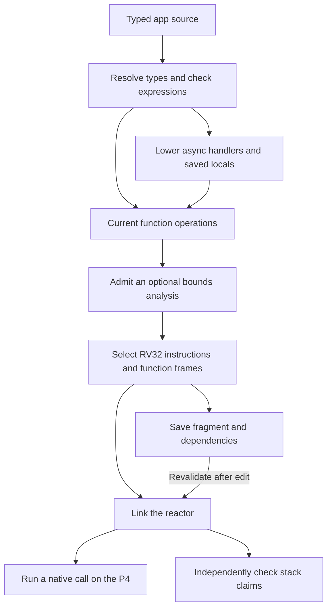
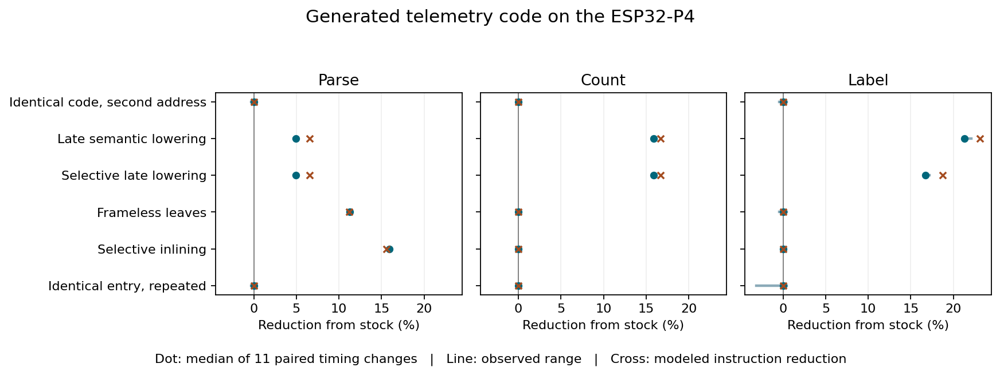
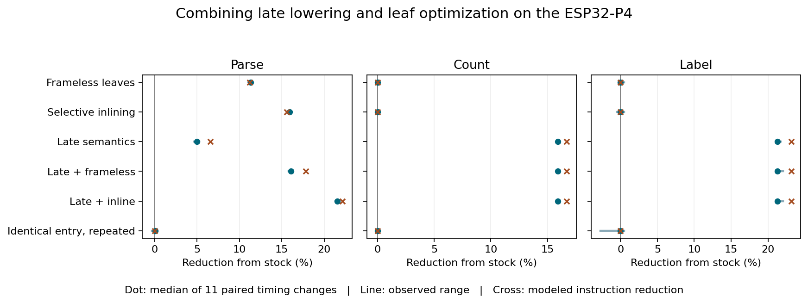

# What a handheld compiler should remember

An app author edits a Typed function on a PicoCalc. The ESP32-P4 must accept or diagnose the new program, generate native RISC-V instructions and run them. The author experiences two distinct delays. The first ends when a usable program exists. The second recurs each time that program processes a key, copies a text label or searches a chess position. An improvement that saves a millisecond on every invocation can justify a slower compile for a frequently executed function. A saved second on each edit can justify keeping a larger compiler state between edits. Those decisions require separate observations.

Six researchers investigated where information is valuable in this process. One kept the identity of a text operation until machine-code generation. Another identified small functions that can execute entirely in registers. Others tried to predict where bounds analysis would succeed, determine which functions survived an edit, establish stack use from machine code, and infer when a temporary buffer could be passed to an asynchronous function. This report follows the information each experiment needs, the cost of obtaining it and the evidence that it changes an outcome.

## From source text to a native call

Typed is the project's JavaScript-like language. A string or buffer reference denotes a length-prefixed array of UTF-16 code units. An integer parameter denotes a 32-bit value. An expression such as `text.charCodeAt(i)` therefore gives the compiler facts about both the memory layout and the required bounds check. The compiler must also preserve the order of observable effects. If an invalid position traps during a write, no later write may already have happened.

The shared frontend checks a function and emits its operations. The native path can encode an operation and its operands as numbers for the current function. The RV32 backend reads those numbers, assigns temporary registers or frame locations, emits instructions and records calls whose addresses must be fixed later. Streaming permits it to release the operation list when the function is complete. A final link establishes targets and can embed the new program into a reactor, the native app component that receives events. The Wasm target supplies an independent execution path for many of our examples. In this project the boundary between frontend and backend is itself an experimental variable. [Shared frontend](../../../../../../picocalc-os/compiler/typed-wasm.js) · [RV32 generator](../../../../../../picocalc-os/compiler/typed-rv32.js)

Consider `text.charCodeAt(i)` again. One compiler can expand this expression into general integer operations as soon as it checks the types. Another can pass the receiver and index to the native generator as a single checked-address operation. The latter still emits a guard and a trap. Its advantage is that the generator already knows which values must be loaded, compared and combined. A separate bounds analysis attempts something stronger. It must prove that every execution reaching the access has an in-range index before it can remove the guard. These two transformations can have very different returns on the same source. Retaining useful operations through lowering has precedents in multilevel intermediate representations, and demand-driven bounds analysis has its own proof obligations. [MLIR language reference](https://mlir.llvm.org/docs/LangRef/) · [Bodík, Gupta and Sarkar, ABCD](https://homes.cs.washington.edu/~bodik/ucb/research/pldi00.html)

## How the director tested transfer

Editor and Chess helped motivate the work. A rule chosen after observing them can perform especially well there. Before disclosing a new evaluation input, I fixed the source, test cases, expected-value calculation and a set of buffer-lifetime scenarios by hash. The two studies of bounds and operation retention registered their decision rules before disclosure. The other four supplied implementation identities as well. An additional comparison that combines two successful transformations was conceived after their individual results arrived. It is an exploratory test.

The new program parses telemetry fields separated by semicolons, calls small arithmetic and classification functions, reads a calibration record and writes a short status message. It has ten functions. The control emits 2,876 native bytes. The host harness independently computes the correct return or trap and checks the entire exposed 448-byte memory region after each call. Its 1,603 cases include 101 expected traps. Data outside the intended writes begins with a known fill pattern. A misplaced write can produce a correct return and still fail the memory comparison. These cases exercise one program. They supply no estimate of the fraction of arbitrary programs an optimization can help. [Frozen inputs and numerical oracle](../scripts/director/heldout/01-burst-oracle.mjs) · [Source under test](../scripts/director/heldout/burst.typed) · [Identity commitment](../various/director/heldout-lock.json)

For physical execution I linked each raw machine image into a common ESP-IDF probe, verified its bytes and callable addresses in the final ELF, and called three entry points on a single 360 MHz core. Each timing covers 48 replays of the same eleven-input batch. Eleven blocks rotate the order of the compiler arms. The probe checks outputs before timing and checks a checksum on every timed sample. It repeats the stock entry at the same address and includes another independently emitted, byte-identical image at a different address. The physical boundary starts immediately before the loop and ends immediately after. The telemetry and standalone Chess probes execute code from flash-mapped text. The ordinary native loader copies a world into PSRAM and relocates it there. Instruction and data placement can change hardware timing even for identical code. The control at a second flash address cannot test the effect of switching to PSRAM. Event dispatch, compositing and display transfer add separate costs. [Production native loader](../../../../../../picocalc-os/port/esp32p4/optional/native_elf/native_elf_p4.c) [Probe and verification](../scripts/director/board/main/bench.c) · [Final linked addresses](../various/director/linked-images.json)

| Native generation on telemetry | Image bytes | Parse time saved | Separator count time saved | Label write time saved |
|---|---:|---:|---:|---:|
| Stock | 2,876 | 2,208 µs baseline | 893 µs baseline | 221 µs baseline |
| Selected bounds analysis | 2,876 | 0.0% | 0.0% | 0.0% |
| Keep both semantic operations until lowering | 2,396 | 5.0% | 15.9% | 21.3% |
| Select semantic operations | 2,468 | 4.9% | 15.9% | 16.7% |
| Frameless leaves | 2,812 | 11.3% | 0.0% | 0.0% |
| Selective inlining with frameless leaves | 2,952 | 15.9% | 0.0% | 0.0% |
| Stock entry repeated | 2,876 | 0.0% | 0.0% | 0.0% |

Percentages are medians of the within-block fractional reduction in elapsed time. The raw baselines are medians over blocks. The plot includes the full observed range and a separate count of instructions from a software implementation of RV32 executing a matching replay. Direct same-block comparisons between selective and all-late semantic code gave median differences of zero for parse and count. Selective label writing took 10 µs longer per batch, with a 9–11 µs range. A modeled instruction is a useful unit of work. A load, a branch and an arithmetic instruction can each count as one while costing different numbers of cycles on the physical core. [All 231 physical measurements](../various/director/physical.json) · [Paired analysis](../various/director/paired-results.json)

## Where a small change in representation pays

The semantic-operation experiment retained two narrowly defined pieces of information. The first represents a checked address within a text object. RV32 lowering reads the index, base and capacity, compares the index as unsigned, traps on failure and computes the address on success. A negative signed index compares as a large unsigned value and fails for an ordinary object. The second operation gives the backend a known literal and its checked destination. The backend can load the destination once and emit the stores in order. It still counts UTF-16 code units, including both units of a supplementary character. Neither operation needs a whole-program graph. [Lowering design and worked example](../design-doc/02-preserve-checked-operations-to-native-lowering.md)

The frameless experiment changes function entry and exit. A leaf function makes no other calls. Some leaves have no mutable locals and can keep every argument and intermediate value in available registers. For such a function, the hardware return-address register still contains the caller's return address when the leaf finishes. Saving and loading it from a stack frame would be unnecessary. The compiler attempts this path for a bounded class of functions and uses ordinary lowering when the candidate needs a spill. Inlining additionally copies a small eligible body into its caller and can remove a call and return. This introduces a second tradeoff. A frameless body can shrink every copy, while replicating a body across multiple call sites can grow the final binary. Our held-out inline image grew 76 bytes over stock, even as parsing became faster. [Leaf eligibility and inlining limits](../design-doc/03-leaf-functions-and-selective-inlining.md) · [Ayers, Gottlieb and Schooler on inlining](https://groups.csail.mit.edu/cag/crg/papers/ayers97inlining.html)

The physical Chess study fixed the search position, depth or node budget and slice size. It checked the move, score, completed depth, node count, number of slices and restored board state. Its five fixtures each ran three times under each of three arms, giving 45 timings, with all expected outcomes preserved. Frameless lowering cut paired elapsed time by 6.86–7.79% across the five fixtures. On the shipped 1,600-node case the medians were 239.159 ms stock, 221.526 ms frameless and 220.738 ms with inlining. Inlining bought less than one additional millisecond there. It was slightly slower than frameless lowering on the pawn ending. This matters for the adoption decision. The frameless path can stream functions. The experimental inline path buffers bodies and adds more code to the comparison. [Chess physical results](../various/03-leaf/summary.json) · [Chess controls and measurement contract](../design-doc/03-leaf-functions-and-selective-inlining.md)

## Cold compilation on the P4

Does late lowering also speed the compiler itself? A dedicated firmware command loaded the release source and reactor, created a fresh compiler engine for each trial, and compiled and linked Editor and Chess. The probe read the source and reactor once per app, then timed each fresh-engine compile and link with a 4 MiB compiler limit and a nine-second allowance. This boundary includes loading and evaluating the compiler bundle, copying its output and tearing down the engine. Ordinary launch starts its six-second clock before opening the two inputs. The resulting app's loading and first frame are separate operations. The stock row here is the stock compiler in the experimental image.

| Application | Stock median | Retain both operations | Paired time reduction | Stock peak JS heap | Late peak JS heap |
|---|---:|---:|---:|---:|---:|
| Editor | 4.545 s | 4.164 s | 8.7% | 2,574,214 B | 2,496,368 B |
| Chess | 5.342 s | 3.038 s | 43.0% | 3,185,084 B | 1,948,022 B |

The table uses the first four complete six-arm blocks per app. A host collection timeout cut off the final Editor sample in the fifth block. The researchers preserved 59 of 60 planned compile observations and reported the balanced comparison separately. Both stock and all-late finished all five pairs in both apps. Using those five pairs gives 9.03% for Editor and 43.09% for Chess, close to the balanced four-block results. For Chess, the drop of about 1.24 million bytes in peak JavaScript allocation is consistent with the compiler constructing and consuming fewer primitive operations. The peak counts live bytes seen by the QuickJS allocator. The separate output allocation and the rest of the firmware heap lie outside that number. Site-level allocation and phase timing would be needed to apportion the saving between operand creation, garbage collection and instruction emission. Late lowering also changes the instructions selected for an operation. This comparison establishes the effect of that combination. A separate arm that recognizes the same sequences after early expansion would test how much retaining their identity contributes. [Raw first run](../various/01-bounds/physical-first.json) · [Balanced block summary](../various/01-bounds/physical-first-summary.json)

## When selecting an analysis costs the only useful result

A bounds check proves a narrow fact at runtime. Reaching the next instruction means that this receiver and index were valid at that point. A compiler can reuse the fact for a later check if the relevant definitions still reach the access and no intervening event invalidated it. One study cached such facts within straight-line code and discarded them at control-flow boundaries, calls and memory writes. It compared four policies. One skipped analysis, one visited every function, and two shared a 640-cell budget. The first budgeted policy admitted functions in source order when they fit. The second also filtered by parameter type and limited each admitted function to 24–192 operation cells. Both policies can decide from the current streamed function.

There are two questions here. Does the proof engine recognize anything useful? Can the admission policy tell where to run that engine? The held-out telemetry source contained checked accesses, but the straight-line engine removed zero checks even with unlimited admission. A selector cannot take credit for preserving all available gains when the available gain was zero. On the current full Chess source, always analyzing removed one 32-byte guard sequence from `chessMake`. Its function occupied 1,139 cells, more than the 640-cell entire budget. All observed Chess always-analysis compiles exceeded six seconds in the nine-second probe. Median compile time was 6.885 s against stock's 5.342 s, a 28.5% paired increase. Ordinary launch under its own six-second limit was not measured. A separate run applied the policies to a previously studied Editor revision with a stronger proof engine. That engine can recover relationships between an index, an upper limit and a text length. Admitting every function found one removable check in `editorPreviewAppend`, saving 16 native bytes. Its function occupied 263 cells. The 192-cell filter excluded it; the source-order budget missed it too. Both kept the original 64,856 bytes. The supplementary implementation still captured 116 candidate snapshots up front, so its smaller search budget describes only part of the analysis work. [Recorded Editor experiment](../various/01-bounds/older-editor.json)

The most informative negative result is quite specific. A cheap size threshold failed on the only profitable function in that revision. One example cannot establish the best new threshold. A future study could make a decision at the individual access, using facts already produced while checking the loop and measuring the cost of acquiring those facts. It would need another independently chosen program and a payout metric weighted by how often that access executes.

## What must survive an edit

A native fragment stores one function's machine words and enough information for the linker to repair its calls. Consider a record holding `offset`, `scale` and `dropped`. Moving a field can change the integer offset embedded in a load. A function reading that field must be reconsidered even if its source text is identical. A function that counts separators has no such dependency. Invalidating the entire module gives correct results but forfeits this distinction.

The incremental study used a prior cache that invalidates its previous root when the global interface changes. The new candidate records dependencies at function granularity, resolves cross-function calls symbolically, and relinks the resulting fragments. The independent oracle separately clean-compiles each edited program. It compares generated output and also observes each function before link-time changes to call displacements. This extra comparison matters. A function can move in the final image while its unpatched words and symbolic call targets are still reusable. A bad edit that triggers a diagnostic must leave the previous usable root intact. Research on incremental computation gives a general account of recorded dependencies and change propagation. [Study design](../design-doc/04-precise-fragment-dependencies.md) · [Hammer and colleagues, Adapton](https://matthewhammer.org/adapton/adapton-pldi2014.pdf)

For the chosen Editor body, signature and layout edits, the independent pre-link comparison found 118, 115 and 109 of 119 functions unchanged. The candidate reused exactly those sets. The corresponding Chess counts were 81, 72 and 76 of 82. The result is stronger than a large hit percentage. Each reused function agrees with an independent output comparison on those specific edits. On the director's telemetry program four valid edits each reused nine of ten functions. They changed an arithmetic body, reordered fields, lengthened a literal and changed an independent declaration. A fifth edit added a required argument to `codeValue` without updating its caller. The clean and incremental builds rejected it at the same source location even though seven functions had already been reused. These observations do not characterize every declaration lookup, diagnostic or source change. They do establish cases where one stale global key previously forced an unnecessary whole-program rebuild. [Clean fragment oracle](../various/04-deps/clean-fragments.json) · [Held-out edit outcomes](../various/04-deps/held-out.json)

The board trial used five rotated blocks per application and edit type. Each arm began the timed edit from a fixed parent version and its corresponding cache. Each arm produced a linked ELF and verified all of its bytes against the clean result outside the timer. The timed interval begins after constructing the session and ends when compilation and linking return. Cache publication, durable storage, launching the edited app and displaying its first frame are separate operations.

| Edit | Clean | Global cache | Per-function cache | Paired change from global |
|---|---:|---:|---:|---:|
| Editor body | 2.266 s | 0.888 s | 1.009 s | 13.5% longer |
| Editor signature | 2.271 s | 2.465 s | 1.080 s | 56.1% saved |
| Editor layout | 2.271 s | 2.474 s | 1.301 s | 47.4% saved |
| Chess body | 3.221 s | 0.583 s | 0.645 s | 10.7% longer |
| Chess signature | 3.224 s | 3.365 s | 0.970 s | 71.2% saved |
| Chess layout | 3.224 s | 3.363 s | 0.891 s | 73.5% saved |

For a body edit both caches already find the same reusable functions. The precise implementation took more time for these two body edits despite identical hit counts. The timers cover several operations, so their individual overhead is unknown. Both paired medians exceed the registered 10% body-edit regression budget. The host study included 30 blocks. With five physical blocks in one boot, the planned hardware confidence interval remains unmeasured. For interface or layout edits the global cache discards all the previous work. The precise arm can then save more than half the runtime on several cases. The one cold observation per arm also shows a startup price. The entire fresh-runtime Chess build with an empty precise cache took 3.961 s and peaked at about 4.07 million QuickJS bytes, against 3.579 s and 3.19 million for the clean build. This timer begins before engine creation and ends after compilation and linking, before verification and teardown. A single cold observation is insufficient for a stable percentage estimate. A hybrid policy that first tests the cheaper global descriptor is worth measuring, along with its retained memory and the extra cost of satisfying two cache paths. [Physical build timings](../various/04-deps/physical-summary.json) · [Timed rebuild entry point](../scripts/04-deps/09-board.js)

## Which facts can be checked independently?

A stack-use certificate describes a generated function's frame and calls so another program can check them against the machine instructions. For an acyclic chain of ordinary calls, a caller's frame is still live while its callee executes. A simple typed-only bound for a function is its own frame size plus the largest typed callee bound on any call edge. Calls into an external SDK need a separate contract. Interrupt handlers, runtime dispatch and other native code also lie outside this calculation. The broader idea of supplying evidence for generated code has a substantial history. [Stack certificate study](../analysis/05-stack-use-certificates.md) · [Necula, Proof-Carrying Code](https://doi.org/10.1145/263699.263712)

The independent checker examined the final typed machine bytes. All ten telemetry functions received a conditional bound, and the five invoked entry points reached their respective certified peaks during the modeled runs. The peak for `readBurst` was 64 bytes. A second review then found that the implemented decoder accepted two ordinary instructions outside its declared grammar. Neither finding demonstrated an underestimated stack bound. Both falsified the explicitly registered instruction-admission criterion. Certificate metadata also exceeded the budget on both applications, and the evaluation corpus was smaller than planned. The decision was to stop this candidate. Any future use alongside frameless leaves needs an explicit rule for the new frame convention as well. [Checker policy audit](../various/05-stack/policy-audit.json) · [Telemetry frame depths](../various/05-stack/held-out.json)

A turn-lifetime proof concerns the source program. The app receives a scratch buffer, extracts a scalar, waits, and resumes later. The scratch memory can already belong to something else on resumption. Saving the integer is safe. Saving an alias to the buffer and reading it after the wait would violate its lifetime. Checking only the original parameter name is insufficient because the program might have passed an alias through a helper. The prototype combines the existing backwards liveness analysis, a bounded examination of direct helper calls and a small explicit contract for SDK calls. Accepted explicit and inferred programs then use the same continuation machinery. Region and effect inference provide a foundation for relating a value's use to the storage in which it can remain valid. [Lifetime design](../design-doc/06-infer-turn-lifetime-parameters.md) · [Tofte and Talpin on region inference](https://www.cs.cmu.edu/afs/cs/academic/class/15745-s06/web/handouts/tofte-popl94.pdf)

Of eight independently specified scenarios, five could be expressed faithfully in the available language. Inference agreed with all five expected answers. Three require a persistent buffer reference which the current type vocabulary cannot express. A safe development example also received a conservative rejection. On supported accepted examples, explicit and inferred policies produced identical native bytes and continuation layouts. The distinction between a raw function and a complete world matters here. The raw RV32 compiler accepted a fixture assigning a resolver result to a buffer-valued persistent field. The complete world validator rejected its nonscalar persistent state. The lifetime conclusion therefore depends on going through world validation and honoring the assumed SDK contracts. A test using Editor's CRLF-handling loop replaced the old scratch contents between turns and checked the scalar result at resume. That experiment supports a modest conclusion with practical value. A source-level proof can accept a useful class of programs with no added runtime representation for the borrowed handle. It also exposes exactly which distinctions the current type vocabulary lacks. [Lifetime trials and generated outputs](../various/06-lifetimes/runtime-and-cost.json) · [World validation boundary](../various/06-lifetimes/world-boundary.json)

## Do the two useful transformations work together?

The two independent telemetry results suggested a practical question. If a function keeps its checked operations intact, will the leaf optimizer still recognize its small arithmetic helpers? I crossed two policies for early or late lowering with three policies for ordinary calls, frameless leaves or selective inlining. The four overlapping controls had to reproduce the earlier physical input images byte for byte before the combined results were accepted. Every combined program passed the same 1,603 output, trap and memory comparisons.

| Native generation | Telemetry bytes | All-case modeled instructions | Full Editor instruction bytes | Full Chess instruction bytes |
|---|---:|---:|---:|---:|
| Early operations, ordinary calls | 2,876 | 158,570 | 89,168 | 256,400 |
| Early, frameless | 2,812 | 149,879 | 89,048 | 256,076 |
| Early, selective inlining | 2,952 | 146,509 | 89,432 | 256,460 |
| Late operations, ordinary calls | 2,396 | 144,166 | 75,932 | 181,184 |
| Late, frameless | 2,332 | 135,475 | 75,812 | 180,860 |
| Late, selective inlining | 2,472 | 132,105 | 76,196 | 181,244 |

On the complete telemetry suite the individual instruction savings add exactly. Late lowering removes 14,404 executed instructions. Frameless lowering removes another 8,691; the inlining arm removes 12,061 from the same baseline. This equality is a measured property of these paths. It would cease to hold if one transformation changed which code the other recognizes, or if the runtime started following different branches. [Six-arm differential replay](../various/director/composition.json) · [Endpoint instruction counts](../various/director/composed-rv32-model.json)

On the P4 a second 231-row matrix compared the combined code with its component arms under one firmware image. For parsing, the streaming combination of late lowering and frameless leaves took 1,854 µs median versus 2,209 µs for ordinary calls and early expansion. Its paired reduction was **16.1%**. The late-plus-inline arm took 1,733 µs, a **21.6%** reduction. All three late arms reduced separator-counting time by 15.9% and label-writing time by 21.3%. The extra call optimization helped only the parse endpoint here. A repeat of the identical stock entry gave a paired parse change of 0.045%. [Physical composition results](../various/director/composed/paired-results.json) · [All 231 crossed measurements](../various/director/composed/physical.json)

I also sent all twelve application variants through the existing world validation and reactor-slot linker. Combining late lowering with frameless leaves reduced the full Editor instruction extent by **15.0%** and the full Chess instruction extent by **29.5%**. The number of recognized leaves remained six in Editor and sixteen in Chess under either operation policy. These are whole-world code sizes. The separate Chess runtime study exercises a smaller search engine extracted for controlled execution. The 242,124-byte Editor ELF and 274,892-byte Chess ELF kept their reserved slot capacities even as the amount of code occupying them fell. Claiming a saving of that many bytes in world memory would require changing the slot reservation and qualifying the new image on the device. [Twelve linked variants](../various/director/composed-release-worlds.json)

## What I would put into the next release trial

1. **Take the two late semantic operations through the normal app entry points.** They improved cold compilation, code extent and execution on this corpus. Keep Wasm as a comparison target. Exercise negative and endpoint indices, multiple writes before a trap, aliasing, mixed one- and two-unit characters, and literal lengths around the selection threshold. The all-late version is the simpler policy for these two operations and matched the selective version on separator counting and gave larger improvements on label writing and in both complete-app cold compiles. Establish a new production cold baseline after integration, using the ordinary compiler bundle.
2. **Qualify frameless leaves independently, then alongside late lowering.** The three-way Chess comparison gives a direct reason to start with the streaming form. The 1,600-node search retained most of the observed speedup without needing buffered inlining. Repeat the fixed-work search in a normally loaded PSRAM world, then measure full app event replays. Recheck any separate tool that assumes a standard stack-frame prologue.
3. **Evaluate per-function reuse on the edit path.** A hit count alone can hide the time spent looking up dependencies, validating signatures and relinking. Require clean-identical complete output after a body, signature and layout change, including the first successful edit after an invalid one. Report cold and edited builds separately. Capture the memory retained strictly to support the next edit so the OS can decide when to discard it.
4. **Keep the negative results visible.** A whole-function bounds selector missed the one useful opportunity on the earlier Editor corpus. A safety checker failed the acceptance rule registered by its authors. A turn-lifetime prototype made progress on supported programs while identifying real gaps in expressiveness. Each result tells the next researcher where to spend effort and where an attractive general claim would exceed the evidence.

The larger architectural conclusion is that each fact has a useful lifetime in the compiler itself. The identity of a checked text operation should survive until the target chooses instructions. A small arithmetic helper's register assignments need survive only until return. An edited function's dependencies must survive across compilations. The provenance of a borrowed handle must survive across source-level aliases during analysis, while its runtime representation must disappear before the handler suspends. Keeping these lifetimes separate lets a streaming compiler gain from richer information while still releasing most function state promptly.

## Reproducing the director's comparison

From the repository root, run the host replay with a new scratch directory and the RISC-V GCC executable from the ESP-IDF installation. The script regenerates the original control using the maintained compiler, runs all six crossed candidates against the frozen oracle, builds the independent RISC-V driver, executes it under the instruction model and compares the results byte for byte. A second script accepts the ordinary release application binary, extracts four hash-verified assets and repeats the twelve complete-app link trials. The physical script takes a built probe, the ordinary release, and a new output directory. It holds the board lock, verifies the existing firmware before flashing, and restores and verifies the ordinary release after collection. [Host replay](../scripts/director/10-replay-host.sh) · [Full-world replay](../scripts/director/11-compose-release-worlds.mjs) · [Physical runner](../scripts/director/04-device-matrix.py) · [Director's chronological diary](../reference/01-director-investigation-diary.md) · [Independent scientific review](../reference/20-independent-scientific-review.md)
