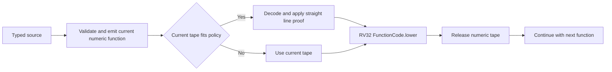

# Select redundant bounds-check analysis while streaming

The native compiler receives a checked function after the shared frontend parses it. Its numeric instructions explicitly check a position against the UTF-16 capacity before computing the address. A second access at the same position can reuse an earlier successful check when both use the same buffer and position and nothing in between can change that relation. The study charges an analysis only while the current function is available. It keeps no function bodies for a second pass over the program and uses the ordinary RV32/Wasm paths as controls.

## Proof and invalidation

Recognize the numeric instruction sequence for the original bounds guard. Accept only a checked position temporary whose reaching definition directly copies a local or constant. Distinguish immediate constants from local versions. A proof key contains the current receiver binding and the position identity. A repeated guard in the same straight-line region may be replaced by an unconditional continuation. The address calculation and subsequent operation remain unchanged. A guard can trap, so an unexecuted, bypassed, or invalidated check supplies no fact.

Discard cached checks on structured control, branch, return, call, and every memory write. State from one loop iteration cannot carry into the next. Numeric temporary identities originate in the same straight-line decode segment and are cleared with the proofs. Every local assignment advances its defined identity. An assignment to a position or receiver invalidates keys based on its prior version. The parser and native backend still validate their normal input. If the auxiliary decoder cannot understand an instruction, discard the function's analysis result and use that function's ordinary body. Raw ABI pointers outside valid Typed objects are beyond this proof.

## Frozen decision rules

1. Never analyzes no function. Always analyzes every completed function.
2. Source-order budget inspects each function if its numeric tape cell count fits the compilation's remaining budget of 640 cells. It debits the full tape count before running and continues to later functions after rejection.
3. Selected uses the same source-order budget and refuses tapes smaller than 24 cells or larger than 192 cells. It also requires at least one buffer or string parameter. Eligibility uses only the current checked signature and cell count. It requires no scanning, training, or prediction from the upcoming held-out inputs.

Charge describes inspected tape cells, not measured time. Report total functions, accepted functions, visited cells and eliminated guards, and keep reported time and native extent distinct. A selection that misses profitable code or attains the same reduction with more work is a negative result. Neither policy bypasses normal checks when proof fails. Thresholds and source-order behavior remain fixed after held-out disclosure.

## Evaluate

Apply the four policies through the same default-streamed compiler on real Chess/Editor and bounded integer scene code. Add targeted checks for control joins, mutable indices, calls and writes, along with a frozen unseen input. Compare complete buffers and result/trap behavior to scalar native and Wasm. Report where code savings occur rather than equating analysis coverage with speed. A hardware benchmark runs generated routines from the same placement on the ESP32-P4 and times literal native workloads separately from compiler orchestration. Preserve the playable app on completion.

## Start with an example

Trace `repeated(text, p)` from `scripts/01-bounds/control.typed`.

```typescript
function repeated(text: string, p: i32): i32 {
    let a = text.charCodeAt(p);
    let b = text.charCodeAt(p);
    return a + b + text.charCodeAt(p);
}
```

For a string of capacity eight and position two, the first guard observes that `unsigned(2) < unsigned(8)`. Nothing before the next read writes the header, changes either operand, or transfers control. The subsequent guard must succeed in that region. The optimization can remove it and still load the UTF-16 payload at byte offset eight. For position minus one, the first guard traps. Neither later guard could be reached. Replace the middle read with a host call or a store to another object and the optimizer must clear its proofs. An alias could reach the first object's capacity header.

A successful check and a speculative check are different premises. For an if arm that evaluates the first read only when a flag is true, its check provides no proof after the arm rejoins. It also cannot prove the first read in the next loop iteration.

## Compiler entry points



- `typedWasm.compileFunctions` in `picocalc-os/compiler/typed-wasm.js` accepts a function callback on the numeric path. The callback receives a validated signature, local count, and code array.
- `typedRv32.compile` in `picocalc-os/compiler/typed-rv32.js` owns the budget for one compilation. Its `consume` callback lowers the current function and releases the code array.
- `scripts/01-bounds/01-stage.mjs` inserts the optional selection at that boundary. `analysis.inc` lists the recognized widths, effect barriers, guard pattern, and policy. It leaves the existing language parser and public ABI alone.
- `scripts/01-bounds/06-prior-engine.mjs` tests the same policy on the original guarded Editor's prior fact search. It records each read's immutable facts at the time of emission and applies the original proof when the function completes. It keeps the old compiler's tracking and local lookahead costs visible.

```text
remaining = 640
for fn as each checked function completes:
    size = cell_count(fn)
    if policy permits this signature and size:
        if budgeted, debit size from remaining
        for instruction at each decoded boundary:
            if it writes memory or transfers control, forget all facts
            if it assigns a local, update the local's identity
            if it is a recognized checked guard:
                remember its current receiver and saved position
                remove it only if those identities were already checked
    lower the current tape and release it
```

The strategy never carries proof state across functions. The 640 budget bounds charged cells for accepted functions. It doesn't bound time spent parsing or lowering, which occurs in every arm. A completed arm that spends fewer cells can still be slower for reasons this count does not represent.

## Reproduction and escalation for an intern

Run the independent corpus first. A failed expected return, trap, or output byte invalidates performance conclusions for that arm. Read the outcomes from the receipts and compare all four policies on each corpus. Explain how many functions were eligible, whether any proof was possible, and whether an eligible site was skipped. For physical work wait for serial handoff and verify the installed ordinary app and partition against the release. Use the private warm tree and restore the exact ordinary image.

The operator locked the policy in `scripts/01-bounds/00-policy-lock.md` before the independent corpus was disclosed. The independent research design is `sources/01-bounds/01-lead-design.md`. It also describes a candidate exact eligibility counter. This implementation deliberately preserves the original fixed-size policy so that neither the earlier bounded engine nor the independent corpus influences the threshold.
