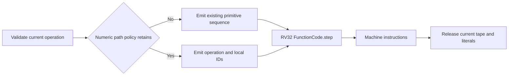

# Preserve checked operation identity until native lowering

The shared frontend knows when a checked access begins and where the corresponding buffer, index and payload operation come from. Early expansion replaces this knowledge with primitive stack instructions. This experiment retains only two small Typed operations on the optional numeric RV32 path. It tests which operations benefit, and whether a simple rule can choose them without a second parse.

## Preserve checks, side effects and value lifetimes

The first retained operation is the checked UTF-16 address. It describes the receiver and saved position locals and produces the same checked header-relative address as the early operation. On RV32, the unsigned bounds comparison branches directly across the existing trap instruction. The address is produced only once the comparison succeeds. A load or store retains its existing four-byte payload offset. A checked write still computes its address before evaluating the value, so a failing check may stop that evaluation at exactly the same point.

The second operation is the write of an already checked literal. The existing start and end guards run before it. A late native lowering loads the address once and emits ordered immediate halfword stores using the shared address register. This is still the direct scalar writer. It changes no image data segment and uses no bulk-copy pool. The accompanying result count comes from the same frontend code. Empty strings preserve evaluation and generate no stores.

Keep the default Wasm and RV32 paths available. The early arm expands the operations as today. Late retains both address and already checked literal writes. The static rule retains the address for reads and retains literal writes of at least eight UTF-16 units. It keeps address expansion early for scalar writes and literal guards. It sees the method kind and literal length during normal frontend emission. This threshold and method rule are fixed before the held-out input. They make a testable tradeoff between a narrow policy and opportunities deliberately left to early emission.

## Compare completed operations

Report code bytes and work per real input from the same shared compiler and fixed linker. Count which methods retained identity, then compare exact output and traps for both operation arms. Required independent tests cover unsigned negative and endpoint indices, dynamic side effects, aliased valid buffers, nested operand stacks, read-versus-write sequencing, and UTF-16 literal lengths on either side of eight. Check at least one real bounded-index renderer and real application sources plus an independently supplied holdout. A rule can be inferior to always-late; record that where observed.

On the board use matched emitted code images in the same physical placement. Treat a local primitive and its workload as separate timing boundaries. Boot, cache residency, EFI loading and whole-application response need separate evidence. Keep the release compiler and app intact.

## Start with a checked write

An index expression runs before the payload of a checked write.

```typescript
destination.setCharCodeAt(p, source.charCodeAt(q));
```

For a destination capacity of eight and `p = 7`, the destination guard succeeds and computes its header-relative address `base + 14`. The read from `source` next checks `q`. Only after it succeeds does the store write the destination at `base + 18`. For `p = 8`, the first guard traps, making neither that read nor that write reachable. A preceding completed store stays visible regardless of which guard fails. The differential fixture checks this across negative, endpoint and extreme signed inputs.

The private checked address carries two local IDs, `receiver` and `position`. It leaves a single address in the same operand-stack slot used by early expansion. On RV32 the check is an unsigned comparison, so a negative `i32` position in a normal object fails. The lowering uses the normal trap, then shifts the saved index and adds the header base on success.

```text
index = load_local(position)
base = load_local(receiver)
capacity = load_u32(base)
if unsigned(index) < unsigned(capacity): jump 8 bytes
EBREAK
produce_address(base + (index << 1))
```

The target loop for literals always uses UTF-16 units. In `ab☺€🐈cd` there are eight. The supplementary character contributes two, `D83D DC08`. The checked write guards the complete range and then produces the same eight halfword stores. The selected policy keeps this write intact into RV32 lowering, while it expands the seven-unit version early. There is no new memory object, allocation or binary data payload written by this lowering.

## Compiler entry points



- The frontend in `picocalc-os/compiler/typed-wasm.js` uses `codeUnitAddress` for checked reads and scalar writes. Its `bufferLiteral` emits guards and the ordered stores. Both call sites still perform the shared type and evaluation checks.
- The prototype in `scripts/02-semantics/01-stage.mjs` inserts an optional operation in both native emitting paths. The Wasm path never emits either private opcode.
- The target's `FunctionCode.step` handles the two private opcodes in `picocalc-os/compiler/typed-rv32.js`. At function completion, `consume` releases the numeric tape and optional literal references. Assembly still owns the lowered machine words and targets.
- The board harness compiles Chess and Editor through the usual world compiler API. A distinct test invokes exactly the machine code previously checked on the host. One measurement records fresh compiler time and peak JS allocation. The other records repeated successful native execution. Native trap semantics are covered by the host oracle.

## Reproduction and attribution for an intern

Compare early against stock bytes before looking at native savings. Use `scripts/01-bounds/02-heldout.mjs` with the director's fixture and oracle, and `03-host.mjs` for the full application images and directed cases. An app compiling successfully does not qualify its gameplay or every operation. The early-vs-late result measures the combined change in operation lifetime and target instruction selection. There is no otherwise-identical early peephole arm to separate the two.

The operator locked the rule in `scripts/02-semantics/00-policy-lock.md` before the independent corpus was disclosed. The original Claude Opus High research design is `sources/02-semantics/01-lead-design.md`. Its general copy and dispatch proposals are outside this prototype. Preserve checked address evaluation and the actual compiler callback before considering those proposals.
