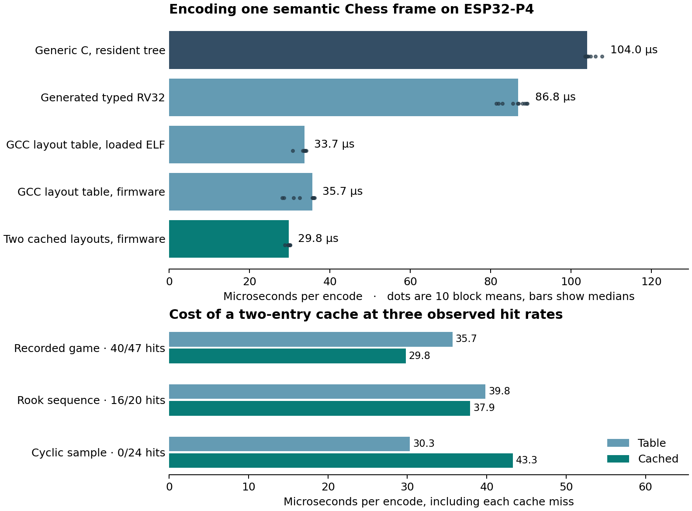

# Compiling the screen writer on a handheld

After a Chess cursor move, the game already knows the board position, legal destinations, score and selected square. The PicoCalc can turn those fields directly into a binary screen message. We had the ESP32-P4 generate a writer for that particular data structure, compile it with the project's typed compiler, load the resulting RISC-V function and execute it. We then asked how much of that pipeline an application actually needs.

On a chronological replay of 47 semantic Chess screens, the generic native encoder took 104.0 µs per screen. The newly compiled function took 86.8 µs. A small native function interpreting a precomputed layout table took 35.7 µs. Extending the table writer with two reusable packet layouts brought the median to 29.8 µs, including seven misses. All four writers emitted the same bytes. A fifth arm ran the table from a loaded native module and took 33.7 µs. The evidence favors deriving the layout when the compiler knows a type, then executing a compact writer. It also tells us exactly what a better code generator has to beat. [Physical block measurements](../various/physical-followup.json) · [Summaries and paired ratios](../various/physical-summary.json)

## Start at the producer

PSIX is the research renderer's indexed binary snapshot format. An application sends one complete state. A receiver can find a field by reading a directory in the packet. This costs the producer work. For example, it has to collect the distinct strings, order them by their UTF-8 bytes, assign each a number, size the variable records and write their locations. On the original full System screen, the generic native PSIX sender took 1.328 ms on the P4, compared with 0.525 ms for printing JSON from the same tree. The gap was 0.803 ms or 153%. On the original expanded Chess screen the corresponding times were 1.850 and 1.816 ms, a 1.9% difference. Neither measurement counted painting. The generic encoder spends time producing the index that makes the receiver's work cheaper. [Previous matched sender and receiver study](../../PICOCALC-RENDER-BINARY--compile-complete-picocalc-screens-into-an-indexed-binary-representation/analysis/01-what-an-index-on-the-wire-buys-a-picocalc-renderer.md)

We chose semantic Chess because we can start before an application constructs that tree. The input to our direct writers is 90 unsigned 16-bit cells. Sixty-four give the piece on each square. Eight bit masks describe legal destinations. Nine signed 32-bit integers occupy the remaining eighteen cells. A fixed declaration specifies how these values become the board string, mask string and numeric array inside the envelope. The view version, digest and field names are also known. Each recorded output was 313 bytes. Compact JSON for the same semantic envelope was 257–263 bytes. Indexed access and cheap production can be valuable even when the smallest message is JSON. [Static producer report](./02-static-encoder.md) · [Recorded inputs](../scripts/board/chess-trace.ndjson)

The generic timing starts with an equivalent cJSON tree already resident. It includes allocating the binary result. The direct writers take the packed state and write into an existing destination. The clock excludes building either input, comparing the result, releasing the generic result, sending the packet and drawing pixels. These endpoints model interfaces that the respective producers could actually use. To establish a key-to-display improvement one would have to connect the winning producer to the real consumer and measure that path.

## Which decisions can the compiler make once?

A type says what kinds of values can occur in a field. It does not fix the field's bytes. In PSIX an integer from −524,288 through 524,287 fits into the 20-bit operand of a tagged three-byte slot. For the next integer, 524,288, the slot instead points to eight bytes encoding the number. Two packets with the same field names and types can consequently have different lengths and different addresses for later records.

Strings supply a subtler example. All distinct keys and string values share one sorted directory. Changing a label from `zz` to `aa` can change the integer IDs of keys elsewhere, even though the label occupies exactly two bytes both times. The independent reviewer constructed a packet using a new dictionary and the old record body. The real reader admitted the packet, then a lookup for the label returned the score. A structural validator can check that a reference is in range. The producer must also establish that this reference designates the right value. Canonical byte equality against an independently implemented writer catches that error. [Worked example and decoded values](./04-staging-and-binding.md)

The Chess plan describes a fixed tuple and nested records, literals, and holes to be filled from the current game state. Specialization precomputes 14 constant dictionary strings, an 85-byte structural body, 19 places at which to install a string ID or record reference, and nine numeric slots. At execution the writer validates its values, finds the order of the two changing strings, and determines which numbers need extra space. It can then assemble the packet without traversing a JS or C object tree. The declaration restricts the repertoire and widths of the two strings. Where the generator cannot establish required invariants, it refuses that declaration. [Schema generator](../scripts/static/01-specialize.js) · [Layout and reference generation](../scripts/board/fixtures.mjs)

```text
Chess declaration and typed buffer contract
       ├── specialize into typed source ── typed compiler ── native writer
       └── derive offsets and fixed bytes ── layout table ── small native loop
                                                                 │
90 current cells ── validate and classify current values ─────────┤
                                                                 ▼
                                               canonical complete PSIX packet
```

The local manuscript *Macros Without Parentheses* distinguishes expansion, when a system works with program structure, from evaluation, when the application obtains values. That distinction is sufficient here. A compiler pass can read resolved declarations, assign identities to its private temporaries and emit an ordinary function. If a caller supplies an expression with effects, evaluate it once and refer to the bound result during both sizing and writing. This is the same binding-time problem studied in partial evaluation and the same type-directed construction used to compose serializers. It requires no new surface syntax for the pilot. [Partial Evaluation and Automatic Program Generation](https://raspi.itu.dk/people/sestoft/pebook/pebook.html) · [Kennedy, Pickler Combinators](https://www.microsoft.com/en-us/research/publication/functional-pearl-pickler-combinators/)

We tested the automatic part on existing source. The public result of `typedWasm.compile(source).records` provides field names, types and offsets. Starting from that metadata alone, one generator derived flat-record writers for Chess `WorldEvent` and `WorldState` and Agenda `Task` and `EntryError`. All 231 host Wasm cases produced the reference bytes and all 231 one-byte-short calls preserved the destination. All four writers compiled to RV32. This second experiment executed Wasm on the host. The nested Chess screen that ran on the P4 used an explicit profile because a declaration of `buffer` cannot tell the compiler that an application wants 64 hexadecimal piece codes or a particular view digest. [Automatic derivation program](../scripts/review/07-derive-typed-record.mjs) · [Record results](../scripts/review/08-derive-results.json)

## Generating instructions, interpreting a table and copying a frame

The first implementation emits typed source so that it can use today's frontend and both ordinary backends. On the P4 the production compiler turned 16,680 bytes of generated source into 16,116 bytes of RV32 instructions. The study linked them into a 33,964-byte ELF with a reserved slot. It compared the complete module with a host-generated reference, relocated it and called its entry point. On the host, 121 distinct inputs, including the 47 recorded game states, matched across four implementations: the JS and C references, Wasm and emulated RV32. The median recorded RV32 invocation executed about 21,496 emulator instructions, including the short measurement wrapper. The emulator provides an instruction count. Physical execution supplied the times below. [Compiler, artifacts and qualification](./02-static-encoder.md)

The second implementation stores the schema decisions as data. A C function reads the offsets and emits the output. We built both a firmware version and a separately loaded 3,340-byte ELF from the same descriptor source. The latter runs under the same ELF loader configuration as the generated writer, with the executable loaded in PSRAM. It is still considerably faster. Code placement alone cannot explain the generated writer's deficit on this workload. The two compilers emit different instruction sequences. Their buffer operations also differ. The typed implementation packs byte writes into the language's 16-bit cells. Disassembly or a controlled byte-store primitive would be needed to attribute a fraction of the difference to that design. [Table writer](../scripts/board/descriptor.h) · [Relocated table entry](../scripts/board/relocated-table.c)

The third implementation caches a copyable packet with the application values removed. Its layout key contains the insertion rank of *each* changing string among the fixed strings, their ordering relative to one another, and a nine-bit mask identifying the fields whose numbers need wide storage. Counting just the wide fields would be incorrect. Two packets of equal length could place a pointer in different numeric slots.

```text
values, key = validate_and_classify(state)
if cache contains key:
    require enough output space
    copy the stored packet and fill both strings and every numeric value
else:
    encode using the table into bounded scratch
    return an error if the input or capacity is unsuitable
    copy the result to the caller
    clear the dynamic regions and remember its layout in a two-entry cache
return encoded byte count
```

The 1,192-byte cache includes both packet buffers and its bookkeeping. That number excludes transient scratch, the caller's buffers, and code. A hit still checks the input and writes all dynamic values. A miss includes constructing and retaining the new layout. Each call yields an independently usable full packet, including after an application or compositor restart. This is copying a *validated wire layout*. Copying the game's own memory wholesale would transmit a different representation. [Cache implementation](../scripts/board/patch.h) · [Malformed input, width and overlap tests](../various/patch/host-receipt.json)

## What the two physical runs establish

The first run used seven rotated blocks. Each writer encoded each of 47 screens four times before moving to the next screen. The generic writer took 101.28 µs, generated RV32 took 78.24 µs and the firmware table took 24.71 µs. A complete on-device installation took 603.79 ms at the median. At a saving of 23.04 µs per call over generic encoding, it would take about 26,200 calls to recover that initial cost under those conditions. There is no such crossover against the faster table writer. [First physical receipt](../various/physical.json) · [Independent interpretation](./07-independent-specialization-results.md)

The follow-up used ten blocks and encoded each frame once in chronological order, starting each cache empty. Each candidate occupied each timing position twice across the five-writer comparison. Timing the chronological stream includes the cost of switching inputs. Both rounds include other differences in the research firmware and harness. Compare candidates *within* their own run. The row medians below are medians of block means. The raw samples preserve individual blocks and the paired ratios.

| Writer on the 47-state replay | µs per screen | Reduction from generic |
|---|---:|---:|
| Generic native PSIX from the resident tree | 103.98 | baseline |
| Typed RV32 generated and loaded on the P4 | 86.84 | 16.5% |
| GCC layout interpreter in a loaded ELF | 33.67 | 67.6% |
| GCC layout interpreter in firmware | 35.67 | 65.7% |
| Firmware table with two cached layouts | 29.79 | 71.4% |



The two-entry cache had 40 hits and seven misses on the 47 frames. Its 16.5% time reduction against the firmware table held in eight of ten paired blocks. The same-position rook test gives a more informative boundary. Twenty chronological frames, including the intervening cursor movements, yielded 16 hits. The two medians were 37.93 and 39.83 µs, with the cache ahead in seven of ten blocks. Cycling among three selected legal states filled the two entries repeatedly, giving zero hits in 24 calls. The cache took 43.27 µs against 30.31 µs for the table, **42.7% more time**, and lost in all ten blocks. The cycle is a deliberate stress experiment. The underlying three selections came from executing the real Chess world. [Rook fixtures and sample construction](../scripts/board/patch-fixtures.mjs) · [Block data](../various/physical-followup.json)

Installing freshly generated code took 606.35 ms in the follow-up. Reading the same prebuilt ELF, relocating it and obtaining its entry took 3.48 ms. Loading the small GCC table ELF took 0.87 ms. The prebuilt clock stopped before the independent test call and byte comparison. The cold generation clock included reading and comparing the golden module as part of qualification. For an application compiled from an edit on the device, generate the layout during that compilation if possible. For a bundled application, the prepared descriptor can ship with the app. These two alternatives avoid paying a fresh compiler startup solely to send a frame.

## Observing a shape at runtime

The complementary experiment started at a different interface. System, Snake, Editor and expanded Chess already hand the producer an object. A guarded traversal plan can recognize that object's structure and reuse the plan. It must inspect the new object sufficiently to justify the reuse and reconstruct value-dependent parts of the string directory. The prototype interprets those plans in QuickJS. It does not compile arbitrary observed objects to native code on the device.

Across 427 host frames the candidates reproduced 581,602 reference bytes. On a nine-frame P4 System holdout, the trained bank reduced encoding from 288 ms to 261 ms over the entire stream. When training was charged its total reached 363 ms, compared with 288 ms for the generic policy. Starting with an empty adaptive cache took 359 ms. A separate six-frame Keys replay exposed a shape absent from the System training. The bank got zero hits. Frequent repetition can justify staging, but recognizing ordinary application objects and deriving from a declared type have different setup costs and different obligations. [Observed-shape study and physical holdouts](./03-observed-shapes.md)

## The next compiler experiment

I would implement an internal derive operation on the compiler's resolved record table, beginning with the already qualified flat scalar records. Its output should be a compact layout descriptor. A second emitter can lower that same descriptor to native operations so both targets consume precisely the same field semantics. For Chess, extend the descriptor with the explicit array lengths and projection that the compiler cannot infer. The existing loader is already adequate for either strategy.

1. Capture the compiler's field offsets and prove each fixed dictionary or offset decision before emitting a descriptor. Provide a diagnostic when a shape needs a convention that its declaration does not specify.
2. Run the table engine and the generated writer against both independent encoders. Include dictionary reordering, inline/wide transitions, empty and one-byte-short destinations, and stale values across consecutive cache hits.
3. Evaluate one compiler change with an identifiable cause. For example, give the native emitter a byte-range copy and a bounds-checked packed store, compare its executed instruction count, then rerun unchanged physical controls. The loaded table's 33.7 µs is the target for this trace.
4. Only then connect the semantic producer to the real compositor and measure state collection through display. Record the slot, resident and temporary bytes, cold edit delay and time to first usable screen. These measurements decide whether a producer win justifies changing the application path.

The strongest result is that the compiler already knows enough to remove whole classes of runtime work. Its most effective contribution on this workload was making layout knowledge available to a small writer. Generating thousands of instructions from the same knowledge was feasible and slower. The experiments leave a concrete compiler problem: determine the smallest set of native operations that can match the table while preserving exact serialization and cheap installation. [Intern design and API guide](../design-doc/01-a-staged-compiler-for-psix-screen-encoders.md) · [Reproduction instructions](../README.md)
