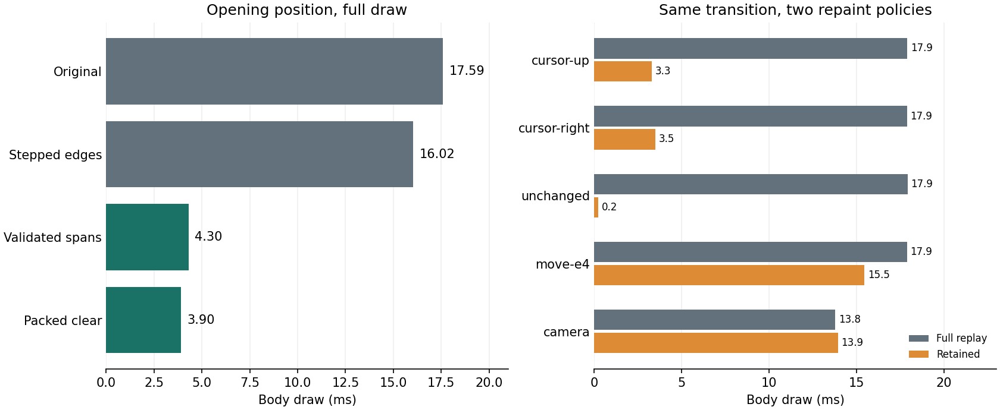

# Where the PicoCalc spends a Chess frame

On the ESP32-P4, an opening Chess board took 17.59 ms to draw from validated triangle commands. The same opening took 4.30 ms after the rasterizer stepped its triangle edges incrementally and wrote spans directly. A variant that filled sufficiently long spans with packed instructions took 3.90 ms. These numbers time the game body on the handheld. They exclude game search, source compilation, native generation of the drawing commands, compositor chrome, display commit, and the SPI transfer. Those stages have their own costs. To estimate the effect on play, start with what the measured code actually did.

## A frame before any optimizations

The game sends a semantic position. The mobile Typed painter projects the squares and the pieces and emits a sequence of commands. One command fills the background, and each triangle command gives three points and a color. The software rasterizer converts the commands into rows of colored RGB565 pixels. RGB565 stores red, green, and blue in five, six, and five bits, so a screen pixel takes two bytes. The framebuffer stores a back image and tracks which horizontal bands have changed. Committing a framebuffer compares dirty bands with the front image so the display driver can send changed rectangles.

The compiler's separate packed projection experiment saved about ten microseconds on an opening frame. It processed genuine board vertices. This raster investigation starts later in the same pipeline, after the vertices have become triangles. In the frozen scalar scene the background covers 89,600 pixels. The triangles generate 5,580 horizontal spans and write 33,150 pixels when overlapping surfaces are counted. Generating each span by calling a general-purpose rectangle fill entails bounds checks, marking, and cost accounting. Most spans are short. The median has five pixels. A reduction of even a few hundred cycles in the setup for a row has a measurable effect over thousands of rows.

*The left panel compares four complete draws of the same opening body. The right panel pairs a baseline full draw with the retained alternative on the same transition. The two experiments used separate sample orders and validation protocols.*

## What the full renderer can establish once

The list validator verifies the coordinate of every triangle before the renderer receives it. Consider an edge joining integer points at heights y₀ and y₁. For each raster row it intersects the edge at height y + ½. Adjacent triangles must assign a center exactly on a shared edge consistently. Otherwise two pieces of one square could leave a one-pixel crack or paint that pixel twice. The original routine finds the intersection again on every row. A fixed edge has a constant slope, so the next horizontal intersection follows from the current quotient and remainder. The new code computes the initial terms once, adds a precomputed increment per row and carries the remainder when it crosses the denominator.

That substitution improves 17.59 ms to 16.03 ms, an 8.9% reduction. The larger change comes next. A validated triangle cannot produce a span outside the game body. The bounded renderer writes the span directly, collects its dirty bands in a bit set, and preserves virtual-time accounting. The scalar arm also treats the full matte as contiguous storage. Together these changes take the opening to 4.30 ms, a 75.5% reduction against the original and a 73.2% reduction against stepped edges alone. The experiment combines direct writes, reduced metadata work and a contiguous matte in that arm. It cannot assign the entire improvement to any one of those three changes. [Implementation and four-arm results](01-where-vector-stores-help-the-chess-raster.md)

The packed path broadcasts one RGB565 color and stores eight copies at a time to a 16-byte-aligned destination. The measured policy enters this path for spans of at least 16 pixels. Every triangle span in the frozen 51-frame corpus is shorter than that threshold. The matte supplies 11,200 groups of eight. Changing the scalar writer to this packed writer saves another 0.40 ms, about 9.4% of the optimized scalar time. The opening takes 77.8% less time overall, or about 4.5 times as many complete raster draws per second at this stage. A different model, board scale, or fill threshold changes that attribution. [Measured span lengths](../various/span-traffic.json) · [Linked instructions](../various/pie-disassembly.txt)

## What can be reused from the previous picture

A second researcher asked how much work a renderer can avoid between two accepted lists. Moving a cursor from e2 to e3 in this scene changes 328 pixels. A damage algorithm can collect rectangles covered by changed commands in both the old and new streams, retain the previous framebuffer, and replay every command that overlaps those rectangles in paint order. Including old coverage is essential when a piece leaves its square. Replaying intersecting foreground faces preserves occlusion. The implementation also handles a repeated list, a change confined to hints, and a camera change that invalidates the entire body.

On the handheld, the cursor transition took 17.89 ms for a full baseline replay and 3.29 ms from retained pixels, an 81.6% reduction. Moving the pawn from e2 to e4 reduced 17.89 ms to 15.46 ms, a 13.6% reduction. The invalidated region and overlapping faces grew considerably. An unchanged scene took 0.22 ms. The camera fallback increased time by a median paired 0.146 ms. It is reasonable to consider retained replay for a cursor, while rotating the entire board gives a much stronger reason to invest in a faster full draw. [Retained study and independent checks](03-retained-chess-repaint.md)

The compositor currently fills the entire screen before issuing its native-painter call. In this configuration a partial replay begins from erased pixels. The retained experiment correctly starts from a preserved previous body. Shipping it would require the compositor to know whether that exact image still owns the surface after a switch, overlay, device invalidation, or rejection. The simpler full renderer needs no history and redraws a newly selected camera on its first invocation.

## Measurement and qualification

The host checked 51 complete displays and compared edge cases against pixel-center coverage. The independent reviewer checked 49,918,680 edge-row steps and 2,568 span lengths and alignments. The retained study checked all 2,601 ordered pairs of the 51 displays, as well as sequences that carry the retained body from one update to the next. These controls catch distinct mistakes. Independently rasterizing a triangle detects an edge error. Redrawing a full position detects a dirty-region or occlusion error. Comparing metadata detects an incorrect dirty flag even if the final stored pixels happen to match.

The board ran at 360 MHz with PSRAM at 200 MHz. The full-draw campaign used 11 samples per series and collected 56 timing series. The retained campaign tested ten named transitions, with seven paired samples per case. The standalone profile used the ordinary 2.5 ns-per-pixel fill charge. Its text coefficient was zero. The small glyphs in the frozen corpus round to the same zero virtual charge under the ordinary text rate. All draws still executed their glyph raster. A bus observer or timing around actual display flushes would be needed to turn any of these measurements into an input-to-visible estimate. [Physical receipt](../various/physical.json) · [Paired retained results](../scripts/damage/board.json)

I selected the independently qualified scalar edge and direct span implementation for the new rotating Chess painter. That choice carries the most effective part of the full-draw experiment into a workload that changes the complete view during a turn. The production integration retains the ordinary generic rectangle fill for its matte. Its wall time therefore requires measurement on the actual new pieces and cameras. The reported 3.90 ms remains the frozen low-polygon benchmark with the packed matte. The full table and reconstruction script let a future researcher test a different dispatch threshold or integrate retention with explicit compositor ownership.
