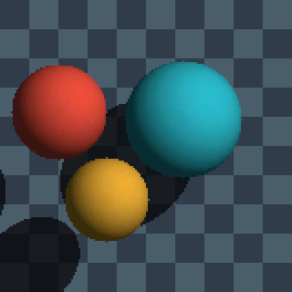

# What eight rays buy on a handheld

The Ray app draws three curved surfaces over a checkerboard. The operator can move one sphere and change the direction of the light. Both actions change the image through arithmetic performed on the handheld. The source image has 160×160 pixels. Each two-byte RGB565 pixel stores five bits of red, six of green and five of blue. The compositor enlarges the picture and draws the surrounding application interface.

## Visibility and shading

Each pixel has a different position in the camera plane. All primary rays follow the same direction. A sphere whose projection contains the pixel intersects its ray. Given the sphere's radius r, the horizontal distance dx and vertical distance dy from its projected center, the discriminant is r² − dx² − dy². Its sign determines whether the sphere can cover the pixel. For surviving candidates the renderer obtains depth from the square root and keeps the closest surface. This second step matters where the sphere silhouettes overlap. An object can pass the intersection test and still be hidden behind its neighbor.

For sphere pixels, the visible point and sphere center give a surface normal. The direction of the light determines the brightness across the surface. For checkerboard pixels, the renderer tests visibility toward the light, which produces a sharp shadow. Moving the light changes both the illumination of each curved object and the shadow it casts on the plane. Keeping this shading code shared across the two primary intersection implementations makes the final image a useful test of the change in arithmetic.

## What actually became parallel

The camera and sphere centers stay fixed for one frame. For each sphere, the renderer precomputes dx² at each possible x. For a given scanline, r² − dy² is also constant. The hot operation therefore reduces to subtracting an array of horizontal squared distances from a single broadcast value. This is simpler than computing three squares in every lane for every ray. It also makes the scalar implementation a stronger baseline.

The P4 assembly loads the row constant into a vector register, reads eight signed 16-bit values in a single aligned load, subtracts them in parallel, and writes eight discriminants. The C renderer resolves the surviving lanes in screen order. The movable center is constrained to keep the arithmetic inside a signed 16-bit lane. The proof uses the bounds of the whole coordinate domain. Seeing a plausible answer at the center of the default scene would give little assurance that an edge position was safe.

Each full scene has 25,600 rays and 76,800 primary sphere tests. Moving the sphere changes the number and pattern of visible hits. The total number of initial tests remains fixed. These quantities give a useful denominator for comparing intersection time and for distinguishing initial candidates from pixels actually shaded as sphere surfaces.

## Reading a hardware comparison

An intersection benchmark returns nearest depths. It exercises packed subtraction and also the scalar operations that decide which surface wins. The full benchmark produces final RGB565 colors, including lighting and shadows. A speedup of the subtraction alone cannot be directly multiplied by the number of lanes to predict either elapsed time. Display composition and transfer add further costs to a real key event. The most useful experiment therefore times equivalent depth and color workloads independently.

A portable scalar implementation also serves as the pixel oracle for the ordinary app. In the animated preview the same implementation runs in a host executable, writes numbered PPM frames and enlarges them using nearest-neighbor sampling. The GIF is an illustration of scene controls. Its frame interval is chosen for viewing; hardware timing is measured on the board. [Preview sources](../scripts/director)

## Physical result

Across eighteen matched pairs on three scenes, the complete scalar frame took a median 8.562 ms and the PIE frame 7.448 ms. Median paired speedup was 1.150×. The isolated nearest-depth pass took 4.107 ms and 2.990 ms respectively, with a median paired speedup of 1.372×. The packed routine finished sooner in every pair. Each pair matched all 25,600 primary depths and all 25,600 colors. The physical app viewport matched all 57,600 reference pixels in four captures. These frame timings measure production of an image in memory. They exclude enlarging that image, compositor chrome and physical display transfer. [Timing receipt](../various/device/summary.json)

Only 6,983 of 76,800 tested lanes survived the sphere intersection stage. Of those candidates, 6,123 contributed a visible sphere pixel in the initial scene. Packed arithmetic improved a regular loop even with sparse hits, because every group still had eight discriminants to calculate. Depth selection, shading and ground shadows then diluted that gain in the whole frame. This is a useful baseline for programmable materials. The [Candela feasibility analysis](../design-doc/02-a-composable-candela-subset-for-the-typed-renderer.md) identifies which material expressions could be constructed by a Typed scene and resolved before entering the pixel loop.
