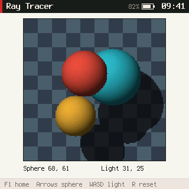

# Moving a sphere through the handheld display

Press **F1**, then **V** to open **Ray Tracer** on the PicoCalc. The red sphere starts in front of a turquoise sphere, with a smaller gold sphere below. Press the right arrow once. The red sphere covers more of the turquoise one, and the checkerboard changes where its shadow falls. Now press **W**. The spheres stay where they are. Their highlights and the shadow on the checkerboard move as the light changes direction.



| Control | What changes |
| --- | --- |
| Arrow keys | Move the red sphere left, right, up or down. |
| A / D | Aim the light left or right. |
| W / S | Aim the light up or down. |
| R | Restore the starting positions of both controls. |
| F1 | Return to the launcher. Reopening the running app resumes the scene. |

The readouts below the image use the renderer’s 160×160 coordinate system. At startup, the sphere center is (68, 61) and the light control is (31, 25). Each key event advances its selected coordinate by eight until it reaches a limit. The center can move between 32 and 127 inclusive on either axis. Light controls cover 0 through 159. At a boundary a step uses just the remaining distance. Moving right from 124, for instance, lands at 127. Those bounds are also the numeric contract for the packed intersection code.

## From key event to displayed pixel

The keyboard driver delivers key events to the compositor, which routes them to the focused application. Ray Tracer publishes a screen containing four numbers. A right arrow changes only the sphere’s x coordinate. This compact screen travels through the same app interface as the other launcher programs. The compositor can replay it on a full redraw, including one prompted by a change in the status bar. The launcher obtains the title, icon, one-line description and shortcut from the app’s own registration.

The compositor checks the sender and verifies that all four coordinates are integers in range. It then uses its writable framebuffer handle to request the drawing operation. The Linux simulator uses the scalar implementation. The ESP32-P4 build can select the hardware implementation. Both accept the same scene and destination stride. The app needs no hardware claim or copy of the pixel image in its JavaScript heap.

The viewport begins at (40, 32) on the 320×320 screen and occupies 240×240 display pixels. That leaves room for the OS title, clock and battery, as well as the in-app coordinates and footer. A separate 160×160 RGB565 staging image would cost 51,200 bytes. Instead, the renderer writes directly into the top left of its final viewport, using the real framebuffer stride of 320 pixels. Each source row touches its own 160 columns. Pixels beyond those columns remain available for expansion and UI drawing.

Enlargement walks the viewport from the bottom right. At display-local coordinates (x, y), it copies the source pixel at (⌊2x/3⌋, ⌊2y/3⌋). The destination row is always at or below its source row. Even when they coincide, expansion from right to left reads each source column before a later write could replace it. With 3:2 enlargement, consecutive source pixels occupy alternating two- and one-pixel runs. Sending a uniform two-pixel run for each source pixel would produce a 320-pixel image and lose part of the scene or the OS chrome. After enlargement, the normal framebuffer commit compares dirty bands and gives the display driver the changed rectangles.

## What the simulator displayed

The host test boots the OS, sends keys through its simulated keyboard and reads PNGs from simulated panel memory. A separate call to the C scalar renderer computes the expected RGB565 pixels for explicitly specified scenes. The verifier applies the 3:2 coordinate mapping and the panel’s RGB565-to-RGB888 conversion to those values. Four captures produced 230,400 exact pixel comparisons. [Reproduction script](../scripts/ui/verify-host.py) · [Measured values and image hashes](../various/ui/host-ui.json)

| Captured pose | Sphere | Light control | Changed viewport pixels from previous pose | Mismatches against reference |
| --- | --- | --- | ---: | ---: |
| Open | (68, 61) | (31, 25) | — | 0 |
| Right arrow | (76, 61) | (31, 25) | 6,156 | 0 |
| W | (76, 61) | (31, 17) | 8,885 | 0 |
| R | (68, 61) | (31, 25) | 12,257 | 0 |

The first change covers only about a tenth of the viewport even though the compositor recomputes the whole scene. One light step changes more pixels than the sphere step in this sequence, because its effects reach the stationary spheres and the visible floor. The final crop reproduced the opening crop byte for byte. A separate check compared the launcher title before opening the app and after pressing F1.

This test covers launch, input routing, scene transfer, viewport orientation, expansion and the simulated panel’s final color values. The reference shares its geometry and shading code with the simulator, so mathematical correctness and packed-lane equivalence require separate tests. The selected waits in the host script simply allow virtual device events to settle. The hardware study measures the actual target under its own stated timing boundaries. [Physical qualification](04-measuring-a-packet-of-eight-rays-on-a-playable-esp32-p4.md)

## Reproduce the preview

From the repository root, run the command below. It requires the normal host toolchain, Python and Pillow. The output directory receives six PNG captures and a JSON summary. In the script, shorten or extend the key sequence to explore different positions. The expected scene list in the verifier describes this particular sequence.

```sh
python3 ttmp/2026/11/20/PICOCALC-RAYTRACE*/scripts/ui/verify-host.py /tmp/picocalc-raytrace-ui
```
