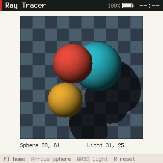
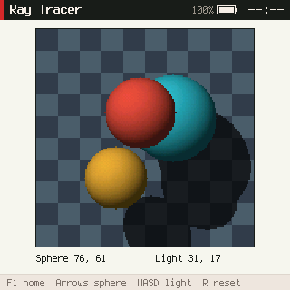

# Measuring eight ray–sphere tests at a time on a handheld

The PicoCalc's ray tracer renders a 160×160 image of three spheres above a checkerboard. It tests each of 25,600 primary rays against all three spheres. The ESP32-P4 has packed integer instructions that can do one arithmetic operation on eight signed 16-bit values at once. We measured the same engine with scalar instructions and with that packed operation enabled. Across 18 matched pairs the complete frame took **8.5615 ms scalar and 7.4475 ms packed** (medians). The primary intersection stage took **4.107 ms and 2.990 ms** respectively. All 18 full images and all 18 primary depth planes agreed word for word on the board. [Complete paired results](../various/device/summary.json)



## Where the eight lanes enter

Each native pixel supplies an x and a y coordinate. The orthographic camera starts one ray at each pixel, all pointing in the same direction. For a sphere centered at (cx, cy), the projected ray travels through the sphere if this signed quantity is at least zero.

```text
d = radius² − (y − cy)² − (x − cx)²
```

For one sphere on one scanline, the first two terms have a common value. The scalar implementation subtracts each precomputed squared x-distance from that value. The other implementation broadcasts the common value into eight lanes, loads eight squared distances into a register, subtracts them and stores eight answers. A scalar loop reads the answers in screen order. For each surviving ray it finds the depth of the nearest point on the sphere, then retains the nearest of all three spheres. When no sphere wins, the renderer samples the checker plane. The complete frame also computes lighting and hard shadows and packs each pixel into RGB565, a 16-bit format with five red, six green and five blue bits. [Renderer](../../../../../../picocalc-os/nucleus/raytrace_demo.c) [Linked instructions and build identity](../various/device/build.json)

The measured arithmetic makes one packet per sphere per eight pixels, or 9,600 packets per frame. A surviving lane is one ray that intersects one sphere. A visible sphere pixel is a different count, because two objects can intersect the same ray at different depths. A shadowed pixel counts a visible point on the plane with an obstructed path to the light. Moving the light can change the shadow count while preserving every primary depth. Occupancy here means the fraction of ray–sphere tests that survive the geometric test. Every packed subtraction executes all eight lanes.

| Pose | Ray–sphere hits / 76,800 | Surviving lanes | Visible sphere pixels | Shadow pixels |
|---|---:|---:|---:|---:|
| Opening | 6,983 | 9.09% | 6,123 | 4,793 |
| Boundary center | 6,983 | 9.09% | 6,537 | 4,214 |
| Moved light | 6,983 | 9.09% | 6,123 | 4,497 |

## What is inside the timer

A single serial command schedules one pair on the ordinary kernel task. The handheld allocates two 51,200-byte external-RAM buffers aligned to 64 bytes and prepares a fixed scene. Both implementations render once to warm the code and destination. A microsecond hardware timer then surrounds just the function call under test. In a timed pair both modes write to the same address. Outside the timer, the first output is copied and the destination is filled with a different pattern. After the second render returns, the runner compares the two outputs byte for byte. An unchanged unwritten word would retain a different pattern and fail the comparison. A separate packed draw gathers counters and must reproduce the same RGB565 image. Buffer allocation and scene selection together took 28 µs at the median in each scene. [P4 benchmark](../../../../../../picocalc-os/port/esp32p4/main/raybench_p4.c)

The full-frame measurement ends after computing the complete 160×160 native frame. The primary-only measurement calls the engine's ordinary traversal and nearest-depth calculation, writing a signed 16-bit plane with zero for a miss. Both include their internal scene setup. The timer stops before viewport enlargement, SPI transfer or serial output. Each block also records an independent setup time for scene choice and the two PSRAM allocations. All raw rows give elapsed microseconds for both arms, allocation time, output CRCs, order and counts. [Raw observations](../various/device/rows.json)

| Pose | Primary scalar / PIE (ms) | Primary paired ratio | Frame scalar / PIE (ms) | Frame paired ratio |
|---|---:|---:|---:|---:|
| Opening | 4.106 / 2.991 | 1.372× | 8.484 / 7.369 | 1.152× |
| Boundary center | 4.107 / 2.990 | 1.372× | 8.611 / 7.497 | 1.149× |
| Moved light | 4.104 / 2.990 | 1.373× | 8.562 / 7.447 | 1.150× |

Each scene has six pairs, three scalar-first and three packed-first. For each paired ratio, divide scalar time by packed time within one block and take the median of the six results. A ratio above one favors PIE. The sample is from one physical board and one release, with warm scene calculations. It supports a hardware result for these poses. First-frame latency would require a separate cold-start experiment. PIE finished earlier in 18 of the 18 primary pairs and 18 of the 18 full frames. The median paired time saved was 1.114 ms for primary depth and 1.1155 ms for the full frame. Nearly the same absolute saving becomes a smaller percentage of the longer frame workload.

## What appeared on the physical device

We opened the ordinary launcher with F1 and selected Ray Tracer with V. The UI placed the 160×160 renderer into a 240×240 viewport beginning at x=40, y=32 in the physical 320×320 framebuffer. Nearest-neighbor expansion chooses native coordinate floor(2x/3), floor(2y/3) for each local display pixel. The framebuffer command checks geometry, run lengths and CRC before decoding all pixels. We rendered the same scene off-device with the portable scalar implementation, expanded it according to that coordinate rule, and checked every one of the viewport’s 57,600 RGB565 pixels. These checks ran for the initial pose, Right to move the sphere, W to move the light, and R to reset. The final viewport reproduced the initial bytes. [Four physical captures and hashes](../various/device/screens.json)



The old playable application and its partition table matched the published release before installing the new application. At the end of the run, both flash regions were verified again and the handheld booted the new playable firmware. The eight existing native worlds were healthy, the previous Chess painter was installed with zero rejected inputs, and the keyboard bus continued polling. The new application digest is `efc938724492f1de8f2a0911abd05d09e8692b80872f5da707da1f92dd08a0c9`. After the final health check, the ordinary launcher reopened Ray Tracer and the handset was left displaying its verified opening pose. [Handoff receipt](../various/device/handoff.json)

The display evidence is a capture of the actual composited buffer before the panel’s scanout. [Device health and flash receipt](../various/device/final.json) [Investigation and reproduction steps](../reference/04-physical-ray-tracing-investigation-diary.md)
