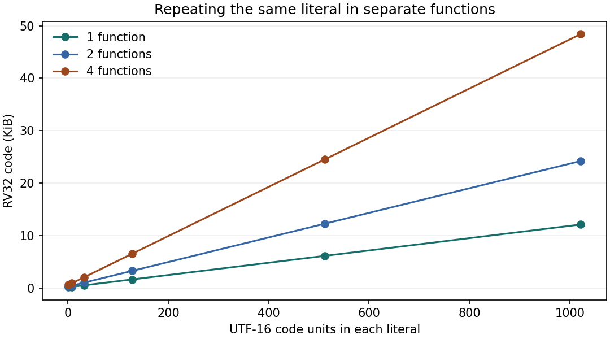

# What a handheld spends on compiling and running Chess

The playable PicoCalc firmware carries two Typed programs for Chess. One implements the game, including legal moves, search and handling a player's inputs. The other projects a board and pieces into a three-dimensional scene. At startup the game sends the painter's source to the compositor. The receiver compiles it for RV32 and invokes it on subsequent position updates. This division lets the app specify its own appearance while the compositor owns display access. It also creates an unusual compiler workload. One program must be able to reproduce another program's source exactly.

A user can encounter at least three delays. Opening the app may require compiling its source. Editing one function may require rebuilding a module that also contains many unchanged functions. Requesting a move runs the code that the compiler has already produced. This study uses separate experiments for each interval. Each begins with an observable input and ends with an observable product, such as a callable module or a verified chess move.

## Why one function occupies most of the shipped game

We reconstructed the ordinary firmware's Chess source from the ordered source list and the shipping painter embedder. The resulting 61,022 bytes matched the SHA-256 digest recorded when the on-device release was qualified. We then compiled it twice on the host using the release compiler, first streaming functions into the backend and then buffering them. The two compilations agreed on every returned field, including the machine instructions, entry addresses, type layouts and relocations. That agreement allows a static census of the code actually discussed here. Wall time and peak heap can still differ between the two compilation strategies. [Census script](../scripts/director/03-shipped-code-census.mjs) · [Results](../various/shipped-code-census.json)

| Role in the installed Chess world | RV32 code bytes | Share |
|---|---:|---:|
| Produce the source that will be sent to the compositor | 197,544 | 77.0% |
| Handle positions, generate moves and search | 26,580 | 10.4% |
| Handle app events and implement the two views | 32,276 | 12.6% |
| Total emitted game code | 256,400 | 100.0% |

The generated source writer consumes over seven times the code used by position handling, move generation and search combined. Its input is 16,316 ASCII bytes. The build-tool script divides that input into pieces because a single Typed buffer literal can contain at most 1,022 UTF-16 code units. The generated function issues one write per piece. The release compiler lowers the destination-capacity checks and a sequence of operations that reconstruct the literal. At runtime the writer supplies source text to another compiler. Its large size tells us how the game delivers the painter. The receiver's native drawing program, measured separately at 23,848 code bytes, performs the actual painting. The shipped game's 256 KiB slot has 261,996 bytes available after its entry and import metadata, leaving 5,596 bytes free. [Release slot measurements](../../PICOCALC-CHESS-3D--render-a-three-dimensional-chess-position-with-a-delivered-typed-painter/various/camera/native-slot-ordinary.json)

We isolated the expansion in an experiment with one, two or four leaf functions. Every function copies the same string of repeated ASCII x characters into a destination buffer. Each compiled Wasm export returned the expected length, wrote the expected code units and preserved an adjacent sentinel. The accompanying RV32 image increased from 148 bytes for one code unit to 12,400 bytes for 1,022. On this input that is exactly twelve additional native bytes per additional unit. Four copies produced four times as much code. Those numbers apply to these functions and character values. For the deployed painter we used the function census because its text, offsets and call sequence differ from the synthetic workload.

A literal-data optimization can encode the character sequence as data and use a short copying operation. Evaluating that change requires counting all storage. If a candidate moves the payload into another section, its size includes that section, alignment and any new support code. If the firmware still reserves the original 256 KiB slot, unused slot space makes room for future code. Recovering that space for the running system requires a separate slot change and a device test.

## What survives an edit

The RV32 frontend collects declarations so that a function can call another function defined later in the same source. As each function compiles, its local instruction stream can be generated before all final addresses are known. The backend eventually knows the lengths of all functions, assigns entry addresses, fixes call targets and copies instruction words into the final image. This ordering explains why comparing only unchanged source substrings is insufficient. A function can keep its text while the offset of a record field it reads changes. It can keep its complete meaning while a call target moves because an earlier function grew.

A fragment cache must therefore distinguish semantic dependencies from addresses assigned during final assembly. Saving relocatable instructions permits the final assembler to repair calls when addresses move. Validating the types and layouts used during compilation determines whether those saved instructions mean the same thing after an edit. The reference comparison is a fresh compile of the exact edited source with the same imports. That comparison covers machine bytes, entry addresses and metadata for valid programs and diagnostics for invalid ones. The practical latency begins when the edit becomes available. A persisted-cache measurement includes reading and validating the saved data needed to serve that edit. A retained-memory measurement describes a different session lifetime.

## Why deeper search is a useful compiler workload

The engine represents a move search as resumable state. It first searches to depth one, records the best completed move, and starts the next iteration with that result available for move ordering. At a new node it generates moves, inspects check status and may evaluate the position or examine tactical continuations. A node budget bounds work even if the requested depth would be expensive. The engine also limits the number of state transitions in one call so the app can yield to other worlds. One transition can start a node, try a move, or propagate a result to its parent. The transition count and the node count consequently measure different work. [Search implementation](../../../../../../picocalc-os/worlds/chess/search.typed)

Two compilers can appear to run this algorithm at different speeds because one run searched fewer nodes, stopped at a different iteration or returned a different move. The experiment fixes the position, side to move, castling rights, en passant information, depth, budget and steps per slice. For each trial it checks the returned move, score, last completed depth, visited nodes and the restored position. Only after this check does it make sense to compare elapsed time. A depth-five request that exhausts its budget after depth three is valuable evidence about work to the budget. It does not supply a time to complete depth five.

## Checking a reused function whose target moves

We wrote a second small program to test an error that could escape a speed benchmark. Its first function, `head`, calls its third function, `leaf`. The middle function, `spacer`, initially returns its argument. We grew only that middle body. The new machine image placed `leaf` at byte 144, up from byte 84. The fragment compiler reused both unchanged functions. Its complete image, entries and metadata matched a clean compile, demonstrating that it repaired the displacement in the reused caller.

Then we edited `leaf` to call `head`. Typed rejects recursive call cycles. Detecting this new cycle requires a call edge from the cached caller as well as the newly compiled reverse edge. The prototype and the fresh compiler reported the same cycle, including its path. Reverting the invalid change reused all three previously valid fragments and reproduced the successful output. Finally, changing declaration order caused all three functions to rebuild. A global declaration guard makes this last case relatively expensive but easy to reason about. These checks give concrete meanings to three requirements for cache reuse: repairing addresses, preserving program-wide checks, and committing a new cache generation only after compilation succeeds. [Experiment](../scripts/director/04-fragment-correctness.mjs) · [Observed outcomes](../various/fragment-correctness.json)
