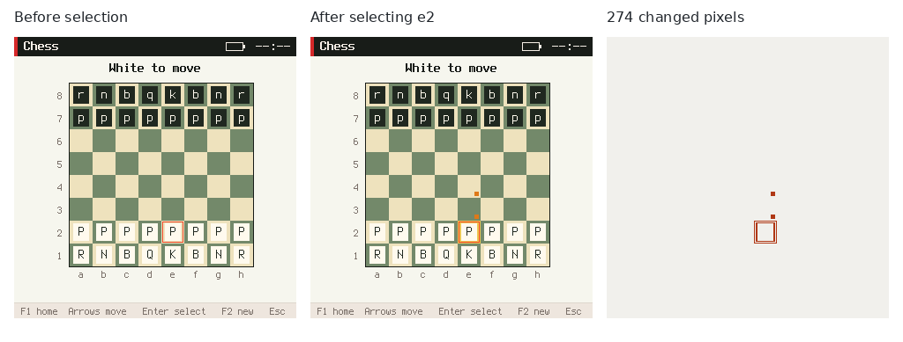

# What crosses the screen boundary when a Chess cursor moves?

Selecting the pawn on e2 changes 274 pixels on the PicoCalc screen. To describe that change, the ordinary Chess application sends almost five kilobytes. What would it cost to tell the display which pawn is selected and let it reconstruct those same pixels?

The PicoCalc calls an application a *world*. Chess runs in its own program and sends a screen description through the `SCREEN` system call. A separate program, the *compositor*, adds window controls and paints the resulting picture. The first experiment follows an update from Chess to a host framebuffer. The second measures the game, renderer and installation work separately on the handheld.

Across 46 changed screens, the position-based design used **11,952 framed bytes in place of 178,955**. The PicoCalc ran the same view from installed bytes or locally compiled source in about 3.49 ms per picture. Compiling and installing from source took 378 ms before the first draw. A cursor event in the existing native game took 1.790 ms in a live trace. Those different clocks matter to the decision about changing the shipping game.

## The two sides of the boundary

The shipping Chess world is written in a typed, JavaScript-like language and compiled to native 32-bit RISC-V (RV32) instructions for the device. The Chess world contains application metadata, a key handler, move legality, a search engine, a timer, and a render function, `chessRender`, which converts game state into a screen description.

In the existing design that description is an *ordinary screen*. It is a JSON tree with a heading, a canvas holding an ordered list of drawing operations, an optional footer, and a separate hint string. The compositor parses the tree and gives it to a common painter. The painter uses a shared font and a C rasterizer to fill a 320×320 RGB565 framebuffer of 204,800 bytes.

For the host test we compiled the Chess game and its event-handling runtime, called the reactor, into two WebAssembly (Wasm) programs.

- G, the generic arm, keeps the ordinary screen unchanged. Its `SCREEN` call carries the existing JSON tree and hint string.
- R, the semantic arm, changes only `chessRender`. It reads its own in-guest board. It publishes a compact by-value snapshot of game state, and a receiving view on the compositor side rebuilds the ordinary tree from that snapshot.

Both arms keep the same metadata, key handler, legality, search, and timer code. Both issue real typed-SDK `SCREEN` syscalls. The capture records the UTF-8 tree and the hints as separate fields.

```text
 host re-creation

 world (Wasm build of the typed source)          compositor side
 +-------------------------------+              +------------------------------+
 | key handler, legality,        |   SCREEN     | envelope parse               |
 | search, timer                 | -----------> |                              |
 | chessRender                   |              | R only: closed view (Wasm)   |
 |   G: ordinary JSON tree+hint  |              |   snapshot -> ordinary tree  |
 |   R: semantic snapshot        |              |                              |
 +-------------------------------+              | JSON.parse -> common painter |
                                                |   font + C raster -> RGB565  |
                                                +------------------------------+
```

## What the semantic arm publishes

Squares use a dense index. a8 is 0, the index runs across rank 8 to h8 at 7, and continues rank by rank down to h1 at 63. The value 64 is a sentinel that means "no square", used for the selected square and for both ends of the last move when they are absent.

The message's JSON schema has version 1. It carries four groups of values.

| Field | Contents |
|---|---|
| Program | A 64-character SHA-256 digest naming the exact approved view |
| Board | 64 hexadecimal digits giving one piece or empty square at each position |
| Legal destinations | Eight two-digit hexadecimal rank masks, starting with rank 8 and placing the a-file in the low bit |
| Display fields | Nine integers giving the cursor, selection, last move source and destination, status, promotion hint, completed search depth, node count and signed evaluation |

The masks mark every legal destination of the selected piece. The world computes them with the game's own move generator, the same code that decides legality. The world computes the current status by testing terminal outcome first, followed by promotion, engine search, an illegal-move notice, check and the ordinary turn message. It does not publish statistics from a search that has not completed. Hidden counters are written as zero, so two states that differ only in hidden values serialize identically and can be deduplicated.

Because every message describes the full visible position, a receiver can start with any one of them.

At launch, white is to move and the cursor rests on e2 (index 52). Its starting record has an empty selection, absent last move and zero display counters.

```text
f = [52, 64, 64, 64, 0, 0, 0, 0, 0]
mask = 0000000000000000
```

The player then selects the white pawn on e2. The selected square becomes 52. The pawn's legal destinations are e3 (index 44, rank 3) and e4 (index 36, rank 4). Bit 4 is the e-file, which is 0x10 within a rank. Rank 4 occupies the fifth byte of the mask and rank 3 the sixth.

```text
f    = [52, 52, 64, 64, 0, 0, 0, 0, 0]
rank = 8  7  6  5  4  3  2  1
mask = 00 00 00 00 10 10 00 00
```

Only selection and the legal-destination mask change in the semantic record. G re-emits the full canvas operation list for the same keypress. Both must color the selected square and place a marker on each of the two legal destinations.



The two captures come from the common host rasterizer. The right-hand panel highlights the 274 pixels whose RGB565 value changed. The semantic and ordinary arms produce identical captures in each state.

## The receiving view

The R arm needs a program on the compositor side that converts the snapshot into the ordinary tree. That program, the closed view, is handwritten in the typed language (`05-closed-view.typed`). It loops over ranks and files and contains a manual adaptation of the original view's presentation helpers. No compiler extracted it automatically from `chessRender`.

The view receives data only by value. The receiver decodes the piece digits and rank masks to integers and copies them, along with nine 32-bit signed fields, into a private Wasm page of 65,536 bytes. WebAssembly reports zero imports for the view. The program can read its local copies and write two bounded UTF-16 buffers. The tree holds up to 8,192 units and the hints up to 120. The host decodes the counted tree buffer and parses the resulting JSON. It decodes the separate hint buffer as display text.

The view preserves all geometry and the original paint order. A per-frame guard caps a tree at 212 operations, and the named fixtures produce between 86 and 148. The view still materializes the full command list on every frame, so the work given to the common painter is the same as in G. The snapshot reduces what crosses the boundary. It does not reduce what is painted.

The experimental loader checks the exact module digest. For source delivery it also checks the approved source and uses a cache key that includes the compiler identity and renderer ABI, the agreement on how to call the view. The receiver validates each incoming state and its output before replacing the last accepted state. Loading arbitrary user-supplied programs would require a separate admission and resource policy.

## Does the screen come out the same?

The main trace has 127 events across 11 scenarios. In the ordinary opening the player tries an illegal selection, cancels a selection, plays e2–e4 and moves the cursor while Black searches. The engine’s 78th timer wake publishes b8–c6 at depth 3, after 1,600 nodes, with an evaluation of 12. Resetting a later search lets the test deliver a stale wake to a new game and check that the screen stays put.

Ten scenarios replace the initial position in both guests while preserving their event and game logic. They exercise promotion, cancellation and underpromotion to a knight, both white castlings, en passant, check, checkmate for each side, stalemate and dead material. An explicitly initialized footer checks negative evaluations.

The trace produces 47 `SCREEN` calls from two independently instantiated real worlds, one per arm. A separately instantiated A/A run, with the unchanged arm on both sides, serves as a confirmation that the comparison itself introduces no differences. One of the 47 calls repeats the previous state, which leaves 46 changed posts.

For every call the checker compares the original and reconstructed UTF-8 tree and hint bytes in their original order. A fresh receiver also reconstructs the screen from the retained snapshot alone. The common compositor, font and C rasterizer then generate a framebuffer for each arm. The final comparison reads all 204,800 bytes of each framebuffer.

The duplicate control and each of the three view installations matched the original on all 47 full frames.

Three further checks exercise recovery and longer histories.

- Lost flush. The host suppressed a flush for a status change affecting 751 pixels. Its virtual panel recovered when the same screen was drawn again through the existing framebuffer repair path. An LCD driver must also recover when it misses a transfer.
- Invalid input. Five invalid states were offered, and none displaced the last valid state. A later valid state replaced it normally.
- Generated games. After the design was frozen, a separate extension generated 20 legal-move games using only the control UI, with 200 White moves and the engine's genuine responses. Over 20,109 events, 2,433 complete trees with hints matched. All 220 launch and settled RGB565 pairs were identical, and the games reached 194 distinct piece arrays.
These games test rendering across deterministic histories. They share the same Black engine and start position.

## Bytes at the boundary

At launch, G emits a 4,835-byte tree and a 41-byte hint. R emits 200 bytes of snapshot and no hint. To compare the two at a realistic boundary, the host builds the native JSON `{"tree":...,"hints":"..."}` and wraps it in the outer `{"app":"chess","title":"Chess","frame":...}`, matching the C grammar. The two wrappers add 60 ASCII bytes to each arm. These are host re-creations of two explicit boundaries. They do not run the kernel mailbox.

| Measurement | G (ordinary) bytes | R (semantic) bytes | Ratio | Reduction |
|---|---:|---:|---:|---:|
| Launch payload (tree + hint) | 4,876 | 200 | 24.4x | 95.9% |
| Launch, both wrappers | 4,936 | 260 | 19.0x | 94.7% |
| 46 changed posts, full trace | 178,955 | 11,952 | 14.973x | 93.32% |
| 18 changed posts, ordinary opening | 89,651 | 4,683 | 19.144x | 94.8% |

Before measurement, a blind estimate predicted a typical ratio of 20–100x. The full trace gives 14.973x, and only the opening subset approaches 20x. The same estimate put the view module at 20–80 KB, but the compiled module is 8,641 bytes. A separate gate requiring at least a 5x ratio passed.

The two delivery arms also transfer the view once. The resident arm has it preinstalled. The approved source is 6,408 bytes and the compiled module is 8,641 bytes. The real eight-byte install header makes the envelopes 6,416 bytes for source delivery (S) and 8,649 bytes for module delivery (M). The first two changed posts of the opening save 9,352 bytes together, more than either envelope. In bytes, therefore, the view pays for itself by the second changed post, whichever form is delivered.

## Host time

Timing ran on Linux x64, Node v24.18.0, on an i7-1165G7. Each cursor or selection class had 1,200 pairs, and G/R and A/A were rotated. The following timing windows distinguish the work.

- The event window covers the real guest event, the screen conversion, and the copy.
- The receiver window covers the host envelope parse. For R it also covers isolated view rendering, decoding the counted output, and the ordinary `JSON.parse`.
- Timing ends when the parsed input reaches the common painter, before any drawing.

| Selected cursor motion, host median | Generic | Resident |
|---|---:|---:|
| Guest event through screen copy | 14.583 µs | 5.347 µs |
| Receiver through parsed painting input | 28.062 µs | 37.404 µs |
| Entire measured key path | 46.025 µs | 44.942 µs |

R moves roughly nine microseconds of work out of the guest and adds a similar amount on the receiving side. The median of the paired differences G−R is 1.024 µs. This differs from the 1.083 µs obtained by subtracting the two medians, because the paired figure is a median taken across individual pairs. The unselected class shows a paired saving of 1.166 µs. A fresh rerun gave 1.408 µs for selected and 1.191 µs for unselected, with byte receipts identical to the first run.

The A/A control sets the scale for these numbers. Its selected pair difference has a median of −0.016 µs and a 95th percentile of +6.525 µs. A paired gain of about one microsecond is therefore small next to the per-pair spread of identical arms. The robust result is a change in where the work happens. The total host cost is close to equal.

Warm median view times were 25.276 µs when the view was already resident, 25.193 µs when the module was delivered as bytes, and 25.410 µs when source was delivered and compiled locally, with 1,200 samples per arm.

## Installing the view

Twelve fresh Node processes per arm measured the interval from starting installation to the first verified tree, with process startup and initial filesystem reads outside the timer. The resident module took 1.787 ms at the median, the delivered module 1.936 ms, and source compiled at the receiver 7.031 ms.

Within a single warm process, 35 trials against a fresh receiver cache gave a median install time of about 25.9 µs for M and 1,054.4 µs for S. Cache hits took about 14.1 µs and 14.4 µs.

Adding an initial comment to the approved source caused one miss and then a hit. Both source revisions compiled to exactly the same bytes. The receiver rejected an unknown ABI and a modified executable.

Source installation also affects other work on the same lane. While the host installed from source, the shared worker lane delayed an unrelated `setImmediate` callback by up to 2.026 ms. On the host, this argues for keeping compilation off any lane that serves time-sensitive work. It does not show that a key press on the device would be delayed.

Byte repayment and wall-time repayment have to be judged separately. Bytes are repaid by the second changed post. The host per-frame time gain is about a microsecond, and the A/A spread exceeds it. Source installation costs about a millisecond in a warm process. That combination does not establish a dependable wall-time crossover.

## Taking the same view to the board

The host experiment records ordinary JSON, semantic state, the isolated program and control checksums. With these inputs fixed, a handheld test can run the actual producer modules, load or locally compile the exact renderer, and replay positions without including a fresh engine search in every timing. The firmware measurements below keep each boundary visible.

The disposable firmware ran five interleaved measurement blocks in one boot. Two runtimes do different jobs. The WebAssembly Micro Runtime (WAMR) interprets executable modules. QuickJS is the embedded JavaScript interpreter used in the isolated parsing experiment and to run the standalone compiler. Unless identified as a setup measurement, each board median below is the median of five within-block means. The ranges describe variation within that boot.

## Matching board output to the reference

The renderer writes its tree and hint into counted UTF-16 buffers. The firmware checks the complete ASCII length of each buffer. It also computes FNV-1a-32 over the low ASCII byte of every counted code unit. Both the lengths and the hash are matched against ordinary guest output that was captured independently. All 47 cases passed on each of three acquisition pathways in each of five blocks, giving 705 successful view checks.

The comparison covers the lengths and a 32-bit digest of the ASCII contents. The host compared the actual complete trees and all 204,800 RGB565 bytes of every case. A board match therefore ties board text to host-qualified text. The board hash is not a board pixel observation, and it is not collision-proof.

## Per-frame bounds and memory

Each frame starts from fresh logical view memory. The device harness proceeds in five steps.

1. Zeroes the full 64 KiB view linear page.
2. Copies in the 64 piece codes, eight rank masks and nine i32 fields.
3. Resets a 2,000,000-instruction allowance.
4. Invokes render.
5. Checks lengths and checksum.

Zeroing plus input copy costs about 0.09 ms per frame. The checksum costs about 0.056 ms per frame. Both are measured separately from the invocation times reported below.

The bounded allocations are one 64 KiB view page and a 16 KiB interpreter execution stack. The shared WAMR runtime, source buffers, compiled code, and the compiler's heap and objects add to that. Neither total peak memory nor compile peak was measured. The director's test used a 6 MiB QuickJS limit. The limit bounds allocation in the test realm.

I had speculated that compiling would take 0.5–5 s on a hypothetical 1.5 GHz core. The measured local acquisition plus compile stayed below 0.5 s. The source differed in size from the one I assumed, and nothing confirms my memory expectations.

## The real game programs under WAMR

This arm used two independently precompiled whole guest modules, of 73,204 and 66,618 bytes. Each had an initial memory of eight pages. They were loaded one at a time and ran the regular game handlers under WAMR.

Each arm in each block verified 25 screens. After launch the driver repeated six keys four times. Left and right moved the ordinary cursor, Enter selected e2, left and right moved the cursor with that selection active, and Escape deselected it.

That gives 250 checked producer outputs in total. The timing starts at `nw_wasm_event`. It ends after SDK conversion to UTF-8 and a private copy of both `SCREEN` spans. It excludes input setup, the fixture checksum, the kernel queue and the painter.

In this backend, removing full guest tree construction saves about 14.4–14.6 ms before painting (see table). Both arms rise by roughly 4 ms on selected moves, because selection still computes legal moves. The semantic design retains the actual move generation cost.

## Why that saving does not transfer to shipping Chess

Shipping Chess on this firmware is compiled native RV32. The director also captured one live key segment on the unchanged native game.

- The single live key took 1.790 ms.
- Native render and publish took 0.468 ms for 4,935 bytes.
- The compositor frame event took 44.984 ms.
- The deferred compositor draw took 26.794 ms. This includes a measured graphics commit of 4.273 ms.
- One completed 2,400-byte SPI pixel send lasted 1.019 ms.

These stages overlap, so they must not be summed. This is one sample, with no matched candidate and no physical key-to-LCD latency. SPI send completion is not an optically observed endpoint.

Above all, a 14 ms interpreter saving cannot be subtracted from a 1.790 ms native key segment. The negative result would only show that the two figures describe different execution paths. In this sample the native producer stages are small beside the compositor event and draw.

## Parsing the outer post in QuickJS

This arm used the launch, e2–e4 and engine-reply outer posts. Each was parsed four times per block with `JSON.parse` in an isolated QuickJS realm on the board. The median parse took 4.559 ms per post for generic and 0.182 ms for semantic.

Parsing the incoming post saved 4.377 ms in the isolated QuickJS realm. The live compositor’s 44.984 ms frame event includes additional runtime paths. The candidate also generates a full ordinary JSON tree. Turning that output into the painter’s input requires another decode and parse. The board harness checked the generated bytes and stopped there. The host included the final parse in its receiver clock.

## Three ways to obtain one renderer

All three acquisition paths fed the same pinned, import-free executable to WAMR under the same bounds.

- **Resident (R)** copies reference bytes already read from the firmware bundle.
- **Module file (M)** reads the matching module from the device filesystem after one upload.
- **Source (S)** reads approved source from that filesystem. It starts a private QuickJS realm, evaluates the real standalone compiler, compiles the source, and copies the generated bytes out.

All three results were compared byte-for-byte against the resident code. Each then went through the identical load, instantiate and export lookup.

Acquisition medians are taken over five cold runs, one per block. Setup is the median of per-block paired sums, so it need not equal the sum of the two component medians. The view-call medians differ by at most 0.011 ms across pathways. Provenance has no effect after installation, and source offers no runtime benefit.

The 3.49 ms view call and the whole guest's 1.340 ms semantic producer come from different harnesses. Their sum does not measure any combined path.

Several additional clocks help interpret these numbers.

- Setup endpoints precede the first draw. They are not edit-to-first-visible-frame times.
- The one-off console uploads took 3,225 ms for the module file and 2,222 ms for the source. Both include host utility startup and chunk handling. They are separate from cold reads and compile. The file transfer uses the physical console upload protocol. The eight-byte header in the host install comparison belongs to a different transport.
- The director ran a separate single-frame installation experiment and injected an unrelated F1 on the same serialized console path. With five samples per arm, the host observed median key acknowledgments after 6.315 ms idle, 40.595 ms with the resident first frame, 44.157 ms with the module first frame and 398.812 ms with source. This measures console admission under contention. The device did not observe the resulting key-to-pixel delay. The source acquisition alone exceeded the existing 80 ms compositor allowance.

The run proves byte identity and a reusable on-device compile path. Local source editing is plausible, but no physical user edit or hot cutover was attempted. Because the specimen is pinned, the run supports no claim about admitting arbitrary code.

## Board results at a glance

| Measurement (board, ms) | Arms | Median | Range |
|---|---|---|---|
| Whole guest, launch | generic / semantic | 15.925 / 1.340 | — |
| Whole guest, plain left/right | generic / semantic | 15.739 / 1.356 | — |
| Whole guest, selected left/right | generic / semantic | 19.919 / 5.330 | 19.877–19.946 / 5.329–5.336 |
| QuickJS JSON.parse per post | generic / semantic | 4.559 / 0.182 | 4.543–4.566 / 0.180–0.184 |
| Cold acquisition | R / M / S | 0.160 / 5.076 / 361.020 | — |
| Load, instantiate, install | R / M / S | 16.796 / 16.590 / 16.664 | — |
| Setup (paired sum) | R / M / S | 16.993 / 21.666 / 377.699 | 16.816–17.078 / 21.609–21.813 / 376.341–381.053 |
| View call per frame | R / M / S | 3.490 / 3.485 / 3.496 | 3.473–3.503 (pooled) |

A dash means no range is reported here. The native live baseline is omitted on purpose, because it is one sample with overlapping stages.

## Decision and reproducibility

Keep the existing native delivery as the default while qualifying a resident integration with the actual native RV32 producer and ordinary consumer. The measured file route works for prebuilt views. Source supports a staged edit-and-install workflow, with compilation scheduled away from interactive painting.

A directly emitted bounded drawing representation might remove the duplicate decoding, but that is a proposed experiment, not a result.

Run `scripts/17-run-host.sh` with a fresh output directory from the PICOCALC-RENDER-CHESS study. The exact view is in `scripts/05-closed-view.typed`, the producer timing harness in `scripts/14-board-producer.inc`, and the device distributions in `various/board-evidence.json`. The independent single-frame key-admission samples are in `various/competing-key.json`. The supervising lab records the board build, console commands and firmware restoration.

## Next experiment

A disposable firmware can run two interleaved native RV32 Chess arms.

- **Baseline.** Run shipping Chess.
- **Candidate.** The native producer emits the semantic position. The resident renderer runs under WAMR within the bounds above. The ordinary consumer decodes the renderer's tree JSON for the existing painter.

Drive the 25-screen key sequence. Timestamp key dispatch, native publication, view return, construction of the consumer tree, draw and the completion of the last successful pixel transfer. A graphics commit can be nested inside a draw, so preserve event nesting when attributing time. Repeat across independent boots, fix a memory budget and minimum useful latency effect before tuning, and compare full RGB565 frames for every input. Include one unrelated key during installation and, if measuring visible response, observe the panel directly.

The resulting test will distinguish three reasons to keep a semantic view: smaller retained messages, less work in the actual shipping game, or lower end-to-end display latency. Only the first is already established across the current traces.
