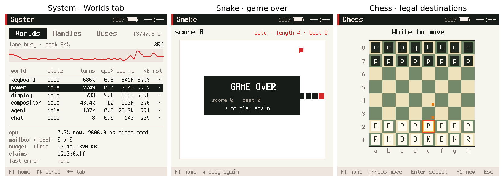
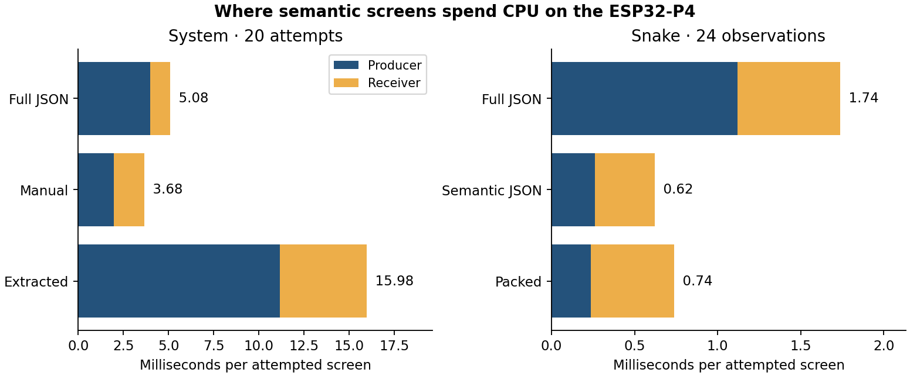

# Where a PicoCalc should build its screen

A Chess cursor moves one square. On a physical ESP32-P4, the game published 4,935 bytes describing the new screen. The compositor spent 44.984 ms receiving that publication and 26.794 ms in the subsequent draw event. The SPI worker spent 1.019 ms transferring 2,400 pixel bytes. From the start of the compositor's key event to the end of the last pixel transaction, 90.713 ms elapsed. These numbers describe one attributed interaction on a running handheld. They identify an expensive boundary early in the path from key to panel.

Two PicoCalc research proposals ask how to change that boundary. The first keeps the producer's complete screen and gives the receiver a way to validate and read it using bounded storage. The second lets the producer send the meaning of the screen, together with the identity of a procedure that knows how to draw it. These proposals have different consequences. Sending all 64 Chess squares uses little bandwidth if the renderer already knows how to paint a board. An Editor displaying arbitrary text still needs an efficient generic path. We tested both cases.

## Follow a frame through the existing system

A world is an application or service with its own state and event handler. The kernel asks a visible world to describe its screen. A description can include text, rows, tables, or a canvas containing drawing primitives. If its serialized description matches the retained one, the kernel suppresses the publication. Otherwise it retains the new description and sends a message on the frames channel. A subscriber can obtain the latest description when it starts, even when the application has received no new input.

The compositor handles the frames message, associates the supplied tree with its publisher, and schedules a separate draw. The painter measures nodes under an available width, resolves their geometry, and calls the graphics primitives that produce RGB565 pixels. Each pixel occupies two bytes, so one 320×320 framebuffer occupies 204,800 bytes. The graphics code compares dirty 16-row bands against the front buffer and emits rectangles covering the differences. The display driver sends the rectangle data to the panel. An uncompleted transfer invalidates the front-buffer comparison so that a later draw can repair the panel.

```text
game state → screen construction → kernel retains a changed publication
                                   ↓
                      compositor receives the message
                                   ↓
                          measure, paint, commit
                                   ↓
                         transfer changed rectangles
```

Three files locate these responsibilities. In `picocalc-os/nucleus/kernel.c`, read `run_segment`, `frame_message`, and `kernel_publish`. In `picocalc-os/js/system/compositor.js`, compare the handlers for `frames` and `draw` with `paint`. In `picocalc-os/nucleus/gfx.c`, `gfx_commit` produces the rectangles. The function `spi_pixels` in `picocalc-os/port/esp32p4/main/bus_p4.c` returns after the queued SPI transactions have completed. The kernel can run other work between stages. The graphics commit is inside the draw event, so adding commit time to draw time would count it twice.

| One changed publication on the running P4 | Publication bytes | Receive event | Draw including commit | Pixel transfer | Key event start to last transfer end |
|---|---:|---:|---:|---:|---:|
| System selection | 1,780 | 15.600 ms | 24.557 ms | 6.413 ms | 74.077 ms |
| Chess cursor | 4,935 | 44.984 ms | 26.794 ms | 1.019 ms | 90.713 ms |
| Snake key | 542 | 4.609 ms | 17.716 ms | 0.802 ms | 42.367 ms |

Each row covers a single interaction. The endpoints exclude keyboard debounce and optical response. Other worlds, including Snake and System, ran during the trace. There was no identifiable changed Editor publication after the selected key in its live window. Editor's independent evidence comes from its deterministic typed-world replay.

## Make identical output a condition of the comparison

An optimization can produce a plausible screen while losing a promotion indicator, shifting a wrapped line, or drawing an old cursor after a skipped flush. A useful test runs both producers from the same initial state, applies the same events, and compares the pixels received by the panel. Comparing the drawing buffer with itself would miss a failed transfer.

The shared host oracle invokes the existing compositor's painter, records its primitive calls and replays them through the actual C font and raster functions. A separate simulated panel receives only the rectangles returned by commit. In a lost-transfer test the harness withholds the update, invalidates the comparison, then repaints the same state. A one-letter change in the positive control changes seven pixels. This exposed an early error in the test recorder's default font handling.

The host corpus includes System's three tabs, Snake movement and overlays, and Chess selection, terminal states and promotion. Keys tests automatic extraction on an application kept aside during development. A separate replay obtains 44 **actual typed Editor** screen callbacks from five existing test sequences, including opening and searching a 64 KiB document. We also captured three screenshots on the normally booted physical device. The screenshots establish what those applications displayed. Exact differential comparisons cover the host replay, and hardware stage checks use length and checksum oracles.



These framebuffer captures come from the playable control before instrumentation. The Chess view shows the selected piece and its legal destinations. The screenshots illustrate the real screens used to design tests; the timing table comes from separately identified interactions.

## Reading a whole tree in bounded storage

An indexed JSON reader can store source positions for each value. Our experimental reader stores four 16-bit words per token. A container's final word holds its number of members, and another word gives the index of the first token after its subtree. The scanner can skip a large nested subtree in one operation. Finding array element 100 can still require walking past the first 100 children. Quoted strings and numbers must be converted when the caller reads them. A dense Chess canvas stresses both costs.

A complete acceptance protocol also specifies who owns each generation. Suppose a painter still reads frame A when the producer submits B. Validating B in A's storage would destroy the last good screen if B is rejected. Our single-draw host ownership model gives each of four producers one current generation, shares one slot for an incoming candidate, and permits one older generation to remain pinned by an unfinished draw. All six slots were occupied in the test. Six arrays of 4,096 eight-byte tokens reserve 192 KiB, with up to 96 KiB of additional **encoded** text at the tested caps. JavaScript strings, accessor wrappers and other subscribers incur separate charges. The current production kernel installs a changed screen before receiver validation. Deploying last-good admission would require changing that ownership boundary.

Host memory measurements show why representation cannot be decided by one array-size calculation. With the input already resident, one representative Chess tree retained 60,768 incremental bytes in 64-bit QuickJS. The fixed token reader retained 45,056 bytes. For Snake the corresponding figures were 8,176 and 45,056. Allocating exactly the observed token count changes the outcome and requires discovering the count first. On the P4, building the JavaScript index and visiting every scalar took 4.50× to 5.88× the control time. All five blocks agreed on the output. Even reading just the root widget kind failed to repay a full scan. The same scanner ran faster when it could skip building an object tree, which isolates a real materialization cost. The more efficient built-in parser still won the complete comparison.

Within-frame geometry caching also needs a measurable source of reuse. Our 96-entry node-and-width cache recorded zero reusable measurements on 100 System, 236 Snake, 47 Chess and 44 Editor frames. Keys reused 48 of 192 measurement calls. All 453 frames produced identical drawing commands. A persistent cross-frame cache has a different invalidation problem and would need a separate experiment. Offset-based token descriptions and demand-driven parsing have established precedents. Their interface and access order matter on this device. [jsmn](https://zserge.com/jsmn/) · [Keiser and Lemire, On-Demand JSON](https://arxiv.org/abs/2312.17149)

## Move stable construction to the receiving side

System's Worlds tab repeats the seven column descriptors, their alignment and typography, surrounding layout, and graph placement. Status values, visible rows and selection change. The System researcher wrote a resident template that reconstructs the original view from complete dynamic values. It preserved application effects, independently renderable updates, and deduplication. A second treatment extracted constant structure from ordinary JavaScript. Its rules were frozen before scoring Keys.

The changed publications across 100 System screens occupied 141,662 bytes in the control, 64,566 with the manual template, and 126,278 with extraction. The mathematical distinction matters. The manual saving is 77,096 bytes. The automatic saving is 15,384. Dividing those savings shows that the extractor recovered **20.0% of the manual opportunity**. On held-out Keys, the extractor recovered 10.43% of the bytes saved by the manual template, again using the generic screen as the reference. A frozen general rule can be evaluated even when it loses.

The physical trial replayed 20 attempts per block, with 17 actual publications. The median combined time fell from 101.960 to 73.345 ms with the template. Its producer almost halved its CPU time. Its receiver rose from 21.559 to 34.149 ms because it rebuilt the layout. The automatic treatment took 319.515 ms. These measurements cover sender construction and receiver reconstruction in isolated QuickJS on the board. The deployed System application and native CJI compositor still need an integrated trial.



The bars divide stage medians by attempts within each tested workload. The printed labels add the two displayed medians. The numerical comparisons in the text use the median of each block's paired total. Those statistics need not coincide.

Snake provides a different test. A complete semantic state can describe its body, food, score and overlays. In a 24-observation paired physical block, generic JSON cost 1,734 µs per observation at the median. Semantic JSON cost 621 µs, a 64.2% reduction. A packed, application-specific treatment used only 628 bytes per block against semantic JSON's 2,382, yet took 739 µs per observation. Its decoder and validation costs explain why minimizing bytes alone gives the wrong ranking. This Snake format does not establish the merits of a general indexed binary tree.

Semantic state also identifies which cells changed. In 195 of 196 timed ordinary moves exactly 363 pixels changed. In the remaining move the head entered the square the tail had just vacated and only 242 pixels changed. The host partial painter preserved pixels across all 236 states and after a missing transfer. Full raster time on an ordinary move had a median of 34.642 µs on the host and the partial painter took 0.388 µs. On a separate physical gameplay trace the timer callback itself commonly took about 24 ms. Optimizing only changed-cell paint leaves that game computation in place.

## Install a view once and send Chess positions

A receiver-side Chess procedure needs enough information to reproduce every mark. The game retains the move generator, search, current board, promotion and selection policy. It computes legal destinations before publishing. The semantic record includes complete pieces, a mask of legal destinations and status fields. The view is an import-free Wasm function with one 64 KiB page of linear memory. Its inputs and outputs are bounded. The runner checks lengths and contents. A separately delivered procedure is associated with a specific artifact identity and ABI. This makes retained replay possible when the game is idle.

In 46 changed Chess publications, the generic representation used 178,955 bytes and the semantic one 11,952, a 93.3% reduction. The 47 reference screens matched. A later generated series exercised 200 legal player moves across 20 games, including replies selected by the real engine. The two producers emitted 2,433 identical reconstructed screen trees and hints, and the 220 saved board-position rasters matched.

For a selected cursor in the full WAMR producer on the P4, the event through the SDK fell from about 19.92 ms to 5.33 ms. Isolated QuickJS parsing of the outer Chess message fell from 4.56 to 0.18 ms per screen in a different fixture. Executing the view cost about 3.49 ms per screen across 47 cases, plus reset and verification. These intervals have different event sets and runtimes. Adding them would create a synthetic estimate. The shipping RV32 Chess handled its live cursor key in just 1.790 ms. The 44.984 ms compositor receipt in that same trace is the reason to integrate a resident view there first.

The same 8,641-byte Wasm artifact was installed three ways. Acquiring and instantiating resident code took about 17.0 ms. Reading a delivered module from local storage followed by instantiation took 21.7 ms. Reading and compiling the 6,408-byte typed source on the device and instantiating it took 377.7 ms. All three then ran the same procedure on the same states. Transfer over the UART to provision the disposable fixtures was measured separately. The experiment demonstrates receiver-side compilation on an edit with a fixed ABI. The production compositor does not currently accept arbitrary application code.

An independent session measured what synchronous installation does to another user event. We sent an unrelated F1 shortly after starting a first-frame installation on the same event lane. Its host-observed serial acknowledgment took a median of 6.3 ms while idle, 40.6 ms during the resident install, 44.2 ms during the delivered-module install and 398.8 ms during source installation. Each treatment had five observations. The endpoint was command acknowledgment. This is sufficient evidence to schedule local compilation outside the interactive draw path and retain a previously valid generation while an edit finishes.

## Put an index into the message itself

The JSON index experiment paid to discover the same structure after every delivery. A fifth research group moved that responsibility to the writer. Its PSIX v1 prototype stores a UTF-8 string directory and a sequence of tagged references in a complete, relocatable byte buffer. A reference occupies three bytes. For a vector whose first slot is at address *b*, slot *i* is at *b* + 3*i*. A map stores sorted key identifiers and references, occupying five bytes per entry. Every offset is relative to the buffer's beginning. The producer pays for discovering strings, sorting the directory, assigning identifiers, sizing containers and writing bytes. The schema-independent idea has a documented precedent in FlexBuffers. PSIX is a research format with its own bytes. [FlexBuffers design](https://flatbuffers.dev/flexbuffers/)

Consider a Chess canvas with 101 primitive operations. The consumer can jump directly to operation 100 once it has validated the frame. It must still make sure the declared length covers the directory, each reference resolves to an allowed value, child counts fit, and strings lie within the admitted storage. Afterward, a C caller can read the requested item from immutable storage until it releases the generation. A JavaScript caller can expose the whole tree using a Proxy. Every access by the production painter then goes through property dispatch and may convert a string or create another view. The same bytes buy a different result at these two interfaces.

The group froze its format and representative-screen selection before opening Editor. Across all 427 System, Chess, Snake and Editor frames, the qualification compared actual drawing commands and RGB565 output. All matched. Aggregate raw bytes fell 8.7% on System, 21.2% on Chess, 1.9% on Snake and 20.3% on Editor. Putting base64 inside the current JSON envelope made every workload larger than its existing JSON. To realize the wire result, the transport must preserve byte lengths and lifetime from sender to receiver.

| P4 representative screen | Native C JSON route | Native C PSIX route | Paired reduction | QuickJS existing-style JSON through paint | QuickJS PSIX through paint |
|---|---:|---:|---:|---:|---:|
| System | 5.175 ms | 1.484 ms | 71.3% | 35.97 ms | 168.72 ms |
| Chess | 16.915 ms | 2.027 ms | 88.0% | 26.69 ms | 134.46 ms |
| Snake | 2.619 ms | 0.525 ms | 80.0% | 9.93 ms | 48.33 ms |
| Editor | 14.021 ms | 1.703 ms | 87.9% | 32.85 ms | 133.17 ms |

The native columns start with the same already resident cJSON source tree. They charge encoding, receiver admission, reading the same late field, and releasing both ends. Seven alternating blocks contained eight invocations per cell. All four PSIX encoders were slower in isolation on the P4. The 32 repeated lookups were slower on System, near parity on Snake and modestly faster on Chess and Editor in a separate native reader test. Direct indexing changes the cost of stepping over a large array; it does not guarantee a faster lookup on every measured path. System's encoder rose from 0.525 to 1.328 ms per screen. The receiver more than recovered that cost by avoiding allocations and destruction of the JSON tree. This is a measured native sender-plus-receiver benefit. It ends before layout and paint.

The two QuickJS columns answer the separate question of changing the ordinary property-access painter. They charge encoding, admission and the first production paint into a common command sink, excluding rasterization and display transfer. The existing-style control checks the envelope. A separate JSON control enforces the experimental structural caps; PSIX through the Proxy also lost to that control on all four fixtures. Seven blocks exercised each treatment. It would be a measurement error to take the native admission gain and combine it with an assumed free JavaScript paint.

We also passed complete semantic updates from the original three groups directly through the binary reader. All 100 System, 236 Snake and 47 Chess observations reconstructed the same trees and hints through their established resident views. These inputs are already compact. For immediate changed payloads in this replay, PSIX saved just 2.73% for System and grew Snake by 5.40% and Chess by 18.10%. The practical reason to try a byte-oriented native route is the measured receiver cost. Native-vs-native results justify implementing one full application path before making the transport the default.

## What the departments should do with the results

| Department | Decision | Next experiment and condition for adoption |
|---|---|---|
| Native compositor and Chess | Advance one integrated native byte path | Run the same actual RV32 game, receipt handler, painter and SPI driver on two builds. Start with one selected or moving cursor, verify equal pixels, then test the 47-screen corpus. Compare total latency and retained bytes at replacement. |
| System | Advance the hand-written template | Preserve the 100-frame, three-tab control, actual deduplication and the Keys holdout. Charge its slower receiver. Compare ordinary JSON, template alone, native indexed transport alone, and both together if both modules are qualified. |
| Snake | Keep semantic JSON as the simpler CPU winner in the isolated QuickJS comparison | Port the measured changed-cell painter behind the existing compositor's paint order. Replay tail entry, overlay removal, retained-state restart and a skipped transfer. Measure timer work separately. |
| Compiler research | Revise automatic extraction | Fit a rule to typed or statically constructed structure that predicts both a win and a fallback before opening another unseen app. Use the hand-written template and path-diff control as starting points. |
| Representation | Preserve last-good admission design and the negative generic JavaScript index result | Move byte ownership to the actual screen ingress in the native trial. Measure simultaneous current, candidate and actively painted generations. Publish maximum live bytes alongside latency. |
| Local editing | Keep the resident module active during source installation | Measure edit-to-first-correct-frame with scheduling outside the interactive lane and record unrelated key latency. The 399 ms key-admission observation supplies the synchronous baseline. |

For the first hardware milestone, alternate ordinary Chess cursor movements on the current and candidate firmware and compare time to the final pixel transfer. The 90.7 ms observation establishes how to instrument that path. The original state must also remain drawable after rejection or restart. A single trial cannot establish the size of that improvement. Alternate controls across boots, run enough actions to report distributions, and preserve the producer engine, scope of the timing and exact output. The independent research changed which implementation merits that experiment.

## Reproducing the study

In the `PICOCALC-RENDER-LAB` ticket, `scripts/30-replay-host.sh NEW_DIRECTORY` regenerates the ordinary screen fixtures, exercises the held-out typed Editor, validates record ownership, reconstructs the four-workload binary capsule, and passes the semantic inputs into the original three resident views. An independent run reproduced all 453 drawing-command observations and all 44 Editor control and treatment pixel digests. The generated binary capsule matched the exact SHA-256 of the one installed on the P4. The binary group separately checked 427 application frames against the original framebuffer path.

The physical session uses `scripts/14-board-session.py`. The first coordinated wave made 140 isolated measurements, followed by 20 competing-key observations and eight independent replay cells. The binary wave made another 140 receiver and JavaScript trials, followed by 56 native sender/receiver cells. The physical receipts record image identities, values and paired order. The capacity and transfer claims apply to the corresponding prototype and workloads. The ticket's application handoff supplies the versioned API, executable examples and the production boundary that still needs implementation.

## Individual research reports

- [What a Bounded Screen Reader Retains](./01-what-a-bounded-screen-reader-retains.md)
- [Restartable screens on the PicoCalc, measured byte by byte](../../PICOCALC-RENDER-SYSTEM--extracting-stable-system-monitor-layouts-from-ordinary-javascript/analysis/01-what-stays-on-the-other-side-of-a-system-screen.md)
- [What Moves When a Snake Advances One Cell?](../../PICOCALC-RENDER-SNAKE--measuring-snake-snapshots-and-damage-against-full-frames/analysis/01-what-moves-when-a-snake-advances-one-cell.md)
- [What crosses the screen boundary when a Chess cursor moves?](../../PICOCALC-RENDER-CHESS--measuring-semantic-chess-screens-and-portable-typed-views/analysis/01-what-crosses-the-screen-boundary-when-a-chess-cursor-moves.md)
- [What an index on the wire buys a PicoCalc renderer](../../PICOCALC-RENDER-BINARY--compile-complete-picocalc-screens-into-an-indexed-binary-representation/analysis/01-what-an-index-on-the-wire-buys-a-picocalc-renderer.md)
