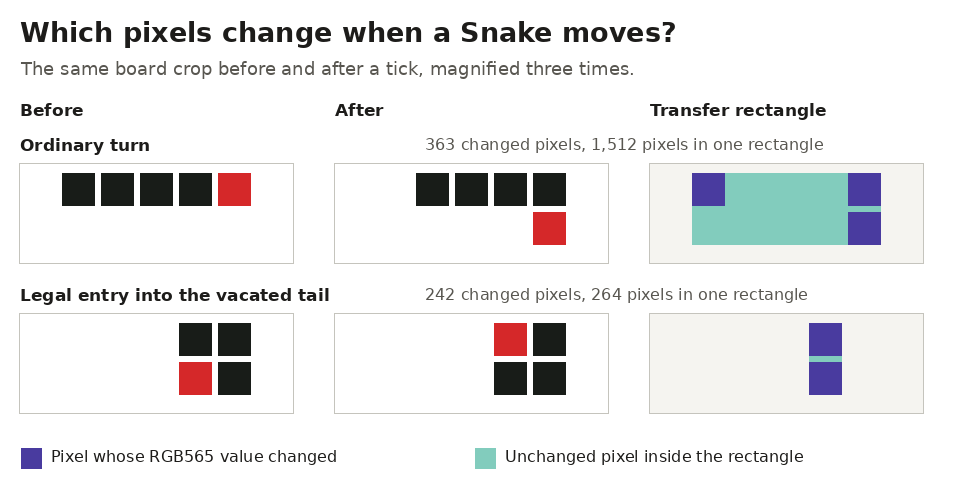

# What Moves When a Snake Advances One Cell?

A snake game on a 320×320 panel changes very little per step. One cell gains a head, another loses its tail, and the rest of the screen stays the same. Between the game's timer and the display, though, that small change passes through several stages. It becomes game state, then a serialized message, then a layout, then a raster image, and finally a comparison of framebuffers. Each stage can carry much more or much less data than the few cells that changed on screen.

This study compares three ways of carrying Snake screen states from a producer to a receiver that rebuilds the user-interface tree. A controlled host replay drives the production game source through twelve states. A physical capsule then runs the same arms on an ESP32-P4 PicoCalc under QuickJS, a compact embeddable JavaScript engine. CJI, the native-code compiler for the shipped JavaScript app, provides an instrumented native game whose separate trace is reported on its own.

## The game under study

The board is 22 columns by 18 rows of 13-pixel cells, for 396 cells in all. A new game starts with a snake of length four. Its head is at column 6, row 8, and it moves right. A 110 ms timer advances the snake while the app has focus and the snake is alive. When the app loses focus, movement stops. The interface has no pause button, so losing focus is the only way to pause.

Pressing `p` turns on an autopilot that steers by breadth-first search, and pressing it again turns it off. Any steering key also turns the autopilot off. A key that would reverse the snake onto its own body is ignored.

Eating food adds ten points and leaves the tail in place, so the snake grows by one cell. On a normal move, the head may enter the cell the tail is leaving on that same step. A collision freezes the body, updates the best score and draws an overlay. Enter resets the body and the score, and the best score survives the reset.

With random seed 5172, the first food lands at (7,8), directly in front of the starting head.

## From timer tick to panel pixels

Before introducing any formats, here is the path a single frame takes.

1. The timer fires and the game updates its state. The state includes the body cells, the food cell, score, best score, direction, the alive flag and the autopilot flag.
2. The application emits a JSON UI tree together with a single hints string.
3. The kernel compares the complete output string with the previous one. When the string changes, the kernel emits `app/title/frame` and embeds the structured JSON frame body directly in the message, so the body is never re-escaped as a string.
4. The compositor lays out the status line, score, board and footer. In the benchmark the clock reads `--:--`, the battery appears as an empty outline with no battery readout, and no banner appears.
5. C code paints the scene in the production antialiased RGB565 style. Each body segment is an 11-pixel square, and food is a 7-pixel square inside an 11-pixel outline. `gfx_commit` then compares the touched 16-row bands of the back plane with the last committed front plane, updates the front plane, and returns the merged changed rectangles. `gfx_commit` itself transmits nothing.
6. A separate display driver sends those rectangles to the panel. Host replay simulated the physical SPI transfer. If the driver drops a transfer, the logical front plane and the panel diverge, so the front plane must be invalidated whenever the driver reports a drop.

The board origin was verified at panel pixel (17,52). The x coordinate increases to the right across the 320-pixel width, and y increases downward. Cell (x, y) therefore has its 11×11 interior at panel columns 18 + 13x through 28 + 13x, and rows 53 + 13y through 63 + 13y, inclusive. For the initial head at (6,8), this gives columns 96–106 and rows 157–167, which matches the verified position.

## One worked turn

I chose the turn that comes right after the first meal. On the first tick, the head moves from (6,8) onto the food at (7,8). The score becomes 10 and the tail stays put. Listed head first, the body is now (7,8), (6,8), (5,8), (4,8), (3,8). On the next tick the player steers down.

In the game state, the head moves to (7,9) and the previous head at (7,8) becomes an ordinary body segment. The tail at (3,8) is released. The length stays at five, and the food, score and best score do not change.

On the panel, three cell interiors change.

| Cell | Change | Panel columns | Panel rows | Pixels |
|---|---|---|---|---|
| (7,9) | white becomes head | 109–119 | 170–180 | 121 |
| (7,8) | head becomes body color | 109–119 | 157–167 | 121 |
| (3,8) | body becomes white | 57–67 | 157–167 | 121 |

In RGB565, each pixel is a 16-bit value with 5 bits of red, 6 of green and 5 of blue. White is 0xFFFF, so each of the 121 pixels of the old tail is set to 0xFFFF. The other two cells receive the head and body colors. In total, 3 × 121 = 363 pixels genuinely change. At two bytes per pixel, that is 726 bytes of framebuffer data.

The rectangle `gfx_commit` proposed for this turn was much larger. It was a single rectangle of 1,512 pixels. That figure equals the bounding box of the three cells, which is 63 columns (57–119) by 24 rows (157–180), and I interpret the rectangle that way. Of those 1,512 pixels, 1,149 had not changed but would be sent anyway. When one rectangle spans separated cells in the same 16-row band, it also carries the unchanged pixels between them.

This turn corrects one of my prospective predictions. Before the runs, I wrote an upper bound of 1,014 bytes for this kind of step. That figure is three whole 13×13 cells at two bytes per pixel, so it describes the cell geometry, not the transfer. The rectangle for this one turn covers 1,512 pixels, or 3,024 bytes. The 1,014-byte figure is therefore not a bound on SPI traffic.

The local experimentalist also deliberately skipped the display flush for this exact turn. The framebuffer held the new picture, but the simulated panel kept 363 stale pixels. The test then explicitly requested another draw of the identical app picture. Because the front-plane history had been invalidated, that draw repaired all 102,400 panel pixels.

## The messages and four ways to encode them

The comparison covers four encodings of each frame.

- **J** is the producer's actual string, meaning the serialized UI tree and hints.
- **B** is the same complete object tree passed through Node's V8 binary serializer. It is a host-only control representing a general binary encoder. It is not the compact tagged-operation format I preregistered, which was never built.
- **SJ** is a complete semantic JSON record of the game state.
- **T** is a packed binary record of the same semantic state.

For SJ and T, the receiver rebuilds the same UI tree that J describes before generic layout runs, so all arms feed identical input to layout. For J, the comparison computes the exact `{app, title, frame}` framing that the generic route uses. When T travels inside JSON, its envelope figures include a descriptive schema field and the base64 overhead.

### The T record byte by byte

```
offset  size     field
0       u8       version (1)
1       u8       flags: bit0 = alive, bit1 = autopilot
2       u16      body length
4       u16      food cell index
6       u16      score
8       u16      best score
10      u16 × n  body cell indices, head first
```

Every u16 is little-endian, and a cell index is y × 22 + x. For the worked turn, the body is (7,9), (7,8), (6,8), (5,8), (4,8), which gives the indices 205, 183, 182, 181 and 180.

```
01 01 05 00 70 00 0A 00 00 00 CD 00 B7 00 B6 00 B5 00 B4 00
```

This packed snapshot stores 16-bit fields in little-endian order. Food at cell (2,5) is encoded as index 112 (0x0070). The best score is zero and the score is ten. The body indices run head first as 205, 183, 182, 181 and 180. Every byte comes from a real turn of the fixed-seed run.

T contains no direction, tick count, seed, focus state or autopilot working data. A receiver can draw the screen from it but cannot advance the game.

The format admits bodies of at most 395 cells. It keeps one of the 396 cells free for food, because food must not overlap the body. That caps a record at 10 + 2 × 395 = 800 bytes. The initial record is 18 bytes.

A separate known issue limits what the 395 figure means. In a simulation where the original game fills the board, placing the last food never completes, because the original placement loop does not terminate in that case. This study does not show a completed 396-segment screen.

### Sizes

All values are in bytes. The last three columns include the full envelope.

| Frame | J | B | SJ | T | J env. | SJ env. | T env. |
|---|---|---|---|---|---|---|---|
| Start | 489 | 478 | 82 | 18 | 529 | 152 | 97 |
| After first meal | 517 | 504 | 87 | 20 | 557 | 157 | 101 |
| Collision | 665 | 648 | 89 | 20 | 705 | 159 | 101 |
| Autopilot tick 200, length 21 | 973 | 930 | 152 | 52 | 1,013 | 222 | 145 |
| Constructed, 300 cells | 8,770 | 8,010 | 1,159 | 610 | 8,810 | 1,229 | 889 |
| Constructed, 395 cells | 11,480 | 10,454 | 1,539 | 800 | 11,520 | 1,609 | 1,141 |

Across the 222 real publications, raw totals were 164,581 bytes for J, 156,586 for B, 25,615 for SJ and 7,732 for T. With full envelopes, J, SJ and T totaled 173,461, 41,155 and 26,790 bytes. Their per-frame medians were 789.5, 181.5 and 121 bytes, and their peaks were 1,026, 223 and 145 bytes. These envelope totals leave out queues, copied headers, controller transfer and the platform bus.

B started at almost the same size as J, 478 bytes against 489. This gives no support for the expectation that a general binary encoding of the same tree would be five to ten times smaller. A hand-written binary operation protocol was not tested, so that question remains open.

## What the trace contains and how equality was checked

The study ran the real JavaScript app with the production JavaScript prelude. It used the source's own callbacks, including the random number generator and the autopilot. Everything ran in a single Node JavaScript realm, with one private hook added to capture state.

The real-input trace has 234 observations. After equal strings were dropped, they produced 222 distinct successive published frames. The trace includes the following events.

- 200 autopilot ticks, reaching score 170 at length 21
- two different collision paths
- a pause caused by losing focus
- a restart
- a legal entry into the cell the tail was vacating
- a rejected reversal

The two constructed serpentine states, with 300 and 395 body cells, were kept separate from the real trace.

For all 236 frames, the trees rebuilt from SJ and T equaled the tree from J. Three sources of images were then compared. Two were independently run reference captures. The third was an independent template that draws the same game appearance without calling the source's screen function. All three produced byte-identical images in all 236 frames.

## Decoder checks and known memory

The T decoder rejected all 15 malformed binary cases. They covered bad version, flags, size, count, scores, food position and body positions, as well as overlapping segments and non-adjacent segments. After each rejection, the previously accepted bytes were unchanged.

The validated packed snapshot is capped at 800 bytes. Two raw records therefore occupy at most 1600 bytes, and a 396-byte occupancy table sits beside them. The JavaScript body list and the UI tree use memory beyond that budget. A separate meter on a 64-bit Linux host ran QuickJS over a 12-state subset in five fresh processes per arm, with the same 260992-byte all-arm corpus resident and garbage-collected in every process. The meter charged each allocation its malloc usable size plus 8 bytes per block. Median high-water excess was 12864 bytes for J and 3888 bytes each for SJ and T, giving total peaks of 273856 bytes for J and 264880 bytes for SJ and T. Each figure covers the entire call, including the benchmark receipt.

The meter reports no per-stage allocator peak, no board heap, no 395-segment worst case and no production installation size. Fifteen tests cover the packed schema. No test exercises hostile ingress, and the build enforces neither JSON admission nor sequence ordering.

On the C side, the partial painter described below holds an old and a new role grid of 396 bytes each. The two framebuffers underneath it take 409,600 bytes. The simulated panel used in the instrumented runs adds another 204,800 bytes that a real device would not need.

## Host codec timings

Timings came from Node v24.18.0 after warm-up. The study used 20 timing blocks run in rotating order. Each block published the whole deduplicated real corpus six times. The table gives the median of the per-operation means, in microseconds.

| Arm | Produce (µs) | Receive (µs) | What receive covers |
|---|---|---|---|
| J | 4.137 | 3.599 | parse |
| J, repeated as control | 4.153 | n/a | n/a |
| B | 5.705 | 4.976 | V8 deserialize |
| SJ | 0.428 | 0.741 | trusted semantic parse and tree rebuild |
| T | 0.457 | 0.706 | bounded decode and tree rebuild |

The repeated J control landed within 0.02 µs of the first J run. Validation and decoding of T alone, without rebuilding the tree, took 0.431 µs. Decoding T creates a JavaScript list.

None of these figures include the game tick, inter-process communication, generic layout, rasterizing, SPI or JSON admission. They are host figures and support no conclusion about microcontroller timing.

## What the physical PicoCalc measured

The device trial uses the twelve source-shaped states of the host replay. They cover game start, eating, an ordinary turn, collision, restart, legal tail entry, wall death, autopilot, and the motion after autopilot. Each arm ran five blocks in rotating order. Every block created a fresh QuickJS realm on the physical ESP32-P4, loaded and evaluated the same all-arms capsule, and timed two passes over the states. Each block therefore contains 24 producer encodes and 24 receiver decodes or builds. Timing excludes capsule setup and installation, game state update, IPC, layout, commit, and SPI.

In J, the producer builds the source UI tree with hints and serializes it to JSON, which the receiver parses. In SJ, the producer sends the complete semantic state as JSON, and the receiver parses it and rebuilds the tree. In T, the producer sends a raw binary record, and the receiver validates it and rebuilds the tree.

The table gives microseconds per snapshot as the median of five per-block means. The paired sum is the median of the measured per-block paired sums, which differs slightly from the sum of the two medians. Bytes are per 24-frame block, with T counted as raw binary before base64.

| Arm | Producer (µs) | Receiver (µs) | Paired sum (µs) | Bytes per block | Paired sum relative to J |
|---|---|---|---|---|---|
| J | 1120.9 | 615.5 | 1734.4 | 15226 | reference |
| SJ | 261.0 | 360.9 | 621.2 | 2382 | -64.2% |
| T | 237.5 | 501.1 | 738.5 | 628 | -57.4% |

Every arm produced checksum 926. Each time includes the capsule's checksum and loop overhead. The capacity case cap 395 is outside the twelve-state trial and does not enter these figures.

T has the smallest packet and the fastest producer, yet its receiver costs about 140 µs more per snapshot than SJ's, and its paired sum is about 18.9% higher. The T receiver applies strict domain checks to each field, while the SJ receiver relies on the engine's trusted JSON parser, and the two receivers perform different conversions into the tree. The trial does not separate these contributions, so the gap is not assigned to validation alone.

For this corpus on this board, SJ is the better semantic arm on paired CPU, and it is the arm carried to the live candidate gate. T remains documented as an option for a path where transfer size, rather than CPU time, is the binding limit.

### Separate native trace

The same temporary image also ran the CJI-compiled Snake game and compositor normally under autopilot, with instrumented spans. Eight generic render-and-publish samples had a median of 224.5 µs (range 213 to 231 µs). That interval includes copying the complete retained sender envelope, 538 to 542 bytes, to subscribers. Seven 110 ms timer callbacks had a median of 24.375 ms. Seven compositor draw callbacks had a median of 18.570 ms, including a nested graphics commit with a median of 4.396 ms. Thirteen successful SPI pixel-send requests had a median of 353 µs, ranging from 102 to 802 µs and from 176 to 2860 bytes per request. These medians come from different real scenes, so nested and uncorrelated spans are kept separate and are not added into a frame cost. The trace contains no same-input semantic arm and therefore gives no native semantic speedup.

A screen retained from this native app shows autopilot, a snake of length five with head-first cells 40, 62, 84, 106 and 128, food at cell 36, score 10, and displayed best 10. Because the visible best is max(best, score), a hidden historical best of 0 or 10 yields the same rendered tree. Compactly serialized to JSON offline, this screen description is 528 bytes, and the inferred 20-byte semantic record rebuilds an identical tree. Host RGB565 rasters of the captured native tree and of an independently reconstructed template tree agreed on all 102400 pixels. This establishes tree and host-raster equivalence for one physical held-out screen description. It is distinct from an LCD pixel comparison and from a capture of source state.

The source replay and physical results are archived in physical-snake.json and native-published-frame.json, together with the device capsule and reproducible host meter fixtures. Allocation figures remain those of the separate host QuickJS allocator runs.

## Painting only the cells that changed

The second question was whether the C side could avoid a full repaint on ordinary moves. The partial candidate keeps its own visual occupancy grid for both the previous state and the new state. It compares all 396 cells and fills only the cells that differ.

The painter redraws the full scene on the first draw, whenever the current or prior scene is dead, and whenever autopilot, score, best score or body length changes. A change of food coordinate by itself stays on the partial path, because the painter tracks food through visual cell roles. This comparison uses fixed chrome with no system banner, clock jump or focus transfer. The painter keeps two 396-byte occupancy tables, and they work independently of the wire encoding.

The full-paint control and the partial painter ran in the same C process over 12 runs. Their order was reversed by frame and by trial. The two arms start their timers at different points.

- The control's timer starts after JavaScript layout and lowering to draw commands.
- The partial painter's timer starts inside C, before rasterizing and the occupancy scan.

The `gfx_commit` call plus the copy to the simulated panel was timed separately. No device SPI was involved.

For ordinary moves, the forced-skip and idle frames were excluded, leaving 196 draws per run. The table gives the median across the 12 within-run medians. The fallback rows cover 24 changed source frames, not counting the initial frame.

| Path | Arm | Paint (µs) | Commit and simulate (µs) |
|---|---|---|---|
| Ordinary move | Full control | 34.642 | 19.697 |
| Ordinary move | Partial | 0.388 | 5.995 |
| Fallback | Full control | 35.118 | 22.102 |
| Fallback | Partial candidate | 34.861 | 22.360 |

PicoCalc Snake draws each segment as an 11x11 colored square of 121 pixels on a fixed 320x320 RGB565 scene, and the measurements below come from normal source movement in the warm native C raster benchmark. Three quantities must be kept separate. Changed source positions are pixels whose color differs between consecutive frames, writes are pixels the partial painter actually rewrites, and transfer area is the number of pixels inside the rectangles sent to the display. Of 196 eligible changed movement draws, which exclude the forced drop and idle frames, 195 changed and partially rewrote 363 pixels, or three cells of 121. One draw changed and rewrote exactly 242 pixels, and it occurred at legal tail entry. In that move the new head occupies the cell that was the tail, so that cell changes from body ink to head accent, while the old head changes from accent to body ink. No cell needs to be erased to white, which leaves 2 × 121 = 242 changed pixels.



A collision in the source trace changed 14,102 pixels and transferred 16,855. No frame required a full-panel transfer except the initial frame and the forced repairs. Whether the candidate stays correct for overlays other than those in this trace has not been established.

## Losing a record, skipping a flush, repainting, scheduling

Four different events sit between the game and the panel. These are a lost record, a skipped display flush, a repaint, and the timing of when frames are actually scheduled. The study tested the first two directly. It used the third as its repair mechanism and did not test the fourth.

One run withheld ten consecutive snapshots. On the next present, the partial painter combined the last occupancy it had actually painted with the new complete state. A separate cold-start run omitted the first 75 observations, and the single retained full record could be drawn on its own. The route uses no keyframe and no retransmission, and every record is a full application snapshot. The host scheduled no automatic idle draw.

**Skipped flushes.** In these tests the framebuffer was current but the panel had not been updated. Stale pixel counts were 558 after a growth step, 363 after a move, 14,102 after a collision and 14,690 after a restart.

**Repaints.** In each case above, the next explicitly invoked draw repaired all 102,400 pixels.

**Scheduling.** The tests triggered the repairs, not the production scheduler. No recovery time in milliseconds was measured. Switching focus to another foreground app was not painted anywhere in this corpus.

## Measured, predicted, open

On the board, every arm reproduced checksum 926 across the complete-state corpus, and the measured ranking places SJ first on paired CPU, T second, and J well behind. On the host, the inferred semantic record for the separately captured native screen rebuilt an identical tree, and its raster matched an independent template on every pixel. The native trace now times real SPI pixel requests on silicon, a stage the host draft had left open, while candidate SPI and photon timing remain unmeasured. Delta and semantic results stay independent. The open gates are a physical end-to-end run, a live CJI candidate, and the 20-seed generic pilot endurance run.

## Recommendation

The next step integrates the simpler SJ format on the device, with T carried alongside it as the competing format wherever payload size matters. Both integrations need explicit admissibility checks and matched deduplication so the two arms stay comparable. Before either format is promoted, the CJI route must be qualified, live overlays must run on the device, and key-to-panel latency must be measured with correlated timestamps. The experimental T build already implements the size caps and version fields.

## Reproduction

From the repository root, run `scripts/11-run.sh OUTPUT` in the study PICOCALC-RENDER-SNAKE, where OUTPUT is the output location. The relevant files are listed below by basename.

- `05-replay.mjs`, the real-source replay
- `06-semantic.mjs`, the SJ and T codecs
- `07-measure.mjs`, the size and timing measurements
- `09-damage.c`, the C partial painter and control
- `11-run.sh`, the driver script
- `summary.json`, `pixels.json`, `events.json`, `timings.json`, `replay.json` and `raster-trials.csv.gz`, the outputs
