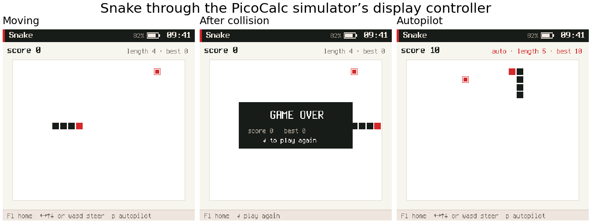
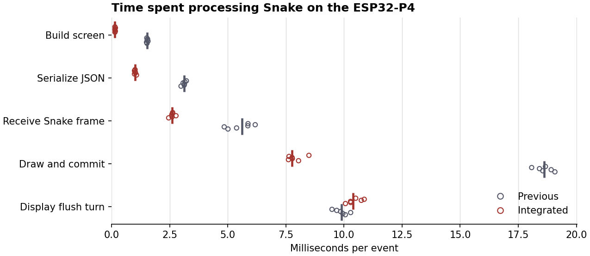

# Drawing a moving Snake on the PicoCalc

When Snake moves one square, the head changes position and the tail recedes. The PicoCalc game used to describe this by sending a score row, a canvas and a list of commands for drawing every segment. The compositor parsed the commands, cleared the 320×320 display buffer, redrew the screen and asked the graphics layer which pixels had changed. On a typical move the answer was 363 pixels. The equivalent move in the integrated game sends a complete list of positions and requires just three rectangle fills. It produces exactly the same image.

This article follows that change through the operating system. Three questions have different answers. How many bytes does the game publish? How many pixels does the compositor write? How much time passes on the physical machine? A test can establish the first two without measuring the third. The underlying code, emulator evidence and device observations let us state which result belongs to which question.



These captures show the actual Linux PicoCalc simulator driving its simulated display controller. Every pixel in the moving, collision and autopilot captures matched a corresponding capture from the previous game. The input script also checks a restarted game and the launcher after leaving Snake. [Whole-system simulation](../scripts/02-simulate-game.py) · [Capture digests](../various/simulator.json)

## Follow the movement of one square

A PicoCalc *world* is an application or service with its own state and event handling. The game world receives keys and a periodic timer. While the game is in focus the timer can advance one step every 110 ms. Autopilot runs a breadth-first search over neighboring cells to choose a direction. The game then decides whether to eat, grow, collide or move. All these decisions remain in the app.

Consider the actual recorded position whose head-first body is `[204,205,183,182]`. A cell number encodes a column and a row on a board that is 22 cells wide. Thus 204 is directly below 182. The next move takes the head upward into 182 just as the tail vacates it. The new body is `[182,204,205,183]`. Both positions occupy exactly the same four squares. An optimization that treats a square as either occupied or empty would leave the old head red.

There are four visual roles on a board square: empty, food, ordinary segment and head. In this move cell 204 changes from red head to dark body, and cell 182 changes from dark body to red head. One cell's filled interior is 11×11 pixels, so two fills change 242 pixels. On an ordinary move to an empty square the departing tail also has to be erased. Three fills change 363 pixels. The independent replay found those exact outcomes in the rendered images. [Independent pixel and recovery study](./03-snake-rendering-correctness.md)

## A smaller message can still describe a complete screen

The new producer's screen callback projects game state into a plain JSON object. It has a type, version, head-first list of cells, food location, current score, best score, and alive and autopilot flags. The normal screen contract still carries the title and hints. A producer on a native build runs machine code generated from the same JS source as the reference game. Snake continues to use the ordinary screen channel with its existing sender identity and retention behavior. [Game world](../../../../../../picocalc-os/js/apps/snake.js)

The distinction between a position and a movement is important. A message saying “erase 179 and place the head at 204” would depend on which earlier moves had arrived. A complete position lets the receiver discard obsolete pending work, switch focus, or restart and paint the right game from one retained message. The reduction comes from moving the stable choices about fonts, colors, cell geometry and game-over text into the compositor. The change requires no binary wire format.

The replay contained 234 observations from the running game and two constructed capacity states. On ordinary game observations, 222 distinct consecutive publications used 164,581 bytes for the previous inner screen frames and 42,659 bytes for the new ones, a **74.1% reduction**. With both constructed positions included, the totals were 184,831 and 45,511 bytes over 224 distinct publications. These counts cover the complete serialized inner frame with hints. The kernel adds an outer message and holds references to it, and JSON representation size alone does not measure world heap. [Replay qualification](./03-snake-rendering-correctness.md)

## Let the compositor prove which work it can skip

The receiver first validates the shape of an incoming Snake frame. A bitset covers the board with 13 integer words. The receiver marks the food cell and visits every body entry, checking range, uniqueness and adjacency. It also checks the type and version, the relationship between score and length and the types of the flags. A malformed snapshot leaves the receiver's accepted frame available for a future draw. In this implementation validation occurs after publication to the kernel. That distinction matters when reasoning about an invalid publisher followed by a newly started compositor.

A valid frame becomes the latest state for the app. Drawing can occur later. While the display driver handles a transfer, a new position or a power update can arrive. The proof must compare the frame about to be drawn with the frame whose pixels are actually in the backbuffer. Using the last message as the reference would give the wrong answer whenever several messages arrive before the next draw.

The fast path requires two live positions with the same food, score and visible controls. It checks every segment after the new head against the preceding segment of the old body. This proves that the move is exactly one step with a departing tail. The compositor also verifies that the title, hints and displayed clock agree and that it has an unobscured Snake backbuffer. The proof costs time proportional to body length and permits at most three fills. Coalesced moves that fail the shift test, growth, death and changes of focus all take the full composition path.

```text
old body       [old head, segment 1, …, previous tail]
new body       [new head, old head, segment 1, …      ]
                                    ↑
proof         new body after its head equals old body before its tail

writes        old tail becomes white unless it is the new head
              old head becomes dark
              new head becomes red
```

The full painter draws the score, complete board, food, body, and any game-over overlay using the original palette and font metrics. The compositor then paints its own banners and hints. A general compositor invalidation clears eligibility for incremental painting even when a draw is already queued. This preserves paint order when a notification or crash banner covers part of the game. [Compositor implementation](../../../../../../picocalc-os/js/system/compositor.js) · [Design and API guide](../design-doc/01-from-a-complete-snake-position-to-changed-framebuffer-cells.md)

## The panel can miss a correct draw

The backbuffer holds the new pixels. A separate front copy records the image against which the graphics subsystem compares dirty 16-row bands. At commit it computes rectangles, copies those pixels to the front copy and asks the display driver to transfer them. Between commit and acknowledgment the front copy can be newer than the physical panel. This is why a renderer that proves its backbuffer correct can still leave an incorrect display.

On a skipped or failed transfer the existing OS invalidates the comparison copy. A subsequent successful transfer can then restore the whole panel using the accurate backbuffer. Incremental painting is compatible with that mechanism because it modifies the same backbuffer and still calls the same commit. The independent test exercised both a skipped transfer and a timeout, then checked all 102,400 presented pixels. In particular “three fills” does not imply “three transfers.” Bounding rectangles can cover unchanged pixels, and retrying a dropped transfer can require the entire screen. [Graphics commit and invalidation](../../../../../../picocalc-os/nucleus/gfx.c)

## Testing the source, the native module and the complete OS

Node ran the original and candidate game callbacks and compositor callbacks against production C raster operations and an independently simulated display. Across all 236 observations the RGB565 images matched the recorded reference. Another test loaded the actual CJI-compiled RV32 Snake into an emulator, exercised its six native SDK screens, and compared the new semantic fields with the positions decoded from the old independent command trace. A whole-OS Linux simulation then drove normal keys and timers through the two releases and compared the display-controller images shown above.

Physical compilation exposed a problem the Node tests could not see. The first version introduced a typed array for validation. CJI tried to specialize the new array's `fill` method alongside the dynamic framebuffer's `fill` method and its method dispatcher failed while building the compositor. The bitset has the same validation semantics, fits in 13 ordinary integer elements and goes through the production frontend successfully. No change to the compiler was required. The physical experiment uses that version. [Director diary](../reference/01-director-implementation-and-integration-diary.md) · [Native SDK fixture qualification](../scripts/01-native-fixture.py)

## Where the new drawing code lives

Moving drawing policy across a world boundary has a cost in program storage. The baseline native Snake module occupied 77,176 bytes and the new one occupies 62,064, a 19.6% reduction. The shared compositor grew from 248,520 to 279,096 bytes, a 12.3% increase. A smaller publisher is only half of this accounting. These ELF file sizes describe the linked programs on disk. Runtime heap also depends on the loader, JS object representation and the lifetime of each frame.

The firmware bundles both modules in compressed form. Their combined compressed size grew from 47,273 to 49,560 bytes, an increase of **2,287 bytes (4.8%)**. This is the storage price of replacing one application's general drawing commands with a receiver that understands Snake. The total playable firmware image grew by 5,568 bytes across the two builds. The two measured module payloads account for only part of that difference. [Native and compressed artifact sizes and digests](../various/world-footprint.json) · [Comparison script](../scripts/05-world-footprint.py)

## Why the earlier 621 microseconds measures something different

Before integration, the lab ran a QuickJS experiment on the ESP32-P4. Each block encoded twelve saved positions twice and reconstructed their widget trees. Semantic JSON consumed 621.2 microseconds per snapshot for those two steps together, the median of five block means. In the same study, a separate trace timed the running game's original native compositor. Those two experiments had different inputs, runtimes and timing boundaries. Dividing the reconstructed-tree time by the old native draw time would produce a meaningless speedup. The new firmware runs the real game in both arms, and its semantic receiver paints directly. Comparing the same measured interval before and after integration answers the production question. [Earlier Snake experiment](../../PICOCALC-RENDER-SNAKE--measuring-snake-snapshots-and-damage-against-full-frames/analysis/01-what-moves-when-a-snake-advances-one-cell.md)

## What changed on the real ESP32-P4

The board ran its ordinary compiled Snake, launcher, compositor and display service in both measured builds. A temporary observer timestamped specific operations and counted posts. The handheld's physical STM32 keyboard controller had stopped acknowledging I²C reads, so both measurement builds supplied the test key status from memory. The native keyboard world still published keys, the game computed each position, and the real SPI controller transferred pixels to the display. Each arm ran six windows of roughly 2.5 seconds of autopilot, with opening and returning to the launcher included in the measurement. The baseline ran first. Physical key scanning and optical response were outside the comparison.

| Physical interval or quantity | Previous | Integrated | Change |
|---|---:|---:|---:|
| Build a screen and resolve hints | 1.529 ms | 0.146 ms | −90.5% |
| Serialize the producer's JSON | 3.131 ms | 1.014 ms | −67.6% |
| Dispatch a game timer event | 20.979 ms | 17.444 ms | −16.9% |
| Kernel render/publication bookkeeping per timer event | 0.214 ms | 0.163 ms | −24.0% |
| Receive a Snake frame in the compositor | 5.622 ms | 2.613 ms | −53.5% |
| Dispatch the compositor draw, including framebuffer commit | 18.612 ms | 7.773 ms | **−58.2%** |
| Display flush turn, including its waiting time | 9.904 ms | 10.398 ms | +5.0% |
| Bytes per kernel publication | 551.4 | 197.6 | **−64.2%** |

Each entry is the median of six block means. First divide the total recorded for each interval by the number of those events in the block. Then take the median across the six blocks. Some intervals nest and their event counts differ. Adding them would double-count work. A draw can be a cheap movement, a full redraw on a focus change or a redraw involving system chrome. The draw figures include the mixture observed in ordinary play. [Board operator's measurement report](./02-snake-on-the-device.md)



Each circle represents one block mean and the vertical mark indicates its median. The final row measures elapsed time across a display turn, including time waiting for the driver. In these windows it increased by roughly half a millisecond. Stable gameplay input deliberately kept the same movement schedule. A lower draw time gives other worlds more execution time between ticks. Measuring key-to-visible-pixel latency or LCD refresh rate requires a different experiment. [Plotting script](../scripts/06-plot-game-timings.py) · [Measured block summary](../various/device/profile-summary.json)

The physical bytes-per-post result and the 74.1% host reduction answer different questions. The device count includes the kernel's serialized publication envelope and samples a short, live run. The host comparison counts a different 222-publication corpus at the inner frame boundary. In both experiments, the reduction comes from encoding the game position once; the precise savings depend on body length, frame wrappers and which positions occur.

A second accounting uses the scheduler's CPU counters for each complete window. Median compositor CPU fell from 801.9 to 409.4 ms (−48.9%), and Snake CPU fell from 629.4 to 504.4 ms (−19.9%). Display-world CPU rose from 149.0 to 160.6 ms (+7.7%). The median SPI transfer count was 198 in each arm, and median bus busy time was 118.3 versus 119.6 ms. The baseline graphics layer already avoided transferring unchanged pixels. Most of the gain is in the software that decides which pixels to draw, before the screen driver receives its rectangles.

The two instrumented images also produced identical RGB565 application crops for game over, game over after re-entry, autopilot, the launcher and the screen after a compositor restart. The top 22 rows contain the system clock and battery, and were excluded from this physical comparison. The independent replay checked the entire screen with a fixed clock. Together these tests establish that the cheaper path reproduces the intended Snake image across realistic state changes.

## The firmware left on the handheld

After both instrumented runs, the operator installed the ordinary release image. Flash verification matched the complete 4,204,544-byte application and its partition map, and a subsequent boot loaded Snake, the compositor, keyboard, display, Files, Agenda, Editor and Chess as native worlds. The application SHA-256 begins `c3d5d8ede739`. Its source and native modules match the production build record. [Production image identity](../various/device/production-build.json) · [Device qualification](./02-snake-on-the-device.md)

The ordinary release has the physical keyboard driver. In its final boot sample all 188 I²C transactions failed, while 66 display SPI transfers completed without error. This leaves one product acceptance check open: opening and steering Snake with the physical keypad after switching the entire PicoCalc off and back on. The measured renderer result already includes native game logic and real display transfers; the remaining check concerns the controller and input path.
