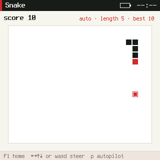

# What the PicoCalc does for each Snake movement

In the installed Snake game, a timer advances the head by one square approximately every 110 milliseconds while the game has focus. The game already knows which cells contain the snake, where food is, and whether the score changed. Until this change, its screen callback converted that state into a tree of rows, text and canvas commands. The compositor received that tree and repainted the focused screen. A normal movement reused most of the same board positions, even though the producer sent a new drawing list and the compositor did a new full paint. The production change sends a complete position and describes the few changed cells when it can prove they account for the difference. [Snake producer](../../../../../../picocalc-os/js/apps/snake.js) · [Compositor](../../../../../../picocalc-os/js/system/compositor.js).

## From game state to a panel transfer

Snake's board has 22 columns and 18 rows. A cell at column `x` and row `y` has index `22*y + x`. The starting head at `(6, 8)` therefore has index 182. The ordered body starts `[182, 181, 180, 179]`. An ordinary move to the right produces `[183, 182, 181, 180]`. The wire carries the whole new body, the food index, the score and the game flags. A compositor with only the new message can draw the same picture as one that drew every old message. The transport is still retained JSON, so the kernel continues to own routing and the latest complete published frame.

If the compositor painted the preceding position and all non-body values and chrome still match, it can verify that the current body has shifted by one. For the example above, it clears cell 179, redraws 182 in body color and paints 183 as the head. If a legal move enters the vacated tail, the new head paint can cover the existing tail cell directly. Growth, a different score or overlay, and a coalesced sequence of updates use the complete paint path. The physical display keeps receiving its normal rectangles from framebuffer commit. The older full paint already had a dirty-rectangle commit. Reusing most of the CPU painting therefore need not reduce SPI bytes for a given final image. [Correctness study and simulated framebuffer comparison](03-snake-rendering-correctness.md).

Moving the boundary affects multiple clocks. The producer callback constructs an object, and the native runtime then serializes it. The kernel accepts the serialized string, compares it with the preceding publication, creates the trusted envelope and queues delivery. The compositor receives it in one turn and paints in another. A turn is one logical callback and can wait for an asynchronous result. A scheduler segment is a piece of active work inside such a turn. The display flush turn often spans a busy physical bus and time spent waiting to resume. A short function can reduce charged CPU time even when the end-to-end display turn is waiting on the same number of bytes.

## Qualifying the ordinary application

The playable build compiles the JavaScript Snake, compositor, keyboard and display worlds through CJI into native ELF modules. The other bundled native applications keep their Typed compilation path. I built the candidate from a committed source archive and recorded both the individual world image hashes and the firmware digest. The old app image and its partition map were verified against the previously installed playable artifacts before the test. Serial access is serialized under the same lock that guarded earlier firmware trials. [Build recipe](../scripts/device/02-build-snake.sh) · [Normal board runner](../scripts/device/01-normal-snake.py).

The UART command schedules key-down and key-up records in the input queue. The native keyboard driver reads these through its I2C route and publishes the same key messages the compositor accepts from that world. The game is opened by typing its launcher letter. For the active windows, the runner allows focus to settle, turns on autopilot with `p`, then returns to the launcher with F1 after about 2.5 seconds. Autopilot selects legal steps and gives the timing window real direction changes and occasional growth. A separate smoke pass exercises an unsteered game over, Enter to restart, pausing through the launcher, re-entry and compositor restart. A second application, System, exercises the shared compositor with a substantially larger screen tree.

The screenshot command copies the committed front buffer to a separate buffer, run-length encodes its RGB565 bytes and reports an integrity check. Screenshot activity is outside the timed windows. The host recomputes CRC-32 and SHA-256 after decoding. An exact game-crop match refers to bytes below the 22-pixel status bar. The top strip may contain a new clock value or battery reading. A framebuffer capture proves the pixels available to the display driver. The SPI counters prove bus activity. Optical key-to-visible-pixel latency requires a separate physical signal and was outside these endpoints.

## How the keypad fault changed the hardware experiment

The first normal-arm preflight reached Snake and captured both a game over and an autopilot run with score 10. In a subsequent run, the STM32 keypad controller stopped acknowledging I2C accesses. Its known recovery procedure is a full PicoCalc power cycle. An ESP32-P4 reboot leaves the STM32 powered. The UART console still acknowledged each scheduled key, but the native keyboard driver could no longer fetch its status register. The picture stayed on the launcher and the test rejected the run. [Bus behavior](../../../../../../picocalc-os/port/esp32p4/main/bus_p4.c) · [Initial normal preflight](../various/device/normal-before-preflight.json).

For the timing comparison, I used matched temporary builds that substitute a reply to that one status-register read. The reply reports how many injected key events are already queued. The native keyboard driver still drains the FIFO and publishes the key, so the compositor's trusted-sender rule and the launcher and game routes remain in use. The actual application, CJI runtime, phase clocks, framebuffer, SPI driver and panel run on the PicoCalc. Physical keypad scanning and I2C behavior require their own qualification. [Isolated observer and input substitute](../scripts/device/03-stage-observer.py).

Claude Code 2.1.328 reported `claude-opus-5-5` for the independent `--effort high` methods commission. The abstract protocol recommended testing exact parity, preserving the runtime input path, separating CPU from SPI, and naming the keypad substitute. Its proposed hardware per-tick capture and optical key-to-pixel measurement would require synchronized capture at both boundaries. The available UART capture copies and streams a frame asynchronously. I used the deterministic emulator replay for all-tick framebuffer checks and used the PicoCalc for fixed checkpoints, scheduled timing and bus counters. The model received no source, console output or measurements. [Independent protocol](../various/device/opus-hardware-methods.txt) · [Model provenance](../various/device/opus-provenance.json).

## What it cost on the PicoCalc

Each arm ran six physical blocks. Each block restarted Snake through the console, let the transient restart banner expire, opened it through the launcher, waited for focus, enabled autopilot for 2.5 seconds, and returned to the launcher. The measurement hooks captured aggregates in memory and printed after the window. The screen callback clock covers building the screen and hints. A second clock isolates the CJI JSON serialization of the screen object. The publication byte count is the exact length of each new message the kernel put on the frames channel, including the sender/title wrapper and hints. The compositor and display clocks are at dispatch and logical turn boundaries. [Baseline blocks](../various/device/profile-before.json) · [Candidate blocks](../various/device/profile-after.json).

| Endpoint | Canvas tree | Semantic Snake |
|---|---:|---:|
| Bytes per published Snake snapshot including wrapper | 551.44 (550.12–551.44) | 197.56 (197.42–197.56) |
| Producer screen and hints callback, ms | 1.529 (1.504–1.568) | 0.146 (0.144–0.167) |
| Producer JSON stringify, ms | 3.131 (2.989–3.218) | 1.014 (0.985–1.072) |
| Compositor Snake-message dispatch, ms | 5.622 (4.847–6.180) | 2.613 (2.457–2.772) |
| Compositor draw dispatch, ms | 18.612 (18.076–19.077) | 7.773 (7.612–8.492) |
| Display flush turn through resume, ms | 9.904 (9.484–10.287) | 10.398 (10.063–10.872) |

Each cell is the median and range of the six per-block means. There were 26–27 distinct Snake publications per block in each arm. Screen callbacks also ran on turns that produced an unchanged snapshot. The compositor measured here schedules paint for different reasons, including focus and ordinary status changes, so its aggregate includes both full and incremental draws. These measurements describe the tested sequence and cannot distinguish fast-path frequency or per-frame tail latency. [Normalized physical summary](../various/device/profile-summary.json).

The full Snake world CPU charge fell from a median of 629.4 ms to 504.4 ms per observation window. The compositor fell from 801.9 ms to 409.4 ms. The measured callback and draw improvements explain a large part of that decrease. The game still runs its path search and the compositor still receives unrelated work during that window. A lower number in the paint column concerns the CPU lane even when both routes produce identical display bytes.

Across the same windows, median SPI2 bytes were 385,183 and 378,666, with ranges that substantially overlap. The median transaction count was 198 on both arms, with zero SPI errors. The bus was busy for 118.31 ms and 119.62 ms respectively. Those totals include launcher transitions and screen updates outside ordinary motion. The previous framebuffer code already compared pixels before transfer, so reducing the work needed to paint them can save CPU with very little change at the bus. Consistent with that distinction, the display driver's CPU charge rose from 149.0 to 160.6 ms in this sequence, and its flush-turn wait stayed near 10 ms. This small window cannot resolve whether the display-side change reflects ordering, sampling phase or transfer grouping.

The overall Snake post was 64% smaller, the screen construction phase spent about a tenth of its former time, and compositing draw dispatch took 58% less time at the median. A display flush can still finish later than a draw because it spans physical SPI work and a scheduled continuation. The team therefore uses the smaller producer and compositor costs as the performance evidence for this change.

## What appeared in the committed framebuffer

All five common physical checkpoints matched exactly below the clock and battery strip. These covered the first death, returning to the launcher, death again after Enter and re-entry, a live autopilot frame, and returning to Snake after a deliberate compositor restart. The candidate also opened System's Worlds tab, rendered the larger tree, and returned through F1. System recorded no error, and the compositor's restart count and previous administrator-restart diagnostic stayed unchanged across that smoke test. This was a physical run with the explicit keypad-status substitute. [Framebuffer hashes and System check](../various/device/profile-after.json).



The picture shows score 10, length five, the red head and a new food cell. The screenshot pass was separate from the timed window. The counterpart baseline checkpoint produced exactly the same game crop. It confirms that the native compositor can accept a semantic snapshot, paint it and expose the same committed pixels as the old tree-based path at that observed position.

## Reproducing the hardware measurements

The build and runner are under the ticket's device scripts. Use the same installed ESP-IDF and playable SDK configuration as the previous Chess qualification. The two profile builds take the old `e339b6a` and staged `8715aaf` code respectively. The ordinary candidate uses the committed source with the `normal` option and contains neither the observation hooks nor the keypad substitute. The installed payload, two native game/display modules, and compiler inputs have separate hashes so a matching source can be checked without assuming byte-identical build timestamps. [Production build identity](../various/device/production-build.json).

```bash
ticket=$(find ttmp/2026/11/20 -maxdepth 1 -name 'PICOCALC-SNAKE-INTEGRATION--*')
idf=/home/manuel/esp/esp-idf-5.4.2/export.sh
esp=/home/manuel/.espressif/python_env/idf5.4_py3.11_env/bin/esptool.py
playable=/tmp/p4-system-fix-final/build

bash "$ticket/scripts/device/02-build-snake.sh" /tmp/snake-observe-A "$idf" e339b6a ref profile memory-keys
bash "$ticket/scripts/device/02-build-snake.sh" /tmp/snake-observe-B "$idf" 8715aaf ref profile memory-keys
python3 -B "$ticket/scripts/device/01-normal-snake.py" /tmp/snake-observe-A-run \
    --baseline "$playable" --flash /tmp/snake-observe-A/build --esptool "$esp" --profile --memory-keys --restore
python3 -B "$ticket/scripts/device/01-normal-snake.py" /tmp/snake-observe-B-run \
    --baseline "$playable" --flash /tmp/snake-observe-B/build --esptool "$esp" --profile --memory-keys --restore --system-check
```

The test runner restores and verifies the provided known playable app after each temporary image. To exercise the real keypad controller with the profiling hooks, build with `profile physical`, omit `--memory-keys` and require the I2C preflight. The scheduler, compositor, and transfer endpoints are the same for that experiment. A physical keypad failure prevents charging those windows under the ordinary-input label.

## The firmware left on the handheld

The PicoCalc was left running the ordinary candidate built at `8715aaf`, with SHA-256 `c3d5d8ede739f5d4d21ad2b4981fbfd839cf20e2ab2a644ba1d330e6374446e3`. Flash read-back matched both the app at `0x10000` and the unchanged partition table. After reboot the expected native Snake, compositor, keyboard and display modules and the four Typed native apps became available with clear kernel error fields. The build contains neither test facility. [Production build receipt](../various/device/production-build.json) · [Install and boot receipt](../various/device/production-installed.json).

The physical controller still NACKed on all 188 sampled I2C0 transfers during that boot check. The same check recorded 66 successful physical SPI2 transfers and zero SPI errors. The final installation is boot-verified. Ordinary keyboard-driven candidate gameplay and the final-image System check remain unverified on this unit until the keypad responds. The physical gameplay, framebuffer parity and System evidence in this report come from the separately identified profile pair. [Install counters](../various/device/production-installed.json).
