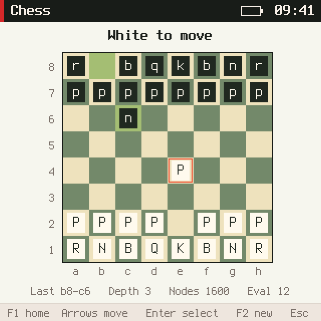
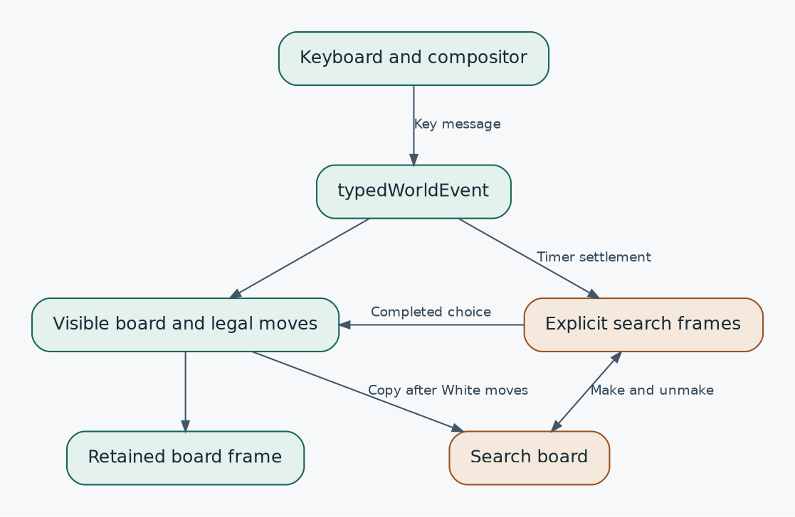
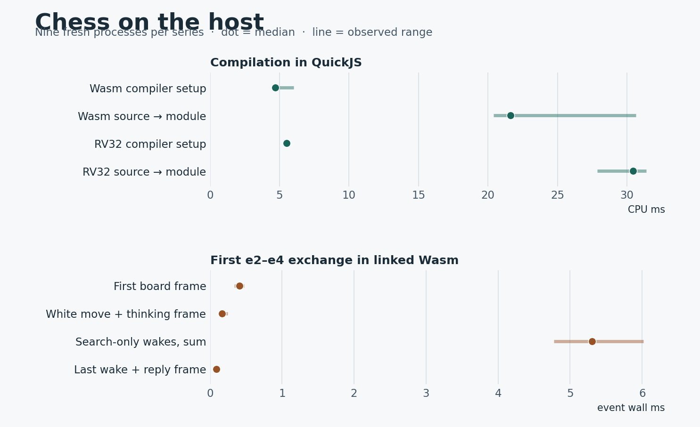

# Chess search without recursion on the PicoCalc

Play White in the Chess app. Open it with **H** from the PicoCalc launcher, move with the arrow keys, and press **Enter** or **Space** to select a piece or commit a marked destination. For promotion, pick **Q**, **R**, **B** or **N**. **F2** starts a new game. **Esc** closes a selection, cancels promotion or returns to the launcher. After **e2–e4**, both compiled targets answer **b8–c6** at completed depth 3, with 1,600 visited nodes and a score of +12 centipawns for Black.

The application adds a fourth source workload alongside Files, Agenda and Editor. Its 40,767-byte source has a different shape. Position tests and nested integer loops dominate its rule and search code. Repeated small calls manipulate two scratch buffers. The app retains just enough scalar state between timer turns to continue a search. The same six typed files link against the existing shared reactor as Wasm or RV32. The host transcript checks the linked applications using the real SDK ABI on each target. [Typed Chess source](../../../../../../picocalc-os/worlds/chess/source.list) · [Application oracle](../various/world-oracle.json)

## One position, two uses

The board is a 128-word mailbox with eight rows of sixteen. The first eight words in each row are files a through h. The rest are off-board. From the white pawn on e2, index 100, a forward move subtracts 16. The e4 destination is index 68. A ray can reuse the same increment until an occupied or off-board word stops it. Seven extra words record the side to move, castling rights, the en passant square, the two king squares and both move clocks.

Moves use dense 0–63 coordinates inside the word carried in a list. Six bits hold the origin, six hold the destination, and three hold the promotion code. The rule functions convert the coordinates when they access the mailbox. One packed word is also enough to retain the app's most recent move and root search result.

A candidate move has to pass two tests. The first enumerates moves that fit piece geometry and occupancy. The second makes the candidate, checks that the mover's king remains safe, and restores the board. The undo record saves the affected squares and metadata. This rule path serves highlighted destinations, perft and engine nodes.

Castling adds an attack test for the starting and crossing squares before the ordinary final-square test. En passant removes the captured pawn from its actual square before the attack test. That distinction matters when the capture opens a rook's file. All four promotion pieces are distinct legal moves, and the human selects one after reaching the final rank. [Official chess rules](https://handbook.fide.com/chapter/e012023) · [Move generator](../../../../../../picocalc-os/worlds/chess/moves.typed) · [Make and unmake](../../../../../../picocalc-os/worlds/chess/position.typed)

The board at a suspended search node can contain an applied speculative move. The renderer always sees the separate game board, so the cursor can move while the engine is thinking. The app uses the generic module load, key message and retained screen interfaces. Its C entry point on ESP32-P4 loads the bundled typed source and reactor and invokes the existing typed compiler. Moves, scoring and the UI stay in typed code. [World event handler](../../../../../../picocalc-os/worlds/chess/chess.typed) · [P4 compiler caller](../../../../../../picocalc-os/port/esp32p4/main/chess_p4.c)

## What a search frame has to remember

In negamax, a child's score changes sign when returned to the parent. Alpha is the best score established in the current window. Beta is the score that suffices to refute the opponent's current choice. Each parent can stop considering siblings once a child reaches beta. The next node gets the negated, reversed window, from minus beta to minus alpha.

The typed compiler rejects recursive call graphs. A search frame therefore keeps values a recursive function would ordinarily leave on the language stack. It holds the depth, window, score, move cursor, best move and pending move. The board holds a separate move list and undo record for each active ply. To visit a child the program applies the candidate, writes the new frame, and advances a scalar ply index. Returning to the parent means decrementing that index, undoing the move, and delivering the negated score.

The app requests four plies under a ceiling of 1,600 node starts. It starts at depth one and commits each root result when an iteration finishes. The next iteration tries the previous root move first, then orders promotions and captures using victim and attacker values. Quiet moves and equal-priority moves retain generator order. The same node budget therefore gives the same decision and counters on both engines. If the budget expires midway through an iteration, the scratch board is unwound and the completed root choice survives. If the first iteration never completed, the precomputed first legal move is available.

Each timer slice runs up to 48 state-machine steps before returning to the scheduler. Preparing a node, advancing to a child and unwinding can happen on distinct steps. The e2–e4 replay produces 78 timer settlements. A reset invalidates old timer tokens. A failed timer uses the last completed choice or the legal fallback.

The largest allowed search depth is six in the harness. Quiescence can add four plies. A list reserves 512 move words and 512 priorities per ply. Even assigning all sixteen pieces the 27 destinations possible for a queen in an empty board stays below that capacity. A pawn can produce up to twelve promotion moves, also below the per-piece queen bound. Both position areas fit the existing reactor scratch storage. The engine does not maintain a transposition table or opening book. The fixed node limit keeps the work reproducible for compiler comparisons.

## Avoiding the expensive pawn

In the defended-rook fixture, **Qd1×d5** wins a pawn at nominal depth one, but **Rd8×d5** takes the queen back. Quiescence extends the search of captures and promotions beyond the nominal leaf. A quiet position can retain its standing evaluation. When the side to move is in check, standing still is illegal, so quiescence enumerates all legal evasions, including quiet moves. At its hard depth cap, checked nodes still try legal evasions and evaluate each resulting position directly. Play and search both distinguish checkmate from stalemate by testing whether any legal move survives. [Search implementation](../../../../../../picocalc-os/worlds/chess/search.typed)

The evaluator prices pawns, knights, bishops, rooks and queens at 100, 320, 335, 500 and 950 centipawns. It adds central activity, pawn progress, a small bonus for the bishop pair and for a rook on its relative seventh rank, and a king term that leans toward safety with more material on the board and centralization with less. Mate scores sit outside ordinary evaluation and lose one point for each ply to mate.

| Position | Depth-one material control | Depth-one activity plus quiescence | Iterative deepening |
| --- | --- | --- | --- |
| Opening | a2a3, 0, 21 nodes | b1c3, +30, 21 nodes | b1c3, +30, depth 3, 871 nodes |
| Defended rook | d1d5, +450, 25 nodes | f2f4, +342, 26 nodes | f2f4, +324, depth 2, 1,600 nodes |
| Quiet mate in two | d6e6, +950, 32 nodes | d6d5, +1010, 38 nodes | d6c7, +29997, depth 3, 1,344 nodes |

The depth-one material comparison changes evaluation, ordering and quiescence together. In a separate Wasm control, disabling only the capture extension at quiet leaves makes the activity-aware engine choose d1d5 at +456 in 25 nodes. Restoring that extension changes its move to f2f4 at +342 in 26 nodes. Evaluation, ordering and checked evasions are identical in those two runs. The quiet mate example tests whether the engine improves when a winning move lies past the capture horizon. Independent enumeration found only **Kd6–c7**, followed by a mate on White's next turn after Black's sole reply. The small hand-picked suite supports these concrete tactical claims. [Search receipts](../various/engine-oracle.json) · [Independent fixture generator](../scripts/02-reference-positions.py)

The app adjudicates checkmate, stalemate, bare kings, a single bishop or knight against a bare king, and bishop-only positions with all bishops on the same square color. It tracks ordinary move clocks in the position record. Repetition claims, the 50/75-move rules, competitive clocks and saving games across app reloads are outside this version.

## Same rules and application on two targets

For perft at depth one, list every legal move. At depth two, count the leaves after a legal reply to every root move. The initial position gives **20, 400 and 8,902** at depths one to three. Kiwipete adds **48 and 2,039** because its root position has castling and a denser tactical move tree. Specialty positions check every legal coordinate, including four promotion siblings, legal versus pinned en passant and castling through an attacked square. The clocks and board metadata are compared before and after traversal and search. [Independent perft cases](https://github.com/gflohr/Chess-Plisco/blob/main/t/05perft.t) · [Full engine receipt](../various/engine-oracle.json)

The standalone engine oracle compares 6,981 returned words across Wasm and streamed RV32 under the CJI emulator. Those words cover legal moves and their deterministic order, perft, score, node count, completed depth and state-machine steps. The oracle checks native buffered output byte parity and separately exercises the actual UI's winner labels after a mate by each color in Wasm. The linked application replay compares 98 real reactor events and 18 retained frame payloads, including input during search, a stale token after reset and a failed timer. The separate WAMR launcher replay uses the keyboard, display, compositor and launcher to capture the game screen. The reset image is byte-identical to the initial image. [Cross-target application receipt](../various/world-oracle.json)

## Keep compilation and play on separate clocks

The hot application clock starts when the compiled Wasm reactor enters an event. It includes SDK and frame construction within that event. The world scheduler, compositor and panel are outside the boundary. The host compiler clock starts in a fresh QuickJS process that has the source and reactor already loaded. It separately records compiler script setup and the public source-to-linked-module call. The device replay measures from the app's Enter event to the retained reply frame. It reports engine, world CPU and kernel render time, and records the number of search settlements. The physical screen transfer and instrumentation's final UART print are outside that window.

| Host clock | Wasm | RV32 |
| --- | ---: | ---: |
| Compiler script setup, median of nine fresh processes | 4.71 ms | 5.50 ms |
| Source to linked module, median of nine fresh processes | 21.63 ms | 30.44 ms |
| Source to linked module, observed range | 20.40–30.64 ms | 27.86–31.40 ms |
| Linked module | 73,204 bytes | 240,452 bytes |

The RV32 artifact includes the fixed executable slot and common reactor, so its file length is larger than the instructions Chess emits. The Node event medians for Wasm are 0.41 ms for the first board frame, 0.17 ms for the move and thinking frame, 5.30 ms across the 77 search-only wakes, and 0.09 ms for the final wake including the reply frame. The 78th wake includes the final move and frame build. An earlier host run during other firmware work measured 30.74 ms for Wasm and 41.05 ms for RV32 with the same compiler scripts. These are observations of the host in those sessions, with clock and system-load differences uncharacterized. The board measures its own scheduler and engine.

See the raw [host timing distributions](../various/host-measurements.json) and the [physical replay preparation and command](../reference/03-reproduce-chess.md).
