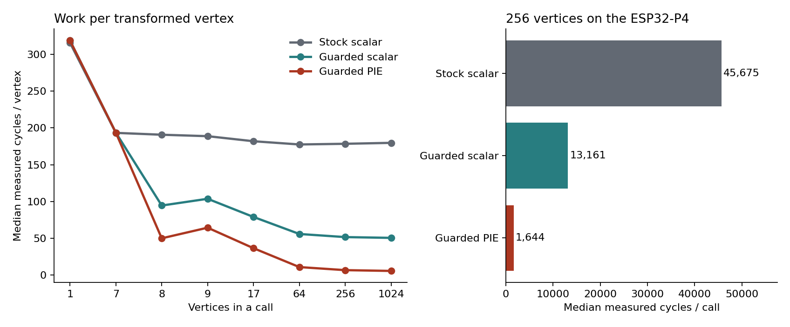

# When eight vertices can share one instruction on a handheld compiler

Consider the loop that projects a piece onto a Chess board. Its inputs are consecutive x, y and z coordinates. Each iteration reads one point, computes its two screen coordinates and a depth, and writes three values. A programmer can write that loop in scalar Typed, which defines one result at a time. The ESP32-P4 also has custom processor instruction extensions called PIE. A PIE register is 128 bits wide. One packed signed addition can calculate eight 16-bit results. For that instruction to implement the source loop, the results and the observable order of memory effects must agree for every admitted input.

Our compiler produced such a loop from ordinary scalar source on the host. On the physical P4, a 256-vertex call took 45,675 cycles with the original scalar backend, 13,161 after changing address computation and bounds checking, and 1,644 using PIE. Giving all of the improvement to the vector unit would greatly exaggerate its contribution. The intermediate scalar result tells us that the loop analysis paid for itself twice, once by enabling better scalar lowering and again by allowing eight independent points to be processed together. The fractions of stock execution time removed were 71.2% and 96.4% respectively. PIE removed a further 87.5% relative to the improved scalar routine. These are measured kernel times on warm flash-mapped code and internal-RAM buffers.

## Inference has two separate obligations

The program reads each coordinate as an unsigned 16-bit buffer cell, performs arithmetic in i32, and stores the low 16 bits of a result. An input expression reduces the stored coordinate modulo 256. Since the load is nonnegative, the resulting x, y and z are all in [0, 255]. For one coordinate system used by the experiment the output is given by these expressions.

```text
screen_x = 384 + x - z
screen_y = 640 + x + z - 2*y
depth    = x + y + z
```

The first result lies in [129, 639], the second in [130, 1150] and the third in [0, 765]. The compiler also checks the intermediate operations in the order they occur. Packed arithmetic can have saturating semantics. If the intermediate sum 384 + x were permitted to overflow a signed 16-bit lane and be reduced later by z, a final result in range would be insufficient evidence. Here the upper bound of that intermediate is 639. The subtraction is safe as well. This arithmetic proof selects a representation for which each lane computes the scalar expression exactly. [Espressif’s PIE instruction introduction](https://developer.espressif.com/blog/2024/12/pie-introduction/)

An arithmetic proof alone cannot establish that eight loop iterations are independent. A later read may overlap a location written by an earlier iteration. A short output buffer may let the scalar loop write several positions before the first out-of-range access traps. The compiler has to preserve the values in all the affected buffers on that exceptional path, including which outputs of the failing iteration were already written. This explains the division between compile-time and run-time work. Compile time proves the structure of the loop. Entry guards prove facts about this particular set of six buffers and the number of points in this call. [LLVM’s treatment of runtime pointer checks](https://llvm.org/docs/Vectorizers.html#runtime-checks-of-pointers)

## Lowering on a streaming compiler

The Typed frontend already emits a checked sequence of operations for each function. Native lowering consumes this sequence one function at a time. The experiment recognizes a restricted form of counted loop at the beginning of the function. It recovers input expressions, output expressions, buffer identities and the induction variable. It checks arithmetic intervals and chooses vector registers. It gives up early when the structure is outside its supported cases. This fits the compiler’s existing streaming model. It also ties the matcher to the frontend's exact expansion of checked accesses, which should be reviewed when that expansion changes.

For an eligible function the backend emits a new entry path ahead of the original scalar body. The guards check that a full group of eight fits, that the relevant buffer payloads are aligned, that the prefix fits each capacity, and that address spans with writes are disjoint. The address check uses the data after the four-byte buffer header. An object beginning on a 16-byte boundary has its data at offset four. Passing it to aligned vector loads would be incorrect. The test fixtures that are intended to select PIE deliberately position the header four bytes before a 16-byte boundary.

```text
checked scalar loop
  ├─ dependencies or ranges unsupported → emit original scalar function
  └─ eligible → emit guarded fast path plus original scalar loop
                   ├─ actual buffers unsuitable → run scalar from original index
                   └─ suitable → transform complete groups, finish scalar tail
```

The candidate’s eligible function occupies 1,384 bytes, compared with 628 bytes in the stock backend. That is 756 extra bytes, or 120.4%. Inside the larger function the vector body takes only 29 instruction words. The extra entry guards and retained general path account for much of the difference. The improved scalar candidate occupies 1,416 bytes. A useful optimizer therefore needs a selection policy for code size as well as correctness. Refusing an unsuitable function should leave the program compilable and preserve its original bytes where no transformation was selected.

## What independent review changed

The reviewer constructed inputs and short programs outside the implementer's original fixture. One legal loop assigned to its induction variable in a place that resembled an input definition. Its first input could change the index to nine, causing scalar execution to update element nine instead of eight consecutive elements starting at zero. The reviewer reproduced the difference and the selector was tightened. A second example placed a function close to the native backend’s 2,032-byte stack-frame limit. Reserving two more scratch slots made an otherwise compilable function fail. The revised implementation reuses dead temporaries; the old limit is preserved.

The final review compared 145 execution states, including 48 traps, and checked another 35 source variants at six counts across two candidate modes. It compared whole memory arenas, which can reveal a correct returned value accompanied by an incorrect earlier store. It also traced the actual configured ESP-IDF port and discovered that its PIE context-switch save and restore lists omit q3. The experiment reserves that register. This constraint is specific to the checked port revision; it should be rechecked when changing SDKs. The independent study documents its machine-code execution model and comparison with assembled P4 words. [Independent review](02-independent-review.md)

## What the board measured



The same physical ESP32-P4 executed all three generated programs. The experiment rotated their order, warmed the routines, and measured batches of calls at eight input sizes. Eleven samples per arm and size produced cycle counts per call. At seven vertices the scalar and PIE builds took 1,353 and 1,355 cycles. At eight vertices the two numbers were 1,526 and 398 cycles. The change at eight identifies where the first complete packed group can execute. A ninth vertex adds a scalar tail. At 1,024 vertices the medians were 184,005 cycles for stock, 51,561 for the improved scalar, and 5,484 for PIE. The independent reviewer reproduced the expected application-memory checksums for all 72 hardware cases and matched the three kernel digests. The board ran a temporary benchmark image and was restored to the qualified Chess firmware after readback. [Compiler research and board protocol](01-when-a-scalar-chess-vertex-loop-becomes-eight-pie-lanes.md)

An application has additional work before and after projection. We compiled four ordinary project workloads with the experimental selector enabled on the host. Files, the Chess game, the 2D Chess painter and Editor all retained the stock image byte-for-byte in the measured corpus. The fixture alone selected the optimization. In nine alternating fresh Node VM pairs the median for the small fixture, including VM setup and compiler evaluation, went from 0.98 to 1.17 ms. Results for larger apps varied in both directions, including Chess at 9.57 versus 10.76 ms and Editor at 21.62 versus 20.58 ms. Node can reuse engine state across observations. These short host timings cannot establish an on-device cold-build regression or improvement. [Host compile receipts](../various/director-host-compile.json)

A first isometric Chess scene also illustrates the current coverage boundary. Its painting code projects individual points while constructing faces. The closed painter entry receives a state buffer and a drawing-command buffer. The verified vector kernel consumes separate coordinate and output columns. Turning on the compiler flag does not convert a call at a time into such a batch. Connecting them requires a decision about bounded scratch ownership, mesh layout and when to project a set of vertices together. The first rendering experiment gives us a visible consumer of geometry and a real scalar baseline. A scene-level speedup will require observing a packed block in that actual code path and measuring the completed frame.

## What I would promote

The range and dependence tests, three-arm comparison, and negative fixtures are reusable now. The target-specific lowering belongs behind its experimental option while it recognizes only this narrow loop family. On the measured P4 the result justifies testing a bounded mesh workspace for an actual renderer. Once that layout exists, compare a cached fixed camera, a rotating camera with scalar projection, and the same rotating views with packed projection. Publish vertex throughput, source-to-native build time, drawing commands, raster time and display transfer separately. Those measurements would tell the compiler team whether it should expand its loop analysis and tell the graphics team how much of that improved arithmetic a player can actually see.
