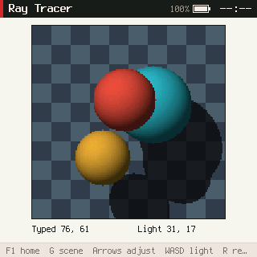
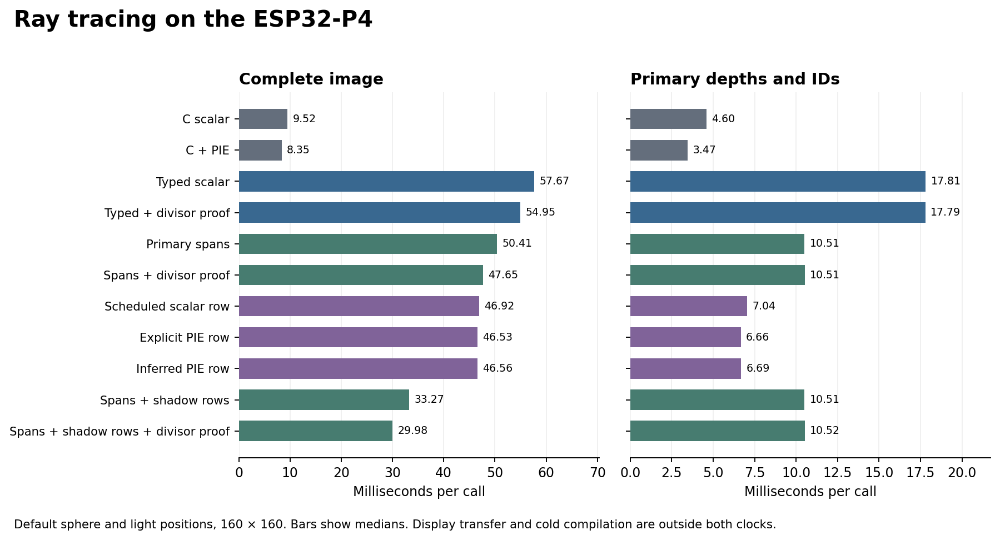

# Which work survives compilation in a handheld ray tracer?

The PicoCalc can compile a complete ray tracer from Typed JavaScript to RISC-V machine code. The application chooses the objects, traces primary rays, tests floor shadows, computes diffuse lighting and writes the screen's RGB565 pixels. The firmware allocates storage, loads the generated code, calls it and presents the result. From a compiler research perspective, this gives us an unusually direct experiment. We can run two programs that agree at every pixel, inspect every instruction emitted by one of them, and time both programs on the processor that compiled the Typed source.

The ordinary firmware offers the fixed-color Typed renderer as a fourth scene. From the launcher, V opens Ray Tracer and three presses of G select Typed. Arrows move the sphere, WASD moves the light and R resets the classic scene. The full benchmark compiler alternatives are opt-in. Rebooting the research firmware restores the ordinary compiler choice.

## Defining a frame

The camera looks straight down the depth axis. All primary rays travel in parallel. A pixel at (x, y) therefore keeps those two coordinates as depth varies. For a sphere centered at (cx, cy, cz) with radius r, the discriminant is the integer d = r² − (x − cx)² − (y − cy)². A negative result misses. A zero result touches the silhouette and counts as a hit. Otherwise the first surface has depth cz − floor(sqrt(d)). The implementation looks up the square root in a 1,025-entry table. It visits the spheres in their declared order and replaces the current winner only when a new depth is strictly smaller. Two surfaces with equal integer depths therefore have a deterministic winner.

For example, the first sphere in the default view has center (68, 61, 56) and radius 26. Its center pixel gives d = 676 and depth 30. At (94, 61), d equals zero, so the sphere contributes a candidate at depth 56. Another sphere may still win the pixel. Compare both depth and identity to detect errors in that choice. Two spheres sharing a material can conceal an identity error in a color-only test. The plane uses depth and ID zero as the miss representation. [Scalar source and ABI study](02-a-complete-ray-tracer-in-typed.md)

Lighting adds another geometric query. A ray that misses the spheres reaches the checker plane. To find a shadow, the program asks whether a sphere intersects the ray from that plane position toward the light. A conservative projected rectangle eliminates many candidates. The remaining dot-product test determines the shadow exactly within the scene's integer contract. Visible sphere pixels use the surface normal and lamp direction for diffuse lighting. Finally, the renderer scales the color channels and keeps five red bits, six green bits and five blue bits in each output cell.

## What the native boundary buys

One ordinary call renders the whole frame. The caller provides an output buffer and 2,048 reusable 16-bit scratch cells. A four-byte header gives each buffer its capacity. The scratch layout contains the sphere descriptors, squared horizontal distances, square roots, lighting projections and the current row's depths and IDs. A stride measured in cells permits the image to occupy a subrectangle of a larger surface. With stride 163, the last visible cell of row zero is 159, the next three cells belong to padding, and row one begins at 163. A test that checks only the first 25,600 contiguous cells would miss this error.

The clean entry writes the final frame. Additional entries expose primary results, shade precomputed depths and IDs, or emit all three visible planes. Timed C and Typed calls must produce the same set of outputs. Writing two extra planes incurs additional stores and consumes bandwidth even when the caller ignores them. Tests prefill output and padding, compare the complete active planes, and verify invalid-input behavior. The scalar researcher exercised 12 host cases encompassing extreme positions, light changes and padded strides. The emulator runs the real RV32 words and checks calling conventions. The physical board provides elapsed time and a display path. Each observation answers a different question.

## Counting the instructions that actually run

Static code size counts each instruction once. The instruction counter in this experiment instead records every visit to an instruction address during one default frame. Each address maps to the generated function that owns it. The result is an exclusive count. Instructions inside a helper belong to that helper even when a caller invokes it tens of thousands of times. The emulator also verified the RGB565 frame against the C checksum. An instruction count weights a stack load, a branch and a divide equally. It cannot reproduce the P4's caches or the cost of a slow memory access.

The scalar frame executed 15,532,624 instructions. The floor-shadow function accounted for 5,528,397, or 35.6%. The primary row function accounted for 3,608,697, or 23.2%. RGB565 packing alone used another 1,740,800 instructions. These figures suggested three different experiments. The compiler can simplify a division whose divisor is a known positive literal. The renderer can restrict primary intersections to analytically visible intervals. It can also reorganize floor-shadow traversal so that the same sphere and row quantities are calculated once. [Per-function instruction profile](../various/director/profile-scalar.json)

## The difference between eliminating an operation and proving a smaller domain

Typed signed division has exceptional cases. An unknown divisor can be zero. Dividing the most negative signed 32-bit integer by minus one also overflows. In an expression such as red * scale / 255, the divisor proves both conditions impossible. Removing those guards leaves the actual signed divide and its truncation semantics intact. On the default clean frame the compiler change eliminated 808,873 executed instructions, or 5.21%. It also saved 404 bytes in the complete module. This is a transferable compiler improvement. Its benefit depends on how often an application performs division by positive constants. [Compiler comparison](../various/compiler/full-frame.json)

Now consider the primary row loop. For a fixed y, h = r² − (y − cy)² is constant. If h is negative, this sphere has no candidate on the row. Otherwise dx² ≤ h is exactly equivalent to |dx| ≤ floor(sqrt(h)). The same small table used for depth provides both inclusive endpoints. The three spheres generate 6,983 valid candidates across 165 nonempty sphere rows. The original loop visits 76,800 sphere/pixel pairs. A 90.9% reduction in candidate pairs becomes a 13.6% reduction in executed instructions for the complete default frame, because clearing rows, finding winners, shading and writing the screen still take work. The experiment includes depth ties and a radius-one sphere. [Exact row-domain experiment](../scripts/director/row-domain.c)

The shadow loop originally asks about up to three spheres at each visible floor pixel. A second source variant reverses the order. It clears a 160-cell shadow mask, visits each sphere, rejects out-of-range rows once, clips x to the projected rectangle and marks samples that satisfy the exact dot-product predicate. A marked pixel can stay marked when another sphere also casts a shadow. Sphere lighting takes precedence over that plane mask. The rewrite is valid because shadow coverage is the union of the individual shadows and the light and scene are constant for the row. The generated code needs 320 bytes of live scratch within the existing allocation. The derivation combines loop interchange, loop-invariant calculations and geometric range information. General loop interchange and automatic vectorization each require dependence analysis before a compiler may reorder accesses. [GCC loop optimizations](https://gcc.gnu.org/onlinedocs/gcc-15.2.0/gcc/Optimize-Options.html) · [LLVM vectorizer design](https://llvm.org/docs/Vectorizers.html)

Using both source changes reduced the default guest count to 8,729,318, a 43.8% reduction. The modified paths matched the C oracle under all 12 host conditions. These are application algorithms. An optimizer that recognizes such a transformation in an arbitrary program would need substantially more evidence than the simple proof for positive literal division. [Combined source experiment](../various/director/profile-both.json)

## Adding programmable materials

The classic scene packs colors determined by a sphere or checker. The programmable scene adds a bounded expression graph and an interpreter compiled from Typed source. We reused the existing Typed scanline shader. The new frame routine gathers the winning material handles across each row, calls the shader, applies lighting to its unpacked RGB output, and stores the final pixels. The native caller supplies six disjoint buffers and two lamp coordinates in the eight argument registers supported by this backend. Graph construction and validation happen before the timed frame.

The independent material evaluator intentionally builds its graph in a different node order. Two fixtures and three weights per fixture produced six complete expected images. Each image matched Wasm and emulated RV32 byte for byte at stride 163, including the unchanged padding. The span variant produced the same images. A mixed C-and-Typed reference retains the C geometry, the packed eight-lane intersection kernel and the Typed material shader. This comparison addresses the cost of moving the remaining visibility and lighting operations across the language boundary for the same authored material. [Full material receipts](../various/director/material-frame.json)

## What comparable scalar and packed rows reveal about the compiler

A vector instruction can compute eight signed differences together. The useful comparison is a scalar row with the same register schedule, upfront checks and early row rejection. For the default frame the scheduled scalar implementation executed 12,464,201 instructions. The explicit and inferred packed implementations each executed 12,354,971. Relative to the matched scalar full frame, eight-lane execution removed 0.88%. Relative to the ordinary 15.53-million-instruction frame, the complete packed template removed 20.46%. The matched comparison attributes most of that difference to the rest of the template. The explicit and inferred paths generated the same measured image. The compiler retains scalar fallback when the input or loop fails its admission checks. These results support a narrow loop recognizer, and leave general vectorization of independently written loops open. [Packed row admission and fallback results](../various/compiler/rows.json)

A separate comparison suggests a concrete next instruction-selection experiment. The physical firmware builds its reference with GCC 14.2.0 at `-O2` for RV32IMAFC with the ESP packed extension. In a separately compiled copy of the reference RGB565 expression, GCC emits a 30-instruction function. It divides three signed products by 255 using the high half of a multiplication by a fixed reciprocal, shifts and signed correction. It emits no hardware divide in that isolated function. The original Typed source expresses subsequent quantization using signed divisions by eight or four on known nonnegative channels. The guarded Typed variant still performs six divisions per pixel. This identifies an opportunity for constant-divisor lowering and for retaining signed range information through packing. An implementation must preserve truncation toward zero for negative dividends outside this bounded example. The experiment archived both the compiler options and the actual instructions. [C reference code generation](../various/director/c-codegen.json)

## The physical result

The test firmware rotated scalar C, packed C and Typed within each block. It exercised nine compiler/source configurations, 12 input cases and three repetitions, yielding 324 blocks. Each block compared the clean frame, the audit with three outputs, the primary visibility pass and the separate shading pass. CPU cycle counts provided an independent check on elapsed microseconds. The frame time ends with RGB565 in memory. Display transfer, enlargement and source compilation have separate boundaries.

On the default pose the complete scalar Typed frame took 57.674 ms. The simultaneous scalar C control took 9.521 ms and the packed C control took 8.350 ms. The ordinary Typed compiler therefore took 6.06 times as long as scalar C for this frame. The older 8.562 ms scalar C number describes a different trial. Fresh controls avoid assigning a change in firmware layout, buffer placement or measurement conditions to the compiler under investigation.

| Default-pose treatment | Full frame | Change in elapsed time from ordinary Typed | Primary pass |
|---|---:|---:|---:|
| Scalar Typed | 57.674 ms | baseline | 17.811 ms |
| Positive-divisor compiler proof | 54.948 ms | −4.73% | 17.791 ms |
| Exact primary spans | 50.410 ms | −12.59% | 10.510 ms |
| Matched scalar row specialization | 46.918 ms | −18.65% | 7.037 ms |
| Explicit eight-lane row | 46.535 ms | −19.31% | 6.661 ms |
| Inferred eight-lane row | 46.560 ms | −19.27% | 6.690 ms |
| Exact primary spans and row-oriented shadows | 33.268 ms | −42.32% | 10.508 ms |
| Both traversal changes and divisor proof | **29.975 ms** | **−48.03%** | 10.517 ms |

The fastest measured combination is 1.92 times as fast as ordinary Typed. Scalar C still finishes about 3.15 times faster. The percentages in the table compare default-pose medians. The matched compiler study pairs trials by fixture and repetition across all 36 combinations. Its median reduction from positive-divisor guards is 4.735%. Against equally scheduled scalar code, explicit packing saves 0.818% of the whole-frame time and 5.239% of the primary phase. Explicit and inferred machine bytes match. A difference measured in tens of microseconds between those two outputs is a useful indication of run-to-run variation.

Compilation also happens on the P4. The ordinary scalar compiler interval took a median 429.863 ms and peaked at 645,728 tracked QuickJS bytes. The fastest rendering treatment compiled in 464.018 ms and peaked at 677,076 bytes. On this implementation the extra 34.155 ms of cold compilation is repaid after the second complete default frame if the measured frame-time difference persists. This calculation excludes relocation, describes these two particular treatments, and assumes the program keeps its compiled image between frames.

The programmable comparison repeated 36 pairs across two fixtures and three parameter values per fixture. With the shared checker scene, mixed C/PIE geometry plus the Typed material shader took 28.759 ms and the complete Typed frame took 71.307 ms. With the captured tile shader the corresponding medians were 18.137 and 60.666 ms. Both returned the expected pixels. The complete Typed cost increased by about 42.5 ms in both comparisons even though the material formula changed. That consistency motivates measuring the geometry and lighting paths independently on more scenes. [Physical experiment and scope](04-how-to-time-a-complete-typed-ray-tracer-on-the-handheld.md)

## Which improvement earns another experiment?

The positive-divisor proof has the clearest path into the general compiler. It improves generated frames across all 36 matched pose/repetition pairs and reduces image size. The next step is to apply the same edge-case checks to the normal app catalog and reproduce the physical gain on another program. The strongest source-level improvement is the row-oriented traversal. It makes the current renderer substantially faster and preserves images, but its geometric proof depends on this orthographic scene. Promoting it as the Ray Tracer implementation and claiming a general compiler optimization would be two different decisions.

For a larger compiler study, the largest measured opportunity is scalar register and bounds handling inside hot loops. Even the fastest instruction-count configuration still executed about 2.98 million loads and stores explicitly based on the stack pointer in one default frame. This is a count of instructions with an SP-based address, including required frame accesses. Some can be eliminated only after a compiler understands how values live across branches and calls. The matched scalar row shows an achievable payoff for retaining a handful of values in registers and checking whole buffer intervals once. A compiler research lane could infer those properties for a second loop with different control flow, publish the admission and fallback rules, and test a held-out application. The existing narrow rule and ordinary compiler give it two measured controls.

The programming-language result is separate. The team shipped working scalar geometry, shadows, diffuse lighting and material evaluation without extending the surface language. Signed 16-bit, unsigned 16-bit and 32-bit indexed arrays would help the compiler express element widths and state narrowing precisely. This experiment does not establish a need for general closures, a collector or an assembly-only renderer. It does establish where a compiler for small, bounded numeric programs can spend its next unit of engineering effort.
