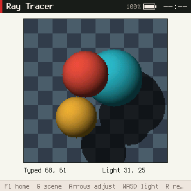

# How to time a complete Typed ray tracer on the handheld

One pixel at the center of a sphere has a visible RGB565 value, a depth, and an object ID. Suppose a compiler changes the winner at an overlap. If the two surfaces happen to quantize to the same RGB565 value, a screenshot of the changed pixel can still look correct. For a compiler study, the intermediate results are part of the evidence. The physical experiment checks over 25,600 values on each of three planes before interpreting a clock.

The baseline is the existing orthographic 160×160 ray-traced scene. Three spheres sit in front of a checker plane. A movable sphere and a lamp supply the four integer inputs. The primary test computes the remaining squared radius at each horizontal and vertical offset, obtains an integer square root for a hit, and keeps the closest intersection. Shading uses the winner and the light direction to compute diffuse illumination; for a floor pixel it also tests whether an object lies between it and the lamp. Quantization into red, green and blue fields completes the pixel. In the complete guest, all those decisions execute in generated native code from one Typed source file. The trusted P4 wrapper supplies buffers and enters the compiled function. [Complete Typed implementation](../../../../../../picocalc-os/worlds/raytrace/raytrace.typed)

## What does an entry call actually measure?

The ordinary clean frame call writes just one plane. An audited frame writes the same RGB565 plane plus the depth and the one-based winning object ID. A miss has depth and ID zero. A primary-only call writes those two diagnostic planes. A fourth call shades precomputed diagnostic planes to reproduce the color plane. The audit and phase functions are present in both the C and Typed implementations. Allocating a new buffer or verifying the result lies outside each frame clock. Within a block, the scalar C, PIE C and Typed arms all receive the same output addresses. Reading the 160×160 image back across UART is unnecessary for each sample; the kernel compares the entire live arrays and returns checksums for an additional host cross-check. [Physical harness](../../../../../../picocalc-os/port/esp32p4/main/typed_ray_p4.c)

Auditing modifies memory traffic. Two extra planes add 102,400 output bytes at packed stride. Timing an ordinary C frame against an audited Typed frame would conflate compiler and interface costs. The separate clean entry addresses this directly. Isolated primary and shading calls also perform their own setup and operate on memory written by a preceding phase. Their sum is a different experiment from the single clean entry. When an operating system component wants a retained display image, the ordinary UI copies the guest's returned RGB565 buffer to the compositor and enlarges it. That presentation cost is outside the frame clock for both implementations.

The experiment rotated which implementation ran first at each pose and repetition, while the four operation kinds within an implementation retained the same order. The 360 MHz P4 read its hardware cycle counter inside a bracketed microsecond clock in the kernel task. The difference in placement of the two clock reads can account for a small discrepancy. The ratio of cycles to elapsed microseconds provides a direct consistency check. The SDK can interrupt a timed call. These results describe this release binary, memory placement and execution order on this board. They do not estimate different linker layouts, cache flush policies, CPU power modes or panel scanout latencies. [Measurement protocol](../design-doc/04-measuring-a-whole-typed-ray-frame.md)

## Make the comparison fail when a pixel is missing

For each pose the physical reference allocated distinct R, Z and ID planes and filled them with 0xAAAA before executing audited C. Each tested arm used 0x5555 in the corresponding live output. The checker compared every active word, checked the padding between rows and inspected an additional guard word at the end. The host separately compiled a portable C reference and verified the hardware reference on all three planes. The default pose has 19,477 misses and 2,121, 2,349 and 1,653 visible pixels for the three objects. Moving only the lamp leaves those three winner counts and depths unchanged. In the gold-overlap case the occluded third sphere wins zero pixels. The widest-stride case stores 160 active words in a row of 320. These cases put depth selection and address calculation under different constraints. [Golden C reference](../scripts/renderer/01-reference.c)

There is a corresponding trap in testing the ordinary UI. The classic C and full Typed modes ought to render precisely the same picture when supplied the same controls. A mistaken mode switch could therefore pass a pixel test. The P4 records successful calls to the actual Typed display entry and the four pose arguments. The test checks that the counter advances for the initial Typed scene, the Right key and the W key, that reset restores the historical classic viewport, and that the typed-mode counter remains stationary for the classic render. The last reboot reopens the Typed screen and repeats the physical pixel and mode checks. [Interactive and measurement driver](../scripts/device/02-device.py)

## What changed in each native image?

Nine fixed-scene programs expose the same four entry points. The first is the unmodified generated scalar program. A second backend recognizes division and remainder by a known positive literal and avoids the stock checks that had been emitted for every division. For a separate pair, the source changes how many candidate rays are considered by finding a sphere's projected span on each scanline. Another pair retains those spans and changes shadow traversal to work by row. These source choices are each compiled once by the ordinary backend and once by the positive-divisor backend.

Two more compilers generate a packetized guarded primary row. The explicit version checks the named function and its precise validated intermediate form. The inferred version checks the same operation sequence without requiring that name. On this source they yield identical native image bytes. A third compiler emits the same guarded row, pointer arithmetic and fallbacks using scalar lane instructions. This matched scalar arm answers the narrow question of how much the actual packed instructions contribute after restructuring the row. Comparing a packetized arm directly to the original version would also include the gains from pointer movement, eliminating repeated bounds checks, and reducing loop overhead. [Exact native image hashes and sizes](../various/device/images.json)

The C controls already include their own optimized row calculations and table lookups. They are the original playable kernel's scalar and PIE modes, both compiled by the SDK toolchain. The guest has a checked buffer representation, uint16 loads and stores, and JS-like truncating integer semantics. Its code executes from the ELF loader's PSRAM segment, whereas the built-in C code follows ordinary firmware placement. Those language, implementation and memory-placement differences all belong to the measured end-to-end comparison. A claim about one RV32 instruction needs the narrower fixed-body or matched-scalar controls.

## What ran faster on the physical handheld?

All 324 pose-and-program blocks passed the whole-plane and canary checks. There were 12 poses, nine programs and three rotated repetitions. Each block contained three implementations and four timed calls per implementation, for 3,888 calls. The cycles-per-microsecond check across these calls ranged from 359.72 to 360.01, with median 359.96. The following table uses the median of three runs at the ordinary opening pose. Scalar and PIE C here come from the blocks paired with the unmodified Typed program. Milliseconds end when the destination is ready in PSRAM. [Raw physical blocks](../various/device/rows.json) [Per-pose summaries](../various/device/summary.json)

| Implementation | Clean RGB, ms | RGB + depth + IDs, ms | Primary planes, ms | Shade from planes, ms |
|---|---:|---:|---:|---:|
| Scalar C | 9.521 | 12.055 | 4.596 | 8.265 |
| C with PIE primary rows | 8.350 | 10.926 | 3.468 | 8.244 |
| Stock Typed | 57.674 | 62.847 | 17.811 | 48.560 |
| Typed positive-divisor compiler | 54.948 | 60.055 | 17.791 | 45.594 |
| Projected spans | 50.410 | 55.550 | 10.510 | 48.529 |
| Spans and positive divisors | 47.649 | 52.829 | 10.513 | 45.583 |
| Scheduled scalar primary row | 46.918 | 52.091 | 7.037 | 48.546 |
| Explicit PIE primary row | 46.535 | 51.726 | 6.661 | 48.540 |
| Inferred PIE primary row | 46.560 | 51.739 | 6.690 | 48.527 |
| Spans and shadow rows | 33.268 | 38.431 | 10.508 | 31.250 |
| Spans, shadow rows and positive divisors | 29.975 | 35.145 | 10.517 | 27.755 |

The original Typed implementation took 6.06 times the scalar C latency at the opening. Across poses, the median paired ratios ranged from 5.96 to 6.27. Positive-literal division saved 2.726 ms of clean time, with almost the entire change in the independent shading clock. Projecting primary spans saved 7.264 ms of clean time and 7.301 ms of primary time. Changing shadow traversal after the span optimization saved another 17.142 ms of clean time. With the divisor optimization as well, the clean frame took 29.975 ms. Its median ratios to scalar C across the 12 poses still ranged from 3.10 to 3.24. These comparisons support investing in the amount of work done per shadowed floor row as well as in compiler checks.

After equivalent scheduling, the actual packed instructions saved 0.376 ms of primary time, or 5.3%, against the matched scalar row. They saved 0.383 ms of whole-frame time, or 0.82%. The larger difference of 11.139 ms between the stock and explicit PIE clean frames includes changes common to both guarded replacements. Explicit and inferred generated the same image; their observed 0.025 ms difference in the clean clock illustrates ordinary measurement scatter within these schedules. The rows in the table make these several comparisons reproducible without treating an instruction count as a physical latency.

Cold compilation remained visible on first selection. The 10,438-byte stock source compiled in a median 429.863 ms over three fresh runtimes, with maximum tracked compiler allocation of 645,728 bytes. It generated 9,564 bytes of RV32 text. The combined spans, shadow and divisor arm compiled in 464.018 ms, with maximum tracked allocation of 677,076 bytes, and generated 10,748 bytes of text. The fixed ELF slot kept the container at 66,816 bytes for both programs. These sizes describe different lifetimes. The code segment and the output buffers persist while the compiler's temporary heap can be released. [Cold compilation receipts](../various/device/loads.json) [Build and memory configuration](../various/device/build.json)

## What if the material itself is programmable?

For the two Candela fixtures, the control uses the existing C+PIE intersections, lighting and shadows with the Typed scanline material shader. The complete guest uses Typed intersections, lighting, shadows and the same material semantics. Six independent fixture/weight combinations ran in both orders in three blocks, producing 36 paired comparisons. Each pair executed a warm-up of each arm, timed both, verified all 25,600 output words and checked the array guards. The host also compared the frame checksum against the independently qualified Candela oracle. Across the 18 shared-material pairs, the mixed frame took a median 28.759 ms and complete Typed took 71.307 ms. The 18 tile pairs measured 18.137 and 60.666 ms respectively. The ordinary single-pose fixed material table cannot substitute for these controls; the shader actually evaluates a different graph and the scene contains two spheres. [Programmable frame receipts](../various/device/materials.json)

The only way to isolate a shadow calculation from material evaluation is to give both phases the data they ordinarily see. An additional diagnostic first computed every actual winning material and every object ID into retained rows. The shadow pass ran over the 160 rows and wrote one uint16 decision per pixel, applying the ray/sphere shadow test only for visible floor pixels. The material pass supplied the real winning material row to the live guest shader and wrote unlit RGB888 as two uint16 cells per pixel. Each arm warmed up once before its reported sample. Row preparation, graph validation, checksum calculation, RGB565 packing, LCD enlargement and scanout were outside both phase clocks. The diagnostic keeps four row buffers per scanline, amounting to 258,560 bytes of retained row structures in addition to its small scratch buffers. The normal clean renderer still streams rows. This probe trades memory for independent observations. [Diagnostic guest source](../../../../../../picocalc-os/worlds/raytrace/material-phases.typed) [Independent mask and color oracle](../scripts/director/phase-check.py)

| Programmable scene | Shadow pass, ms | Unlit material pass, ms | Independently verified visible shadow pixels |
|---|---:|---:|---:|
| Shared and mixed spheres | 24.570 | 20.327 | 3,339 |
| Tiled floor | 24.573 | 9.720 | 3,339 |

Each median pools 18 physical observations across three weights, three blocks and both call orders. All 36 observations matched both independent reference checksums. A weight edit changed the material colors; geometry, lamp and the floor shadow mask stayed fixed. The tile fixture uses a canonical row specialization and spent less than half as much guest time producing its unlit colors as the shared-material fixture. These two fixtures exercise different expressions as well as different row paths. Both fixtures spent almost the same time resolving their geometrically identical shadows. The measurement holds 160 calls and output stores per phase fixed, and excludes combining those results into a final lit pixel. Adding the two rows of work cannot reconstruct whole-frame time. [Physical phase samples](../various/device/phases.json) [Complete shader regression](../various/device/material-regression.json)

## What remained on the handheld?

The final qualification verified both flash regions, rebooted, checked all eight native worlds and the mobile painter, and confirmed keyboard I²C transfers advanced. It reopened the actual Typed display entry through F1, V, G, G, G and left the opening scene visible. All 57,600 pixels in the enlarged viewport matched the previously qualified stock Typed screen and the historical classic viewport CRC 4b91a3c8. The final diagnostic build's application SHA-256 is db17ab6adbcfa32e6a64a311b434562b1f35c12aa415f1ba8a4e838b6386764c. The earlier matrix used a separate verified executable; the final image rechecked all nine fixed programs and all six complete material inputs after adding the phase probes. [Final live firmware and mode receipt](../various/device/final.json) [Nine-program replay](../various/device/fixed-regression.json)

## Choosing a denominator for a device result

The Opus High measurement researcher emphasized that the same silicon supplies two legitimate controls. Against scalar C the ordinary and fastest Typed frames take 6.06 and 3.15 times as long on the default pose. Against packed C the corresponding ratios are 6.91 and 3.59. The first comparison addresses scalar code generation. The second asks how close the implementation comes to the established hardware-specific renderer. Rotating the controls through each block reduces sensitivity to pose and board state.

The fastest Typed treatment combines two changes to the traversal with a compiler proof. The measured 48.0% reduction applies to the complete combination. Per-pass clocks, individual compiler arms and matched scalar scheduling identify some of the contributions. Three repetitions per pose give limited information about variation across long sessions. A repeat on another board and a held-out scene would test whether the ordering and the size of the gains carry over. [Measurement researcher's final discussion](../various/commission/03-measurement-final-discussion.md)
